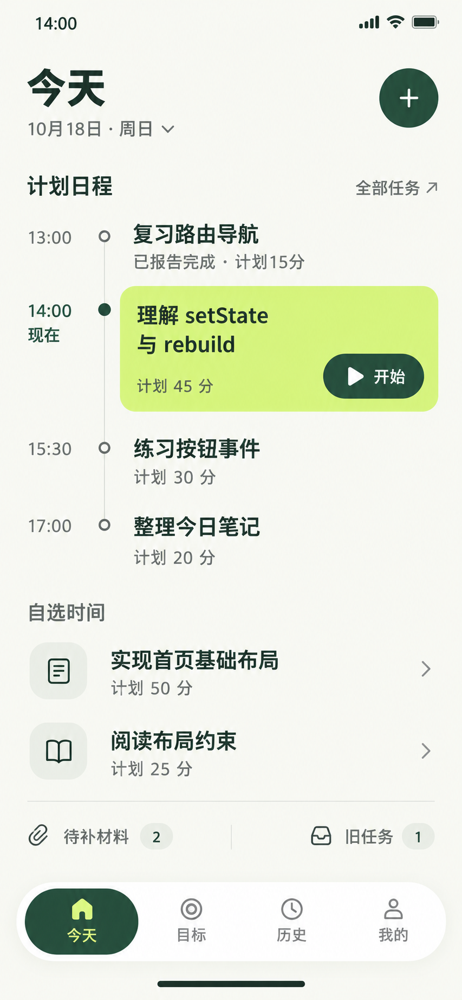

# 今天页 — 当前稿

2026-10-18，用户已允许作为暂定风格参考并继续其他页面；尚未最终锁定。图片为设计样例，不是应用数据或已实现功能。

## 本次改动

当前稿保留当前任务的强调，其余改为紧凑行，使用四固定加两自选共六项示例。时间节点只表示排序，不使用等比时间网格，也不让卡片高度暗示计划时长。所有任务标题统一18/24，不因当前项而另放大字号。

| 示例任务 | 安排 | 状态 |
| --- | --- | --- |
| 复习路由导航 | 固定13:00，计划15分 | 示例START13:00、END13:15，报告完成，SELF_REPORT，CLOSED |
| 理解setState与rebuild | 固定14:00，计划45分 | NOT_STARTED；沿用旧样例强制材料策略，截止当天18:00 |
| 练习按钮事件 | 固定15:30，计划30分 | NOT_STARTED，新样例，与旧截图Oct19的“写一个计数器示例”不是同一任务 |
| 整理今日笔记 | 固定17:00，计划20分 | NOT_STARTED，新样例 |
| 实现首页基础布局 | 当天自选，计划50分 | NOT_STARTED，不编造开始时刻 |
| 阅读布局约束 | 当天自选，计划25分 | NOT_STARTED，新样例 |

材料2与旧任务1是其他任务的示例数量；13点完成项已关闭，不属于材料2。当前14点仍未开始，不显示执行时长、进度、真实END或自动完成。此图只覆盖这个正常状态；跨日运行、暂停优先级、空状态、冲突及超长标题仍须后续单独验证。

## 版面与动效检查

在可检查的排版模型中测量，而不是从PNG反推逻辑尺寸：

- 390×844：正文区域宽390、高614，内容无横向溢出；六项、待处理入口均完整显示。
- 320×568：正文可视高338、内容高602，允许下滚；当前“开始”按钮底350，小于正文底464，首屏仍可操作。任务标题仍为18，没有缩字。
- 六个任务标题计算字号均为18px；计划/时间14px、导航12px。交互底稿是精确参数来源，PNG只是视觉参考。
- 系统减少动效生效时，任务展开计算时长0s；用户主动打开“演示完整动效”后，展开360ms、透明度180ms，测到过渡中的非零位移；关闭与Escape返回原任务焦点。没有循环漂浮效果。

交互小样只覆盖任务展开、返回和明确标注的本地计时演示；新建、日期、全部任务、材料和顶层导航是静态入口示意，不构成整页功能验收。计时演示关闭后清零，不写应用数据库。

本次调整的是信息展示优先级：路径/Why进展开层、活动统计下移，是对现行界面规格默认布局的设计候选，未修改领域状态或正式业务文档。

## 文件与生成记录

- 单页原生PNG：853×1844，无放大；[图片](../assets/今天页.png)。
- 使用内置imagegen，最近的实际排版截图作构图参考；[完整提示词](01-今天页.prompt.txt)。
- [可独立打开的交互预览](01-今天页-交互预览.html)与[颜色/布局定义](../颜色与布局规范.md)。
- [页面需求推演](页面需求推演.md)和[具体参考作品](../设计依据.md)。

当前仅保留本稿，后续页面沿用统一规范。
