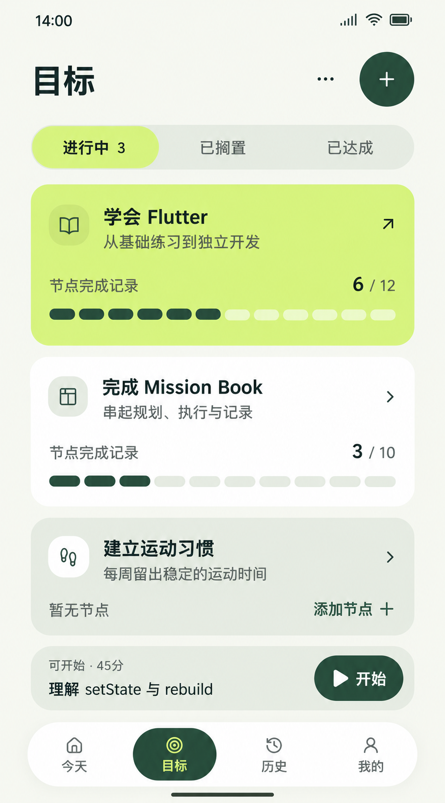

# 目标页 — 当前稿

2026-10-26实装更新：本文图片为历史风格参考。当前创建直接进入表单，导入由独立入口原页办理；宽屏空库创建/导入并排，选中目标后列表/路径并排。颜色、图形、动效与当前截图以[本轮审查](../制作记录/2026-10-26-颜色层级与空态审查.md)为准。

目标页沿用当前统一配色、字号、形状、图标线条及胶囊导航，待用户反馈。全部为示例数据，未修改应用代码。

## 先回答什么

用户先看“我在推进哪些方向、哪些节点留下过完成记录”，再进入节点树采取行动。目标列表不重复今天的完整排期，也不加入尚未定义分类/聚合口径的周学习时间。

三项目标沿用旧样例：学会Flutter6/12、完成Mission Book3/10、建立运动习惯暂无节点。图形分别表达50%、30%的节点记录覆盖；每个节点只计一次，包括各层有效节点。它不表示掌握度，也不自动将目标设为已达成。没有节点不画假进度。

首项目标的强调面仅用于本张样例的视觉优先级，未新增“置顶/主目标”领域状态。其他目标可继续下滚；窄屏不缩标题字号。

## 与今天页一致的规则

- 共用[暂定颜色和布局定义](../颜色与布局规范.md)及[JSON](../assets/正稿v1.1/design-tokens.json)。页面标题28/36，目标标题18/24，说明/数据标签14/20，导航12/16。
- 分组使用同一组软圆角和开放间距；进度图形有业务含义，禁用大面积植物或无关背景图。
- 三个状态在原页面筛选。“已放弃的目标”在更多操作内切到原位筛选，不额外加中转列表页。
- 当前任务快捷栏采用摘要角色：名称14/20、状态12/16、开始14/20。完整任务卡仍18/24，不把紧凑摘要与完整标题混作同级。

## 三步路径

从今天/历史/我的开始：**目标（1）→目标卡的节点树（2）→节点行“建任务”表单（3）**。不强制绕节点任务列表；保存反馈必须留在第3跳的工作上下文，查看今天作为可选动作。新建目标、添加节点、已放弃恢复的候选路径见[三步交互原则](../三步交互原则.md)。

底部当前任务快捷栏用于从目标页直接进入执行，避免先回今天再找任务。真实实现须复用当前任务查询优先级，运行时返回执行、暂停时显示继续、待开始明确开始，无任务则不显示。此处沿用14点/45分NOT_STARTED样例，不绘制倒计时或执行进度。

快捷入口只是减少跳转的一个部分。结束报告、材料编辑、提交回执与文件选择器的完整链路仍须后续重做，不能由本张静态图声称所有功能已达标。全面问题见[静态审查](三步可达审查.md)。

## 核对范围

- 可检查模型390×844：正文宽390、高470，三项目标完整显示，无横向溢出；底部快捷栏和导航有独立空间。
- 模型320×568：正文宽310、高194，内容高460，可下滚；三个目标标题仍18px，无横向溢出，低优先描述在窄屏收起。
- 模型分段图实测6/12、3/10；已搁置/已放弃空状态、更多菜单及返回进行中筛选已在浏览器验证。新建、目标卡、添加节点、当前任务和底部导航仍是静态入口示意，未做业务验收。
- 筛选选中背景定义240ms位移，默认遵循系统减少动效；宿主本次开启减少动效，未声称已完成所有导航动效验收。

PNG用于视觉参考，精确逻辑尺寸/字体来自排版模型，不从生成图反推。原生935×1683，无拉伸或放大；与今天PNG原生画幅不同，落地共用同一组390宽逻辑参数。

## 生成记录

使用内置imagegen，以本页实际排版截图作构图参考；[完整提示词](02-目标页.prompt.txt)、[唯一原图](../assets/正稿v1.1/目标列表.png)、[独立交互预览](02-目标页-交互预览.html)。文件只保留当前稿。
