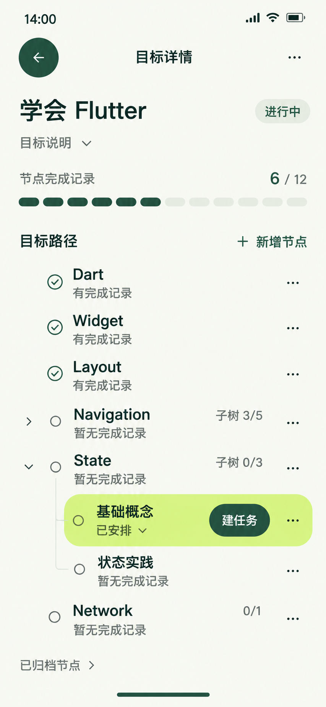

# 目标详情与节点树 — 当前稿

基于当前统一UI风格继续设计，待用户反馈。数据为跨页一致的设计样例，未接入应用，未修改应用代码。

## 用户先看什么

先看目标的行动记录覆盖，再找到要推进的节点并采取行动。说明默认折叠；树的缩进、连接线和展开箭头表达父子关系，图形不冒充掌握度或完成整条路径。

子页采用返回栈，没有四项底部导航和顶层当前任务栏。目标名28/36；所有节点名18/24；状态、子树计数和操作14/20。当前定位的基础概念使用浅柑橘强调面，其他节点是紧凑开放行，不给每行加大卡。

## 样例与计数

| 根节点 | 有效节点数（含自身） | 有直接完成记录的节点数 | 首屏状态 |
| --- | --- | --- | --- |
| Dart | 1 | 1 | 有完成记录 |
| Widget | 1 | 1 | 有完成记录 |
| Layout | 1 | 1 | 有完成记录 |
| Navigation | 5 | 3 | 折叠；子树3/5，本节点暂无完成记录 |
| State | 3 | 0 | 展开；子树0/3，本节点暂无完成记录 |
| Network | 1 | 0 | 0/1，暂无完成记录 |
| 合计 | 12 | 6 | 与目标列表6/12保持一致 |

Navigation父节点没有直接完成报告；三个子节点有报告不能给父节点打勾。交互小样为四个隐藏子节点补充了“路由基础、页面跳转、返回栈、深层链接”样例名称，前3个有记录，最后一个暂无；这些名称是原型补充，不是数据库查询结果。

State的基础概念是已安排，状态实践暂无完成记录；父节点不能因此自动标“已安排”或“已完成”。浅柑橘只表达当前定位，不新增Phase。基础概念已有的示例任务仍是14点、计划45分、待开始的“理解setState与rebuild”。

## 三步与动作分工

- 从其他顶层出发：目标（1）→目标详情树（2）→节点行“建任务”表单（3）。其他节点菜单也直接提供建任务，不强制绕节点任务列表。
- 已安排标签可原位展开当前节点的已有任务摘要，再直接开始/继续/查看记录。对应工作页为第3跳；完整任务列表保留为可选浏览入口。
- “建任务”是另建任务的入口，不修改或覆盖已有setState任务。创建表单预填与保存重验仍依领域规则。
- 保存成功原位反馈，不自动再去日期列表。已同步修订[界面与交互](../../v1.0/界面与交互.md)§5.1；应用行为尚未改造或验收。
- 根节点新增在“目标路径”区。节点菜单承载建任务、添加子节点、编辑和归档；归档须明确说明包含子树、历史保留并确认。不能省略确认后再宣称少跳转。
- 非ACTIVE目标和归档节点隐藏所有新建Mission入口，已有任务仍可执行和补材料；不能扩大成非ACTIVE禁止所有节点维护。恢复归档要满足父节点有效。

完整办理、系统选择器和强制材料链的约束仍按[三步交互原则](../三步交互原则.md)，不是由一张树图证明全应用已达标。

总复核补充：本图为可选专注详情。普通办理也支持目标列表卡内直接展开同一节点树/任务区，保留目标标题、覆盖、相邻目标和顶层导航；执行到材料原位连续处理，文件选择及必要返回计两跳。原表所述详情链用于阅读/直接建任务，不作为文件材料办理的强制中转；当前导航以三步交互原则为准。

## 排版与交互验证

可检查模型与PNG分开验收，精确参数不从PNG量取。

- 390×844：正文可视宽390、高730，无横向溢出；默认Navigation折叠、State展开，八行节点与归档入口可见。
- 320×568：正文宽310、高454、内容高722，允许下滚；12个节点名称（含折叠内容）计算字号都为18px，名称与计数无横向溢出。普通根行52、当前子节点64、其他子行56；同级标题对齐，子标题正常缩进24、窄屏16。
- 已验证Navigation/State分支展开收起、节点菜单打开与Escape关闭、目标说明折叠、已安排任务摘要和归档空态。折叠内容设置aria-hidden和inert，不让不可见操作留在键盘焦点序列。
- 系统减少动效时展开计算时长0s；主动开启本地演示后为360ms，观察到展开过程中的中间高度（未直接跳到完整高度）。箭头旋转240ms，分支从父节点处展开，后续行随布局移动；不循环装饰，不修改系统动效设置。
- 空归档列表是小样假设，不代表真实数据没有归档节点。

新建、任务列表/执行跳转、归档确认及恢复仍是静态入口或后续状态设计，不能把小样当作已实现功能。节点菜单目前只验证展示和关闭，菜单动作未提交真实业务操作。

## 文件与生成记录

内置imagegen生成，实际排版截图仅作为构图参考。原生853×1844，无拉伸放大；[唯一原图](../assets/目标详情.png)、[完整提示词](03-目标详情页.prompt.txt)、[独立交互预览](03-目标详情页-交互预览.html)。

颜色与字号沿用[暂定统一规范](../颜色与布局规范.md)，当前仅保留本稿；后续同名更新。
