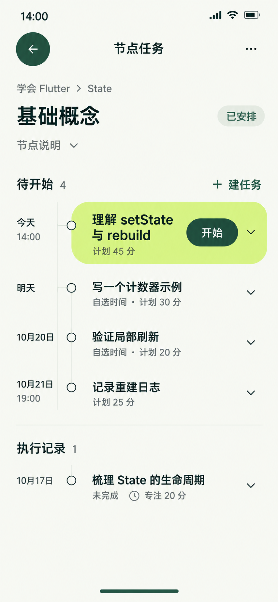

# 节点任务页 — 当前稿

本页已按当前统一UI重绘，直接替换同名文件，不另存旧版本。采用暖白、森林绿、柑橘强调面、无衬线标题及圆形返回操作，和今天、目标列表、目标详情保持一致。数据为原型样例，应用代码未改动。

## 当页重点

回答“这个节点安排了什么、下一件能做什么、曾留下什么执行记录”。面包屑保留学会Flutter→State，标题为基础概念；说明按需展开。当前任务强调，其他项按日期紧凑排列；只设一个“建任务”入口，无四项底部导航。

所有任务标题使用统一18/24，日期、时长、状态和按钮14/20，节点标题28/36。左侧日期与细线只表达先后，不按分钟比例拉开空档；待开始的数值是计划，执行记录的数值是Focus。

## 五项样例

| 分组 | 任务 | 安排 / 记录 | 来源 |
| --- | --- | --- | --- |
| 待开始 | 理解setState与rebuild | 10月18日14:00固定，计划45分；NOT_STARTED | 与今天页相同 |
| 待开始 | 写一个计数器示例 | 10月19日自选，计划30分；NOT_STARTED | 沿用原节点样例 |
| 待开始 | 验证局部刷新 | 10月20日自选，计划20分；NOT_STARTED，SELF_REPORT | 补充未来任务样例 |
| 待开始 | 记录重建日志 | 10月21日19:00固定，计划25分；NOT_STARTED，SELF_REPORT | 补充未来任务样例 |
| 执行记录 | 梳理State的生命周期 | 10月17日已结束，Focus20分，报告未完成 | 沿用原节点样例 |

四项待开始、一项记录，不存在COMPLETED报告，所以节点仍“已安排”，State子树0/3、目标记录覆盖6/12保持不变。新增任务都在未来日期，不改变今天页的六项当天安排。材料截止和已有任务策略未改写；未显示不存在的实际END、计时或评分。

## 三步与原位操作

从其他顶层进入目标（1）→目标树（2）→节点任务列表（3）。本页作为第三跳时，不能再强制经第四页才能办理常用操作。

总复核补充：此为可选完整浏览链。普通执行到材料办理从目标列表卡内展开路径和本节点任务区，保留目标、相邻条目及导航，整段只发生切目标一次；系统文件选择进入及必要返回再占两次。不能把上述第三跳浏览页当作文件材料办理的强制前置。以当前[三步交互原则](../三步交互原则.md)为准。

- “建任务”在节点上下文内展开标题、日期、计划时长的紧凑编辑区，保留节点身份与任务列表；选填方案再展开。保存原位反馈并阻止重复提交，仍须重验Goal为ACTIVE、节点有效。不能把独立全屏表单改叫弹窗来隐去跳数。
- 任务名/下箭头原位展开Why、方案和按阶段可用的操作，完整详情不是强制中转。
- “开始”保留任务身份，在当前任务区域进入执行工作状态；不能另强制一条详情→执行的路由链。报告、材料和系统文件选择的完整办理仍按统一三步审查继续设计，静态图不证明这些分支已通过。
- 已有运行任务冲突、提前开始、改期/取消、材料截止等规则仍按领域模型；非ACTIVE或归档节点隐藏建任务，已有任务保持可访问。
- 未来任务不自动开始或顺延；历史未完成用中性文字，不伪造成失败检测或已掌握。

## 动效与验证边界

原位展开沿用已有组件的360ms空间展开、240ms箭头旋转与减少动效支持；返回保留任务和滚动位置，不循环装饰。新建编辑区从“建任务”所在区展开，保存后在该上下文显示真实结果。

本轮为单页静态图。已目视核对五项标题、4/1分组、计划/Focus区分、日期、节点状态、返回与无底部导航；字体和窄屏规则沿用统一参数。未新增本页完整交互程序，也未声称本页320/390响应式布局或业务操作已实际验收。窄屏落地须允许行高增长和滚动，不缩小标题来塞齐。

## 当前文件

使用内置imagegen，以当前目标详情图仅作风格参考。原生853×1844，无拉伸或放大。

[唯一原图](../assets/正稿v1.1/节点任务.png) · [完整提示词](04-节点任务页.prompt.txt) · [颜色与布局](../颜色与布局规范.md) · [三步交互原则](../三步交互原则.md)
