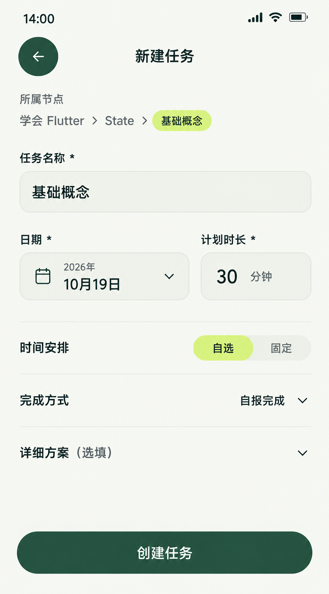

# 新建任务页 — 当前稿

更新：2026-10-19。已采用当前统一UI，同名替换旧稿，不保留并列版本。本轮只生成这一个页面的正常未提交状态。数据为原型样例，应用代码未改动。

## 首屏与样例

- 归属可见：学会Flutter→State→基础概念，Goal为ACTIVE、节点有效。
- 任务名称预填“基础概念”，仍是可编辑输入值。
- 日期2026年10月19日，计划30分钟。本稿采用10月19日场景；前面页面的10月18日样例未改。实际应用默认日期取运行当天，不能硬编码此图日期。
- 时间安排默认自选，映射FLEXIBLE；固定开始时间隐藏。
- 完成方式默认自报完成，映射SELF_REPORT；未显示验收方向和材料截止。
- 详细方案收起；Why、具体目标、步骤等按需填写，来自节点/Goal的内容按规格预填。

这是另一个未提交草稿，不是已有14点/45分setState任务的编辑态，不覆盖原任务。尚未保存，因此节点任务数量和目标覆盖率不随本图变化。

## 统一布局与字号

沿用森林绿圆形返回、暖白底、柑橘选中态和森林绿主操作。只保留一个“创建任务”主按钮，无四项底部导航。

三个必填项保持外置标签和明确输入边界。日期/计划时长并排，减少三个全宽大框的堆叠；年份作为辅助信息，月日为主要日期值。时间安排使用原位分段选择，完成方式用下箭头表示展开。设置行不额外包大卡片。

设计参数：输入值18/24，标签和单位14/20，设置名称16/24，设置值14/20，主操作16/24；触控目标至少48。窄屏不足时日期和时长允许换行堆叠，归属保留末级节点可读，不通过缩字号塞入。键盘弹出时保留滚动与底部安全空间。

## 条件与三步路径

从其他顶层→目标（1）→目标详情树（2）→本表单（3）。日历、归属选择、固定时刻和完成策略均在同一表单上下文展开，不另起向导或完整选择页。不能把独立整页藏进弹窗后称为零跳转。

节点任务页已是第三跳时，使用其原位紧凑创建区，复用本页字段与校验，不强制再打开本独立工作页。

- 固定模式开启后才显示开始时刻；切回自选清楚表明无固定时刻。
- 选择可选或强制材料后显示验收方向；强制材料额外显示准确截止日期与时间。
- 日期/时区变化后重算默认截止并展示最终值；过去或无效截止须显式修正，不自动推往未来或静默保存。
- 具体目标默认随标题变化；用户单独改过后不覆盖。保存重验Goal状态与节点有效性。
- 仅执行一次原子创建。失败保留所有输入；成功在原上下文显示已创建、阻止重复提交，查看今天是可选动作，不强制第四跳。
- 创建不自动开始；离开有内容的表单仍需确认丢弃。

## 动效与检查边界

条件区域从对应设置行下方展开，沿用360ms空间变化；选择反馈与箭头使用统一节奏，并遵循减少动效。保存反馈在原表单位置替换，不新增成功页面。

本轮为静态单页原型。已目视核对归属、三个必填值、年份/月日、30分钟、自选/自报、折叠方案及唯一主操作；没有额外截止、评分或已创建状态。日期/键盘/条件校验、320/390响应式实现与完整交互尚未实际验收，不由PNG代替证明。

## 文件与生成记录

使用内置imagegen，当前节点任务图只作风格参考。原生935×1683，无拉伸或放大；精确逻辑字号采用统一参数，不从PNG反推。

[唯一原图](../assets/正稿v1.1/新建任务.png) · [完整提示词](05-新建任务页.prompt.txt) · [统一规范](../颜色与布局规范.md) · [三步交互原则](../三步交互原则.md)
