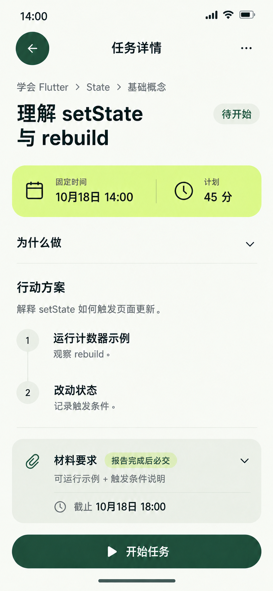

# 任务详情页 — 当前稿

制作日期2026-10-19。按统一UI重绘，只保留当前同名文件。此图展示已有任务，不是新建页的未提交草稿。任务、日期和计划为固定原型样例，未读取或修改用户真实任务。

## 首屏取舍

先看任务身份、固定排期与计划投入，再看目标和两步行动。Why按需展开，材料方向与准确截止直接可见。子页不复制四项底部导航；只有“开始任务”是主操作，编辑/改期/取消放在更多菜单。

主体名称使用已有页面标题层级28/36，列表任务名仍18/24；节标题16/24、正文/状态/辅助14/20、主要计划值18/24。用统一角色层级区分详情主体与列表项，不给同级条目随机变字号。

浅柑橘计划条以日历/时钟和明确文字表达固定时间与45分计划，不画未开始任务的执行进度。两枚相同的1/2圆形只表达步骤顺序，不是完成标记。

## 任务事实

| 项目 | 样例值 |
| --- | --- |
| 任务 | 理解setState与rebuild |
| 归属 | 学会Flutter→State→基础概念 |
| 状态 | NOT_STARTED，待开始 |
| 排期 | 2026-10-18 14:00，固定时间 |
| 计划 | 45分钟 |
| 材料策略 | REQUIRED_EVIDENCE |
| 材料截止 | 2026-10-18 18:00 |

画面时钟场景固定在10月18日14:00、截止之前；不是制作当天的真实日期。继续沿用前面已有任务的配置，不将新建草稿的10月19日、自选30分、自报策略写回此任务。

Why：为交互页面建立状态管理基础。目标：解释setState如何触发页面更新。步骤：运行计数器示例并观察rebuild；改动状态并记录触发条件。验收方向：可运行示例和触发条件说明。

“报告完成后必交”明确材料触发条件。报告未完成不会因该策略而被强制交材料；也不能将“有材料要求”误画成已有材料、验证通过或掌握度。图上没有START、END、Focus、倒计时或推算结束时间。

## 交互与三步

详情是可选阅读入口，不是开始前的必经中转。开始后保留同一任务身份、计划与只读方案，在任务工作上下文进入执行；不强制一条“详情→独立执行→独立报告→材料”的长导航链。

- Why、完整验收要求在原位展开；取消、改期、编辑保留阶段约束和必要确认。
- START只由明确点击触发并绑定有效排期。另有RUNNING任务时先提示用户处理，不静默暂停对方。
- 启动后不再显示仅待开始可用的取消/编辑/改期。
- 后续报告/材料/系统文件选择仍须核对完整路径，不能由本图证明所有三步分支已通过。报告须明确确认，材料截止不得绕过。

动效沿用360ms原位展开和240ms方向反馈，遵循减少动效。进入执行应保持任务上下文连续，不以整页换皮伪装零跳转。

## 检查与文件

已目视核对任务名、14:00固定排期、45分计划、两步内容、待开始、材料触发条件及18:00截止；无错误的完成勾、假计时或评分。材料标签经过一次文字校正，项目只保存校正后的最终单图。未新增本页完整交互实现，响应式/菜单/阶段变化/业务校验未由静态PNG验证。

内置imagegen生成，原生853×1844，无拉伸放大。提示词整合生成与最终文字修正，角色尺寸采用统一定义。

[唯一原图](../assets/正稿v1.1/任务详情.png) · [当前提示词](06-任务详情页.prompt.txt) · [统一规范](../颜色与布局规范.md) · [三步原则](../三步交互原则.md)
