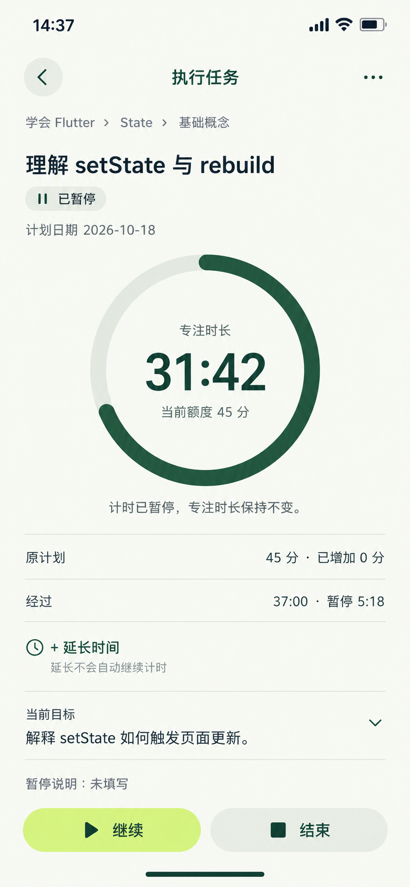

# 07 执行任务 — 已暂停，明确继续

2026-10-20重绘，同名替换旧RUNNING截图与提示词。内置imagegen，单页静态候选，原生853×1844，未拉伸裁切。当前图改为PAUSED状态，浅色返回与主操作、开放行和必要计时图形；运行态沿用同一组件映射。它仍是既有setState任务，不是05新建的阅读任务草稿。

依据：[执行交互](../../v1.0/界面与交互.md#6-执行任务)、[事件合法性](../../v1.0/领域模型.md#42-事件与合法性)、[计时与额度](../../v1.0/领域模型.md#6-时间口径)、[三步路径](../三步交互原则.md)。

## 固定样例与时间核算

任务“理解setState与rebuild”，归属“学会Flutter→State→基础概念”；计划日期2026-10-18，原计划45分钟。下列是该日的静态快照，不表示制作当天。Goal覆盖不因暂停或延长变化，没有完成报告或材料提交。

| 已保存事实 / 查询 | 值 |
| --- | --- |
| START | 2026-10-18 14:00:00 |
| 第一次PAUSE / RESUME | 14:15:00 / 14:20:00 |
| 第二次PAUSE | 14:36:42，说明未填写 |
| 截图时刻 / 阶段 | 14:37:00 / PAUSED，尚无END |
| Elapsed | 37:00 = 2220秒 |
| Paused | 5:00 + 0:18 = 318秒，暂停2次 |
| Focus | 2220 − 318 = 1902秒 = 31:42 |
| 原计划 / 已加 / 当前额度 | 45 / 0 / 45分钟 |
| 实际超时 | max(1902 − 2700, 0) = 0 |
| 环 | Focus / Current Budget = 1902/2700 = 70.444%；顺时针253.6° |

暂停只冻结Focus，Elapsed与Paused会随当前时间等量增加；不能冻结全体计时值，也不能把经过37:00画成专注。圆环是投入/额度，不是剩余倒计时、完成率或掌握度，不在额度变化时清零Focus。位图弧长为视觉近似，实际实现由公式绘制，不能从PNG量角当作精准计算验收。

材料策略仍为REQUIRED_EVIDENCE，截止2026-10-18 18:00；执行时可在只读方案内查看，不提前出现上传或已提交。暂停说明本例未填写，当前显示只读文本，不给已保存的PAUSE补写说明入口。

## 逐项动作与跳转

| 操作 | 当前上下文 / 去向 | 数据及失败处理 |
| --- | --- | --- |
| 继续 | 同一Mission恢复RUNNING，控件改为“暂停 / 结束” | 明确点击才写RESUME；先重查全局其他RUNNING，有冲突则原位提示处理，不静默暂停别的任务；成功前仍PAUSED |
| 延长时间 | 当前任务下展开正整数分钟输入、当前及确认后额度、确认/取消 | 明确确认才写EXTEND；原计划保持，PAUSED仍PAUSED，不附带RESUME；非法或0分钟不能提交，失败保留输入与原额度 |
| 当前目标箭头 | 原位展开只读objective、steps、验收方向、材料要求及截止，缺少可选内容不造空标题 | 已开始任务不出现方案/排期编辑入口；收起不改事实 |
| 暂停说明：未填写 | 只读当前暂停记录的说明 | 不能把事后编辑当作未保存的PAUSE字段；RUNNING下的下一次暂停说明规则见复用表 |
| 结束 | 已PAUSED，直接在同一任务工作上下文展开08报告，不再写一次PAUSE | 初次报告无默认选择；取消报告仍PAUSED；只有明确确认才写END/报告 |
| 返回 / 系统返回 | 返回原任务来源，保留相同Mission可达性 | 不隐式RESUME、PAUSE或END；无未提交输入时无需丢弃确认；延长草稿有变化时确认放弃或继续编辑 |
| …→查看任务详情 | 可选查看06的同一Mission完整详情，返回仍是本暂停状态 | 属于可选阅读的一次实际跳转，不能算作原位；不增加编辑、新一轮开始或已开始任务的取消入口 |
| 写入失败 / 设备时钟倒退 | 保留当前真实阶段、计时、输入并给可重试原因或校时提示 | 不先播放成功动画或造事件；时钟倒退按领域规则临时钳制查询并拒绝新倒退事实；结果未知先查询，不盲目重写 |

本图作为可选独立专注视图，保留正常返回栈，无四项底部导航。正常含文件办理仍从顶层任务行原位展开同一计时/控制组件，保留任务标题、相邻项和导航，再原位报告/材料/回执；文件选择及返回另占2跳，总计不超过3。不能让07独立视图成为所有操作的强制中转，再把全屏新页面称为“原位”。当前任务快捷栏应直达来源任务区；用户主动进入专注阅读视图的额外跳转照实计数。

## 与08报告图衔接

当前已于14:36:42保存第二次PAUSE。若用户不继续、不追加额度，直接点结束，则[08报告图](08-结束确认页设计说明.md#时间与任务事实)仍是14:37:00、31:42/45分、已暂停；不重复PAUSE。若14:37:15确认报告，Elapsed2235秒、Paused333秒、Focus仍1902秒。08图中“选择已完成”尚未确认的时点不改变本任务事实。

若用户选择延长或继续，则之后报告/结果必须采用该真实分支的最新额度与事件时间，不继续硬编码08旧快照。追加额度与继续执行是不同动作，二者不能相互冒充。本图不采用已延长60分的分支，因此无需修改08/09/10当前原图中的45分基准。

## 运行、暂停与额度复用

| 条件 | 同一计时区显示 | 操作边界 |
| --- | --- | --- |
| RUNNING | 状态“执行中”；Focus随事件与当前时间递增；主操作“暂停”，次操作“结束” | 暂停可先原位展开选填说明，未展开可直接写无原因PAUSE；不能强制说明。点击结束先PAUSE成功再打开报告 |
| PAUSED | 本图“已暂停”、明确继续图标/文字；Focus不增加，经过/暂停继续增加 | 继续明确写RESUME；已暂停点结束不再PAUSE；返回报告不自动恢复 |
| PAUSED下确认+15分 | 同一Focus31:42，原计划45、已加15、当前60；环改为52.833% | 只写EXTEND，仍PAUSED；由实际事件重算，说明文字不再保留旧额度 |
| 达到/超过当前额度 | 原始Focus继续如实显示；环最多满环，显示实际超时及“结束 / 继续”提示 | 不自动END或凭阈值虚构PAUSE；同一额度阈值在一次前台会话提示一次，继续需选择正额度并写EXTEND；若本来PAUSED仍需明确RESUME |

Actual Overtime始终相对原计划计算；追加额度不清除已经发生的实际超时。额度到达及延长输入确认见[28](28-额度到达与延长页设计说明.md)，普通延长和暂停态按同组件复用；另一RUNNING冲突及恢复请求复用见[27](27-执行任务冲突页设计说明.md)。

## 视觉、动画与核对边界

计时主数字48/56，任务身份18/24，操作/区块16/24，辅助14/20；触达至少48逻辑像素。大环有投入/额度含义，森林绿仅用于线条与文字；主按钮浅柑橘，次按钮浅灰绿。方案、元数据和只读暂停说明使用开放行和细分隔，不每项套方框。不用闪烁或呼吸动画制造专注错觉。

PAUSE保存成功后Focus停在事件推导值，状态/按钮180ms更新；恢复成功才重新递增。EXTEND成功后数字与环统一360ms过渡，不清零、不转圈；失败保持原统计。结束展开报告时计时环360ms收为28/36冻结摘要并保留任务身份，报告文字180ms显现；取消回原暂停状态。按压140ms，曲线cubic-bezier(.22,.8,.24,1)；减少动态效果直接切换并保留状态文案与焦点。

旧说明记载的2026-10-19局部浏览器演示属于历史证据；对应HTML已在工作区被删除，本次不恢复、不提供或重新验收网页。当前交付只有生成图片与设计说明，不能把以前的样例预览当作应用事务或本轮动画已实现。

已核对原生853×1844与副本哈希一致；目视核对PAUSED标识及继续/结束、31:42/45分、原计划45/增加0、经过37:00/暂停5:18、只读说明与方案、浅色控件和环的约70%示意，主要文字未见遮挡。归属与计划日期为只读身份信息，不作可点编辑入口。生成颜色与弧长为近似，实际实现采用统一纯色、字号及计时公式。样例事件与时长已复核；静态图不证明真实计时、后台恢复、事件写入或辅助技术行为。

[提示词](07-执行任务页.prompt.txt) · [颜色与布局](../颜色与布局规范.md) · [跳转总表](页面跳转总表.md) · [覆盖清单](补图覆盖清单.md)。
