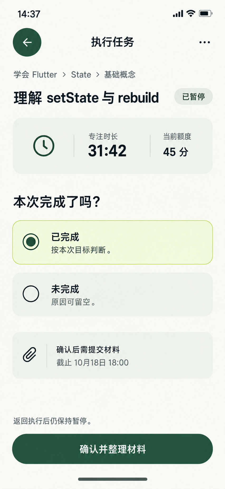

# 结束报告 — 当前工作区状态

制作日期2026-10-19。沿用统一UI，同名替换旧图。本图是执行工作区内的报告状态，不是新增必经路由。原图继续使用稳定文件名“结束确认.png”。

## 保留上下文，突出决策

执行任务栏、任务名、归属、已暂停和31:42专注摘要持续可见。大计时环收为摘要，原区域展开“本次完成了吗？”及两个单选项，没有遮罩或独立全屏弹窗覆盖原任务。

问题采用页面标题28/36，任务身份18/24；冻结Focus摘要复用28/36，额度值18/24；选项和主操作16/24，辅助14/20。选中态用柑橘面和单选实心圆点，不用表示既成完成事实的勾号。未完成选项为中性，不以红色惩罚或强制填写原因。

图中用户已主动选择“已完成”，但尚未确认；初次进入须无默认选择，主按钮不可提交。选择本身不写END或完成报告，不改变节点记录覆盖。

## 时间与任务事实

- 既有任务：理解setState与rebuild，学会Flutter→State→基础概念。
- 原计划45分、追加0、当前额度45分。
- START于2026-10-18 14:00；第一次PAUSE14:15、RESUME14:20。
- 点击结束时在14:36:42保存第二次PAUSE；Focus固定1902秒，即31:42。
- 本图时刻14:37:00：Elapsed2220秒，Paused318秒，Focus仍1902，暂停次数2；阶段PAUSED，尚无END。
- 材料策略REQUIRED_EVIDENCE，截止2026-10-18 18:00；当前示例尚未过期。

这是固定10月18日的原型快照，不表示制作当天的真实执行。上一页的局部试玩不会改变本样例时长/额度。

若后续示例在14:37:15确认成功，END为该时刻，Elapsed2235秒、Paused333秒（5:33）、Focus1902秒，仍暂停2次。实际实现必须采用真实确认事件时间，不能硬编码此样例或定时自动确认。

## 条件与三步

- 从RUNNING进入先PAUSE；已经PAUSED则不重复暂停。返回执行仍PAUSED，用户明确继续才恢复。
- 报告区本身承担明确确认，不再叠加一个通用“再次确认结束”窗口。
- 已完成+强制材料且未过期时，显示本图截止和“确认并整理材料”。确认后才原子写END/报告并进入待补材料，材料此时尚未提交。
- 选未完成时原位显示可选原因，留空亦能确认并结束；所有材料策略都不因此强制交材料。
- 自报完成直接结束；可选材料由用户明确选择直接结束或稍后提交，不套用本图强制文案。
- 强制材料已到截止仍可保存完成报告，同时记录材料未按时提交；不得引导过期上传。
- 提交中防重复，失败保留选择和原因，不产生部分END。所有阶段保留任务身份与必要摘要，不因多张原型图强制多次页面跳转。

确认成功后COMPLETED报告可使本节点有完成记录，即便材料待补；不表示验证通过或目标达成。材料编辑不增加Focus，也不再写一次END。

## 动效与验证边界

先反馈暂停、冻结秒值，再将计时环收为摘要，在同任务区域展开报告。沿用360ms空间过渡、180ms显隐及减少动效规则；选项改变只更新本区域条件内容，不导航。

本轮为静态单页状态图。已目视核对暂停、31:42/45分、两个单选、已完成选中、未完成原因可空、确切截止、返回保持暂停、唯一确认动作；没有已保存报告/已结束标签、未来END时间、上传控件或庆祝评分。

未新增结束报告的完整运行程序；07的局部演示仍仅覆盖计时、暂停和延长。报告保存事务、分流、截止竞争、键盘/读屏及320/390响应式实现尚未实际验收，不能由图片证明。设计保持三步约束，不把独立编辑任务改称弹窗来隐去跳数。

## 文件与生成记录

内置imagegen生成，当前执行图仅作风格与任务上下文参考。原生853×1844，无拉伸/放大。只保存当前单图及当前提示词。

[唯一原图](../assets/结束确认.png) · [当前提示词](08-结束确认页.prompt.txt) · [统一规范](../颜色与布局规范.md) · [三步原则](../三步交互原则.md)
