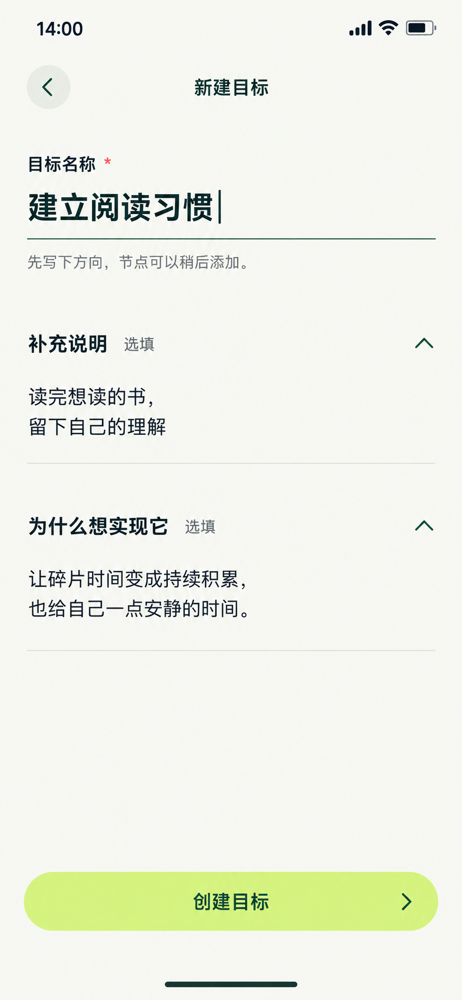

# 13 新建目标 — 专注书写与选填展开状态

2026-10-20，按用户对逻辑、颜色、方框堆叠及动效演进的反馈修订。本轮仅使用内置imagegen生成一张修正版，替换同名旧图。原生853×1844，未拉伸裁切，项目副本与生成原图SHA256一致。仅交付图片及配套说明。

依据：[Goal字段](../../v1.0/数据模型.md#21-goal)、[Goal状态](../../v1.0/领域模型.md#21-goal-状态)、[界面§10](../../v1.0/界面与交互.md#10-goals-与节点树)、[视觉规范](../颜色与布局规范.md)。

## 修订依据与真实状态

旧图在新建表单上方放置已有Flutter目标和7/12节点统计，虽然原意是保留列表上下文，但归属模糊，造成“新目标已存在节点”的误读。现改为独立手动创建表单：只出现待创建目标的输入，没有既有目标、父节点、覆盖率、进行中数量或底部导航。原列表留在返回栈，不占据表单。

目标仅有title、选填description、选填why；去除首尾空白后名称必须非空。本图“建立阅读习惯”及说明、Why均为用户已输入的示例草稿，尚未持久化，尚无节点。初次打开只展开名称，选填区由用户展开；本图捕捉两处选填均已展开的中间状态，不代表默认强制填写三项。

创建前不显示“暂无节点”或添加节点动作；保存成功回目标列表，新卡才显示“暂无节点”和“添加节点”。初始状态ACTIVE，节点与任务须之后明确创建，不因目标创建自动生成。没有目标截止、材料策略、任务时长等字段。

## 从书写到新目标的动效演进

动效用于说明对象关系及操作结果，不把过程拆成多页向导。以下是图片的交互设计标注，尚未实现或运行验证。

| 时刻 / 触发 | 画面如何演进 | 数据与可用性条件 |
| --- | --- | --- |
| 目标页＋选择手动创建 | 进入专注表单，名称保持主视觉，原列表位置进入返回栈 | 真实独立页，计一次跳转；不冒称原位 |
| 名称获得焦点 | 底线颜色加深，输入光标表明可编辑；不靠永久边框包围全文 | 外部标签始终可见，聚焦可辨识，名称不能为空 |
| 展开说明或Why | 对应正文区域360ms扩高，后续内容随布局平滑下移；正文180ms显现，箭头随状态旋转 | 两块独立展开，不清空收起的本次输入；不能只做淡入却瞬间跳高度 |
| 键盘与长文出现 | 正文滚动，当前输入避让键盘；按钮进入可达位置 | 不缩小字号、不覆盖最后一行，仍可返回或提交 |
| 点击创建 | 按压反馈140ms；原按钮就地显示保存中，正文和返回暂时防重复操作 | 用户确认后才原子保存；不知道进度时不显示伪百分比 |
| 保存成功 | 返回目标列表，以目标名称为共享对象，360ms衔接到新卡标题的位置与字号，再显示“目标已创建”与“暂无节点” | 数据提交成功才开始成功过渡；不是先播成功动画再写数据 |
| 保存失败 | 留在同一表单，按钮恢复，错误就近出现 | 保留名称、选填输入和展开状态，不返回列表、不出现节点 |
| 减少动态效果 | 取消位移、缩放与高度补间，直接切换最终布局 | 对象名称、结果文字和焦点衔接保留；不靠动画才能理解操作 |

统一曲线cubic-bezier(.22,.8,.24,1)，不循环漂浮、弹跳或播放装饰动画。手动创建成功后的目标卡形态沿用列表组件；本张不同时拼入成功帧。

## 逐项跳转标注

| 操作 | 去向与返回 | 约束 |
| --- | --- | --- |
| 02目标页＋→手动创建 | 独立13表单，保留来源筛选和滚动位置 | 不创建Goal，不预置节点；草稿初次仅名称区可见 |
| 02目标页＋→JSON导入 | 目标页内导入区，粘贴/选择文件、校验、树预览、确认保存 | 不经过13手动表单；系统选择进入与返回各计一次 |
| 名称、说明、Why | 本表单编辑；选填区原位展开/收起 | 非空名称是唯一必填条件；不擅自生成选填内容 |
| 创建：校验失败 / 保存失败 | 留在13，就近错误和重试 | 保留输入、展开状态；无部分成功或伪目标 |
| 创建：保存成功 | 返回来源02，列表显示新卡和回执 | 没有筛选变化时进行中数量递增；原列表位置保留并确保新卡可见，不强制再去03详情 |
| 左上返回 / 系统返回 | 键盘可见先收键盘；离开表单时，有内容确认“放弃未保存的内容？” | 继续编辑保留内容；放弃仅清草稿，回02；无内容直接返回 |
| 成功后的新卡“添加节点” | 目标路径区内的节点编辑 | 属于创建后的下一项独立功能；不在未保存草稿中提前展示 |

最坏起点的手动完整路径：其他顶层→目标1→手动创建2→保存成功返回目标3。JSON文件路径：其他顶层→目标1→系统选择2→返回目标导入区3，校验、预览、确认和成功原位完成。取消及异常单独核对，不能跨功能清零必经跳数来掩盖超限。

## 形态与颜色

以开放书写区、文字层级、留白及底线表达可编辑性，取消三个重复描边方框。app bar16/24，目标名称作为编辑中的主要对象使用28/36，选填正文18/28，标签14/20，操作16/24，390逻辑宽边距24。名称角色明确，不能把其他普通表单输入也随机放大。

背景暖白#F7F8F2；森林绿#244D3D用于文字、底线与图标；唯一大面积动作底使用浅柑橘#D7F57B，配深绿文字，沿用已有色源。返回使用柔和底#E8EDE4。深绿主按钮在其他页面仍有其角色，本轮不声称全项目按钮均已改色。

生成图仍把必填星号近似为红色，按钮也带轻微生成明暗变化；精确落地采用森林绿星号和纯色填充。静态PNG不证明动效、对比度、键盘或真实提交已验收。

## 核对与范围

已目视核对：无既有目标、节点/覆盖统计或底部导航；只有一个页面标题；三个输入内容完整；两处选填有展开标记；浅色主动作与安全区完整。尺寸与原图复制已核对。没有新增应用业务代码或运行交互。

[生成提示词](13-新建目标页.prompt.txt) · [页面跳转总表](页面跳转总表.md)。
