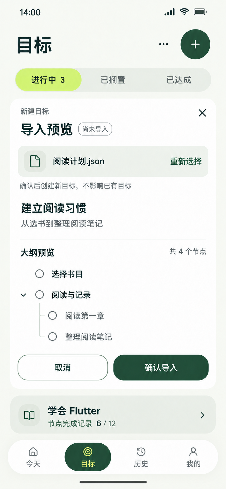

# 13 目标导入预览 — 当前候选

2026-10-26实装更新：本文图片为历史风格参考。当前创建直接进入表单，导入由独立入口原页办理；宽屏空库创建/导入并排，选中目标后列表/路径并排。颜色、图形、动效与当前截图以[本轮审查](../制作记录/2026-10-26-颜色层级与空态审查.md)为准。

日期：2026-10-21。使用内置 imagegen 生成，沿用正稿 v1.1 的暖白、森林绿、柑橘强调与胶囊导航。本轮只补一张操作状态图，保留原有 12 张图片。属于目标页的新建区域，不新增必经路由。

## 这张图解决什么

用户从目标页“＋”选择 JSON 导入，文件返回并通过校验后，先核对即将创建的目标及完整节点结构，再明确确认。页面保留“目标”标题、筛选、相邻已有目标与底部导航，避免把原位预览画成独立全屏页面。

依据：[界面与交互 §10](../../需求文档v1.0/界面与交互.md#10-goals-与节点树)、[导入协议 §5](../../需求文档v1.0/数据落地与平台.md#5-goal-outline-导入)、[节点关系](../../需求文档v1.0/领域模型.md#22-节点结构与编辑)。本轮不增加合并、覆盖、任务批量导入或 AI 生成功能。

## 样例与显示逻辑

对应可复核的[阅读计划样例](13-目标导入样例.json)，它是设计数据，不接入应用运行数据。

- 待导入目标：建立阅读习惯；说明：从选书到整理阅读笔记。
- 两个根节点：选择书目、阅读与记录。后者有两个子节点：阅读第一章、整理阅读笔记。共 4 个节点，2 层；父节点本身也计数。
- 预览尚未保存，因此筛选仍显示“进行中 3”；“尚未导入”说明当前状态。不得提前显示“导入成功”、完成勾或节点完成进度。
- 下方“学会 Flutter / 节点完成记录 6 / 12”属于已有目标，与新树的 4 个节点无关。示例沿用旧目标列表的报告前快照，不表示用户当前真实数据。
- 本图场景没有运行或暂停任务，因此不放当前任务快捷栏；真实存在时仍须遵守全局快捷入口规则，内容区滚动承载。
- 树中的圆点仅标识节点，不是选择框；整棵大纲一并导入，不支持勾选部分节点。根节点对齐，只有父节点有展开箭头；父子关系靠缩进与连接线表达。

## 入口、确认与反馈

正常路径：其他顶层 → 目标（第 1 跳）→ 系统文件选择（第 2 跳）→ 返回当前创建区（第 3 跳）。读取、校验、预览、明确确认和保存反馈都在该区发生。在目标页开始时只有系统往返两跳。

用户看到的主操作为“确认导入”，含义是创建一个新目标及其全部节点。说明采用“确认后创建新目标，不影响已有目标”，不把业务主键、事务、协议字段等实现细节堆进页面。不会在确认时自动创建任务。

保存成功后在原区域显示“已导入「建立阅读习惯」，共 4 个节点”，创建区收起为新目标卡；在本样例无其他并发变更时，“进行中 3”更新为“进行中 4”，新目标显示“节点完成记录 0 / 4”。不强制再跳结果页；“查看大纲”是可选后续操作。成功后清除本次待提交输入，不能再次点击原按钮重复提交。

## 其他状态与文案约定

下表是后续实现要求，本张图只绘制“校验通过、等待确认”。

| 触发 | 原位显示与处理 |
| --- | --- |
| 初次进入创建区 | 创建直接进入表单；JSON导入为独立次级入口，支持选择文件与粘贴文本。没有输入时不显示有效预览 |
| 正在读取、校验 | “正在读取大纲…”；完成前禁用确认，不显示旧输入已通过 |
| 格式或字段不合法 | “无法导入，请检查文件内容”；下方显示具体字段路径及原因。未知字段、版本、重复 key 和类型错误明确拒绝，确认禁用 |
| 超出限制 | 按实际原因提示“文件超过 2 MiB”“节点不能超过 500 个”或“大纲不能超过 12 层”；不只显示通用失败 |
| 重新选择 | 系统往返属于当前操作的额外跳转，不能重新计数。取消系统选择保留原预览；新文件返回后先校验，通过后替换预览，失败时展示该文件错误并禁用确认，不能把旧树当新文件导入 |
| 取消或关闭 × | 放弃当前未保存的预览，保留既有目标列表；不写业务数据。这里是只读文件预览，不额外制造“保存草稿”功能 |
| 点击确认、正在保存 | 按钮为“正在导入…”并禁用，暂时阻止重复确认、重选和取消；由业务入口原子保存目标和全部节点 |
| 保存失败 | “导入失败，未创建任何目标，请重试”；保留校验通过的预览和输入，按钮恢复“重试导入”。底层错误另行记录，不向用户显示堆栈 |
| 空大纲 | 协议允许 nodes 为空：显示“暂无节点，导入后可添加”，确认仍可用；成功卡显示“暂无节点”，不能写 0 / 0 或 100% |

文件与粘贴共用完整校验：固定 schema、version 为整数 1、必填及字段类型、未知字段拒绝、整树 key 唯一；UTF-8 最多 2 MiB、最多 500 节点、根为第 1 层且最大 12 层。只有确认时生成运行 ID、顺序及时间，目标初始进行中，节点未归档。取消、解析失败、写入失败均不得留下半条导入。

## 布局与可访问性要求

- 复用[颜色与布局规范](../颜色与布局规范.md)和唯一 design-tokens.json；目标名 18/24、操作 16/24、辅助 14/20，导航 12/16。导入预览作为区域标题，避免在落地时与页面主标题争夺层级。
- 同级根节点共用图标与文字起始列，没有子节点的行保留箭头空位。大纲圆点不设置勾选语义；展开按钮单独标注“展开/收起子节点”。
- 重新选择、关闭、展开等触控区至少 48 逻辑像素；长文件名可换行，不能遮住操作；深层树不无限右移挤没标题，应支持折叠及完整路径查看。
- 窄屏或大字体时整页纵向滚动，确认操作随创建区排布，不覆盖相邻目标或导航。文件名、目标名、长树、错误状态均需实现时测试。
- 图片只作为近似视觉参考，不能从图片像素反推字号、颜色对比度或触控区验收。

## 生成与核验记录

完整[生成及修订提示词](13-目标导入预览.prompt.txt)。参考图：目标列表.png（配色、组件、导航）、目标详情.png（树结构）。内置生图首稿后发现两个根节点的起始列不一致，再用内置编辑只修正树对齐；正式目录仅保存校正后的当前图。

最终图目视核对：主要中文文案无明显错字，4 个节点与示例一致，两个根节点对齐，两个子节点仅连接“阅读与记录”；尚未导入与已有目标数量一致，保留相邻目标和选中的目标导航，按钮无遮挡。原生 853×1844，直接复制保存，无拉伸或外部图像修补。

本轮未实现导入程序，未调用系统选择器、数据库或设备交互；正常路径为设计层审查，失败分支仅文字定义，未生成对应状态图。学习进度仍承接 U06 创建表单与真实查询，图片不代表 U15/U16 已实现或用户已掌握。
