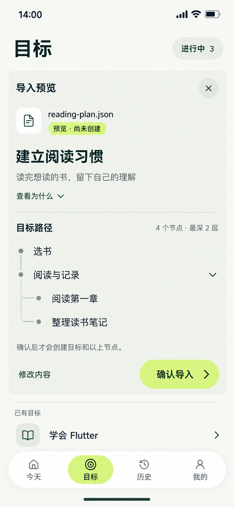

# 14 JSON导入预览 — 确认前的大纲

2026-10-20。内置imagegen，本轮仅生成这一张图片；原生尺寸已核对为853×1844，原图与项目副本哈希一致，无拉伸或裁切。仅图片与跳转、动效说明，不创建交互页面。

依据：[导入协议及校验](../../v1.0/数据落地与平台.md#5-goal-outline-导入)、[目标与节点导航](../../v1.0/界面与交互.md#10-goals-与节点树)、[三步原则](../三步交互原则.md)、[颜色与布局](../颜色与布局规范.md)。

## 当前画面代表什么

JSON已读取且完整校验通过，但用户尚未点击确认。本图“建立阅读习惯”及4个节点都只是输入预览，没有Goal或GoalNode落库。明确显示“预览·尚未创建”；不能绘制行动记录覆盖、完成勾、已达成或执行中的状态。

目标页保留标题、进行中3、底部导航及下方明确分开的“已有目标”邻项。导入区域在列表内展开；不是独立全屏预览页。已有Flutter目标位于预览区下方，不是新目标的归属或父节点。现有数量在确认保存前保持3，成功创建后才递增。

### 样例输入口径

| 项 | 本图对应值 |
| --- | --- |
| 来源 | reading-plan.json；设计示例，不表示仓库内或设备上存在这个文件 |
| 协议 | schema=mission-book.goal-outline，version为整数1 |
| 新目标标题 | 建立阅读习惯 |
| description | 读完想读的书，留下自己的理解 |
| why | 让碎片时间变成持续积累，也给自己一点安静的时间。默认收起，查看入口保留 |
| 根节点1 | key=books，title=选书，无子节点 |
| 根节点2 | key=reading，title=阅读与记录，当前展开 |
| 根2的子节点1 | key=chapter，title=阅读第一章 |
| 根2的子节点2 | key=notes，title=整理读书笔记 |

共4个节点、2个根节点，最深2层。整棵树key唯一；key只用于本次输入校验，不当作运行ID。预览计数属于导入内容，不是已有节点的覆盖率。

## 完整跳转标注

| 操作 / 阶段 | 去向与反馈 | 数据和返回条件 |
| --- | --- | --- |
| 02目标页＋→JSON导入→选择文件 | 从目标页直接打开系统选择器；返回原导入区域进行读取和校验 | 不经过13手动表单；取消选择不创建Goal |
| 粘贴输入→校验 | 目标页导入区内显示本预览 | 输入、校验、预览都不新增独立页 |
| 文件读取 / 解码 / 校验失败 | 回同一导入区，具体错误路径与限制就近显示 | 不进入有效预览、不清空可恢复输入、不写业务数据 |
| 查看为什么 | 本预览中展开why，收起保留原值 | 不编辑或自动丢弃JSON中的可选字段 |
| 阅读与记录右侧箭头 | 展开/收起这两个子节点 | 结构和总计数不变，不算完成动作 |
| 修改内容 | 同一目标页导入区切回JSON文本输入，预填当前源内容 | 修改使旧校验结果失效，须完整重校验后再确认；不直接改已有Goal |
| 确认导入 | 在同一区显示保存中，阻止重复提交 | 再校验待确认源版本；一次事务保存Goal和全部节点，不把预览当已保存 |
| 保存成功 | 本区域变为[16新目标与成功回执](16-目标导入成功页设计说明.md)，列表保留 | 应用生成ID、父子关系、同级顺序和时间；Goal初始ACTIVE，节点未归档；没有任何完成记录 |
| 保存失败 | 留在预览，显示原因与重试 | 不留下部分目标或部分节点；保留源内容与预览，不播放成功过渡 |
| 右上× / 离开目标页 / 系统返回 | 有导入内容时确认丢弃；继续则保留，放弃后恢复原目标列表 | 丢弃只影响此次未保存输入，已有目标不变；确认成功后的数据不能被“关闭预览”撤销 |
| 下方已有目标行 / 底部导航 | 先完成相同离开确认，再执行所选查看或导航 | 不静默丢弃未导入内容，不把已有目标误当新目标的一部分 |

首次正常文件路径：其他顶层→目标1→系统文件选择2→返回目标导入区3；校验、预览、确认和成功反馈均原位。预览后“修改内容”为本区切换，不增加跳转。主动重新进入系统选择器另增加进入和返回2次，累计不清零；不声称任意重选/重试仍必然三跳。

## 输入边界不可省略

文件和粘贴文本都按UTF-8最多2MiB处理；最多500节点、根为第1层、深度最多12。解析前检查字节大小，遍历中超限立即停止；报告错误路径和实际限制。Root、Goal、Node只接受协议列出的字段；拒绝未知字段、非法类型、重复key及以null代替String/Array。外部id/status不得进入运行数据；不支持合并或替换已有目标。

这些条件是完整办理的约束。本张只画校验通过后的预览，输入和错误状态仍需后续单独补图，不能用一个有效样例证明校验已经实现。

## 动效演进与形态

读取和校验完成后，目标标题保留来源连续性，源文本区在同一区转换为大纲预览，不弹出全屏新页。树展开用360ms高度与后续行位移联动、180ms显隐，折叠不改变数据。查看why同样原位展开；选择箭头必须随展开状态变化。

确认时按钮保持尺寸，只变为保存中；提交成功后，预览中的目标名与树承接到真正的新目标卡，明确的“尚未创建”才改为成功反馈。事务失败不触发该过渡。减少动态效果时直接切换最终布局，保留名称、层级和结果文字。本张不拼接多帧，不代表这些动画已经实现。

沿用开放树、留白、薄分隔及浅柑橘主动作，不给每个节点套方框。目标页标题28/36、导入区标题18/24、待确认目标名24/32、节点18/24、区块/操作16/24、辅助14/20、导航12/16。导入对象名角色固定，不随内容长度缩字。当前导航采用小块浅柑橘与深绿文字；其他旧图导航仍待统一复核。

大纲超过首屏时在正文滚动，保留确认入口和总计数；长节点换行并允许展开，不缩小字体，不静默隐藏未展示节点。深层树的横向空间、长文、窄屏与键盘需实现阶段单独验收。

## 验证范围

已目视核对：文件名、预览未创建提示、4个节点、两层缩进、折叠箭头、Why入口、修改内容、确认导入、既有目标分隔及四项导航。无完成率或已保存勾；行文与主操作未遮挡。生成图有轻微明暗近似，精确落地仍采用纯色参数。根节点按同缩进识别，子节点只属于“阅读与记录”，不能把装饰主干连线当作额外父子关系。

本次为静态候选图及设计口径，不代表真实文件读取、输入校验、事务或动画运行通过。最终交付核对记录实际尺寸、目视检查和复制哈希。

[生成提示词](14-JSON导入预览页.prompt.txt) · [全局跳转](页面跳转总表.md) · [后续覆盖清单](补图覆盖清单.md)。
