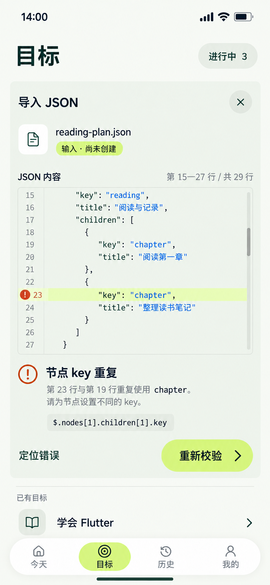

# 15 JSON输入校验 — 重复key的可恢复错误

2026-10-20。使用内置imagegen逐次单图修稿，只入库一张853×1844当前原型。首稿实际934×1683未通过尺寸门槛；仅纠正画幅后重新核对原生853×1844，原图与项目副本哈希一致，未拉伸或裁切。沿用14的目标页导入区和浅色主操作；源内容保留在同一区，错误不会变成独立失败页。



依据：[导入字段与校验](../../v1.0/数据落地与平台.md#52-字段和校验)、[14有效预览](14-JSON导入预览页设计说明.md)、[全局跳转](页面跳转总表.md)。

## 错误事实与输入保留

JSON语法可以解析，但业务校验未通过：整棵树中的节点key必须唯一。第23行的chapter与第19行重复，路径分别为$.nodes[1].children[1].key和$.nodes[1].children[0].key。4个节点、最深2层均未超过限制；这不是JSON格式错误，也不是目标名称错误。旧预览已失效，当前不能确认导入。

样例与14相同，只将“整理读书笔记”的key从notes改为chapter来演示错误。既可表达14点击“修改内容”后的错误回查，也可表达首次读入此错误文件后的校验失败。所有节点尚未创建；已有目标数量保持3。

编辑器展示第15—27行，原文共29行，前后文在滚动区域中保留。代码区是可编辑输入，不是另存的一段截断JSON；截图仅捕捉滚动位置。完整设计源如下，description与why虽然不在当前视窗，仍会保留：

```json
{
  "schema": "mission-book.goal-outline",
  "version": 1,
  "goal": {
    "title": "建立阅读习惯",
    "description": "读完想读的书，留下自己的理解",
    "why": "让碎片时间变成持续积累，也给自己一点安静的时间。"
  },
  "nodes": [
    {
      "key": "books",
      "title": "选书"
    },
    {
      "key": "reading",
      "title": "阅读与记录",
      "children": [
        {
          "key": "chapter",
          "title": "阅读第一章"
        },
        {
          "key": "chapter",
          "title": "整理读书笔记"
        }
      ]
    }
  ]
}
```

## 逐项跳转与恢复

| 操作 | 结果 / 去向 | 不能发生的行为 |
| --- | --- | --- |
| 02新建菜单→JSON粘贴或选择文件 | 目标页原导入区输入；校验失败原位呈现本状态 | 不经13手动表单，不清空用户输入，不创建Goal |
| 定位错误 | 滚动到第23行并聚焦重复key；若已可见则直接定位焦点 | 不擅自改名或删除节点；减少动态效果时立即定位 |
| 编辑源内容 | 保留全部源文本和本次光标位置；旧校验结果标为待重新校验 | 不能仍用旧“通过”结果开启确认；不把修正输入自动落库 |
| 重新校验 | 先检查UTF-8字节大小，再完整解析与遍历；失败仍显示路径及原因 | 不只复核当前这一处重复；不能跳过未知字段、类型、500节点、12层和2MiB限制 |
| 改为唯一key并校验通过 | 同一导入区转为14有效预览，源文本与大纲对应 | 仍没有业务写入；之后明确确认才创建 |
| 继续失败 | 保留输入，更新当前首个错误并支持定位 | 不跳通用失败页、不展示旧树作为有效预览 |
| ×、系统返回、打开已有目标或切底部导航 | 键盘可见先收键盘；离开有内容的导入区先确认丢弃，继续则返回本输入 | 不静默丢稿、不删除原有Goal；放弃只清理本次未保存内容 |

从其他顶层首次文件路径为目标1→系统选择2→返回原导入区3；错误、编辑、重校验、14预览及最终确认/回执原位完成。主动再次进系统选择器会增加进入与返回，累计不清零，不用“异常”命名掩盖实际跳数。

## 视觉与动效演进

单一代码输入区域需要清晰边界与行号；其他区域采用开放错误说明与薄分隔，不把每条错误套成卡片。代码14/20、行号12/20、错误标题16/24、错误正文/路径14/20、操作16/24；错误路径允许换行。用警告图形、明确文字及第23行浅柑橘标记定位，不仅依赖颜色。导航与确认区沿用14的浅柑橘/森林绿配对。

定位在尚未可见时平滑滚动至源行；已可见则只改变焦点。错误显现180ms，不让代码区域跳回文件顶部。重校验中按钮原尺寸显示状态并避免重复触发；通过后360ms在原区转为标题和大纲预览，源文本仍可回查。减少动态效果时取消空间补间并保留路径和焦点。这些是图片配套的交互标注，未生成可运行页面，也不声称已验证动画。

窄屏与键盘时允许正文和代码区滚动，长代码不缩成小字；必须能触及错误和重试动作。实际软件仍需验证中文输入法、选择/撤销、滚动焦点、读屏和并发校验结果的过期保护。

## 本轮核对范围

已从完整设计源解析并遍历：29行、4节点、2层，恰有一处重复key，重复路径与首次出现路径相符。已目视核对代码第15—27行、两处chapter、第23行定位、错误路径、尚未创建提示、重新校验及底部导航；源行与错误说明对应，主要文字未遮挡。原生尺寸和复制哈希通过。代码蓝色、警告橙色和填充明暗为生成近似，统一色源未因此静默增加颜色；精确配对仍待全局风格复核。该设计源校对不代表应用校验器已实现。

[生成提示词](15-JSON输入校验页.prompt.txt) · [仅纠正画幅的提示词](15-JSON输入校验页-画幅修正.prompt.txt) · [剩余覆盖范围](补图覆盖清单.md)。

