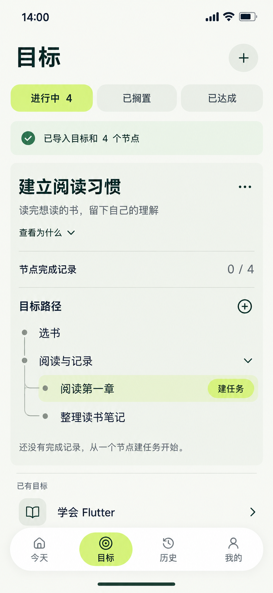

# 16 目标导入成功 — 保存后的真实目标

2026-10-20。使用内置imagegen生成当前单页候选，原生853×1844已核对，原图与项目副本哈希一致，未拉伸裁切。此图承接14的确认导入，表达成功提交后的最终画面；不是另开的成功路由。仅图片与设计说明。

依据：[导入确认与单事务保存](../../v1.0/数据落地与平台.md#53-导入路径)、[Goal状态](../../v1.0/领域模型.md#21-goal-状态)、[节点覆盖率](../../v1.0/领域模型.md#23-节点记录与覆盖率)、[14预览样例](14-JSON导入预览页设计说明.md#样例输入口径)。

## 与预览相比，哪些事实改变了

用户已经明确确认，单事务保存成功：新增一个ACTIVE目标和4个有效、未归档节点。原有3个进行中目标未被改写，进行中数量变成4。若来自15错误示例，须先将重复key修正为唯一值、完整校验通过并再次确认，不能从失败直接播放本成功画面。

目标仍是“建立阅读习惯”，description与why保留，后者默认通过入口展开。树顺序不变：根“选书”；根“阅读与记录”及其两个子节点“阅读第一章”“整理读书笔记”。运行ID由应用生成，输入key不作为持久化身份。

| 显示 | 正确含义 |
| --- | --- |
| 已导入目标和4个节点 | 本次导入操作成功；回执可淡出，数据不会随回执消失 |
| 进行中4 | 四个ACTIVE目标，非四个执行中的任务 |
| 节点完成记录0/4 | 四个有效节点都没有直接关联的COMPLETED报告；不能显示“暂无节点” |
| 阅读第一章行高亮 | 选中焦点，仅影响当前UI；不是运行状态、完成标记或新的领域字段 |
| 建任务 | 现在归属已经存在，可为选中节点创建草稿；导入本身没有创建Mission或START |

没有AI验证、掌握度、目标已达成、同步、执行时长或自动任务。原始JSON不会被伪装成正式审计附件；文件名和“尚未创建”标签退出当前业务画面。新目标已有4节点，不能沿用手动空目标的“暂无节点”。

## 逐项跳转标注

| 操作 | 去向 / 反馈 | 数据与返回 |
| --- | --- | --- |
| 14确认导入成功 | 原目标页导入区转为新目标展开区与回执 | 不新增路由；保存失败仍留14并保留输入，不显示本图 |
| 查看为什么 | 同目标区展开保存的why | 只读，不丢失源字段，不新开说明页 |
| 目标菜单 | 原位编辑元数据或手动变更状态 | 变更按既有Goal规则；导入成功不自动ACHIEVED |
| 目标路径右侧＋ | 当前目标路径内展开新增根节点 | parentNodeId为空；明确保存才追加，失败不改变现有4节点 |
| 阅读与记录展开箭头 | 收起/展开两个子节点 | 结构、有效总数和覆盖率不变；关闭展开区不等于归档 |
| 点击阅读第一章等节点 | 原位选择并展开该节点任务摘要 | 当前没有任何任务；节点所属目标保持本新目标 |
| 选中节点“建任务” | 原位展开05表单规则，归属显示“建立阅读习惯→阅读与记录→阅读第一章” | 预填节点与Goal Why；不照搬05旧图的Flutter归属；明确保存才创建，默认FLEXIBLE/SELF_REPORT，日期今天，时长仍需有效输入 |
| 节点完整任务列表 / 目标完整详情 | 可选04 / 03阅读视图 | 不作为建任务强制中转，返回恢复当前列表/节点位置 |
| 新建目标＋、其他目标行、筛选与底部导航 | 按正常目标列表处理 | 导入已提交，不再弹“丢弃导入”或通过关闭撤销；后续新草稿单独按未保存规则处理 |

首次文件导入仍是其他顶层→目标1→系统选择2→返回目标导入区3，确认及本成功状态原位。下一项建任务可在当前目标节点区办理，不强制进入独立目标详情、节点列表后再开表单。

## 动画演进与视觉

只有提交成功，预览中的标题与树才360ms衔接为保存后的同一对象；“尚未创建”和确认动作退出，回执180ms显现，数量3更新为4。统计不得先跳4再异步补存。提交失败保留预览、错误和输入，不播放成功动画。减少动态效果时立即显示最终布局，保留成功文字与对象身份。

收起或展开树使用360ms高度/行位置联动，不只淡入内容而瞬间跳版。选中节点的强调面平移/显隐只服务焦点，不使用计时环或完成勾。原有列表邻项与导航保留，避免成功后失去来源。

页面标题28/36；展开对象标题24/32承接14对象身份，普通收起邻项18/24；树节点统一18/24，区块与操作16/24，辅助14/20，导航12/16。只保留一个展开目标分组，不给每个节点加方框。浅柑橘用于选中/操作，森林绿用于内容，颜色不单独承担完成状态。

## 核对范围

已核对PNG尺寸、源/项目副本哈希。目视核对进行中4、导入4节点回执、0/4、两根两子结构、仅选中叶节点的建任务动作、Why入口、根节点＋及导航；主要内容未遮挡。回执中的勾只表示导入成功，树节点没有完成勾。下方“已有目标”指此次导入前的邻项，新目标也已正式保存；不把该标签解读成新目标仍未创建。生成填充明暗为近似，统一色源仍采用纯色。静态图不证明事务、派生查询、键盘或动效已经实现。

[提示词](16-目标导入成功页.prompt.txt) · [全局跳转](页面跳转总表.md) · [剩余覆盖清单](补图覆盖清单.md)。
