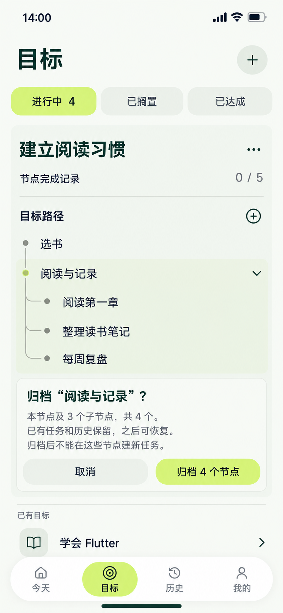

# 18 归档子树确认 — 范围包含父节点及全部后代

2026-10-20。内置imagegen，单页静态候选，原生853×1844及复制哈希已核对，未拉伸或裁切。确认区在目标树内展开，不另开独立归档页；图片不代表实际修改数据库。

依据：[节点结构与归档恢复](../../v1.0/领域模型.md#22-节点结构与编辑)、[有效节点覆盖率](../../v1.0/领域模型.md#23-节点记录与覆盖率)、[GoalNode顺序](../../v1.0/数据模型.md#22-goalnode)、[17新增草稿](17-新增子节点页设计说明.md)。

## 样例时点与范围

本图假设17中的“每周复盘”已经明确保存成功，再进入新的归档操作。此时“建立阅读习惯”是ACTIVE，两个根“选书”“阅读与记录”；后者有“阅读第一章”“整理读书笔记”“每周复盘”三个已保存子节点。共5个有效节点，均无完成记录，覆盖0/5；全局进行中目标4。

用户选择归档“阅读与记录”，当前只是待确认。范围包括这个父节点和全部三个后代，共4个。“选书”在范围之外。不能把17的未保存草稿直接拿来归档，也不能在此待确认帧提前减到0/1。

| 阶段 | 有效节点 | 已归档节点 | 当前覆盖 | 目标状态/数量 |
| --- | --- | --- | --- | --- |
| 归档确认打开 / 取消 / 失败 | 5 | 0 | 0/5 | ACTIVE，进行中4 |
| 确认且原子归档成功 | 1，仅选书 | 4，阅读与记录及3个后代 | 0/1 | ACTIVE，进行中4 |
| 后续恢复整个分支成功 | 5 | 0 | 0/5 | ACTIVE，进行中4 |

本例从未创建任务，所以没有虚构的受影响任务条数。“已有任务和历史保留”是通用规则说明，不表示本例实际已有历史。

## 逐项跳转与确认

| 操作 | 去向 / 动作 | 数据与失败处理 |
| --- | --- | --- |
| 阅读与记录菜单→归档 | 当前树内显露范围和确认区，原节点仍可见 | 仅UI选择，不写archivedAt |
| 归档4个节点 | 本区显示提交中、防重复提交，重查范围后单事务归档 | 记录所选节点及整个子树的archivedAt；确认范围若变化则更新提示并重新明确确认，不静默扩大范围 |
| 归档成功 | 原位收起这4个有效节点，显示回执和“已归档节点4”入口 | 有效分母变1，完成分子仍0；目标保持ACTIVE，orderIndex不重排；归档项仍保存在原Goal/父子关系下 |
| 归档失败 | 保留范围与确认区，显示原因及重试 | 不留下部分归档，统计与树仍5个有效节点 |
| 取消 / 系统返回 / 点击其他目标、筛选、菜单、＋或导航 | 未提交时等同取消本次确认，再执行所选查看/导航 | 本确认没有文本草稿，不额外套一层丢稿确认；不产生业务变更；提交中待结果明确后再离开 |
| 已归档节点入口 | 当前0归档时从目标更多菜单访问；归档成功后路径区显示“已归档节点4”，同目标区查看[19归档树与恢复提示](19-已归档节点恢复页设计说明.md) | 打开其他查看动作前取消本次确认；支持恢复原子树；恢复子节点前要求父节点有效，必要时先恢复父节点，不擅自改变父关系 |

正常路径从其他顶层→目标1，树、菜单、范围确认、归档结果和归档查看均原位，共1次页面跳转。完整详情不是强制中转；取消不会执行归档。

归档不物理删除节点、不改已有Mission归属、不取消或暂停已有任务、不删除事件或材料。已有任务仍能执行或补材料；归档节点仅被排除出当前覆盖率且不能用于创建新Mission。“查看已有任务”和“建新任务”必须区分，不能一起禁用。

## 动效与视觉

确认区在所选分支附近360ms扩高，分支范围以位置和淡强调面说明，文字180ms显现，树仍是正式有效状态。只有提交成功才收起该子树，并将范围衔接到“已归档节点4”入口；“选书”保留，0/5再改为0/1。失败保持原布局；取消反向收起确认区。减少动态效果时直接切换，保留范围、结果和焦点。

树节点18/24，展开目标24/32，确认标题20/28、正文14/20、动作16/24。浅柑橘动作使用明确的“归档4个节点”，不把归档伪装成目标完成或永久删除。正文清楚说明本节点及3个子节点、历史保留和可恢复；不靠颜色或勾表示状态。

复用到其他子树时须查询实际范围，不能硬编码4；若归档后有效节点为0，覆盖区域显示“暂无节点”，不显示0/0或100%。目标达成仍由用户决定。

## 交付核对

已核对尺寸/哈希；目视核对正式5节点及两根三子、所选父节点与3个后代的高亮范围、待确认0/5、全局4、历史保留/新任务限制/可恢复说明、取消及“归档4个节点”。未见主要文字遮挡。图中路径右侧仍为新增根节点＋，不是已归档入口；当前归档入口按上表在目标菜单中，归档后再显露计数入口。生成填充明暗为近似，精确实现采用统一纯色参数。未验证真实事务、并发范围变化、恢复权限或动画。

[提示词](18-归档子树确认页.prompt.txt) · [全局跳转](页面跳转总表.md) · [覆盖清单](补图覆盖清单.md)。
