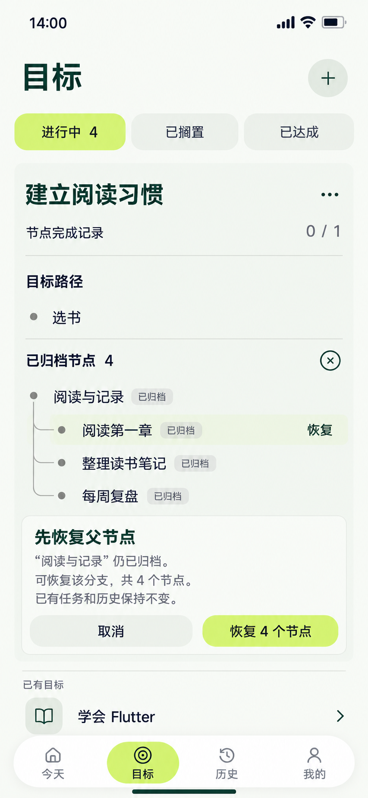

# 19 已归档节点与恢复 — 先满足父节点约束

2026-10-20。内置imagegen，单页静态候选，原生853×1844和复制哈希已核对，未拉伸裁切；承接[18归档成功后的状态](18-归档子树确认页设计说明.md#样例时点与范围)。归档查看和恢复提示在当前目标区展开，保留有效路径、邻项与导航。

依据：[归档与恢复规则](../../v1.0/领域模型.md#22-节点结构与编辑)、[有效节点覆盖率](../../v1.0/领域模型.md#23-节点记录与覆盖率)、[同级顺序](../../v1.0/数据模型.md#22-goalnode)。

## 当前事实

18中的归档已明确确认且保存成功：有效节点只有“选书”，覆盖0/1；“阅读与记录”及三个子节点“阅读第一章”“整理读书笔记”“每周复盘”共4个已归档。Goal仍ACTIVE，全局进行中仍4，已归档节点不计入有效分母。

用户选择了归档子节点“阅读第一章”的恢复动作，但其父“阅读与记录”仍已归档，不能直接使这个子节点有效。当前提示只解释并提供明确的新选择“恢复4个节点”；没有自动恢复父节点，也没有改父关系或将子节点挪到根层。

该父节点本身是目标的根节点，没有归档祖先，所以恢复这个父分支是合法替代。操作范围是父节点及全部三个子节点，不是只恢复父和所点子节点。图中必须清楚告知4个范围，让用户明确确认。

| 时刻 | 有效 / 归档 | 覆盖 | Goal |
| --- | --- | --- | --- |
| 当前提示、取消或恢复失败 | 1 / 4 | 0/1 | ACTIVE，进行中4 |
| 用户确认恢复父分支并单事务成功 | 5 / 0 | 0/5 | ACTIVE，进行中4 |

没有执行记录或任务由恢复产生，历史、ID、Goal与父关系、同级顺序均保留。顶部状态筛选是Goal状态；归档查看属于目标内部的节点维护。

## 逐项跳转与恢复

| 操作 | 画面 / 去向 | 保存与失败处理 |
| --- | --- | --- |
| 路径区“已归档节点4”或目标菜单入口 | 同目标区展开本归档树，有效“选书”和0/1保留 | 不改状态、不跳独立回收站、不清理历史 |
| 阅读第一章→恢复 | 本区显示“先恢复父节点”及父分支4节点范围 | 子节点仍归档；不能偷偷扩大原动作或只清子节点archivedAt |
| 恢复4个节点 | 明确确认恢复“阅读与记录”整棵子树，原位提交中 | 重查Goal/节点存在、父关系及范围；该根节点无父节点；一个事务清除所选子树archivedAt，orderIndex不改 |
| 恢复成功 | 这4节点回到有效树的原位置，归档数4→0、覆盖0/1→0/5，局部回执 | 展开父分支并回到原请求子节点焦点；之后建任务仍按Goal状态与节点有效性判断 |
| 恢复失败或范围变化 | 保留归档区和当前真实统计，说明原因或更新范围后重新确认 | 不留下半条恢复；不能为让提交通过擅自改变父关系；并发已恢复时重查实际结果，不重复造节点 |
| 取消 | 收起当前父恢复提示，保留归档树 | 没有数据修改，也没有文本草稿须丢弃 |
| 归档区× / 系统返回 / 切目标、菜单、筛选或导航 | 未提交时取消提示并按所选查看动作返回，×收起归档区回有效路径 | 不恢复、不删除；提交中防重复及结果不明时离开 |

正常最坏起点：其他顶层→目标1，目标区内查看归档、选择、提示、确认及成功反馈原位完成，共1次页面跳转。完整目标详情可选，不作强制中转。

## 直接恢复与更深祖先的复用映射

直接选择“阅读与记录”恢复时，复用同一范围确认区，说明父节点无效的阻断提示可省，明确范围仍为4。若别的归档节点拥有有效父节点，可直接恢复所选节点及其子树，范围查真实数据。若更深祖先也归档，先说明哪个祖先分支可合法恢复及完整范围，明确选择前不扩大操作。

节点恢复不改变Goal状态。其他样例中若Goal已搁置/达成/放弃，恢复节点也不能自动将Goal激活；“建任务”继续遵循Goal必须ACTIVE的既有规则。已有任务仍可查看、执行和补材料，不能与新建任务入口一并禁用。

归档清单变空时复用无归档内容状态，显示“暂无已归档节点”和返回有效路径入口，不伪造记录。普通树的已有顺序通过原orderIndex恢复，过滤后的显示序号不写回。

## 动效与视觉

已归档分支在有效树下方原位展开，文字和层级可读；子节点被选择时只标UI焦点。父约束提示180ms显现，必要高度360ms展开，保留所选节点与父关系。只有恢复成功才把相同名称和树线衔接回有效区域并更新计数；失败或取消保持归档事实。减少动态效果时直接切换，保留范围文字和焦点。

沿用暖白/森林绿/浅柑橘和开放树。已归档状态用文字与分区区分，不用低透明度把文字做得难读；节点18/24，区块/动作16/24，约束说明14/20。归档节点无“建任务”，不画完成勾。

## 核对范围

已核对尺寸/哈希；目视核对有效“选书”与归档4节点的分区、0/1、进行中4、归档父及3子、选中子节点、其恢复入口、先恢复父节点提示和明确“恢复4个节点”。主要文字未见遮挡，归档行无新建任务或完成勾。生成明暗为近似，统一色源仍采用纯色。静态图不证明实际恢复事务或动画已经实现。

[恢复成功后调整同级顺序](20-同级节点排序页设计说明.md) · [提示词](19-已归档节点恢复页.prompt.txt) · [全局跳转](页面跳转总表.md) · [覆盖清单](补图覆盖清单.md)。
