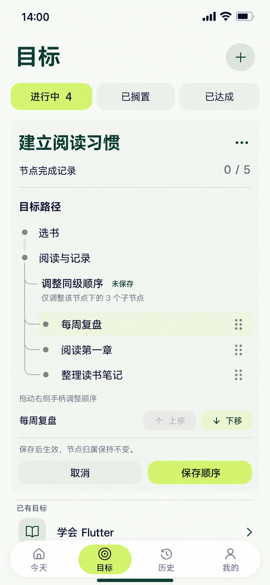

# 20 同级节点排序 — 预览顺序，明确保存

2026-10-20。内置imagegen，单页静态候选，承接[19恢复成功](19-已归档节点恢复页设计说明.md#当前事实)后的五节点有效树。目标列表内原位调整，保留目标身份、根节点和邻项目标；不增加独立排序页路由。

依据：[节点编辑边界](../../v1.0/领域模型.md#22-节点结构与编辑)、[覆盖统计](../../v1.0/领域模型.md#23-节点记录与覆盖率)、[含归档项的同级顺序](../../v1.0/数据模型.md#22-goalnode)。

## 当前事实与草稿

19中的父分支已由用户明确确认并恢复成功。当前Goal为ACTIVE、进行中目标4；有效节点5、归档0、节点完成记录0/5。两个根节点依次为“选书”“阅读与记录”。“阅读与记录”原来的三个子节点依次为“阅读第一章”“整理读书笔记”“每周复盘”。

用户进入该父节点的同级排序，将“每周复盘”从最后拖到最前，已松手，当前只是待保存预览。树中显示的子节点顺序为“每周复盘”“阅读第一章”“整理读书笔记”。标题旁“未保存”区分预览与正式数据；当前不会显示保存成功回执。选中高亮表达操作焦点，不表示完成、归档或任务状态。

| 数据范围 | 当前已保存 | 当前草稿 / 成功保存后 |
| --- | --- | --- |
| 根节点及orderIndex | 选书0，阅读与记录1 | 保持不变 |
| 阅读与记录的子节点及orderIndex | 阅读第一章0，整理读书笔记1，每周复盘2 | 每周复盘0，阅读第一章1，整理读书笔记2 |
| 父关系、节点ID与Goal | 均为既有关系 | 保持不变 |
| 有效 / 归档、覆盖 | 5 / 0，0/5 | 保持不变 |

表中的后列仅在保存成功后成为正式数据。拖动期间不逐次写库，取消会恢复前列；失败保留草稿和错误原因，不显示已保存。排序不创建任务、执行报告或完成记录。

## 逐项跳转与提交

| 操作 | 画面 / 去向 | 数据与失败处理 |
| --- | --- | --- |
| 阅读与记录菜单→调整子节点顺序 | 同一目标树内展开本区；其他节点行任务/新增动作暂时收起 | 记录原顺序及本次完整同级集合；不写业务数据 |
| 拖动任一子节点右侧手柄 | 在该父节点的同级范围内预览插入位置，松手形成草稿 | 越过父节点边界不接受落点；不能拖到选书下或根层；ID随行移动 |
| 选中行→上移 / 下移 | 等价于与相邻同级交换；保持选择焦点 | 第一项上移禁用、末项下移禁用；本图每周复盘在首位，只有下移可用 |
| 保存顺序 | 原位提交中；成功后收起排序工具，普通树保留新顺序，显示轻量回执 | 事务内重读完整同级集合和边界，按新排列写连续orderIndex；防重复；保存前不改变统计 |
| 无变化时保存 | 无须提交；保持取消/退出可用，保存按钮禁用 | 不制造无效更新或成功动画 |
| 取消 | 丢弃本次排序草稿，恢复原树及原焦点 | 按钮本身已明确取消，无需再询问一次 |
| 系统返回 / 切目标、筛选、导航、＋或目标菜单 | 有变化时在当前区确认“放弃顺序调整？”；继续留在草稿，放弃才执行原查看动作 | 不默默保存；提交中避免结果不明时离开 |
| 写入失败 | 本区显示“顺序未保存，请重试”，保留当前预览、选择和取消入口 | 事务全回滚；正式数据仍旧顺序，不能部分重排 |
| 同级集合被新增/归档/恢复/调序等改变 | 保留用户意图，说明内容已变化并重载真实范围供重新调整确认 | 不以旧ID列表覆盖新项、重新归档节点或擅自重挂；不要在不明结果下盲目重复提交 |

正常最坏起点：其他顶层→目标1，选择父节点菜单、排序、确认和反馈均在当前目标区完成，共1次页面跳转。03完整详情属于可选阅读，同一排序组件可复用，不作为必经中转。

## 根节点、归档同级与辅助操作复用

根节点调序复用同一区块，作用范围改为同一Goal下parentNodeId为空的完整集合，文案为“调整根节点顺序”；只能改变根节点相对顺序，子树随所属根节点显示，不改变任何父关系。

若该同级集合含归档项，排序区临时显示所有同级，归档项明确标注“已归档”，不提供建任务。说明“排序包含已归档节点”，允许在同一完整序列中调整；保存为含归档项的连续orderIndex。退出排序后普通树继续过滤归档项，展示序号重新派生，不能拿过滤后的序号覆盖真实顺序。本图归档0，因此无需画虚构的归档行。归档/恢复操作自身不重排orderIndex，恢复位置以保存的完整同级顺序为准。

点击行选中后提供上移/下移，供不方便拖动的用户使用；辅助技术读出名称、位置“第1项，共3项”和可用动作，按钮触达不小于48逻辑像素。排序只涉及当前同级，误拖出界时说明“只能调整同级顺序”，原草稿保持。

## 动画与演进

进入排序时原树线及节点位置保留，动作工具180ms显现，必要高度与后续内容位置360ms展开。拖动时被抓行跟随手指，使用稳定ID定位；相邻行在目标插入位置形成连续让位，松手后360ms落位，避免整棵树消失再出现。此时只改变草稿，显示“未保存”；不出现保存成功动画。

按压反馈140ms。保存成功才收起工具并180ms显示“顺序已保存”，保持刚才的行顺序，不二次跳动。取消时360ms回原排列并归还焦点；失败不回跳，保持可恢复草稿。空间动效采用cubic-bezier(.22,.8,.24,1)，减少动态效果时直接呈现落点、状态文案和焦点，不依赖拖动动画传达结果。

沿用暖白、森林绿、浅柑橘，开放树行和细分隔，轻色主按钮；节点18/24、区块与动作16/24、辅助文案14/20。不是每个节点单独套卡片。图片表达拖动松手后的一个时刻，动画规则是实现约定，静态交付不证明运行中的动画、事务和辅助技术操作已经实现。

## 核对范围

已核对原生853×1844、复制哈希一致；目视核对两个根节点、三个子节点同层挂载、每周复盘移至首位、未保存标识、上移禁用/下移可用、取消/保存、0/5和进行中4，主要文字未见遮挡。排序标题旁无节点标记，其后的树线仅表达父节点下的作用范围，不计作第六个节点。生成明暗为近似，统一色源仍以纯色定义为准。样例顺序及连续索引、同父范围、ID/关系与统计不变已复核；取消/失败规则为设计约定。未验证软件排序事务、拖动动画或辅助技术运行行为。

[保存后调整目标状态](21-目标状态切换页设计说明.md) · [提示词](20-同级节点排序页.prompt.txt) · [全局跳转](页面跳转总表.md) · [覆盖清单](补图覆盖清单.md)。
