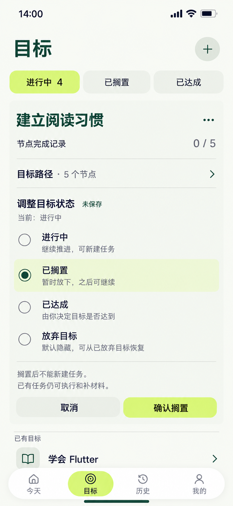

# 21 目标状态切换 — 选择与保存分开

2026-10-20。内置imagegen，单页静态候选。承接[20排序成功](20-同级节点排序页设计说明.md#当前事实与草稿)后的目标；排序草稿已经明确保存，本图不是同时编辑两个草稿。状态设置在目标列表内原位展开，树收起为5节点摘要，保留目标名称、完成记录、相邻目标和导航。

依据：[Goal四状态与恢复](../../v1.0/领域模型.md#21-goal-状态)、[Goal数据边界](../../v1.0/数据模型.md#21-goal)、[覆盖统计](../../v1.0/领域模型.md#23-节点记录与覆盖率)。

## 当前事实与选择

“建立阅读习惯”已保存为ACTIVE，进行中目标4；有效节点5、归档0、完成记录0/5。树中两个根节点、三个子节点的身份与20保存后的顺序保留，本图只是收起树。样例没有关联Mission，不虚构已有执行或待补记录。

用户选择“已搁置”，尚未点“确认搁置”。“当前：进行中”和“未保存”同时说明正式状态与本次选择，顶部进行中4不提前变3。圆形单选标记表示候选状态，不是目标或节点完成勾。

| 时点 | Goal正式状态 | 进行中数量 | 有效节点 / 完成记录 |
| --- | --- | --- | --- |
| 当前选择、取消或保存失败 | ACTIVE | 4 | 5 / 0/5 |
| 确认搁置且保存成功 | PAUSED | 3 | 5 / 0/5 |
| 之后明确改回进行中且保存成功 | ACTIVE | 4 | 5 / 0/5 |

以上数量假定其他目标未变化；实现从真实列表重新计算，不能固定增减样例数字。Goal的PAUSED不等于Mission的PAUSED；目标状态变化不写START、PAUSE、END，不取消、不改期、不结束任何已有任务，历史和材料保留。

## 逐项跳转与确认

| 操作 | 去向与反馈 | 事实边界 |
| --- | --- | --- |
| 当前目标菜单→调整目标状态 | 同卡原位展开，初始选中正式状态，暂无变化时确认禁用 | 不增加路由；若有节点/排序草稿，先按原编辑离开规则处理 |
| 选择已搁置 | 本图候选选择，展示搁置影响，主按钮“确认搁置” | 没有状态写入或计数变化；不暂停已有任务 |
| 选择进行中 / 已达成 / 放弃目标 | 原位更新候选、说明与相应确认文案 | 选择本身不写库，不跳成功页；具体差异见下表 |
| 确认搁置 | 原位提交中，成功才收起工具、更新实际计数 | 重新读取Goal，明确写本次状态；防重复。失败保留候选与说明，当前仍ACTIVE |
| 成功后目标离开进行中筛选 | 保持当前进行中筛选；该目标收起并离开列表，邻项自然补位，回执“目标已搁置 · 查看” | 不强制跳转；查看是可选原位切换到已搁置并定位同Goal，确认路径不额外增加页面 |
| 取消 | 收起状态区，保留当前目标和来源筛选 | 丢弃本次选择，不需要二次确认 |
| 有变化时返回、切导航/筛选/目标、点＋/树摘要/目标菜单 | 原区确认“放弃状态调整？”；继续留在选择，放弃才执行原查看动作 | 不隐式保存；无变化可直接离开。提交结果未确定时先处理结果 |
| 保存失败 / 外部状态已变化 | 保留候选并说明真实当前状态，提供重试或重新选择 | 不以旧快照静默覆盖新状态；结果不明先查实际数据，不重复写关联任务 |

其他顶层→目标1，菜单、选择、确认及成功反馈原位办理，共1次页面跳转。03专注详情可复用此区，不作必经中转。来源筛选不匹配新状态时按同样的“成功后离开本筛选”规则处理，空列表复用相应空状态，不留虚假的匹配项。

## 四状态复用与恢复

| 候选状态 | 确认区与主操作 | 保存后规则 |
| --- | --- | --- |
| ACTIVE，进行中 | “继续推进，可新建任务”，主操作“确认继续推进” | 解除Goal层的新建限制；关联节点仍须有效，不能顺便恢复已归档节点或启动旧任务 |
| PAUSED，已搁置 | 本图两行影响说明，主操作“确认搁置” | 不能新建关联该Goal的Mission；已有Mission仍可执行和补材料 |
| ACHIEVED，已达成 | “由你决定目标是否达到”，影响说明“达成后不能新建任务，已有任务和历史保留”，主操作“确认达成” | 允许在0/5时由用户设定，也不在5/5时自动设定；覆盖率不改为100% |
| DROPPED，放弃目标 | “默认隐藏，可从已放弃目标恢复”，影响说明“隐藏目标和新建入口，已有任务与历史保留”，主操作“确认放弃目标” | 从普通状态列表隐藏，不能新建关联Mission；不物理删除Goal、节点、任务、历史或材料 |

这些都是同一四选一组件与影响说明的替换，不另外套多步向导。点击明确确认就是本次状态变更确认；不再弹相同的第二次确认。当前状态无需重复保存。用户未明确选择时不得根据覆盖率、过期任务或日期自动改状态。

已搁置和已达成可从对应筛选定位目标，菜单选择进行中再明确确认。已放弃目标沿用[02的更多操作入口](02-目标页设计说明.md#与今天页一致的规则)，选择“已放弃的目标”在原位列出，选择恢复需明确显示将恢复为进行中；这是目标恢复，与19节点归档恢复完全不同，不恢复已归档子树。本图仅画出放弃候选与解释，已放弃筛选和恢复状态见[22补图](22-已放弃目标恢复页设计说明.md)。

非ACTIVE时所有新建关联Mission入口（Goal级、节点级、再次尝试预填归属和其他表单选择器）统一提示先恢复进行中；保存前仍校验。已有Mission按自身阶段显示开始/继续/补材料等合法操作，不能整卡禁用。重新进行中不重置已有报告，也不自动恢复计时。目标无物理删除入口。

## 动效与核对边界

状态区在同一目标内360ms展开并推动相邻内容，文字/选择标记180ms显现；点击反馈140ms。切候选只更新选择和影响说明，不挪走目标、不改计数。只有保存成功才收起工具、更新实际数字，目标在当前筛选不匹配时360ms离开并让邻项补位；失败保留位置和候选。cubic-bezier(.22,.8,.24,1)；减少动态效果时直接更新，但保留状态文字、回执和焦点。

沿用暖白/森林绿/浅柑橘，四个开放单选行，不为每个状态单独套卡。目标标题24/32，选项18/24，区块/主动作16/24，辅助14/20，触达至少48逻辑像素。不能用深绿大块按钮或红色垃圾桶暗示物理删除。

首稿原生935×1683未入正稿；画幅修正后当前唯一图原生853×1844，未拉伸裁切，复制哈希一致。已目视核对四个单选项、当前进行中与未保存的搁置候选、0/5和进行中4、树摘要5节点、确认搁置/取消、两行影响说明和邻项/导航，主要文字未见遮挡。生成明暗为近似，颜色定义仍以统一纯色为准。静态样例与领域/数据规则已核对；目标状态写入、已有Mission独立性及动画未在应用运行中验收。

[提示词](21-目标状态切换页.prompt.txt) · [画幅修正提示词](21-目标状态切换页-画幅修正.prompt.txt) · [全局跳转](页面跳转总表.md) · [覆盖清单](补图覆盖清单.md)。
