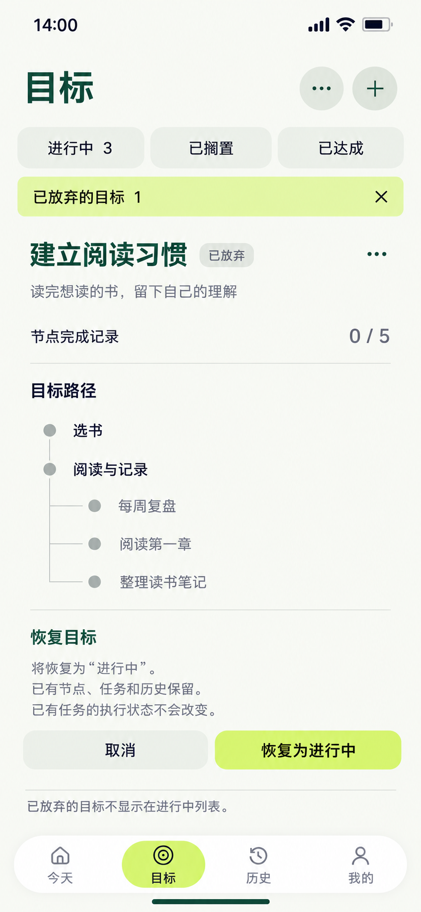

# 22 已放弃目标恢复 — 明确恢复为进行中

2026-10-20。内置imagegen，单页静态候选。目标页的特殊筛选与当前Goal内确认状态；保留顶层标题、普通状态筛选和底部导航，不新增独立回收站路由。

依据：[Goal状态与放弃恢复](../../v1.0/领域模型.md#21-goal-状态)、[Goal数据边界](../../v1.0/数据模型.md#21-goal)、[原列表更多入口](02-目标页设计说明.md#与今天页一致的规则)、[21状态选择](21-目标状态切换页设计说明.md#四状态复用与恢复)。

## 样例分支与当前事实

20中的节点排序已经保存。随后在21的同一状态选择区，用户将候选从“已搁置”改成“放弃目标”，明确点“确认放弃目标”并保存成功；这不是从搁置自动变为放弃。进行中从4变3，该Goal从普通列表隐藏。用户再通过目标页更多操作打开“已放弃的目标”，本样例只有这1个匹配项。

当前“建立阅读习惯”的正式状态为DROPPED，恢复动作尚未确认。顶部进行中3、特殊筛选已放弃1均为已保存事实。普通三个筛选均不选中，额外浅柑橘筛选条明确当前正在看已放弃项；其×退出本筛选。

放弃Goal不等于归档节点：五个节点仍有效、归档0、完成记录0/5。根节点仍“选书”“阅读与记录”，后者子节点仍按20保存后的“每周复盘”“阅读第一章”“整理读书笔记”排列。树中没有建任务入口或完成勾。样例没有关联Mission，说明文字只解释一般保留规则，不伪造已有执行记录。

| 时点 | Goal | 进行中 / 已放弃 | 节点与统计 |
| --- | --- | --- | --- |
| 本图、取消或恢复失败 | DROPPED | 3 / 1 | 有效5、归档0、完成记录0/5 |
| 明确确认恢复并保存成功 | ACTIVE | 4 / 0 | 同一5节点、同一顺序，仍0/5 |

数量假定其他目标未改变；实际从真实数据查询。恢复不重建Goal或节点、不复制任务、不改变任何任务执行事件、排期、材料、历史，也不复活已关闭任务。若其他样例含已归档节点，恢复Goal后这些节点仍归档，需单独按19处理。

## 逐项跳转与恢复

| 控件 / 操作 | 去向与结果 | 保存与错误处理 |
| --- | --- | --- |
| 页面标题右侧…→已放弃的目标 | 原位切换特殊筛选、显示匹配Goal，保留底部导航 | 与卡片…区分：页面菜单管列表；卡片菜单管当前Goal；＋仍只创建目标 |
| 特殊筛选条× | 返回进入特殊筛选前的普通筛选及滚动位置 | 若恢复尚未提交，可取消本次确认后直接返回；没有文本草稿，不要求重复丢弃确认 |
| 已放弃目标行 / 卡片…→恢复目标 | 在当前Goal树下原位展开本图确认，明确“将恢复为进行中” | 只选择对象与操作，没有提前恢复或增加进行中数 |
| 恢复为进行中 | 同区提交中；成功后Goal改为ACTIVE | 重读同一Goal及当前状态，原子保存；防重复；不写节点archivedAt或任何Mission事件 |
| 恢复成功 | 保持已放弃筛选，当前Goal离开列表、数量1→0，显示“暂无已放弃的目标”和回执“目标已恢复 · 查看” | 查看是可选原位切换进行中并定位同Goal；不强制跳转成功页；列表空了也保留关闭筛选入口 |
| 取消 | 收起当前恢复确认，保持已放弃树和筛选 | 正式状态仍DROPPED，不删除或恢复任何数据 |
| 目标路径展开/收起、卡片更多查看 | 本Goal内切换只读内容；确认未提交时收起确认再执行所选查看动作 | 不暗中确认；当前恢复意图无需文本草稿丢弃提示 |
| 普通筛选、底部导航、＋、系统返回 | 未提交时取消恢复确认，再按目标动作离开/查看 | 系统返回优先收起确认，再退出特殊筛选，之后遵循顶层返回规则；提交结果不明时先处理结果 |
| 保存失败 | 保留当前Goal、确认和原统计，说明“目标未恢复，请重试”并保留取消 | 不显示成功、不预加数量；结果不明先查询；Goal已被别处改变时刷新真实状态，不以旧请求静默覆盖 |

正常最坏起点：其他顶层→目标1，页面更多、已放弃筛选、Goal恢复确认与成功反馈原位完成，共1次页面跳转。完整详情可选，不增加必经中转。此图只有1个匹配Goal，不为凑邻项混入进行中的“学会Flutter”。

## 复用与限制

初次进入已放弃筛选时恢复确认区收起；选择一项目标后展开，因此不是为所有行同时铺满恢复表单。无匹配时复用“暂无已放弃的目标”及退出筛选，不伪造占位历史。多个匹配时保留相邻目标，恢复只影响当前Goal，焦点交给下一个合理位置。

恢复到ACTIVE后可新建关联Mission，但关联节点仍须有效；Goal层恢复不能解除归档节点的限制。已有任务无论Goal处于哪个状态，都按自身阶段办理；全局RUNNING冲突、强制材料截止等原规则仍适用。Goal放弃/恢复没有物理删除入口，不弹“永久删除”，不把“恢复5个节点”当作目标恢复动作。

已搁置/已达成重新推进使用21的状态选择复用；本图专门补齐默认隐藏后的可发现入口、恢复目标的明确目的状态和成功后空筛选的关系。静态图不代表应用已实现页面菜单、筛选或恢复事务。

## 动效与视觉核对

特殊筛选切换180ms显隐，保持顶层和列表区域。展开恢复确认360ms改变必要高度，180ms显示说明与动作；按压140ms。确认前不挪走目标、不改计数。仅恢复成功后360ms收起离开当前筛选，180ms更新空状态和回执；失败原位保留。曲线cubic-bezier(.22,.8,.24,1)，减少动态效果直接更新，但保留状态文案与焦点。

沿用暖白、森林绿和浅柑橘，开放树行、细边界及一块必要的Goal分组，不给每个节点单独套方框。已放弃标签可读，不用整卡低透明度假装禁用；主动作是浅柑橘“恢复为进行中”，不使用深色大块。字号角色沿用统一规范。

已核对原生853×1844、复制哈希一致，未拉伸裁切；目视核对页面更多与＋、特殊筛选1/×与进行中3、已放弃标识、两根三子及其顺序、0/5、明确恢复目的、取消/确认和导航，主要文字未见遮挡。两个根节点标记在同一层，三个子节点缩进在“阅读与记录”下；浅色节点点不代表归档或完成。生成明暗为近似，仍按统一纯色定义落地。样例与领域/数据规则已核对，未验证运行中的数据库保存、真实列表筛选、焦点或动画。

[提示词](22-已放弃目标恢复页.prompt.txt) · [全局跳转](页面跳转总表.md) · [覆盖清单](补图覆盖清单.md)。
