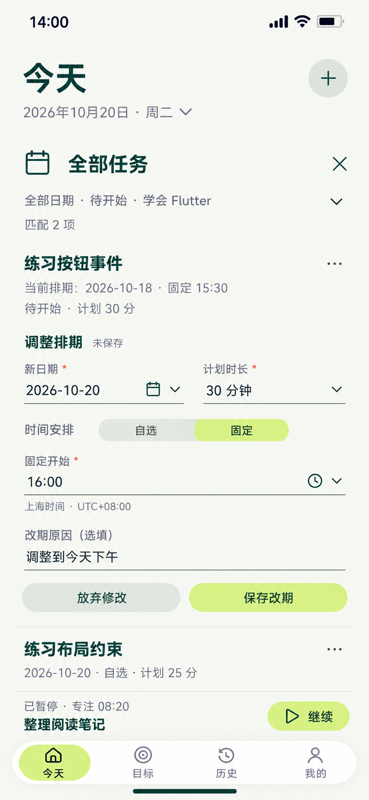

# 25 旧任务改期 — 同一任务追加排期

2026-10-20。内置imagegen，单张静态候选，原生853×1844，未拉伸裁切。承接[24的old任务](24-全部任务筛选页设计说明.md#当前条件与最小样例)，在同一结果行展开排期编辑，保留当前任务身份、相邻结果、Today日期、条件摘要、暂停任务栏及导航，不强制进入新建页。

依据：[排期与有效修改](../../v1.0/领域模型.md#41-排期)、[排期快照字段](../../v1.0/数据模型.md#32-missionschedulerevision)、[待开始编辑规则](../../v1.0/界面与交互.md#51-创建表单)、[05条件字段复用](05-新建任务页设计说明.md#条件组件复用)。

## 保存事实与草稿分开

当前14:00上海时间。任务“练习按钮事件”仍为NOT_STARTED，属于学会Flutter、nodeId为空；没有START、取消、END、报告或材料。完成方式仍SELF_REPORT。顶部当前排期取已保存快照，不随本地输入提前改变。

| 字段 | 现有排期（样例版本1） | 未保存草稿 / 保存成功后新版本2 |
| --- | --- | --- |
| scheduledDate | 2026-10-18 | 2026-10-20 |
| timeZone | Asia/Shanghai | 保持 |
| timePolicy | FIXED | FIXED |
| fixedStartAt（上海） | 2026-10-18 15:30 | 2026-10-20 16:00 |
| plannedDurationMinutes | 30 | 30 |
| evidenceDeadlineAt | null（SELF_REPORT） | null |
| changeReason | 原值 | 用户选填“调整到今天下午” |

后列在明确保存成功前只是草稿。固定时刻的UTC分别为10月18日07:30Z、10月20日08:00Z，均与对应排期日期匹配。新时刻在本样例14:00之后；这不是额外规定所有自报任务排期都必须在未来，过去排期不会自动产生失败或取消。

有效修改后追加完整快照，保留旧版本、同一个Mission.id、Goal/节点归属、标题、Why及ExecutionPlan，不新建Mission。这里尚未START，30分是计划时长，不是已经绑定的执行原计划；之后START才绑定届时最新排期。当前操作不写START/RESUME/END或完成记录，也不改变独立暂停任务“整理阅读笔记”的08:20。

## 控件与跳转

| 操作 | 去向及保存边界 | 失败 / 返回 |
| --- | --- | --- |
| 24旧任务“改期” | 当前行展开本区，原条件折为“全部日期·待开始·学会Flutter”摘要 | 查询条件没有改变；原Start按钮暂收起，不在同一行同时引导开始和保存草稿 |
| 新日期 | 同区日历选择，更新草稿日期；保留明确上海时区 | 固定时刻重组为新日期的合法时刻，最终值可见；非法值定位字段，不清其他输入 |
| 计划时长 | 同区正整数分钟输入 | 0、非整数或空不能提交；不把数值当Focus或计时额度 |
| 自选 / 固定 | 复用05设置；固定展示且要求时刻，自选收起并保存fixedStartAt=null | 不把隐藏的旧固定时刻携入自选快照 |
| 固定开始 | 同区时间选择，和新日期组成完整fixedStartAt | 检查排期时区及日期一致；不自动开始或只改显示文本而漏存日期 |
| 改期原因 | 选填文本，允许留空 | 不因未填写而禁用合法保存，不编造原因 |
| 保存改期 | 原位提交中；事务内重读NOT_STARTED及最新版本，追加完整快照后才反馈“排期已更新” | 状态已开始/取消则拒绝改写；范围或版本已变化先告知并重查，不用旧草稿静默覆盖；失败保留输入，旧排期仍正式有效 |
| 放弃修改 | 丢弃本区草稿，恢复24旧排期行及焦点 | 明确放弃按钮无需再询问一次；不是取消Mission，不写cancelledAt |
| 条件摘要/日期、全部任务×、任务菜单、邻项、暂停任务继续、＋或底部导航 | 有有效变化时先确认“放弃改期修改？”；继续编辑留在本区，放弃才执行原目的动作 | 不静默保存；提交结果未明时先确定结果。仅展开不改值时可直接收起 |

保存成功后，本图“全部日期＋待开始＋学会Flutter”仍匹配两项，不因改期加一条任务，也不因原日期消失减一。原行更新为10月20日固定16:00，不再标“以前未开始”；相邻自选任务仍25分，独立暂停任务仍可达。若其他入口筛选只包含旧日期，成功后按实际条件离开匹配列表，并保留更新回执及可选查看新日期入口，不偷偷改筛选。

其他顶层→今天1，全部任务、改期、日历/时间、保存与反馈均在当前对象区办理，共1次页面跳转；本操作没有系统文件选择。完整06详情可选，不作强制中转。

## 编辑与材料策略复用

普通“编辑任务”复用05字段与本行保存/返回组件：标题改“编辑任务”、动作“保存修改”，允许在待开始时编辑已有Mission，不能调用创建事务造第二个任务。纯元数据修改只更新对应字段，不追加无效排期；实际排期改变或验证策略改变才追加完整快照。无变化时保存禁用，不刷版本或成功回执。

本图仅改排期，其他任务设置保持。可选/强制材料策略的验收方向、条件截止及完整最终值复用05；强制材料在日期或时区变化时重设默认截止并展示，过期默认值要求用户明确修正。旧排期截止留旧版本，不覆盖；提交前截止必须晚于操作时刻，FIXED还晚于固定开始，FLEXIBLE还晚于排期日期起点。SELF_REPORT/OPTIONAL_EVIDENCE的排期截止为空，不为凑字段画虚构期限。

取消任务是另一个需明确确认的动作，本图“放弃修改”不代替它；保存本改期后再选择取消的画面见[26](26-取消任务确认页设计说明.md)。开始后元数据、方案与排期锁定；不能通过改期界面复活已结束或已取消Mission，重试仍应创建有来源关系的新任务。

## 动效及核对边界

原任务下方360ms展开编辑区并推动邻项，筛选折为摘要以保留空间，不替换整个Today；文字180ms显现、按压140ms。输入只更新草稿和未保存标识，不提前更新当前排期/匹配数。保存成功才更新原行、收起编辑区和显示回执；失败保留草稿，放弃回原值，焦点回原任务。减少动态效果时直接切换并保留状态文字与焦点，曲线cubic-bezier(.22,.8,.24,1)。

开放输入边界、并排日期/时长、轻色局部按钮沿用统一样式；任务/输入18/24、动作16/24、辅助14/20、触达至少48。键盘时滚动定位，不缩字号遮住保存操作。已核对原生尺寸853×1844、复制哈希一致；目视核对旧排期/新草稿区分、条件摘要与匹配2、30分钟/固定16:00/上海时区、选填原因、放弃/保存、邻项及暂停08:20，主要文字未见遮挡。生成颜色为近似，实施仍以统一纯色定义为准。样例日期/UTC与同Mission快照边界已核对；静态设计不证明排期事务、并发检查、键盘或动效已运行通过。

[提示词](25-旧任务改期页.prompt.txt) · [跳转总表](页面跳转总表.md) · [覆盖清单](补图覆盖清单.md)。
