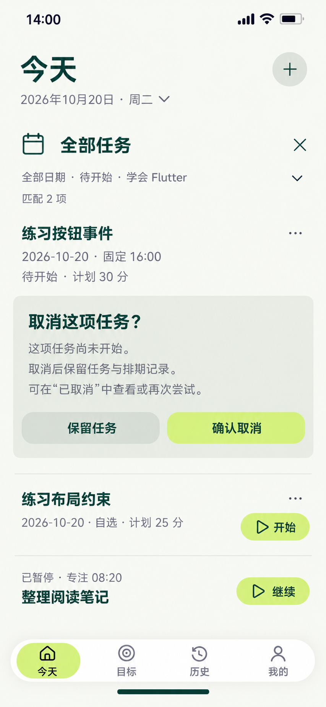

# 26 取消任务确认 — 取消不是删除或结束报告

2026-10-20。内置imagegen，单张静态候选，原生853×1844，未拉伸裁切。承接25中用户已明确保存改期成功之后：同一“练习按钮事件”排到10月20日16:00、计划30分，改期草稿已结束。随后从该任务菜单选择取消，在原任务下展开本确认，不是放弃25的编辑草稿。

依据：[取消与再次尝试](../../v1.0/领域模型.md#53-材料阶段与取消)、[阶段主操作](../../v1.0/界面与交互.md#52-详情主操作)、[Mission取消字段](../../v1.0/数据模型.md#31-mission)、[25排期保存](25-旧任务改期页设计说明.md#保存事实与草稿分开)。

## 当前事实与待确认范围

当前14:00上海时间。Goal仍学会Flutter、nodeId为空，策略SELF_REPORT。目标Mission仍NOT_STARTED，cancelledAt为空，没有START、END、报告、材料或失败记录。用户只是打开确认，还没有取消，不能提前显示“已取消”或让它从列表消失。

日期/阶段/Goal条件仍为全部日期、待开始、学会Flutter，匹配2项。确认仅针对“练习按钮事件”，不包含相邻“练习布局约束”，也不影响全局独立PAUSED任务“整理阅读笔记”的08:20。原排期及已追加的新排期都已保存，本操作不改排期历史。

| 时点 | 目标任务事实 / 阶段 | 当前待开始匹配 | 本最小集合已取消匹配 |
| --- | --- | --- | --- |
| 本图、保留任务或取消保存失败 | cancelledAt为空、无START，NOT_STARTED | 2 | 1（24中原有另一条） |
| 明确确认且保存成功 | 写真实cancelledAt、无执行事件，CANCELLED | 1 | 2 |

四个Mission身份都保留，不因取消变成三条数据。取消不产生END、用户未完成FailureRecord、执行时长、完成标记或材料要求；Goal节点覆盖不增加。它也不算完成报告，不能用完成动画或失败惩罚色来反馈。

## 逐项确认、跳转与回退

| 操作 | 去向及反馈 | 事实与失败处理 |
| --- | --- | --- |
| 任务…→取消任务 | 在同Mission下展开本区，暂收起该任务的开始/改期动作 | 重查仍未开始；不先写cancelledAt，不删除原记录 |
| 保留任务 | 收起本确认，回同一任务、原筛选与位置 | 没有数据写入，不叫“恢复”，也不额外再问一次是否保留 |
| 确认取消 | 原位提交中，事务内重读NOT_STARTED并写取消时刻 | 点击本按钮即明确确认，不再叠相同确认；防重复；不写START/END或失败记录 |
| 成功 | 任务离开待开始结果，匹配数按真实查询2→1；原位回执“任务已取消 · 查看” | 邻项自然补位；当前暂停任务仍可达；不强制跳历史或成功页 |
| 回执查看 | 原位切到已取消阶段，仍保留全部日期与Goal条件，定位同Mission | 本最小集合此时2项；它有取消时间和最新计划，但没有执行记录、报告或Focus |
| 已取消任务→再次尝试 | 打开05新建草稿，带合法RETRY来源，用户确认保存后才生成新Mission | 日期默认今天、自选时间，策略/方案按规则预填；不复制取消、执行事件或报告，不把旧Mission改回待开始 |
| 全部任务×、日期/条件摘要、顶部＋、导航或系统返回 | 取消本次未提交确认，再按原目的查看/离开 | 这里没有输入草稿，无需再弹放弃文本提示；离开不等于确认取消 |
| 邻项开始 / 暂停栏继续 | 收起本确认后处理用户明确选择的另一Mission | 不取消本目标；各自仍需START/RESUME事实及全局RUNNING冲突校验 |
| 提交失败 | 保留确认、任务真实阶段和当前统计，给原因及重试/保留入口 | 不先让任务消失；结果不明先查真实状态，不重复改写首次取消时间 |
| 确认期间任务已经开始 / 状态被改变 | 拒绝旧取消请求，刷新同Mission真实状态与合法操作 | RUNNING/PAUSED只能通过结束报告处理，不能为完成旧请求补一次取消；已取消时展示实际结果，不重写cancelledAt |

正常最坏起点：其他顶层→今天1，全部任务、选择、确认、反馈和查看已取消都在本页对象区办理，共1次页面跳转。再次尝试才按用户选择进入新任务表单，不是取消的必经后续动作。

## 复用边界

Today日程、全部任务、Goal/节点任务区及未开始详情都复用同一取消确认，始终显示当前Mission标题与最新排期，不只给一个无对象的通用“确定吗”。它不接收一批任务，不添加未定义的取消原因字段，不出现物理删除入口。

取消后关闭确认与关闭结果都不会再改任务状态。没有直接“恢复原任务”入口；“再次尝试”按既有RETRY规则创建不同ID的新Mission并保留sourceMissionId/relationType。归属若不再合法，需要用户明确选择并校验，不为通过创建静默搬到别的Goal或复活归档节点。

已经START的任务隐藏取消入口；“放弃执行”必须走08未完成报告，记录END与相应事实，不能复用本取消来规避已有执行历史。CANCELLED不再允许编辑或改期，查看取消记录与再次尝试仍可用。

## 动效与静态核对

确认区在原任务下360ms展开，相邻列表随高度变化，说明180ms显现，按压140ms；不遮掉任务身份或底部当前任务。保留时反向收起并回到触发菜单焦点。只有取消保存成功后360ms移出当前匹配结果并更新实际数字，180ms回执；失败保持任务及确认。减少动态效果直接切换，保留范围文字与焦点，曲线cubic-bezier(.22,.8,.24,1)。

只用一处必要的浅色确认分组，邻项仍开放行；主动作浅柑橘、文字森林绿，保留任务用中性浅色。不用垃圾桶、红色惩罚、完成勾或不存在的评分。任务18/24、确认标题24/32、动作16/24、辅助14/20；触达至少48逻辑像素。

已核对原生853×1844/复制哈希一致；目视核对已保存新排期16:00、待开始与匹配2、明确取消目标和范围、无原因字段、保留/确认、邻项/暂停08:20及浅色导航，主要文字未见遮挡。尚未提交时不显示已取消，邻项与暂停任务在确认范围外；颜色为生成近似，实施仍按统一纯色定义。样例取消前后计数、ID/排期及无执行事实边界已核对；静态审查不证明取消事务、并发重读、查询或动效运行通过。

[取消保存后出现另一RUNNING的开始冲突](27-执行任务冲突页设计说明.md) · [提示词](26-取消任务确认页.prompt.txt) · [跳转总表](页面跳转总表.md) · [覆盖清单](补图覆盖清单.md)。
