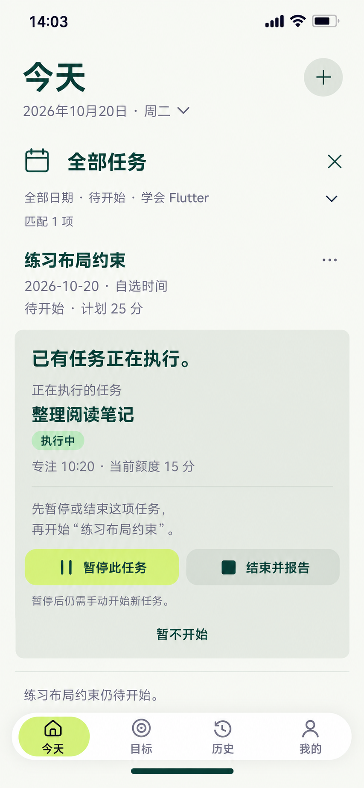

# 27 执行任务冲突 — 先处理唯一RUNNING

2026-10-20。内置imagegen，单张静态候选，原生853×1844，未拉伸裁切。Today当前任务区原位并列展示请求开始的Mission与冲突的另一Mission，保留日期、筛选、对象身份及导航；不新增冲突详情中转页。

依据：[全局RUNNING与事件合法性](../../v1.0/领域模型.md#42-事件与合法性)、[原任务区冲突处理](../../v1.0/界面与交互.md#6-执行任务)、[结束先暂停后报告](../../v1.0/界面与交互.md#7-结束确认)、[计时口径](../../v1.0/领域模型.md#6-时间口径)。

## 两个对象与样例时点

承接26取消已明确保存成功之后：练习按钮事件仍保留但为CANCELLED，待开始筛选匹配数由2变1。用户又于14:01明确继续独立任务“整理阅读笔记”，这次RESUME已经成功；到14:03尝试开始另一项“练习布局约束”时被全局唯一RUNNING规则阻止。

| 对象 | 当前事实 | 本图动作范围 |
| --- | --- | --- |
| 请求开始：练习布局约束 | 学会Flutter、nodeId空；10月20日FLEXIBLE、计划25分；无START/取消，NOT_STARTED | 请求被阻断，尚未开始，不显示Focus或执行额度 |
| 正在执行：整理阅读笔记 | 独立Mission；计划15分、无追加额度；START13:10、PAUSE13:18:20、RESUME14:01，无END | 唯一RUNNING，只有本命名区域的暂停/结束动作可改变它 |

14:03:00快照：整理阅读笔记的Elapsed53分=3180秒，Paused42:40=2560秒，Focus10:20=620秒；原计划/当前额度15分。它来自24的同一独立任务，不是07的setState任务，也没有因被别的任务请求而自动暂停。UI中的“新任务”指接下来要开始的已有待办，不是在此创建一个Mission。

全部日期/待开始/学会Flutter仍匹配1项，冲突的独立RUNNING不计入它。没有新START、END、FailureRecord、自动排队或延迟启动；阻断请求也不是任务失败。当前任务已在冲突区突出显示，因此不再重复一条全局快捷栏。

## 逐项处理与跳转

| 操作 | 保存及去向 | 目标任务与失败边界 |
| --- | --- | --- |
| 待开始任务“开始”被阻断 | 在原任务下显示本区，保留两个明确名字和真实状态 | 不静默PAUSE其他任务，不给目标写START，不在后台排队自动开始 |
| 暂停此任务 | 明确对“整理阅读笔记”写PAUSE，成功后显示已暂停及目标的“开始”动作 | 只暂停该Mission，不同时启动练习布局约束；Focus冻结在真实PAUSE事件值，不能把截图10:20硬编码为点击时长 |
| 暂停后点击目标开始 | 再次事务内重读目标NOT_STARTED与全局无RUNNING，合法才写START | 不因为刚看过成功提示就跳过重查；若有新冲突重新呈现；目标按自己的最新排期绑定25分 |
| 结束并报告 | 先PAUSE“整理阅读笔记”成功，再在同上下文展开它的08报告组件 | 这不是练习布局约束的报告；初次无默认选择，明确确认才写END；本样例该独立任务为SELF_REPORT |
| 取消报告 | 回原区，整理阅读笔记仍PAUSED，目标仍NOT_STARTED | 不自动RESUME、不自动START目标；用户可选择开始目标或明确继续原任务 |
| 报告确认成功 | 按该Mission真实策略结束并反馈；保留目标开始入口 | 不强制增加结果页；处理完另一任务也不自动执行原开始请求 |
| 暂不开始 | 收起冲突提示，目标仍待开始；另一任务继续RUNNING | 无事件写入；恢复正常全局RUNNING快捷栏，不能冻结它的计时或丢失控制 |
| 请求任务名/菜单 | 收起未提交冲突查看请求任务的原位详情或合法未开始操作 | 不能把另一RUNNING的事件/报告归到请求任务上；可选独立详情实际增加跳转 |
| 日期、条件摘要、全部任务×、＋、导航或系统返回 | 退出未提交冲突，再执行对应查看/创建动作 | 没有输入草稿，无须假造丢弃文本确认；离开不改变两个任务的阶段；进行中的写入先确定结果 |
| 暂停/报告保存失败、另一任务已自行变化 | 保留真实状态并重查对象、给原因与重试 | 不先展示已暂停或目标已开始；原RUNNING若仍在跑，Focus继续推导；若已暂停/结束，提示事实并提供目标明确开始，不补重复事件 |

所有“暂停此任务 / 结束并报告”控件均隶属于命名为“整理阅读笔记”的区域，不因它不符合Goal筛选而删除。没有两个任务都可点的无对象“继续”按钮，也没有隐藏的暂停并自动开始组合操作。

正常最坏起点：其他顶层→今天1，选任务、冲突、暂停/结束报告、明确开始目标及反馈均保留对象区；系统文件选择及返回另占2跳。原位冲突不得整页盖掉目标，再称作零跳转。可选完整任务详情不作必经中转。

## 清除冲突后的状态

暂停或结束原任务后，当前筛选仍匹配1项，直到练习布局约束的START保存成功。开始成功后，它离开待开始结果，匹配1→0，但同Mission的执行控制继续在原位当前任务区，不因筛选空了而消失。原独立任务若只是暂停，保留其事件与冻结Focus，之后从其他暂停任务入口可达；不会自动取消或记未完成。

“恢复某个已暂停任务”遇到另一个RUNNING时复用本组件：请求方状态/动作改为PAUSED/继续，成功清除冲突后仍由用户明确RESUME请求方。不能用START重启已有任务。进入报告、提交材料等本就不要求独占RUNNING的查看动作不应滥用此阻断。

## 动效与核对边界

冲突区360ms展开并推动必要内容，状态/说明180ms显现，按压140ms；没有遮罩、闪红或失败评分。显示提示期间唯一RUNNING继续计时，不能为了画面静止偷偷写PAUSE。实际PAUSE成功后才冻结其Focus并提供下一步；失败不播放成功切换。报告按对应Mission收为冻结摘要，取消后保持暂停。减少动态效果直接切换，保留两个名字、状态和焦点，曲线cubic-bezier(.22,.8,.24,1)。

仅一块必要的浅色冲突分组，当前15分额度与10:20使用紧凑摘要，不占用完整执行页的大环。任务18/24、冲突标题24/32、动作16/24、辅助14/20，触达至少48；浅柑橘用于明确暂停动作，不用深绿大块。

已核对原生853×1844/复制哈希一致；目视核对14:03与匹配1、请求任务25分待开始、另一任务RUNNING/10:20/15分、暂停/结束并报告/暂不开始、请求方仍待开始的文案、无重复快捷栏与导航，主要文字未见遮挡。生成颜色为近似，实施仍按统一纯色定义；样例时长及唯一RUNNING边界已核对。静态审查不证明全局事务、事件竞争、持续计时或动效运行通过。

[暂不开始后继续运行并达到额度](28-额度到达与延长页设计说明.md) · [提示词](27-执行任务冲突页.prompt.txt) · [跳转总表](页面跳转总表.md) · [覆盖清单](补图覆盖清单.md)。
