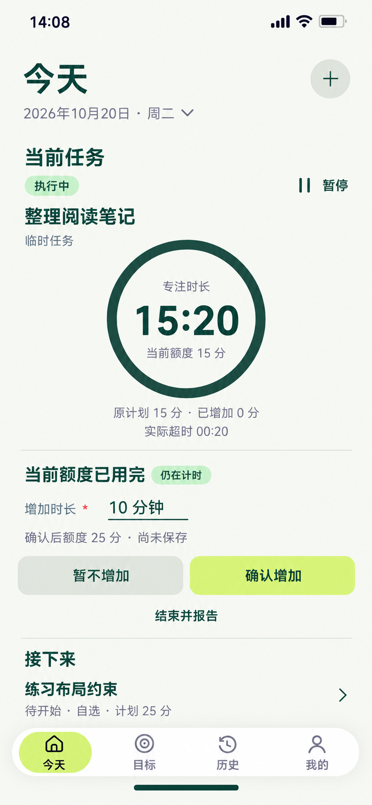

# 28 额度到达与延长 — 增加投入额度，保留原计划

2026-10-20。内置imagegen，单页静态候选，原生853×1844，未拉伸裁切。承接27中用户选择“暂不开始”，未暂停或结束整理阅读笔记；收起全部任务后回Today当前任务区继续执行。临时任务身份、当前状态和邻项保留，不新增额度向导页。

依据：[投入/原计划/当前额度与超时](../../v1.0/领域模型.md#6-时间口径)、[EXTEND事件边界](../../v1.0/领域模型.md#42-事件与合法性)、[执行交互](../../v1.0/界面与交互.md#6-执行任务)、[暂停态复用](07-执行任务页设计说明.md#运行暂停与额度复用)。

## 时点与未保存预览

任务仍是独立Mission“整理阅读笔记”，SELF_REPORT、无Goal/节点。START13:10、PAUSE13:18:20、RESUME14:01；目前没有EXTEND或END。14:07:40时Focus首次达到15分，本图14:08:00已经超出20秒；达到阈值没有自动PAUSE、END、失败记录或完成报告。

| 查询 / 草稿 | 本图值 | 依据 |
| --- | --- | --- |
| Phase | RUNNING，仍在计时 | 最新执行切换为RESUME |
| Elapsed / Paused | 58:00 / 42:40 | 从START至当前，扣除暂停区间 |
| Focus | 15:20 = 920秒 | 3480 − 2560 |
| Original Planned / Granted Extension | 15分 / 0分 | START绑定原排期及已保存EXTEND之和 |
| Current Budget | 15分 = 900秒 | 原计划15 + 已加0 |
| Actual Overtime | 00:20 | max(920 − 原计划900, 0) |
| 环 | 满环 | min(Focus/Current Budget, 1)，不回绕 |
| 尚未保存的增加输入 | 10分钟 | 用户填写，不算作已加额度 |
| 确认后额度预览 | 25分钟 | 当前15 + 草稿10；不是已保存事实 |

输入或打开额度提示时，RUNNING的Focus仍随事件/当前时间增长；图上15:20是快照，不是编辑时冻结。实际点击时间不能硬编码为14:08。环不表示任务完成、掌握度或剩余倒计时。

确认成功只追加正10分钟EXTEND，保留原排期15分钟，不把排期改成25、不重新START、不清零Focus。若比较同一计算时刻，920/1500为61.333%，实际超时仍20秒；真实确认后显示按当时最新Focus计算，后续仍可增加。实际超时始终相对原计划，不因新增额度而被抵消。

## 控件、确认与回退

| 操作 | 结果 / 去向 | 保存与失败边界 |
| --- | --- | --- |
| 达到额度→继续 | 在本Mission下原位展开本增加输入区，当前画面为已展开状态 | 初始到达提示提供结束/继续，选择继续不写EXTEND、不把已加0提前改10 |
| 增加时长 | 当前区正整数分钟输入，即时计算“确认后额度”预览 | 空、0、负数、小数或非法值原字段提示并禁用确认，不改原计划；输入不是提前保存 |
| 确认增加 | 事务内重查本Mission为RUNNING/PAUSED，再追加EXTEND，成功更新实际额度和回执 | 只保存一次正分钟数，RUNNING仍RUNNING、PAUSED仍PAUSED；不顺带RESUME、END或新建任务 |
| 暂不增加 | 丢弃此次输入并收起增加区，保留达到额度的实际提示和再次延长入口 | 不暂停或结束，不加额度；明确暂不增加无需再询问是否丢弃 |
| 暂停 | 为同Mission保存PAUSE，冻结真实事件时刻Focus，控件变继续 | 同任务的增加草稿保留；提示改为已暂停，不继续显示“仍在计时”；确认增加也不自动RESUME |
| 已暂停后继续 | 明确RESUME并重查全局RUNNING冲突，必要时复用27 | 增加额度不等于继续执行；不能调用START重启同Mission |
| 结束并报告 | 先PAUSE成功，再在此Mission下展开08报告组件 | 未确认增加不写EXTEND；保留草稿供取消报告返回；明确确认END后草稿失去提交条件并结束执行编辑 |
| 取消报告 | 仍PAUSED，返回同任务和未提交的增加草稿 | 不自动恢复计时；当前额度仍为已保存值；不能把输入10当已加10 |
| 接下来任务→详情/开始 | 先处理离开当前增加草稿的保留/放弃，再查看同一邻项；开始遇本RUNNING按27处理 | 不因当前额度到达而自动开始下一个任务；邻项练习布局约束仍NOT_STARTED、计划25分 |
| 日期、＋、导航或离开任务区 | 有变化的输入先确认放弃或继续编辑；无输入可正常查看/返回 | 页面切换本身不PAUSE、END或EXTEND；保留同Mission可达性 |
| 写入失败或结果不明 | 保留输入与当前真实阶段/额度，说明原因并重查结果 | 不先把额度改25；RUNNING仍继续计时；不重复追加相同请求 |
| 额度已由其他入口改变 / Mission已结束 | 重读当前事实；需重新呈现有效预览并由用户确认，已结束拒绝EXTEND | 不用旧预览覆盖实际额度或复活结束任务；Current Budget是派生值，不直接写一个总数冒充事件 |

同一额度阈值在一次前台会话只提示一次，刷新与输入每秒变化不能反复弹框。成功新增EXTEND后按新阈值判断。用户暂不增加或忽略提示仍可以继续RUNNING，实际投入及超时如实展示，不因未选择新额度而自动造暂停或结束。新增额度只要求合法正整数，不把“必须清除已发生超时”作为隐藏条件。

## 复用与跳转

07普通“延长时间”入口复用本输入/预览/确认组件，不必先达到额度；PAUSED分支换状态文案与继续动作，仍保留输入、原计划和真实已加额度。NOT_STARTED只编辑排期时长，不能写EXTEND；CLOSED/CANCELLED也不能延长。

本图是执行额度，不是材料截止。SELF_REPORT在报告完成后可直接结束；材料截止、材料超时与可选材料放弃仍走对应既有规则，不能把Focus超过计划时长当作材料未按时提交或失败。

正常最坏起点：其他顶层→今天1，当前任务、额度提示、增加、确认、暂停或报告/反馈均保留原对象区；如其他材料策略需文件选择，系统进入与返回另占2跳。图中已显示当前任务，不重复全局快捷栏；独立07专注视图可选，不作必经中转。

## 动效与核对边界

同一Mission的额度区360ms展开，输入/预览180ms显现，按压140ms。只有EXTEND成功后已加数字和当前额度统一变化、环360ms重算到新比例；不能从0重新填环或抹掉实际超时。原计划15保持，RUNNING每秒从事件推导Focus，不靠装饰动画模拟；失败保留原额度和输入。PAUSE成功才停Focus，结束报告时环收为冻结摘要。减少动态效果直接切换并保留数字、阶段和焦点；曲线cubic-bezier(.22,.8,.24,1)。

使用开放元数据、下划线输入和浅色动作，必要计时环有明确业务含义；任务18/24、计时48/56、区块/动作16/24、辅助14/20，触达至少48。键盘出现允许滚动并保留安全区，不能为凑齐所有控件而缩小输入。

已核对原生853×1844/复制哈希一致；目视核对14:08、RUNNING/仍在计时与暂停、15:20/当前15、原计划15/已加0、实际超时00:20、草稿10与25分尚未保存预览、确认/暂不增加/报告、邻项及浅色导航，主要文字未见遮挡。满环没有完成勾、没有自动改额度或阶段；颜色与圆形图为生成近似，实施仍采用统一纯色与公式。样例时长、阈值及确认前后比例已核对；静态核对不证明额度事务、持续计时、阈值去重或动效运行通过。

[未确认增加而选择未完成报告](29-未完成报告页设计说明.md) · [提示词](28-额度到达与延长页.prompt.txt) · [跳转总表](页面跳转总表.md) · [覆盖清单](补图覆盖清单.md)。
