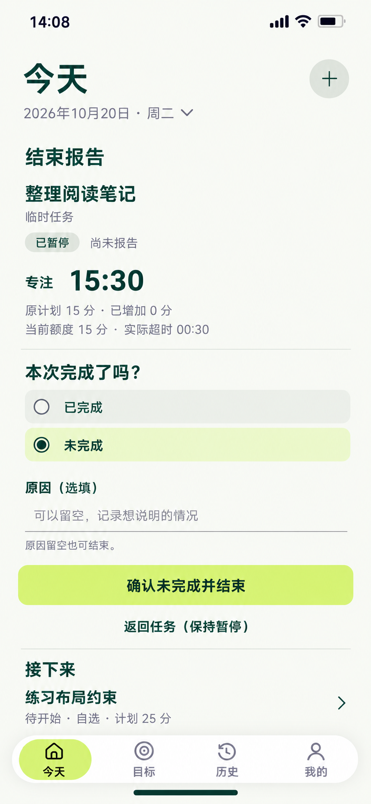

# 29 未完成报告 — 原因选填，确认后才结束

2026-10-20。内置imagegen，单张静态候选，原生853×1844，未拉伸裁切。承接28的整理阅读笔记：用户未确认增加10分钟，直接选择结束并报告；14:08:10的PAUSE已保存，原大环收为冻结摘要，在同任务区展开报告，保留Today日期、对象与邻项。

依据：[用户报告与原因](../../v1.0/领域模型.md#43-用户报告与可选材料决定)、[END分流](../../v1.0/领域模型.md#52-end-的分流矩阵)、[未完成记录](../../v1.0/领域模型.md#82-failurerecord)、[记录字段](../../v1.0/数据模型.md#52-failurerecord)、[报告交互](../../v1.0/界面与交互.md#7-结束确认)。

## 当前事实与选择

整理阅读笔记仍是独立SELF_REPORT任务。START13:10、PAUSE13:18:20、RESUME14:01、PAUSE14:08:10；没有EXTEND或END。28的10分钟输入只在页面草稿中，没有改原计划或当前额度。本图14:08:20：

| 值 | 当前事实 |
| --- | --- |
| Phase / 正式报告 | PAUSED / 尚未报告 |
| Elapsed / Paused | 58:20=3500秒 / 42:50=2570秒 |
| Focus | 15:30=930秒，第二次PAUSE后冻结 |
| 原计划 / 已加 / 当前额度 | 15 / 0 / 15分钟 |
| Actual Overtime | 00:30，相对原计划15分 |
| 用户页面选择 | 未完成，未确认 |
| 原因文本 / 分类 | 都空；图中文字为placeholder，不是已输入原因 |
| END / FailureRecord / Evidence | 均未产生 |

第一次进入报告不代选，未选时确认禁用；本图是用户主动选了未完成之后，虽然原因空，确认仍可用。选中圆点是单选状态，不是完成勾或已保存报告。超过原计划不自动推断未完成，当前选择来自用户；不能由00:30超时生成失败记录。

## 逐项跳转与保存

| 操作 | 当前区 / 去向 | 事实与错误处理 |
| --- | --- | --- |
| 28结束并报告 | RUNNING先PAUSE成功再展开本区；已经PAUSED则不重复PAUSE | 成功前不显示冻结成功；PAUSE之后无END，取消报告也保持PAUSED |
| 未完成单选 | 展开原因选填区，主操作“确认未完成并结束” | 选择只改草稿，不写报告、不更新完成统计、不生成失败记录 |
| 原因输入 | 当前任务内可选文本，允许留空 | 不设置必填星号；不根据输入长度惩罚或禁用合法结束；不推断能力、健康或自动生成原因分类 |
| 确认未完成并结束 | 单事务保存END.userReportedResult=NOT_COMPLETED及恰好一条USER_MARKED_NOT_COMPLETED记录，成功派生CLOSED | 原因可null，记录不可省；END.reason为空，原因只存FailureRecord；submitOptionalEvidence为空。防重复，不能只写一半END/记录 |
| 成功结果 | 在同Mission原位显示已结束及“未完成”事实、冻结时间、原因未填写及可选再次尝试 | 不用完成勾、AI诊断或“取消任务”；不自动改到明天。当前任务栏不再把此CLOSED任务当可继续任务 |
| 返回任务（保持暂停） | 返回同任务PAUSED控制，保留选择/原因草稿及未确认的增加输入供本上下文返回 | 不RESUME、不END、不丢弃正式PAUSE；要恢复计时须明确继续，若有另一RUNNING按27处理 |
| 已完成单选 | 同一区切到该任务策略对应的完成确认；本例SELF_REPORT直接结束分支 | 不把未完成原因偷偷带成已完成的FailureRecord；草稿可供切回，正式写入按最后明确选择 |
| 接下来任务或日期、＋、导航、系统离开本任务区 | 有未提交选择/原因时按草稿规则继续编辑或确认放弃，再执行所选动作 | 只放弃报告草稿，不撤销PAUSE，不伪造已结束；不能把报告提交给邻项练习布局约束 |
| 保存失败 / 时间倒退 / 任务已被其他入口处理 | 保留可恢复选择和文本，显示真实状态及原因，重查实际结果 | 无部分END/未完成记录；结果不明先查；已有END不可覆盖，不盲目追加第二个END |

例如14:08:30明确确认成功：Elapsed3510秒、Paused2580秒、Focus仍930秒；END和未完成记录occurredAt同为实际确认时刻。示例不能硬编码到真实操作。没有材料上传、EVIDENCE_PENDING或材料超时记录，Goal节点覆盖不增加；独立任务本来也没有可被“顺便完成”的Goal/节点。

邻项练习布局约束仍未开始。原任务结束后，Today可按既有优先级突出这条可开始任务，但不自动START它。再次尝试沿用05，确认保存才创建有RETRY来源的新Mission，不复活或改写本END报告。

## 三种材料策略下的未完成复用

NOT_COMPLETED在SELF_REPORT、OPTIONAL_EVIDENCE、REQUIRED_EVIDENCE下都复用本选择/原因/确认组件，成功均为CLOSED且保存用户未完成记录；不强制交材料、不记录材料超时，也不要求可选材料决定。submitOptionalEvidence必须null，不是为了方便写false。

只有用户切到COMPLETED才按真实策略显示后续差异：自报直接结束，可选材料明确选择直接结束或稍后提交，强制材料展示确切截止及是否过期。可选材料的专门视觉状态仍待补，本图不能据此称全部报告分支已有图片。

完整正常路径：其他顶层→今天1，任务执行/结束先暂停、报告选择、确认和反馈均在本对象区；未完成没有系统选择器或材料路由。不能把“结束”拆成强制第二次确认页。可选完整记录属于用户主动阅读，不是提交必经步骤。

## 动效与核对边界

PAUSE成功后大环360ms收为28/36的冻结摘要，报告文字与选项180ms显现，保留任务名与阶段。切未完成时原因区360ms展开、按钮文案随选择更新；不提前播放结束成功动画。确认成功才更新阶段和结果；失败保持草稿，返回仍暂停。按压140ms、曲线cubic-bezier(.22,.8,.24,1)；减少动态效果直接切换并保留状态、可空原因及焦点。

中性开放单选行、下划线写作区和浅柑橘主动作；原因未填不是红色错误，未完成不是惩罚评分。任务/输入18/24、报告问题28/36、冻结时间28/36、动作16/24、辅助14/20，触达至少48；键盘可滚动，不遮挡确认。

首次请求连接失败未生成图片，同提示词内置重试后成功。已核对原生853×1844/复制哈希一致；目视核对暂停/尚未报告、15:30与原计划15/已加0/当前15、超时00:30、未完成单选、灰色placeholder而非已填原因、可用确认、保持暂停返回、邻项及浅色导航，主要文字未见遮挡。颜色为生成近似，实施仍按统一纯色定义；样例计时与空原因的事务边界已核对。静态核对不证明END/FailureRecord事务、并发或动效运行通过。

[提示词](29-未完成报告页.prompt.txt) · [跳转总表](页面跳转总表.md) · [覆盖清单](补图覆盖清单.md)。
