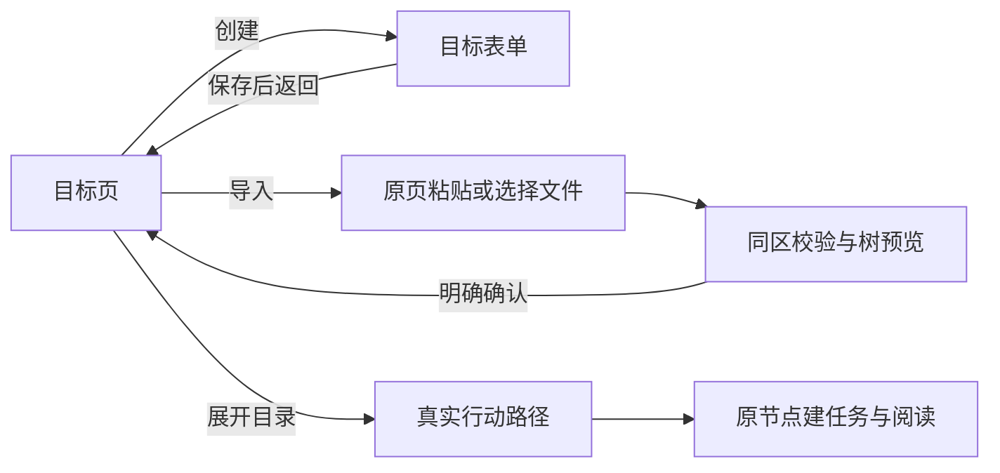

# 颜色层级、图形引导与自适应工作区审查

2026-10-26。用户授权直接重构，并先保存全部原有改动。原有39个文件已独立提交并推送为 `cf64c90`，保存前静态检查与428项测试通过。本次在此基线上修改呈现与目标入口，不改变数据库、任务事件或目标状态规则。

## 设计哲学与依据

用户本轮明确：少文本，多语义图片、图形和能引导理解的动效；平板与Windows应利用可用空间重排真实功能，提高办理效率。对应的项目选择如下，不能把这些选择说成Flutter语法要求。

| 依据 | 本项目采用的判断 |
| --- | --- |
| [Android颜色角色](https://developer.android.com/design/ui/mobile/guides/styles/color)、[Material颜色使用](https://developer.android.com/develop/ui/compose/designsystems/material3) | 背景、内容、操作和状态分配不同颜色角色；品牌色不等于所有容器都染色。默认辅助控件不再自动使用亮柑橘。 |
| [NN/g视觉设计原则](https://www.nngroup.com/articles/principles-visual-design/) | 面积、对比、位置共同影响注意力；大面积深绿空态会盖过真正的主要操作。 |
| [NN/g空状态](https://www.nngroup.com/articles/empty-state-interface-design/) | 明确空状态与下一步入口；用贴合场景的图像辅助理解，不编造目标、完成数或掌握度。 |
| [NN/g交互启发原则](https://www.nngroup.com/articles/ten-usability-heuristics/) | 直接创建减少一次选择；导入独立、预览和确认保留；错误、未知保存结果与草稿保护不能被视觉精简抹掉。 |
| [WCAG颜色](https://www.w3.org/WAI/WCAG22/Understanding/use-of-color.html)、[文字对比](https://www.w3.org/WAI/WCAG22/Understanding/contrast-minimum.html) | 保留动作文字、状态文字和程序化选中语义；不靠颜色或装饰图单独传递状态。 |

主次由真实业务决定，不套用“某色必须占多少百分比”的公式。图片与动画用于说明关系、状态和变化；任务名称、时刻、数值、提交动作和必要错误反馈保留文字。

## 逐页结果

| 区域 | 问题与调整 |
| --- | --- |
| 全局主题 | 绿色正文和容器普遍染色。改为暖白/白/中性浅灰面、中性深灰文字；森林绿用于小面积主要动作、品牌和聚焦。亮柑橘仅为少量当前状态。所有Material表面角色显式映射，避免默认种子色继续染色。 |
| 分类与导航 | 整块深绿选中面与主操作竞争。改为浅面、细边及选中文字；保留选中语义、触控尺寸与真实回调。 |
| 目标空库 | 深绿巨幅空态、两处创建、冗余方式选择。改为纸艺插画、短标题、目标→行动→记录图形关系和一个实心创建动作；创建直接进入表单，导入独立。 |
| 目标宽屏 | 卡片与路径只上下排，横向空间没有服务当前工作。选择目录后，列表与真实行动路径左右并排，路径中的根分支继续按宽度分列。空库时创建区与可直接粘贴/选文件的真实导入区并排。 |
| 今天 | 计划时段改为浅提示，图标和状态仍区分计划/实际。插画仅在整天没有安排时出现；有自选任务时固定区使用紧凑空态，避免装饰挤走真实任务。 |
| 历史 | 空记录以纸张插画和“报告·专注·材料”提示回看内容；删除重复页口号。有记录后展示原记录、时间和正式材料。 |
| 执行与材料 | 执行结束后的深绿大计时块改为白底28字号冻结摘要，避免抢占下一步材料办理。运行中的Focus及原计时圆环保留。 |
| 我的与设置 | 删除重复口号；权限缺失采用提醒色的小面积提示。真实资料与统计、授权和设置入口保留。 |
| 创建与导入 | 删除可由字段和控件表达的解释段落。必填/选填、校验、预览、保存与未知结果恢复继续存在。 |

## 图像与动效

三张本地透明PNG分别为目标纸艺路径、空白日历、空白记录纸张；没有在素材中写入文字、完成勾、评分或示例事实。[完整提示词与检查](../../教学/制作记录/2026-10-26-UI空态插画.md)。装饰插画排除读屏，图形流程另外提供“设定目标，拆分行动，回看记录”的语义说明。

| 动效 | 用途与边界 |
| --- | --- |
| 插画420ms淡入与10像素轻移 | 首次可见时建立空态；隐藏页不提前播放，同一实例返回不重复；结束后无循环计时。 |
| 关系图640ms顺序显现 | 用目标、路径、记录三个图标与箭头表达使用关系；不是完成进度。 |
| 节点树260ms高度变化 | 展开/收起时保留相邻内容的位置联系。 |
| 节点箭头180ms旋转 | 直接表达展开方向与当前开合。 |
| 分类180ms样式过渡 | 反馈用户选中的类别，业务查询仍走原入口。 |

新增动效读取系统减少动态效果设置，关闭时直接呈现最终状态。没有循环漂浮、假计时、自动写事件或用动画帧数累计Focus。

## 自适应及办理路径

断点按扣除导航后的面板实际宽度与字号计算，不能仅检测“Windows”或“平板”。原导航、详情载体和业务入口复用。

| 面板 | 宽屏 | 窄窗/放大文字 |
| --- | --- | --- |
| 空目标库 | 可用宽度至少900×字号比例：创建与导入并排，立即粘贴、选文件、校验与预览 | 单列；选择导入后在原页办理。宽屏开始输入后缩窗仍保留导入区和同一份草稿。 |
| 目标与已选目录 | 至少860×字号比例：左侧列表占30%，限300–380；其余给真实路径 | 同一棵Wrap子树改为上下排列，当前目录、节点和草稿继续保留。 |
| 行动路径根分支 | 每列至少320×字号比例，最多三列 | 不够宽自动合列，不缩字号、不裁任务。 |

这些均为当前入口。系统选文件与必要返回仍计入三步原则；没有新增必经结果页，也没有新增数据表或未来AI占位接口。打开目录不表示任务开始或目标达成。

## 验证

基线428项通过。首轮全量中发现“仅有自选任务时，空固定区新增插画使原任务下移”的实际层级问题；调整为仅整天无安排才显示插画，相关编辑与目标/路径44项回归通过。

收尾全量432项、最后视觉/导入/动效17项与图片首帧截图专项10项通过；最终静态分析无问题、Web构建成功，三张打包素材与源码逐字节一致。完整验证及截图结果见[学习进度](../../教学/学习进度.md)本轮记录。渲染使用隔离内存库及固定2030测试日期，不读取用户数据库；截图是组件渲染证据，不是Android/Windows实机验收，也不能据此声明帧率或耗电改善。

当前截图：[手机目标](../../教学/assets/ui-review-20261026/goals-empty-390.png)、[宽屏空库](../../教学/assets/ui-review-20261026/goals-empty-1280.png)、[宽屏路径](../../教学/assets/ui-review-20261026/goals-1920.png)、[空日程](../../教学/assets/ui-review-20261026/today-empty-390.png)、[空历史](../../教学/assets/ui-review-20261026/history-empty-390.png)。
