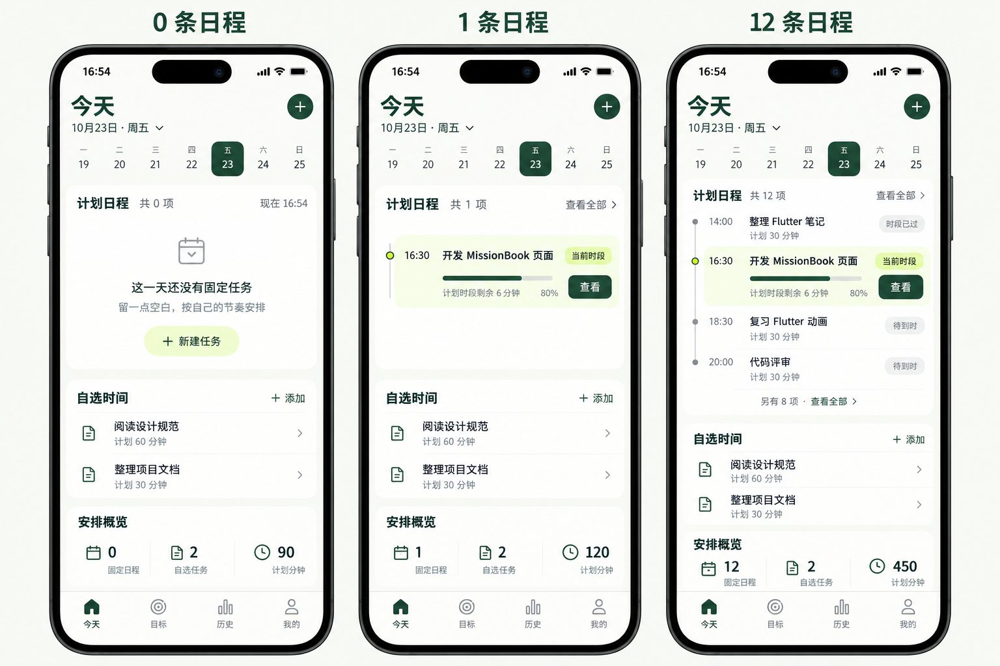
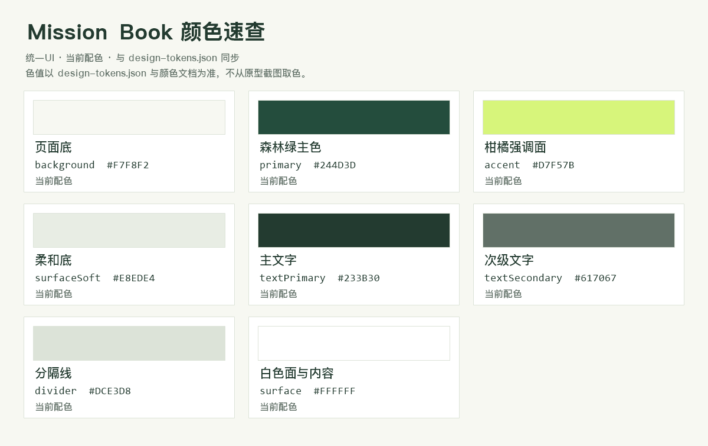

# Mission Book — 当前颜色与布局规范

唯一配色源：[design-tokens.json](assets/正稿v1.1/design-tokens.json)。当前稿统一采用暖白、森林绿与柑橘强调面；所有新页面沿用相同字体层级、组件和动效。原型不代表应用功能已实现。

[目标列表](assets/正稿v1.1/目标列表.png) · [目标详情与节点树](assets/正稿v1.1/目标详情.png) · [三步交互原则](三步交互原则.md) · [设计依据](设计依据.md)

完整页面状态以[手册入口](README.md)为准。各页原图是视觉参考，实现参数以本文和JSON为准。

[节点任务当前稿](assets/正稿v1.1/节点任务.png)沿用18/24任务标题与14/20辅助信息。日期列只表达先后；当前任务强调，其他项开放排列；详情和紧凑创建区按需原位展开。静态图之外的响应式排版和完整办理路径仍须实现验收。

[新建任务当前稿](assets/正稿v1.1/新建任务.png)使用18/24输入值、14/20标签和单位、16/24设置名称与主操作。日期和时长优先并排，窄屏可堆叠；同角色不缩字。时间安排和完成方式在原上下文选择，条件字段原位展开；保存后原位反馈。浅柑橘表示已选归属或选项，不表示已经创建/完成。

[任务详情当前稿](assets/正稿v1.1/任务详情.png)的主体名称复用页面标题28/36；列表任务名仍18/24。计划值18/24，步骤标题16/24、辅助14/20。计划条不画执行进度，步骤编号不表示完成。材料提示写清“报告完成后必交”，并直接显示确切截止。

[执行任务当前稿](assets/正稿v1.1/执行任务.png)以Focus为唯一计时主值，使用48/56等宽数码；任务身份18/24、辅助14/20、控制16/24。森林绿圆弧表示Focus/当前额度，柑橘点标记当前位置，底轨不表示任务已完成。暂停为高频主操作；结束保持次级清晰可见。额度变更采用360ms数据过渡，遵循减少动效。

[结束报告当前状态](assets/正稿v1.1/结束确认.png)保留任务工作上下文：Focus由48主计时收为28/36摘要，问题28/36，任务身份18/24，选项与主操作16/24、辅助14/20。选项以单选圆点表达尚未提交的选择，不使用完成勾。确认前状态仍为已暂停，材料提示须随选择和实际策略变化。

[材料编辑当前状态](assets/正稿v1.1/材料编辑.png)沿用同一任务工作区，任务身份18/24，冻结Focus摘要28/36，整理材料标题28/36，区块与操作16/24，输入18/24、辅助14/20。文字有可见输入边界，附件使用开放行；柑橘只强调待补上下文和添加入口，不表示材料已提交。截止精确到日期和时间，主操作为“提交材料”。输入、长文件名和键盘场景可滚动，不压缩字号；图中文字比例为生成近似，落地遵守角色参数。

[执行记录详情当前稿](assets/正稿v1.1/执行记录详情.png)使用28/36冻结Focus摘要、18/24任务身份与摘要值、16/24区块、14/20时间与状态。只保留一块执行摘要面，材料使用开放行；完成报告和材料状态分开标注。三节点时间线表达事件顺序，节点间距不编码时长，材料提交时间不冒充END；完整事件及材料修正链按需原位展开。

[历史当前稿](assets/正稿v1.1/历史.png)沿用28/36页标题、18/24任务名、16/24日期分组、14/20结束时间与记录摘要、12/16底部导航。按END倒序分组，节点间距不编码时长；完成勾仅表达COMPLETED报告，不代表材料已交，材料待补与截止另用文字标注。材料操作在记录行内展开，保留历史列表和对象身份，完整执行记录不是强制中转。

[我的当前稿](assets/正稿v1.1/我的.png)沿用28/36页标题、18/24功能名、16/24区块与操作、14/20能力说明、12/16导航；通知、准时提醒分别呈现真实权限状态。柑橘提示需要处理的通知能力，不能解释为已开启；填充面上的正文使用主文字或主色。备份说明、进度和结果保留在原数据区，关于信息原位展开，不用头像或虚构账户填充页面。

### 颜色定义

| 角色 | HEX | Flutter | 用途 |
| --- | --- | --- | --- |
| 页面底 | `#F7F8F2` | `Color(0xFFF7F8F2)` | 暖白背景 |
| 主色 | `#244D3D` | `Color(0xFF244D3D)` | 主按钮、当前节点、选中导航 |
| 强调面 | `#D7F57B` | `Color(0xFFD7F57B)` | 当前任务底；选中导航的内容 |
| 柔和底 | `#E8EDE4` | `Color(0xFFE8EDE4)` | 图标底、数量徽标 |
| 主文字 | `#233B30` | `Color(0xFF233B30)` | 所有标题、正文 |
| 次文字 | `#617067` | `Color(0xFF617067)` | 日期、计划时长、次级入口 |
| 分隔线 | `#DCE3D8` | `Color(0xFFDCE3D8)` | 装饰连线与分隔；不单独承担交互边界 |
| 白色面/内容 | `#FFFFFF` | `Color(0xFFFFFFFF)` | 导航底、深色按钮上的内容 |

颜色配对计算：主色/白9.53:1，主文字/强调面9.91:1，次文字/页面底4.89:1，主色/强调面7.82:1。数值来自以上实色定义，不代表生成图中每个像素都有相同颜色。当前、完成报告、未开始仍使用位置/文字/节点形状区分，不能仅靠绿色推断状态。

填充面配对：主色/柔和底8.02:1，主文字/柔和底10.15:1。次文字/柔和底仅4.39:1、次文字/强调面4.29:1，不作为普通小字配对；sage/citrus上的辅助信息也使用主文字或主色。图片为近似视觉，不能据其像素声称通过对比度验收。

### 字号统一

全部使用平台无衬线字体，不再混用宋体。以下为逻辑像素，生成图片按同一比例呈现。

| 角色 | 字号 / 行高 | 字重 | 约束 |
| --- | --- | --- | --- |
| 页面标题 | 28 / 36 | 600 | 一个页面标题，不再叠加大问候 |
| 计时主值 | 48 / 56 | 500 | 仅执行页的主Focus，使用等宽数码；辅助时间不放大 |
| 任务标题 | 18 / 24 | 600 | 当前、已报告完成、未来、自选共六项同级同字号 |
| 区块标题 | 16 / 24 | 600 | 计划日程等 |
| 日期、时间、计划、状态 | 14 / 20 | 400 | 同角色保持一致，数字使用等宽数码对齐 |
| 主要按钮、表单设置控制 | 16 / 24 | 600 | 同级动作不因文案长度缩字 |
| 列表内紧凑快捷动作 | 14 / 20 | 600 | 仅行内建任务、展开等快捷动作，触控仍至少48 |
| 导航与短辅助标识 | 12 / 16或18 | 400–500 | 不用于承载任务名和主要操作 |

### 布局与形状

- 390宽时边距24，窄屏16；当前项约126高，其他固定项48–56，自选项约60。
- 时间节点只表达开始时刻和顺序，间距、容器高度不再编码分钟；计划时长以每项短标签显示。没有分钟网格、推算结束线或自动顺延。
- 当前任务用强调面，普通任务开放排列；新建用圆形、导航用胶囊、图标底用圆角模块。形状服务角色，不将每一行都包成大卡。
- 图标20–24；主要操作实际触控区至少48，视觉40高的开始按钮上下扩展触控范围。文字两行优先，窄屏滚动，不缩字塞齐。
- 所有任务标题相同字号，突出当前项依赖背景、位置和操作，不依赖随机放大字体。图片与可检查模型的具体细节可能略有差异，落地参数采用此文与JSON。

### 动效规则与边界

点击任务后展开详情层，保留原任务位置；返回回到原任务焦点。展开位移360ms、透明度180ms，曲线`cubic-bezier(.22,.8,.24,1)`；按压反馈140ms。默认遵循系统减少动效设置，不循环漂浮。交互小样中的完整动效按钮只影响本地演示，不修改系统设置。

静态PNG不能证明动效成立。小样验证范围为展开/关闭、键盘返回和明确标注的计时演示；日期、新建、导航和材料等仍是静态入口示意，不代表功能验收完成。

维护：每页固定一个文件名，新稿直接替换当前文件，同步说明和提示词，不再并排堆放旧版本。色值、JSON与色板必须一致。
