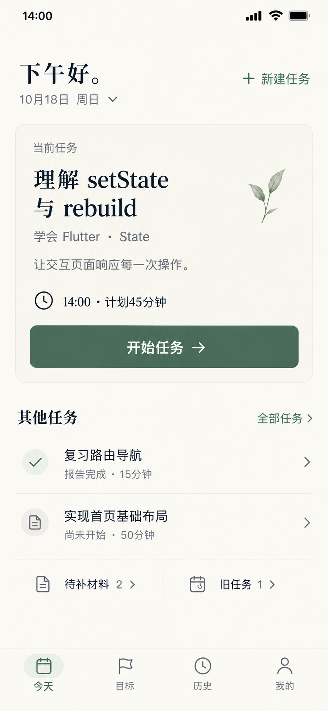
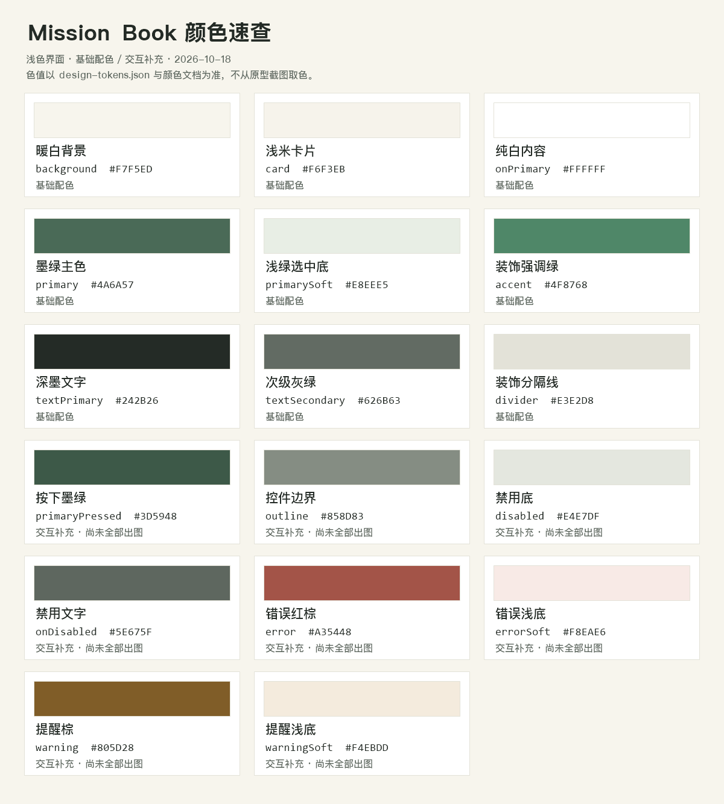

# Mission Book — 颜色与布局规范

更新：2026-10-18。适用：当前浅色界面，Windows / Android。风格基准为今天页 v4，后续页面沿用本文颜色和组件规则。

本文负责**颜色定义、用途、字体与布局尺寸**；[界面与交互](../v1.0/界面与交互.md)负责页面行为，[领域模型](../v1.0/领域模型.md)负责业务状态。图片用于视觉参考，不能按截图取色替代本文色值，也不能按截图文字大小反推实际字号。

## 1. 先看参考图

### 当前界面基准



参考重点：暖白背景、墨绿按钮、少量宋体标题、轻量列表、清楚的主次关系。当前任务不在下方重复，长说明进入详情，新建入口直接可见。图片原生尺寸为 853 × 1844，未放大。

同一风格的后续页面：[目标列表 v1](assets/目标列表-v1.png)。它沿用同一配色、边距与底部导航，以三张轻量卡和一个新建主操作组织信息。目标记录计数以文字为准，图片进度条仅示意比例。

### 品牌气质参考


继承书籍感、暖白与墨绿、自然植物的轻微点缀。封面的大标题、宣传语、大幅山景属于品牌展示，不直接搬入操作页面。

原始[设计 1](设计1.png)、[设计 2](设计2.png)、[设计 3](设计3.png)用于参考页面类型；涉及英文按钮、评分和验证结论时，以[设计稿说明](README.md)的替换规则为准。v1—v3 的密集布局不作为新的参考标准。

## 2. 总体风格

**暖白、墨绿、安静、清楚，有书卷气但保持工具的效率。**

- 页面以暖白为底，卡片只做轻微底色区分，不堆叠阴影。
- 实心墨绿留给页面主要操作；次级操作用文字或描边表达。
- 宋体用于少量标题，正文、状态、日期和按钮使用无衬线字体。
- 先区分主次，再决定放多少信息；不用缩小文字解决拥挤。
- 低频细节进入详情或展开区，新建、开始、返回等必要操作保持可发现。
- 一次设计一个页面的一个状态，后续页面复用相同颜色与组件。

## 3. 基础色板



[机器可读颜色定义](assets/design-tokens.json)保存相同色值；适合查找、复制和后续生成主题。颜色有修改时同步修改本文、JSON 和色板，不能各自维护不同版本。

### 3.1 已确定的基础颜色

Flutter 色值格式是 `Color(0xFFRRGGBB)`，其中 `FF` 表示完全不透明。

| 名称 | 标识 | HEX | Flutter | 使用位置 |
| --- | --- | --- | --- | --- |
| 暖白背景 | `background` | `#F7F5ED` | `Color(0xFFF7F5ED)` | 页面底、AppBar、底部导航底 |
| 浅米卡片 | `card` | `#F6F3EB` | `Color(0xFFF6F3EB)` | 当前任务卡、需要轻微分组的区域 |
| 纯白内容 | `onPrimary` | `#FFFFFF` | `Color(0xFFFFFFFF)` | 实心墨绿按钮上的文字与图标 |
| 墨绿主色 | `primary` | `#4A6A57` | `Color(0xFF4A6A57)` | 主按钮、选中导航、文字链接、焦点 |
| 浅绿选中底 | `primarySoft` | `#E8EEE5` | `Color(0xFFE8EEE5)` | 导航选中底、轻量标记底 |
| 装饰强调绿 | `accent` | `#4F8768` | `Color(0xFF4F8768)` | 小面积插画、非文字装饰，不用于普通小字 |
| 深墨文字 | `textPrimary` | `#242B26` | `Color(0xFF242B26)` | 标题、正文、重要字段 |
| 次级灰绿 | `textSecondary` | `#626B63` | `Color(0xFF626B63)` | 日期、计划时长、状态说明、未选中导航 |
| 装饰分隔线 | `divider` | `#E3E2D8` | `Color(0xFFE3E2D8)` | 列表细线、导航顶线，只辅助分组 |

`card` 和 `background` 刻意接近：分组主要靠留白，不靠大色块。若输入框需要明确边界，使用下方 `outline`，不能拿浅分隔线作为唯一边界。

### 3.2 交互与反馈补充色

以下是为实际组件补齐的设计定义，**尚未全部在原型中独立展示，也未接入现有主题**。后续相关页面沿用这些值，真实实现时再核对交互表现。

| 名称 | 标识 | HEX | 使用位置 |
| --- | --- | --- | --- |
| 按下墨绿 | `primaryPressed` | `#3D5948` | 主按钮按下；按钮文案仍为白色 |
| 控件边界 | `outline` | `#858D83` | 输入框、需要清楚轮廓的次级按钮 |
| 禁用底 | `disabled` | `#E4E7DF` | 禁用按钮底，不用于正常卡片 |
| 禁用文字 | `onDisabled` | `#5E675F` | 禁用按钮文字；仍保持可读 |
| 错误红棕 | `error` | `#A35448` | 保存失败、无效输入、删除等危险操作 |
| 错误浅底 | `errorSoft` | `#F8EAE6` | 错误说明底，前景使用 `error` |
| 提醒棕 | `warning` | `#805D28` | 截止提醒、需要处理但非操作失败的提示 |
| 提醒浅底 | `warningSoft` | `#F4EBDD` | 提醒底，前景使用 `warning` |

完成报告使用 `primary`，暂不额外增加“成功绿”。颜色必须配合图标或文字；“未完成”默认是中性事实，不能一律标红，“已取消”也不等于操作出错。

## 4. 颜色怎么用

| 组件 / 状态 | 背景 | 文字 / 图标 | 边界与说明 |
| --- | --- | --- | --- |
| 普通页面、AppBar | `background` | `textPrimary` | AppBar 不另铺大色块 |
| 当前任务卡 | `card` | 标题 `textPrimary`，辅助 `textSecondary` | 圆角 18，细线可选 |
| 主要按钮 | `primary` | `onPrimary` | 高 48–52，圆角 12 |
| 主要按钮按下 | `primaryPressed` | `onPrimary` | 不改变按钮宽高 |
| 主要按钮提交中 | `primary` | `onPrimary` | 文案或进度指示变化，阻止重复提交 |
| 禁用按钮 | `disabled` | `onDisabled` | 不只降低整个控件透明度 |
| 文字按钮 / 链接 | 透明 | `primary` | 如“新建任务”“全部任务” |
| 次级描边按钮 | 透明 | `primary` | `outline` 边界，避免与主按钮同样醒目 |
| 导航选中项 | 图标后 `primarySoft` | `primary` | 标签和选中底同时表达状态 |
| 导航未选中项 | `background` | `textSecondary` | 保持可读，不用过浅灰 |
| 输入框默认 | `background` 或 `card` | 输入 `textPrimary`，提示 `textSecondary` | `outline` 边界 |
| 输入框聚焦 | 同默认 | 同默认 | `primary` 2 宽边界；保留可见焦点 |
| 输入框错误 | 同默认 | 错误文案 `error` | `error` 边界与具体原因 |
| 单选行已选 | `primarySoft` | 标签 `textPrimary`，圆环与实心点 `primary` | 整行可点击；同时用圆点、轮廓和底色表达选择 |
| 单选行未选 | `background` | 标签 `textPrimary`，空心圆环 `outline` | 浅外框仅辅助分组，圆环承担控件识别；“未完成”不默认标红 |
| 提醒 / 错误说明 | `warningSoft` / `errorSoft` | `warning` / `error` | 同时给文字和图标，不只换颜色 |
| 普通列表 | `background` | 主次文字分别使用对应颜色 | `divider` 细线，不逐行套卡片 |

不要让绿色同时代表“报告完成”“材料已经提交”“已掌握”。这些是不同事实；当前没有 AI 验证或掌握度结论。材料待补时直接写明“待补材料”，不显示成功勾来替代。

## 5. 对比度速查

以下按不透明 sRGB 颜色计算，保留两位小数。普通文字以至少 4.5:1 为目标；需要识别的非文字控件边界以至少 3:1 为目标。装饰线不承担控件识别时不按控件边界使用。

| 前景 / 背景 | 对比度 | 结论 |
| --- | --- | --- |
| `textPrimary` / `background` | 13.28:1 | 可用于正文与标题 |
| `textSecondary` / `background` | 5.06:1 | 可用于小字与辅助说明 |
| `textSecondary` / `card` | 4.98:1 | 可用于卡片辅助说明 |
| `onPrimary` / `primary` | 6.02:1 | 可用于按钮文案 |
| `primary` / `primarySoft` | 5.10:1 | 可用于选中标签 |
| `primary` / `background` | 5.51:1 | 可用于小字号链接 |
| `accent` / `background` | 3.85:1 | 不用于普通小字 |
| `outline` / `background` | 3.14:1 | 用于控件轮廓 |
| `outline` / `card` | 3.09:1 | 可用于卡片内控件轮廓 |
| `error` / `errorSoft` | 4.57:1 | 可用于错误说明 |
| `warning` / `warningSoft` | 5.06:1 | 可用于提醒说明 |
| `onDisabled` / `disabled` | 4.69:1 | 项目仍为禁用文案保留可读性 |

这些计算不代表截图或整个应用通过无障碍验收。实际渲染中的透明度、材质叠加、字体和焦点状态仍需单独检查，不应给文字随意加透明度。

## 6. 字体与信息密度

下表为 Flutter 逻辑尺寸目标，斜杠后是行高。行高 30 / 字号 22 在 `TextStyle.height` 中写作约 `1.36`，不是 `30`。

| 用途 | 字号 / 行高 | 字体与字重 |
| --- | --- | --- |
| 顶层页标题 / 简短问候 | 24 / 32 | 宋体气质，常规或中等，不使用粗黑展示字 |
| 当前任务标题 | 22 / 30 | 宋体气质，中等字重 |
| 区块标题 | 16 / 24 | 无衬线，中等字重 |
| 列表任务标题、按钮 | 16 / 24 | 无衬线，常规或中等 |
| 正文、日期、状态、时长 | 14 / 20–22 | 无衬线，常规 |
| 底部导航标签 | 12 / 16 | 无衬线，常规或中等 |

Windows 可参考微软雅黑正文、宋体标题；Android 可采用系统无衬线正文，并在确定字体资产和授权后使用思源宋体等衬线标题字体。当前未引入字体资产，不能只写一个不存在的 `fontFamily` 就认为字体已生效。

标题优先控制到两行，长内容应允许合理换行或进入详情；不要全局强制截成两行。大字体模式先放开高度并允许滚动，不关闭系统文字缩放。

首屏保留一个主要操作；一个当前任务；一句目的摘要。当前任务不在其他任务列表重复。说明文字过长时先重新分层，不直接缩字号或压行距。

## 7. 布局尺寸速查

基准是约 412 × 892 的手机逻辑视口，用于讨论比例，不是要求写死屏幕尺寸。系统状态栏、底部安全区使用实际平台值。

| 项目 | 建议值 | 使用说明 |
| --- | --- | --- |
| 间距序列 | 4、8、12、16、24、32、48 | 同类关系复用同一档 |
| 手机页面左右留白 | 24 | 内容可用宽度减去两侧留白 |
| 窄屏左右留白 | 16 | 先照顾可读和触控，不横向溢出 |
| 主要区块间距 | 24–32 | 大于同一组件内部间距 |
| 卡片内边距 | 20–24 | 所有文字与按钮共用内边界 |
| 列表内边距 | 横向 16、纵向 12–16 | 简单行可与页面边界对齐 |
| 卡片圆角 | 默认 18，可用 16–20 | 同级卡片统一 |
| 按钮圆角 | 12 | 不把所有组件都做成胶囊 |
| 主按钮高度 | 48–52 | 长文案允许增长，不硬裁切 |
| 单项触控区 | 至少 48 × 48 | 图标可小于点击区 |
| 图标 | 常用 20–24 | 同一家族，保持视觉线宽一致 |
| 普通列表行 | 约 72–80 起 | 字体放大或标题变长时自适应 |
| 装饰细线 | 约 1 | Flutter 逻辑尺寸，非照片像素 |
| 聚焦边界 | 2 | 可见且不造成布局跳动 |
| 底部导航 | 组件默认高度加安全区 | 不从原型图片量像素写死 |

桌面端延续相同颜色和字号层级。首轮实现可让主要阅读区居中并限制宽度，初始参考 720 逻辑宽；真正需要并排内容时再做分栏。不要把手机图片等比放大成整个 Windows 页面，也不要把 720 视为已经验收的断点。

## 8. 今天页的布局关系

```text
问候 + 可见的新建入口
日期选择
          24–32 间距
当前任务卡
  任务标题 → 简短归属 → 一句目的
  计划时间 → 主按钮
          24–32 间距
其他任务 + 全部任务入口
  其余当天任务，轻量列表
待补材料 / 旧任务入口
          可继续下滚查看活动统计
固定底部导航 + 平台安全区
```

不是每个页面都使用当前任务卡。目标页重点是目标卡与筛选；执行页重点是计时与控制；表单页重点是输入和错误反馈。统一的是颜色、字体关系、间距、圆角和导航习惯，而不是强迫所有页面同构。

## 9. Flutter 对应建议与当前差异

现有统一颜色入口为 [colors.dart](../../lib/core/theme/colors.dart)，主题入口为 [app_theme.dart](../../lib/core/theme/app_theme.dart)。页面优先使用主题或集中颜色常量，不在每个页面重新写一套 HEX。本轮只整理文档，不改学习中的应用代码。

| 文档定义 | Flutter 主题角色 / 组件 |
| --- | --- |
| `background` | `scaffoldBackgroundColor`、`ColorScheme.surface`、AppBar、导航表面 |
| `card` | 卡片表面，通过 `CardTheme` 或专用组件设置 |
| `primary` / `onPrimary` | `ColorScheme.primary` / `onPrimary` |
| `primarySoft` / `primary` | `primaryContainer` / `onPrimaryContainer`，导航选中底与前景 |
| `textPrimary` / `textSecondary` | `onSurface` / `onSurfaceVariant` |
| `outline` / `divider` | `outline` / `outlineVariant`，再配置输入框与分隔线主题 |
| `error` / `errorSoft` | `error` / `errorContainer`；错误浅底上的文字用 `error` |
| `warning` / `warningSoft` | 自定义颜色或主题扩展，勿借用错误红表达所有提醒 |
| `primaryPressed` / 禁用色 | 主按钮状态样式；默认状态层不一定产生完全相同色值 |

现有主题使用 `ColorScheme.fromSeed`。种子色只负责生成配色，不能保证所有角色都等于本文定义；需要精确的角色应明确指定，再配置对应组件。此处是落地说明，不要求现在全部接入。

2026-10-18 读取现有代码的差异如下：

| 项目 | 当前代码 | 本文目标 | 说明 |
| --- | --- | --- | --- |
| 主文字 | `#2B2B27` | `#242B26` | 统一为原型规范的深墨色 |
| 次级文字 | `#6F6F62` | `#626B63` | 当前色在暖白底约 4.66:1，并非不可读；目标改为更深的灰绿 |
| 分隔线 | `hairline #E3DFD2` | `divider #E3E2D8` | 可保留旧常量名，统一值；不要同时维护两个近似色 |
| 主色上文字 | `AppColors.background` | `#FFFFFF` | 现有暖白对比约 5.51:1，也可读；本文统一采用纯白 6.02:1 |
| 浅绿选中底及交互色 | 未集中定义 | 见本文与 JSON | 需接入时再加入统一颜色来源 |
| 错误色 | `danger #A35448`，注释含“未完成” | `error #A35448` | 色值沿用，语义收窄；未完成默认中性，不统一标红 |

## 10. 使用与维护

做新页面前，先选主任务与首要操作，再按第 4 节选择颜色；按第 6、7 节确定字号和间距。先复用，再考虑新增颜色。

新增颜色需说明用途、前景/背景配对和适用状态；不能只说“好看”。暗色主题本轮未定义，不通过简单反色生成。

更新 JSON 后，可在项目根目录用 PowerShell 执行 `./tool/generate_ui_palette.ps1` 重建色板；再运行 `python tool/check_docs.py` 检查文档链接和现行规格结构。脚本见[生成色板](../../tool/generate_ui_palette.ps1)。

页面出图后检查：是否只有一个主操作、是否重复信息、次级小字是否过淡、图标是否抢视线、任务状态是否有明确文字、长标题是否可读。实际实现还需检查焦点、触控区、字体缩放、键盘与滚动。

设计原则来源：[NN/g 视觉层级](https://www.nngroup.com/articles/visual-hierarchy-ux-definition/)、[NN/g 逐步展开](https://www.nngroup.com/articles/progressive-disclosure/)、[Android 无障碍指南](https://developer.android.com/guide/topics/ui/accessibility/apps)、[W3C 文字对比](https://www.w3.org/WAI/WCAG22/Understanding/contrast-minimum.html)、[W3C 非文字对比](https://www.w3.org/WAI/WCAG22/Understanding/non-text-contrast.html)。

Flutter 对照来源：[ColorScheme.fromSeed](https://api.flutter.dev/flutter/material/ColorScheme/ColorScheme.fromSeed.html)、[TextStyle.height](https://api.flutter.dev/flutter/painting/TextStyle/height.html)。
