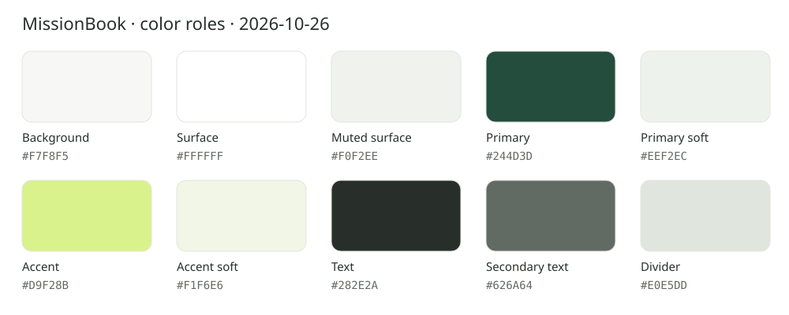

# Mission Book — 当前颜色与布局规范

2026-10-25 全部任务补正：固定时间任务直接用按比例的时间轴展示，不提供“课表／列表”模式切换。日期导航下显示固定日程，自选与取消任务接在下方；筛选进入顶栏，统计默认折叠。任务名使用titleMedium，时间／状态使用bodyMedium，时间轴刻度／年份使用bodySmall；全部沿用AppColors、AppLayout和AppTopBar。冲突以并排与交集斜纹表达，当前时间线位于卡片下面，避免穿过标题；窄屏或较多重叠列可横向滚动，短任务保留真实比例并补充阅读入口。

唯一配色源：[design-tokens.json](assets/正稿v1.1/design-tokens.json)。当前稿统一采用暖白、森林绿与柑橘强调面；所有新页面沿用相同字体层级、组件和动效。原型不代表应用功能已实现。

[目标列表](assets/正稿v1.1/目标列表.png) · [目标详情与节点树](assets/正稿v1.1/目标详情.png) · [三步交互原则](三步交互原则.md) · [设计依据](设计依据.md)

完整页面状态以[手册入口](README.md)为准。各页原图是视觉参考，实现参数以本文和JSON为准。

2026-10-26 UI审查更新：中性色承担背景、文字和普通容器；森林绿只承担小面积主操作与品牌，柑橘只承担少量当前状态。分类栏为中性轨道、白色选中面与绿色细边；手机和侧栏导航均为浅面选中。目标空态按面板重排：手机为图形引导与创建；2026-10-30 起导入改为独立工作区，空态宽屏不再并排导入表单。有目标时，选中目录后左侧紧凑列表、右侧真实行动路径；空间不足合列，同一草稿保留。创建为唯一实心主操作并直接进入表单。目标/空日程/空历史采用同组本地透明纸艺插画；有内容后不占用列表空间。详见[原则、逐页审查和路径](制作记录/2026-10-26-颜色层级与空态审查.md)。本条覆盖下文历史记录中整块深绿空态、实心分类、柑橘排期大卡及旧颜色的约定。

2026-10-25 四个主页面当前规则：统一使用 AppPageHeader 的标题、说明与主操作基线；同一暖白背景、详情阅读表面限宽792和窄屏16 / 常规24边距；2026-10-26 工作区按可用宽度铺满，仪表盘和表单允许重组多列，分栏间隙有背景。今天保留成熟的日程层级，不内嵌执行页；目标卡统一白底与细边，选中目录用边线和浅图标底表达，正式 GoalStatus 通过文字呈现，节点完成记录仍单独显示；历史按真实本地结束日期分组，紧凑记录卡直接展示时间、报告、Focus 和材料状态，正式图片缩略图直接可见并可放大，材料编辑进入独立记录页；我的把提醒能力、系统授权、备份和版本分区呈现。旧运行截图仅作修改前记录，当前视觉等待用户实机验收。

2026-10-25 目标关联界面补正：目标卡标题20/28，说明和直接记录14/20；目标详情名称28/36。树行开放排布，说明随展开显示，任务区使用整个节点宽度；所有节点建任务均为紧凑文字入口；展开/添加合并工具栏，空节点不放假展开。卡片和详情显示真实节点记录摘要，卡片展开保持白底；真实 RUNNING/PAUSED 任务使用细边框强调，点击进入同一独立执行页，不把第一项或展开当作已开始/达成。新建页顶部为可选归属路径，必填名称/日期/时长优先，详细方案原位折叠；末级归属浅柑橘只表达选择。具体动作边界及取样见[制作记录](制作记录/2026-10-25-目标节点与任务归属界面.md)。

2026-10-23 字体与排布统一（本轮优先于旧PNG及历史页面说明）：三个任务页面使用同一套语义字号，源码见 `lib/core/theme/app_typography.dart`，布局见 `lib/core/theme/app_layout.dart`。今天页固定、自选和取消项标题统一16/24、计划与时间统一14/20；不再按距离把标题从16缩到12，也不再给自选项单独使用14字号。当前计划时段保留强调面，不再采用透视或随焦点缩字，系统放大文字正常生效。普通内容边距24、窄屏16，页面外框最大宽792，区块间距24、标签至内容8。创建、详情和编辑共用此规则；详情主体大标题28/36用于完整任务身份，表单与详情顶栏均16/24，不把所有文字强行设成同一大小。

2026-10-23 今天页采用已验收的紧凑日程窗口：七天选择、首页2–4项固定日程、完整当日日程、自选前三项展开及真实安排概览。轨道只表达顺序，首尾各收进12，单项也有竖线；不再使用整条绿色经过线、透视或按分钟投影。计划高亮与进度只表达计划时段，不能推断已经开始执行。文字、空态、时钟与240ms动效的现行约定见[界面与交互 §4.1](../需求文档v1.0/界面与交互.md#41-布局与当前任务)。自选与全部任务共用阶段图标底36、图标22、与文字间距12，触控至少48；今天页无底部取消分区，取消数据保留。

[节点任务当前稿](assets/正稿v1.1/节点任务.png)沿用18/24任务标题与14/20辅助信息。日期列只表达先后；当前任务强调，其他项开放排列；详情和紧凑创建区按需原位展开。静态图之外的响应式排版和完整办理路径仍须实现验收。

[新建任务当前稿](assets/正稿v1.1/新建任务.png)使用18/24输入值、14/20标签和单位、16/24设置名称与主操作。日期和时长优先并排，窄屏可堆叠；同角色不缩字。时间安排和完成方式在原上下文选择，条件字段原位展开；保存后原位反馈。浅柑橘表示已选归属或选项，不表示已经创建/完成。

2026-10-23 新建任务实装：标签14/20、输入值18/24（500）、年份12/16、设置名称16/24、选项和单位14/20。日期／时长共用68逻辑像素的可见边框高度，并随字体缩放增长；输入文字与单位居中。选项触控高48，选中面自身保留完整胶囊圆角，和设置名称中线对齐。标准手机左右边距24、输入圆角16，空间不足时日期和时长纵排，固定时分仍在当前表单展开。新建和详情页的返回顶栏使用下述公共规范，旧原型中的差异不再作为实现依据。

[任务详情当前稿](assets/正稿v1.1/任务详情.png)的主体名称复用页面标题28/36；列表任务名统一16/24。计划值18/24，步骤标题16/24、辅助14/20。计划条不画执行进度，步骤编号不表示完成。材料提示写清“报告完成后必交”，并直接显示确切截止。

[执行任务参考稿](assets/正稿v1.1/执行任务.png)以Focus为唯一计时主值，使用48/56等宽数码。2026-10-25 按用户新参考调整实装：任务完整名称使用28/36，真实目标归属在名称下方显示，不叠加大阶段徽标；圆环内直接显示“正在专注 / 已暂停”、Focus和当前额度。森林绿连续细圆弧表示Focus/当前额度，取消柑橘端点，满环不表示任务完成。暂停／继续为主操作、结束为描边次级操作，采用16圆角并紧接圆环下方；延长为文字入口。有增加额度时补充原计划与已增加分钟，未增加时省去重复数值。当前目标使用白色紧凑摘要卡，完整目标、步骤和备注展开可读；执行中不常驻显示暂停说明，点击暂停后弹窗选填原因，确认后才暂停。正文整体滚动，大字体按钮纵排；结束报告的确认按钮仍固定底部。暖白背景与森林绿沿用现有令牌，不复制参考图中的示例内容和鼓励语。

[结束报告当前状态](assets/正稿v1.1/结束确认.png)保留任务工作上下文：Focus由48主计时收为28/36摘要，问题28/36，任务身份18/24，选项与主操作16/24、辅助14/20。选项以单选圆点表达尚未提交的选择，不使用完成勾。确认前状态仍为已暂停，材料提示须随选择和实际策略变化。

[材料编辑当前状态](assets/正稿v1.1/材料编辑.png)沿用同一任务工作区，任务身份18/24，冻结Focus摘要28/36，整理材料标题28/36，区块与操作16/24，输入18/24、辅助14/20。文字有可见输入边界，附件使用开放行；柑橘只强调待补上下文和添加入口，不表示材料已提交。截止精确到日期和时间，主操作为“提交材料”。输入、长文件名和键盘场景可滚动，不压缩字号；图中文字比例为生成近似，落地遵守角色参数。

[执行记录详情当前稿](assets/正稿v1.1/执行记录详情.png)使用28/36冻结Focus摘要、18/24任务身份与摘要值、16/24区块、14/20时间与状态。只保留一块执行摘要面，材料使用开放行；完成报告和材料状态分开标注。三节点时间线表达事件顺序，节点间距不编码时长，材料提交时间不冒充END；完整事件及材料修正链按需原位展开。

[历史当前稿](assets/正稿v1.1/历史.png)沿用28/36页标题、18/24任务名、16/24日期分组、14/20结束时间与记录摘要、12/16底部导航。按END倒序分组，节点间距不编码时长；完成勾仅表达COMPLETED报告，不代表材料已交，材料待补与截止另用文字标注。材料操作在记录行内展开，保留历史列表和对象身份，完整执行记录不是强制中转。

[我的当前稿](assets/正稿v1.1/我的.png)沿用28/36页标题、18/24功能名、16/24区块与操作、14/20能力说明、12/16导航；通知、准时提醒分别查询真实权限。2026-10-26：只为明确缺失的权限保留授权行，已允许项收起入口；全部允许时用浅绿正常摘要，未知或读取失败时给中性说明与重试。柑橘只提示需要处理的权限，不能解释为已开启；填充面上的正文使用主文字或主色。备份说明、进度和结果保留在原数据区，关于信息原位展开，不用头像或虚构账户填充页面。旧图片保留布局参考，不代表当前授权后的显示状态。

旧颜色速查PNG及原型页面图为历史视觉参考，以本节令牌与源码为准。

### 颜色定义

| 角色 | HEX | Flutter | 用途 |
| --- | --- | --- | --- |
| 页面底 | `#F7F8F5` | `Color(0xFFF7F8F5)` | 中性暖白页面底 |
| 森林绿品牌色 | `#244D3D` | `Color(0xFF244D3D)` | 小面积主操作、品牌及聚焦边线；不铺满普通卡片 |
| 柑橘强调色 | `#D9F28B` | `Color(0xFFD9F28B)` | 小面积当前状态；不作为通用容器、普通导航或分类选中面 |
| 品牌浅底 | `#EEF2EC` | `Color(0xFFEEF2EC)` | 导航选中、品牌相关图标和徽标 |
| 中性浅底 | `#F0F2EE` | `Color(0xFFF0F2EE)` | 分类轨道、普通控件和只读信息面 |
| 强调浅底 | `#F1F6E6` | `Color(0xFFF1F6E6)` | 当前计划时段的浅提示；不表示真实执行 |
| 主文字 | `#282E2A` | `Color(0xFF282E2A)` | 标题与正文；内容优先于品牌染色 |
| 次级文字 | `#626A64` | `Color(0xFF626A64)` | 日期、计划时长、辅助说明 |
| 分隔线 | `#E0E5DD` | `Color(0xFFE0E5DD)` | 装饰连线与分隔 |
| 白色面与内容 | `#FFFFFF` | `Color(0xFFFFFFFF)` | 导航与内容卡片、深色按钮文字 |

实色配对：主文字/页面底13.01:1；次文字/页面底5.23:1、白底5.58:1、中性浅底4.95:1、品牌浅底4.93:1；白字/森林绿9.53:1；主文字/柑橘11.24:1。按WCAG相对亮度公式复算，仅验证这些令牌配对，不宣称整页或平台已通过无障碍验收。状态还必须有文字、图标或程序化选中语义；装饰图排除读屏。

### 字号统一

全部使用平台无衬线字体，不再混用宋体。以下为逻辑像素，生成图片按同一比例呈现。

| 角色 | 字号 / 行高 | 字重 | 约束 |
| --- | --- | --- | --- |
| 页面标题 | 28 / 36 | 600 | 一个页面标题，不再叠加大问候 |
| 计时主值 | 48 / 56 | 500 | 仅执行页的主Focus，使用等宽数码；辅助时间不放大 |
| 默认任务标题 | 16 / 24 | 600 | 固定、自选和取消任务保持一致；详情主体用页面标题 |
| 今天页列表标题 | 16 / 24 | 600 | 单行省略，不随位置或分组缩字 |
| 区块标题 | 16 / 24 | 600 | 计划日程等 |
| 正文、日期、时间、计划、状态 | 14 / 20 | 400 | 同角色保持一致，不回落系统默认字号 |
| 主要按钮、表单设置控制 | 14 / 20 | 600 | 同级动作不因文案长度缩字；按钮字号不得压过行标题 |
| 列表内紧凑快捷动作 | 14 / 20 | 600 | 仅行内建任务、展开等快捷动作，触控仍至少48 |
| 输入值与计划主值 | 14 / 20 | 400 | 任务名、具体目标、时长、日期值共用输入角色 |
| 弹框标题 | 20 / 28 | 600 | 公共确认框 |
| 表单外置标签 | 14 / 20 | 500 | 与区块标题区分 |
| 导航与短辅助标识 | 12 / 16 | 400–500 | 年份、时区和徽标，不承载任务名和主要操作 |

### 二级页面公共顶栏（2026-10-23）

- 新建任务与任务详情共用 `lib/presentation/widgets/app_top_bar.dart` 的 AppTopBar；此目录属于项目约定，不是Flutter强制路径。其他尚未实现的二级页沿用此规范，顶层导航页及弹窗不强制使用。
- 工具栏高64（不含系统状态栏），返回按钮48×48、品牌浅底，24森林绿左箭头，距可用区域左侧24（窄屏16）；标题靠左，使用主题titleMedium的16/24、600。颜色读取现有ColorScheme，不在页面重复定义色值。
- 保存期间允许禁用返回，保留按钮位置并采用主题的柔和底与弱化图标。公共组件负责样式和点击分发；页面负责丢弃确认、系统返回保护及是否允许返回。未提供自定义回调时使用Navigator.maybePop，尊重路由的PopScope。

### 布局与形状

- 390宽时边距24，窄屏16。今天页采用自然行高和紧凑日程窗口，大字体允许换行增高；不按焦点递减字号或强制固定卡片高度。
- 时间节点只表达开始时刻和顺序，间距、容器高度不再编码分钟；计划时长以每项短标签显示。没有分钟网格、推算结束线或自动顺延。
- 当前计划时段用强调浅底，真实运行状态用小面积标识，普通任务开放排列；新建用圆形、导航用胶囊、图标底用圆角模块。形状服务角色，不将每一行都包成大卡。
- 图标20–24；主要操作实际触控区至少48，视觉40高的开始按钮上下扩展触控范围。文字两行优先，窄屏滚动，不缩字塞齐。
- 标题使用固定角色；今天页仅保留留白与倾斜变化，不再按透视距离缩小字号。图片与可检查模型的具体细节可能略有差异，落地参数采用此文与JSON。

### 2026-10-30：形状、间距与动效 token

源码集中定义在 `lib/core/theme/app_layout.dart`（形状与间距）和 `lib/core/theme/app_motion.dart`（动效）。页面不再直接写圆角数字或动画毫秒数。

| 类别 | token | 值 | 用途 |
| --- | --- | --- | --- |
| 形状 | radiusXs / Sm | 4 / 8 | 进度端点、内部小块 |
| 形状 | radiusMd | 12 | 输入框、代码块、小图标底 |
| 形状 | radiusLg | 16 | 按钮、分段选中、聊天气泡 |
| 形状 | radiusXl | 20 | 内容卡、操作卡 |
| 形状 | radiusXxl | 24 | 品牌卡、确认框、底部弹层 |
| 形状 | radiusPill | 999 | 导航、胶囊和筛选药丸 |
| 间距 | spaceXs–space3Xl | 4 / 8 / 12 / 16 / 20 / 24 / 32 | 新结构优先使用；页面局部微调需说明理由 |
| 触控 | touchTargetMin | 48 | 主要按钮和行内操作的最小高度 |
| 布局 | executionRingGap | 40 | 执行页圆环到主按钮的最小呼吸空间 |
| 布局 | actionMinHeight / topBarHeight | 52 / 64 | 主操作最小高度、二级页面顶栏高度 |
| 描边 | strokeThin / Focus | 1 / 1.5 | 常规分隔、聚焦和选中边界 |
| 阴影 | shadowBlur / OffsetY | 24 / 4 | 仅导航胶囊和助手悬浮层的轻量阴影 |
| 动效 | quick / standard | 180 / 240ms | 反馈、展开箭头、状态过渡 |
| 动效 | entrance / launch | 420 / 450ms | 空态插画、启动页过渡 |
| 动效 | curve | cubic-bezier(.22,.8,.24,1) | 全站统一缓动；减少动效时由 `AppMotion.resolve` 归零 |
| 图标 | iconSm / Md / Lg | 18 / 20 / 24 | 行内、常规、导航和操作图标 |
| 图标 | iconDisplay / Xl | 32 / 40 | 空态装饰、执行页大图标 |

补充口径：

- 输入值统一使用 `bodyLarge` 14/20；本文件早期出现的“输入18/24”“输入15/22”是历史记录，以本表和源码为准。主按钮统一使用 `labelLarge` 14/20，不得大于行标题。
- 用户聊天气泡改用 `primaryContainer` 浅底和 `onPrimaryContainer` 文字，森林绿只保留发送按钮和小面积强调。
- 启动页底色统一为页面底 `#F7F8F5`，Android 通知强调色统一为品牌绿 `#244D3D`。
- 圆角、间距、图标和动效新代码必须引用上述 token。0–5px 只用于光学微调，76px 是助手悬浮层偏移，104/220 等是图片内容尺寸；这些不设为通用间距 token。
- 选中、今天等状态仍可在既有文字角色上叠加 `FontWeight` 强调，但不新增字号或字体家族；Android 通知色需原生常量，必须与 `AppColors.primary` 保持一致。对话框宽度、气泡最大宽等内容约束属于组件自身尺寸，不套用间距 token。
- 路由转场的 360ms 展开和 140ms 按压仍是设计目标，当前主要动效已接入，路由自定义转场尚未实现。
- 插画仍存在“纸艺静物 + 旅程风景”两套语言；本次未替换素材，统一插画、暗色主题和多分页暗色适配留待后续确认。

### 按压反馈（2026-10-25）

取消大范围扩散水波纹。文字/描边/图标按钮按下用主色6%、悬停3%、键盘聚焦8%的轻量反馈；深色主按钮使用相应的白色反馈。行内“＋建任务”统一为14/20文字动作，可见高度40，触控仍至少48，不因节点展开变成大实心胶囊。AppTheme.light 是初始化后的主题，开发时改变全局主题需要热重启，普通热重载不重新执行其静态初始化。

### 动效规则与边界

点击任务后展开详情层，保留原任务位置；返回回到原任务焦点。展开位移360ms、透明度180ms，曲线`cubic-bezier(.22,.8,.24,1)`；按压反馈140ms。默认遵循系统减少动效设置，不循环漂浮。交互小样中的完整动效按钮只影响本地演示，不修改系统设置。

静态PNG不能证明动效成立。小样验证范围为展开/关闭、键盘返回和明确标注的计时演示；日期、新建、导航和材料等仍是静态入口示意，不代表功能验收完成。

维护：每页固定一个文件名，新稿直接替换当前文件，同步说明和提示词，不再并排堆放旧版本。色值、JSON与色板必须一致。

### 公共双按钮确认框（2026-10-23）

- `lib/presentation/widgets/app_confirm_dialog.dart` 提供 AppConfirmDialog；页面传入标题、正文、继续/确认文案，等待 bool 结果。只有明确确认返回 true，继续、遮罩及系统返回均为 false。输入判断、保存锁定、防重复弹框和是否退出仍由页面负责。
- 白色面读取 ColorScheme.surfaceContainerLow，圆角24，最大宽360，屏幕四周至少24，内部间距24；标题20/28、600，正文沿主题14/20。保留框架遮罩、焦点和弹框语义。
- 继续操作使用森林绿实心按钮，确认操作使用主色描边按钮，按钮字16/24、600，圆角16，触控高度至少48。内容宽小于280或16字号放大后超过20时改纵排，否则等宽横排，按钮间距12；正文及按钮随字号增长，视口不足时整体可滚动。
- 新建任务首先接入：继续填写保留内容，放弃填写才退出；没有输入直接返回。此组件仅覆盖双按钮确认，不扩展选择器或输入表单。

### 今天页已取消分区（2026-10-23）

- 沿原稿底部工具入口布局：上方一条弱分隔线与页面内容左右边界对齐；“归档图标＋已取消＋数量徽标＋展开箭头”组成紧凑入口靠右排列。当前左侧自然留白，待补材料未接通前不放假入口。
- 按钮高度至少48、圆角16、左右内边距12；文字14/20与18箭头用次级色，图标20，数量用主色浅底和深色12/18文字。悬停/按压/焦点分别使用主色4%/8%/10%透明反馈，只包住紧凑按钮。此布局替代先前整行 ExpansionTile 及其左右12标题内缩方案。
- 默认折叠，展开记录占完整内容宽度，复用原任务行；返回详情刷新保留当前展开状态，按钮提供完整数量和展开状态的读屏语义。取消标题保留单行省略、次级色和500字重，不画删除线；状态文字和详情入口保留。
- 固定/自选任务、时间轴、查询及取消业务不变。效果见[手机折叠](../开发/assets/web-cancel-footer-collapsed-20261023.jpg)、[手机展开](../开发/assets/web-cancel-footer-mobile-20261023.jpg)。

### 2026-10-23 三页字体与排布实装

- AppTypography集中定义字号、行高和字重，AppTheme接入TextTheme及三类文字按钮主题。页面选择headlineSmall（主体28）、titleLarge（弹框20）、titleMedium（区块/任务/顶栏16）、titleSmall（标签14）、bodyLarge（输入/计划主值18）、bodyMedium（正文14）、bodySmall（短辅助12）、labelLarge（操作16）、labelMedium（快捷动作14）。当前三页与公共确认框不再局部写fontSize。
- 详情正文不再依赖裸Text继承的默认字号；编辑和取消等整页动作同为16/24。表单的具体目标与其他输入同为18/24，提示值也采用同一输入角色。日期和时长等高68、随系统字体增长，触控至少48。
- AppLayout统一三页最大宽792、左右边距24/16、区块间距24；创建页正文顶部改为同样24（窄屏16），底部操作和内容左右对齐，宽屏不再铺满。公共返回按钮也遵循相同边界。
- 自动测试106/106通过，覆盖窄屏、大字体、键盘、日历以及焦点切换时节点与卡片几何关系。浏览器核对390×844三页与320×568创建页；未更新或验收原生安装包。
- 效果：[今天页](../开发/assets/web-typography-today-20261023.jpg)、[详情页](../开发/assets/web-typography-detail-20261023.jpg)、[创建页](../开发/assets/web-typography-form-20261023.jpg)。

### 2026-10-23：今天页紧凑日程窗口

- 按用户新参考图落地白色分区、七天日期选择、紧凑节点与当前时段浅柑橘色高亮。移除原透视倾斜、逐帧文字测量和整条时间轴绿色经过线；本条替代此前今天页透视及轨道推进规范。
- 首页按屏高和字号展示2–4项（不足时只显示真实项），围绕当前或下一项保留一项前情；全部结束展示末尾。40%为常规屏幕的窗口预算，不裁切大字体或重叠时段内容。首尾省略量合计显示“另有 N 项”，查看全部进入所选日期的完整固定日程。
- 空态保留标题、数量和新建入口；单项只有一个节点，自然收缩；多项连线只表达顺序。重叠时段独立高亮，其他项显示待到时/时段已过。所有日程均可进入现有详情继续编辑、改期或取消。
- 动效采用240ms easeOutCubic的高度、底色与进度过渡，减少动态效果时为0；没有循环装饰。每秒检查时钟，仅分钟或时段边界变化重建，空列表、隐藏、后台停止计时。
- 当前数据只有排期和取消事实，所以主动作是“查看”，进度只表达计划时段经过比例；安排概览统计固定、自选数量与计划分钟。执行中/暂停/完成/待补材料不从时间推断。
- 用户补充的状态设计：开始/返回执行/继续任务分别绑定真实START/执行/暂停；Focus采用累计实际专注时长，超计划仅显示超出量，不自动结束；材料超期独立于完成报告；已取消进入取消记录。上述执行与材料状态尚未接通数据，当前不放假按钮。后续实现须以正式业务规格为准。
- 用户要求自行验收，本轮最终版本未继续跑测试、浏览器或实机检查；回归用例已按新窗口和状态语义调整，等待用户执行。没有新增用户掌握记录。

### 2026-10-23：移除底部已取消入口，修正单项日程竖线

- 按用户要求删除今天页底部“已取消”分区及其专用展开组件；已有详情中的取消状态和数据保留，固定/自选列表继续沿用既有过滤规则。
- 单项同时为首尾，旧布局把竖线高度设为0；改为首尾各收进12像素、中间行连接到边界，单项也有穿过节点的竖线。节点中心按时间文字行高对齐。移除不再使用的showTimeline开关，用isFirst/isLast表达位置。
- 仅格式化并调整已有相关断言，按用户要求未运行测试或界面验收，等待用户审查。

### 2026-10-24：详情、执行、记录按职责编排

- 设计稿参考视觉层级，代码按真实状态编排，不照抄示例归属、步骤、材料和评价。详情标题28/36、执行Focus48/56、冻结摘要28/36，其余沿主题字号角色。
- 详情保留排期、Why和方案；修改/取消直接可见，开始固定底部，最小高52。自报且没有验收方向时不展示空材料卡。开始后详情只读，不插入计时圆环或结果。
- 独立执行页以自适应圆环为中心，原计划/增加额度置下方，目标按需展开，暂停原因在点击暂停后的弹窗选填；暂停/继续和结束紧接圆环下方随正文滚动。报告隐藏圆环和执行控件，保留冻结Focus与真实草稿。
- 独立记录页使用柔和摘要卡、真实报告和时间线，不继续计时、不重复详情正文；缺少正式材料、失败原因或评价时省略对应区块。再次尝试是新任务草稿。
- 窄屏/大字体标题与操作可堆叠；正文和底部操作分开，键盘压缩高度时底部也能滚动到达。今天的固定/自选行与当前任务栏共用实时标签；运行更新，暂停和结束冻结。
- 自动验证与用户外观验收分开。用户保留浏览器操作，最新证据见[学习进度](../教学/学习进度.md)。

### 2026-10-26：五项截图反馈补正

- 输入装饰集中到 `AppTheme.light.inputDecorationTheme`：白色输入面、12圆角、16水平/垂直内边距、弱边线、1.5主色聚焦边线、红棕错误边线。`AppTextField` 与任务表单装饰函数只补标签、提示和单位，继承同一份主题。
- 执行页圆环到主按钮至少40；根据实际视口高度和键盘占用分配额外留白，避免在高屏中全部挤在顶部，仍按自然正文滚动。延长时间输入到确认按钮16。
- 分类栏使用白色选中面、森林绿细边和文字，未选中使用中性浅底和次级字；已放弃时增加明确选中分类。目标各类空态均使用中性面，进行中的创建动作为小面积森林绿。
- “我的”显示本机资料卡与真实行动概览，右上角齿轮进入设置。没有虚构昵称、头像、评分或云账号；默认称呼明确为“本机使用者”。

### 2026-10-26 图形与动效优先

采用少文本、语义图片/图形和动效引导的设计哲学：能被图形清楚表达的关系不再堆解释段落；保留任务名称、真实数值、操作名称及必要错误。空态图像首次可见420ms入场，目标→行动→记录640ms顺序显现，目录高度260ms变化、节点箭头180ms旋转，分类180ms反馈；系统减少动态效果时直接显示最终状态。不以循环装饰占用注意力，不从图形流程推断执行事实。

### 2026-10-27：目标页各状态文字与对齐

目标页沿用同一套 AppTypography 角色：页标题28/36、空态标题20/28、区块和目标名称16/24、状态及说明14/20、页面操作16/24、分类选项14/20、输入15/22；同角色不随目标状态变化。空态中的插画、标题、说明及操作居中，列表条目和表单左对齐，分类选项内部居中。目标数的位置在空态与有数据时一致，避免分类栏跳动。目标列表、空态辅助列表和导入预览的目标名统一使用16/24；目标状态和节点说明不使用12号短标识角色。

### 2026-10-27：我的与设置

资料和行动概览使用同一中性色表面、字号角色和间距；宽屏分栏、窄窗与大字体依内容空间重排。真实统计用图标与数字表达，空态才显示既有插画；文字、状态与操作可读且不依赖颜色。设置按用途分组，权限信息采用白色卡面，避免大面积强调色；备用说明和导出结果采用正文层级。装饰图排除重复读屏，展开动效遵循系统减少动态效果。

### 2026-10-31：主导航四页顶栏统一

- 今天、目标、历史、我的统一使用 `AppPageHeader(showTitle: false)`：左侧只显示当前页面的真实上下文（日期、目标数、记录数、资料说明），右侧只放48×48圆形图标动作；页面唯一的创建动作使用实心圆按钮，其余入口使用普通图标按钮，不再混用整行文字长条或 tonal 填充。
- 历史页删除列表首行的“全部照片与文字记录”文字入口，改为右上角照片库图标；Tooltip 与读屏保留全称，点击仍进入同一记录列表（`RecordsEntry.iconOnly`）。页头到分类栏16、分类栏到内容20，与目标页一致。
- “我的”设置改回普通图标按钮；今天“全部任务”不再单独染成品牌绿，避免次级入口与主操作抢层级。
- 验证：静态分析无问题；主页面多尺寸样式、历史、记录上下文、外壳、响应式工作区、我的与目标页共51项测试通过；Web构建与浏览器复查见当轮说明。

### 2026-10-31：紧凑设置、记录编辑与展开行统一

- 设置页：删除“我的记录”和顶部大段说明；分区改为14/20次级标签 → 8 → 白卡 → 20，卡片零内边距；新增 `AppSettingsRow`（至少56高、图标、16/24标题、14/20短说明、尾部动作），动效改为行入口+底部选择。权限、计划、备份与关于均改为紧凑行，保留必要状态和操作，删除长段落；记录入口只保留在历史页右上角。
- 记录编辑：内容放入白卡，按附件/类型、说明、关联、保存分组；照片使用可点击的 `EvidenceImagePreview`（全屏缩放预览），附件可更换或移除；类型改为 `AppSegmentedControl`，关联改为统一行，丢弃确认改用 `AppConfirmDialog`。附件图片 Future 在状态中缓存，输入说明时不再重复读取。
- 展开行：新增 `AppExpansionTile`，标题反馈面内缩8、12圆角、48触控，展开内容回到卡片内容边界；目标详情、任务详情/表单、助手卡片、全部任务统计、材料修正、执行目标、记录摘要和目标导入等全部展开行已迁移，不再保留原生 `ExpansionTile`。设置页和助手设置共用 `AppSettingsRow`。
- 全局反馈：原生 `AlertDialog` 统一继承确认框的白色面、24圆角、20/28标题和14/20正文；全站 `ListTile` 点击反馈收进12圆角；页面不再出现裸 `DropdownButton`、原生展开头或独立硬编码字号。
- 助手设置：删除“让助手按你的方式工作”大标题及说明和两个无内边距文字按钮，改为“助手记忆/联网搜索”紧凑行；数据隐私压缩为一行；角色与风格改用新展开行。
- 今天页：日期按钮改为8内边距、12圆角的浅底胶囊，避免激活时出现贴字灰块；跨周“回到今天”48图标仅在内容宽≥330时显示；没有当日记录时不显示“当日记录”空入口。窄屏日期只显示“月日”，星期继续由周日期栏承担。
- 目标导入：展开头与预览条目不再使用原生整条激活底；预览信息、固定/历史标签、导入按钮、筛选与列表按12/20间距分层；预览列表行与内容左对齐并用细分割线。
- 字号层级：主按钮 `labelLarge` 从16/24降为14/20，输入值 `bodyLarge` 从15/22降为14/20；行标题保持16/24，按钮不再压过内容。
- 验证：静态分析无问题；全量测试640通过、1项在线模型测试跳过；Web构建与浏览器复查见当轮说明。

### 2026-10-29：助手页面（代码草稿，未接通）

- 用户确认助手作为独立主导航，并要求与全站 UI 统一；任务/目标内保留“问助手”。设计规则见[Agent 接入 App](../设计/Agent接入App.md#22-ui-统一约束)。
- 页面不引入新色板或字体：主页面使用 `AppPageHeader`，二级页使用 `AppTopBar`；正文限宽、边距、白色分区、输入、按钮、确认框和窄屏重排全部读取现有 `AppLayout`、`AppColors`、`AppTypography`、`AppTheme`。
- 对话按用户/助手/依据分层，不把每句话包成大卡；只有待确认、成功、失败、未知的操作使用描边卡片。森林绿只用于主操作、当前提案和短状态，普通正文保持中性色。
- 操作卡片默认展示字段和前后安排，进入“修改”后才显示输入控件；成功必须有真实业务回执和对象入口，取消明确零写入，失败保留原因，未知结果先核对。读屏要区分未读取、无记录、已截取、失败等事实。
- 助手页、历史、设置和操作卡片目前只是工作分支草稿：尚未接入 AppShell，静态分析还有错误，没有截图、目标设备或视觉验收。本规范不把草稿文件当作已交付页面。
