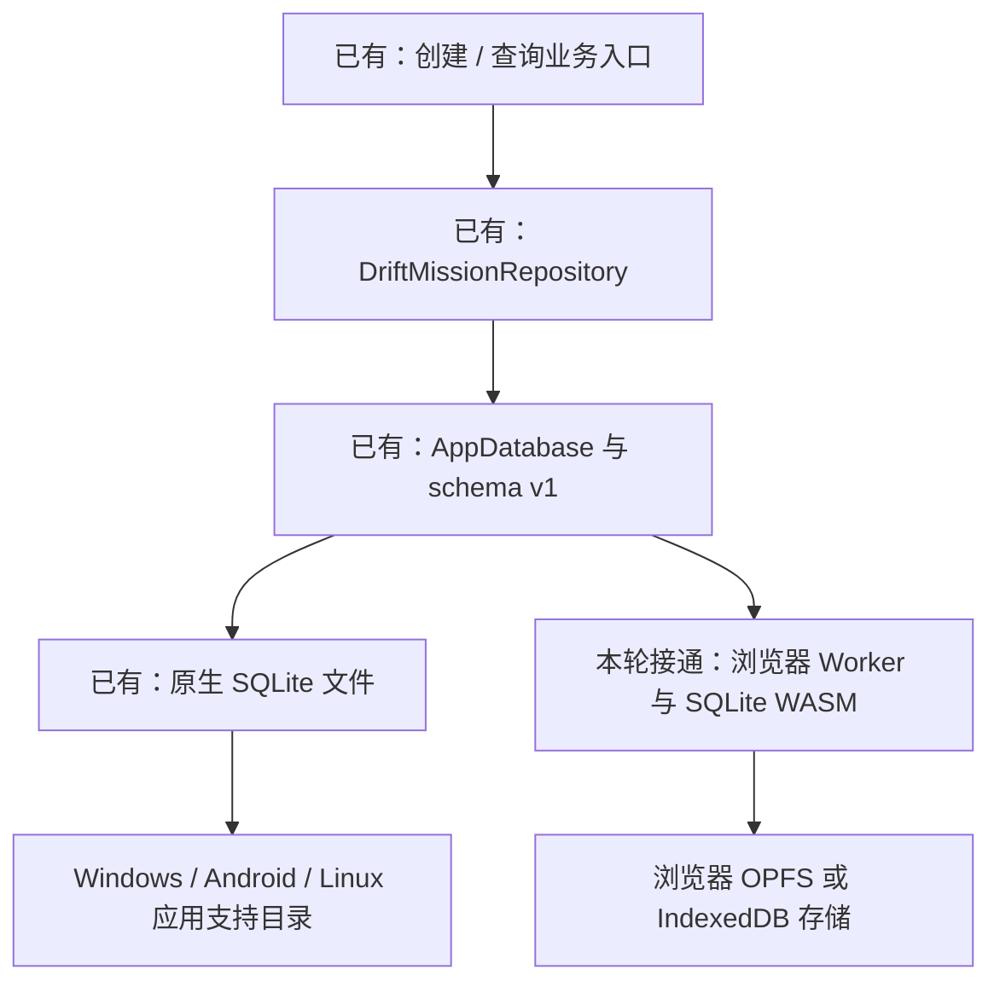
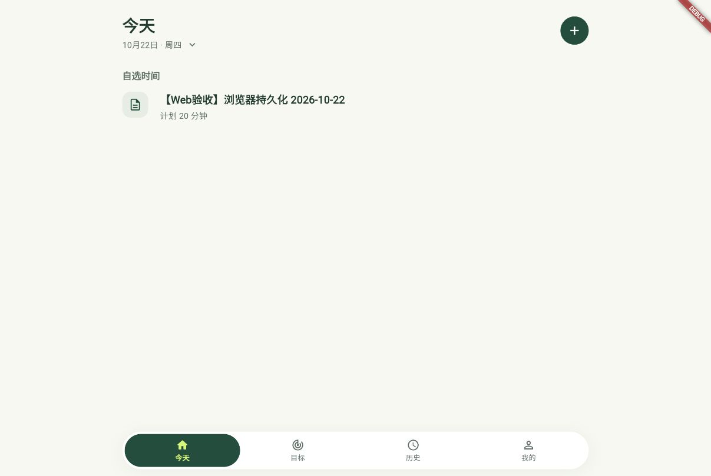

# 本设备浏览器预览

2026-10-22：Web 预览复用当前的创建任务、今天页查询与刷新链路。正式交付目标仍为 Windows / Android；浏览器预览不代表通知、附件、备份或其他未实现功能已完成。

## 启动

在项目目录执行：

```bash
flutter pub get
flutter run -d web-server --web-hostname 127.0.0.1 --web-port 8085 --cross-origin-isolation --no-web-resources-cdn --no-pub
```

编译完成后打开 [MissionBook 本机预览](http://127.0.0.1:8085)。终端保持运行，按 `q` 停止；修改 Dart 后可在终端按 `r` 热重载或 `R` 热重启。

- `-d web-server` 明确选择浏览器服务，避免默认启动 Linux 桌面。
- `127.0.0.1:8085` 固定本机访问地址；服务仅绑定本机。
- `--cross-origin-isolation` 提供浏览器文件存储和 Worker 所需的隔离响应头。
- `--no-web-resources-cdn` 从本地服务加载 Flutter 渲染资源，减少预览时对外部 CDN 的依赖。
- `flutter devices --show-web-server-device` 可以列出 Web Server；它默认可能不出现在普通设备列表中。

当前设备通过 `web-server` 手动打开浏览器即可，不要求 Flutter 自动启动 Chromium，也不用改变全局 Flutter 配置。

## 数据保存在哪里

AppDatabase 按运行平台选择连接，两端继续共用三张表、schema v1、仓储转换和事务。



浏览器中的数据库属于“浏览器配置 + 协议 + 主机 + 端口”。`localhost:8085` 与 `127.0.0.1:8085` 属于不同来源；换端口或浏览器也可能看到另一份数据。这里没有后端数据库，也不会读取原生应用的 SQLite 文件或自动跨端同步。

普通窗口刷新或关闭页面后，可以从同一来源读回记录。清理网站存储、隐私模式、浏览器存储策略和空间回收仍会影响数据；开发预览不要作为重要数据的唯一副本。若 Drift 只能提供刷新即丢失的纯内存连接，应用拒绝使用该连接，避免把临时数据误报为持久化成功。

## Worker 和 WASM 如何维护

| 文件 | 来源和职责 |
| --- | --- |
| `tool/drift_worker.dart` | 本项目 Worker 编译入口；调用 Drift 的 workerMainForOpen，不另写数据库逻辑 |
| `web/drift_worker.js` | 使用项目锁定依赖编译的 Worker；提交生成结果，让克隆后的项目可直接预览 |
| `web/sqlite3.wasm` | sqlite3 3.5.2 官方发布的浏览器 SQLite 运行库 |
| `web/THIRD_PARTY_NOTICES.txt` | 对应运行库的许可证说明 |
| `lib/data/local/app_database.dart` | 配置相对资源地址；原生连接继续使用应用支持目录 |

当前版本是 Drift 2.34.0、drift_flutter 0.3.1、sqlite3 3.5.2；没有升级这三个依赖。现有 flutter_local_notifications_web 1.0.0 未声明其生成注册代码所需的 flutter_web_plugins，因此项目显式补充 Flutter SDK 自带的注册库，不修改生成代码或包缓存。

不要只按 Drift 版本下载预编译 Worker：本轮实测官方 Drift 2.34.0 Worker 与当前 sqlite3 3.5.2 WASM 组合会报 `xFileControl` 导入不匹配。项目 Worker 必须使用与应用相同的 pubspec.lock 编译。

更新 Drift、sqlite3 或 Dart SDK 后，重新编译并重新做浏览器读写验证：

```bash
flutter pub get
dart compile js -O4 --no-source-maps tool/drift_worker.dart -o web/drift_worker.js
```

编译产生的 `web/drift_worker.js.deps` 只是本机依赖清单，已忽略；正式 JS 与 WASM 均保留在 Git。

本轮 Dart SDK 3.13.3 下的资源校验值：

```text
web/drift_worker.js  c317e7ba27b18cc471deb7861166ce1acca23166609fdb6a130061e6c29d4c47
web/sqlite3.wasm     13d3f11d05b39ba0618a7115fb41640a5d48b6300f5d3f325f554b42bd6688a4
```

WASM 原始下载地址：
[sqlite3 3.5.2 官方资源](https://github.com/simolus3/sqlite3.dart/releases/download/sqlite3-3.5.2/sqlite3.wasm)。版本依据见 [SQLite3 Dart 3.5.2](https://github.com/simolus3/sqlite3.dart/releases/tag/sqlite3-3.5.2)，连接配置参考 [Drift Web 文档](https://drift.simonbinder.eu/platforms/web/)。

## 构建与验证

```bash
flutter analyze --no-pub
flutter test --no-pub
flutter build web --no-pub --no-web-resources-cdn
```

`build/web/` 是构建产物，不提交。发布到其他服务器时，需正确提供 `application/wasm` MIME、隔离响应头，以及相同路径下的 Worker 和 WASM；本轮没有执行公网发布。

本轮通过本机内置浏览器实际创建了一条标题带【Web验收】的 20 分钟任务，验证返回列表后的刷新、整页刷新，以及关闭页面后重新打开的读回。样本只保存在本机浏览器的 `http://127.0.0.1:8085` 来源中，不注入启动代码，不修改原生应用数据。完整检查结果见[学习进度](../教学/学习进度.md)。


