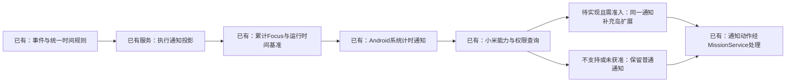

# 小米超级岛计时通知接入调研

调研日期：2026-10-26。用户目标设备为红米 K80 至尊版、HyperOS 3，希望执行任务时，在桌面或其他应用顶部查看任务与计时。本文是实施建议；现已补普通计时通知、独立设置页及能力/焦点权限查询，没有实现或验证超级岛展示。

2026-10-26 实现进展：本文仍是小米超级岛接入调研，私有协议和准入尚未实施。下文“拟补普通系统计时通知”的累计 Focus、时间投影与 Android 自定义内容已由本轮[布局反馈与通知修复](布局反馈与通知修复.md)接通；使用系统 Chronometer 与静默执行频道，实际小米通知样式、后台与锁屏仍待真机验收。下方原关系图是调研时的建议，不作为这些部分仍未实现的依据。

## 官方能力与实际门槛

小米支持在客户端发送原生通知时附加 `miui.focus.param` 及相应图片、动作数据，不必为本地计时引入服务端推送。系统提供岛能力、焦点协议版本、当前应用焦点通知权限的查询接口；须实际查询，不能只凭机型或 OS 名称开启功能。见[小米开发指南](https://dev.mi.com/xiaomihyperos/documentation/detail?pId=2131)。

HyperOS 3 对应超级岛，HyperOS 2 对应焦点通知，见[版本信息](https://dev.mi.com/xiaomihyperos/documentation/detail?pId=2141)。普通系统通知权限、准时提醒权限和焦点通知权限分别判断；设置页分别查询普通通知、准时提醒、执行频道、岛能力与焦点通知权限；查询结果不代表模板已经接通。

正式接入需要应用/签名配置、场景审核、设备白名单联调及上线验证，见[接入流程](https://dev.mi.com/xiaomihyperos/documentation/detail?pId=2132)。普通通知已经获准不代表本应用可以上岛。

场景有准入边界：有限生命周期且不超过12小时；官方将系统已覆盖的基础倒计时等列为不通过参考。MissionBook 可按用户主动开始、可暂停/恢复的任务执行场景申请评估，但不能预先保证通过。岛展示到限时，只能降级展示，不能因此结束任务、写 END 或改变时长。见[准入原则](https://dev.mi.com/xiaomihyperos/documentation/detail?pId=2140)。

## 当前代码能复用什么

- `AppNotificationService` 已订阅任务变化，开始/暂停/继续/延长/结束后重读事实，刷新同一任务的执行通知。
- 通知 payload 已包含任务、排期版本、执行序号与稳定候选事件编号；动作仍经 `MissionService` 及原仓储事务校验，重复与过期按钮不另走写入路径。
- `calculateExecutionTimes` 已从真实事件推导累计 Focus。执行投影现已传递累计Focus和投影时刻，自定义内容与标准通知兜底均使用系统计时组件。
- Android 分发器已有通知正文和按钮；优先保留同一个通知编号、点击与按钮意图，避免普通通知和岛通知出现两套相互冲突的操作。

当前与规划的连接关系（模板展示仍待实现）：

## 实施顺序与显示规则

1. **先补普通系统计时通知。** 投影带上累计 Focus、投影时刻与阶段；运行时以当前时刻减累计 Focus 得到系统秒表基准，暂停显示冻结值。Android `setUsesChronometer` 能由系统自动更新显示，见[Android 通知 API](https://developer.android.com/reference/android/app/Notification.Builder#setUsesChronometer(boolean))。此显示基准不是新的业务计时事实；恢复前台、收到事件与重启时仍按原时间规则重算。时钟回拨、设备重启和省电场景要单独验收。
2. **再接小米原生扩展。** 先在 Android 桥中查询支持情况及焦点权限，再为同一执行通知附加官方模板数据；图片、原按钮及正文点击继续保留。当前 Flutter 通知封装没有项目所需的小米模板入口，可用原生桥扩展，不修改依赖缓存。具体计时字段待逐项核对官方模板库并在白名单设备验证。
3. **按阶段更新。** 运行时大岛优先显示短任务名与累计 Focus；长标题在展开卡片阅读。暂停时停止动态计时并显示暂停，结束或取消移除执行通知。多个暂停任务仍保留各自入口；优先展示唯一 RUNNING，不能假设每个暂停任务都能同时占据顶部。小岛空间有限，不能承诺每种形态都显示完整任务名与计时。
4. **动作复用现有流程。** 正文进入原执行页；停止仍是 PAUSE 后打开 END 确认，取消确认保持暂停；继续仍检查全局单 RUNNING。若增加独立“暂停”按钮，须明确与现有“停止”区分并同步交互规格。采用系统支持的计时组件，不以 Flutter 后台每秒唤醒发送通知作为主要方案。

大岛可参考“图文＋等宽数字”组合，展开态选用官方支持的计时与按钮模板。见[摘要态规范](https://dev.mi.com/xiaomihyperos/documentation/detail?pId=2143)、[展开态规范](https://dev.mi.com/xiaomihyperos/documentation/detail?pId=2142)。方案默认单次更新不反复响铃；持续展示、超时、系统回收和锁屏行为以实测为准。

## 实施时涉及的文件与验收

拟修改：`lib/domain/notifications/reminder_request.dart`、`lib/application/notifications/app_notification_service.dart`、`lib/data/notifications/android_notification_dispatcher.dart`；按实际桥接方案修改 `MainActivity.kt`，必要时新增一个专门的小米通知适配文件。领域事件、数据库结构及唯一时间规则保持原契约；现在不预建空接口或字段。

先跑投影、暂停冻结、恢复连续、重复/过期按钮和普通通知降级测试，再在目标手机验证：退到桌面、切换其他应用、锁屏、关闭进程后显示、通知拉起、权限撤销、结束清除和超过展示时限。没有真实手机及应用权限证据前，只能标记“实现待验收”，不能标记已上岛。本次未申请权限、发邮件或修改设备系统设置。
