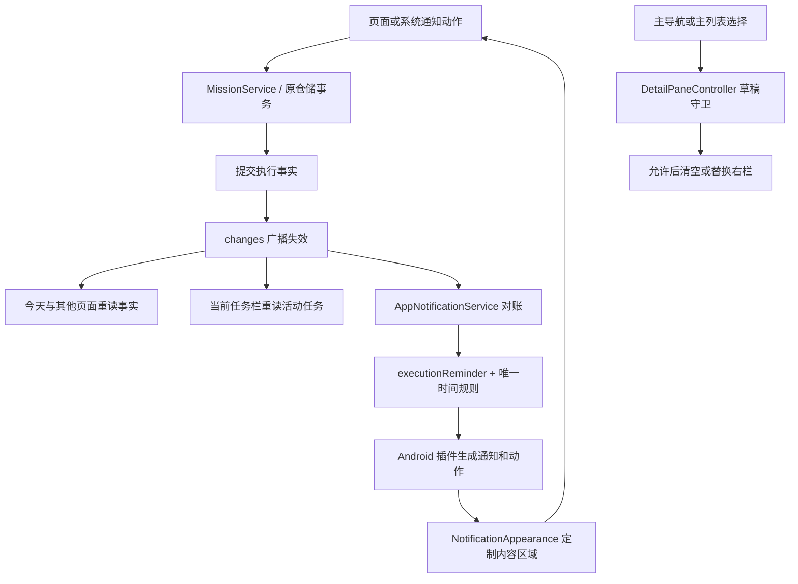
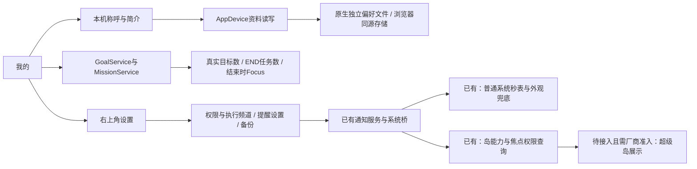

# 布局、反馈与通知修复

核对日期：2026-10-26。依据用户提供的真实设备截图与当前工作区；保留进入本轮前已有的自适应页面修改。以下说明本轮修改，不将历史测试或截图当作当前设备验收。

## 已确认的原因和处理

| 现象 | 当前代码原因 | 本轮处理 |
| --- | --- | --- |
| 右侧已结束，今天仍显示暂停 | TodayPage 在自己打开创建/详情时跳过 changes，双栏左侧一直可见却要等返回才刷新 | 子页提交也立即重读，保留原日期与乱序结果保护 |
| 切主导航后看不到目标页面，返回才出现 | AppShell 只更新 IndexedStack，右栏保持覆盖；列表还有持续到路由关闭的点击锁 | 主导航先通过草稿守卫再清空右栏；主列表选择另一任务/目标替换右栏，右栏内继续逐级导航 |
| 中间黑色竖条 | 左右 Positioned 之间的 paneGap 没有绘制任何背景 | 工作区统一绘制页面背景；这只能修复应用内空隙，不证明设备兼容模式黑边也消失 |
| 顶部大卡片挤压日期和日程 | 宽屏把 ActiveMissionsBar 放在页面顶部，内嵌可展开暂停列表 | 所有形态移到底部，只保留一条紧凑摘要；多个任务点开选择器，不展开挤压日程 |
| 自选与全部任务图标不表达状态 | 原先固定使用文档图标或 task_alt | MissionPhaseIcon 统一六阶段图形、36 逻辑像素底、22 图标；列表按内容自然增高，至少保留原触控范围 |
| 执行通知像普通文本、反复打扰 | 开始提醒和执行状态共用高优先级频道，执行投影没有 Focus | 分离静默执行频道；新增单色图标、自定义紧凑/展开内容，保留原点击和按钮意图 |

本轮没有改变八张领域表、事件事务、全局最多一个 RUNNING、旧通知动作校验或业务时间规则。任务结束后的跨页同步来自提交后 changes；Android 系统通知只负责外部呈现。

## 调用关系（均为本轮已接通）

右栏内部的“详情 → 编辑 → 返回”保留原栈。主列表选择新的对象才替换整条右栏链；通知进入仍可在已有草稿上方入栈，返回继续原草稿。缩放只调整同一右栏 Navigator 的载体，草稿和页面实例保留。任务表单、目标表单、结束报告及材料输入在离开前使用各自守卫。

## 反馈与系统通知的边界

- 操作成功、失败和过期按钮反馈使用底部浮动 Snackbar，沿用主题颜色与圆角。
- 当前任务栏是应用内组件，不是小米超级岛；始终位于主工作区底部，手机位于底部导航上方。暂停任务在选择器中查看。
- 固定计划提醒保留 `mission_reminders` 提醒频道；执行状态使用新的 `mission_execution_v2` 低重要性频道，关闭声音、振动和重复提醒。旧频道的行为无法在创建后直接改低，因此采用新频道，保留用户对频道的系统控制。
- AndroidNotificationDispatcher 先让原插件生成通知、payload 与停止/继续按钮，再经 `mission_book/notification_appearance` 通道定制内容区域；原通知编号、动作身份、点击拉起与 END 撤销仍沿用原链路；外观通道失败也在 finally 中尝试原插件撤销，错误仍反馈。
- NotificationAppearance 使用 RemoteViews 和系统 DecoratedCustomViewStyle；紧凑视图用单行任务、阶段图标/系统副标题与时间，给大字体保留48dp内容高度；展开补充状态、专注和额度；保留系统外框与标准动作区，不申请悬浮窗权限。
- RUNNING 使用系统 Chronometer；基准来自累计 Focus 与投影时刻，后台无需每秒唤醒 Dart。PAUSED 显示冻结文字；时钟回拨显示校时提示而不继续系统秒表。恢复或收到新事件后按事实重投影。系统时间改变但未完成对账期间的外部秒表显示仍需设备验证。
- 主 FlutterEngine 和计划任务后台引擎均注册外观通道；自定义外观前核对已有通知标题与摘要，通知尚未进入系统可读列表时最多等待320ms，仍未就绪保留标准通知；撤销先 invalidate 待呈现操作，等待期间不补绘已撤销通知，已被新摘要替换时不覆盖。
- 真正的系统顶部横幅位置由 Android/厂商控制；本轮没有接入小米私有岛 API，也不承诺通知从系统屏幕底部弹出。厂商可能折叠按钮或调整通知内容大小。

## 代码入口

| 文件 | 职责 |
| --- | --- |
| [app_shell.dart](../../lib/app_shell.dart) | 导航切换、底部任务栏、工作区背景 |
| [detail_pane.dart](../../lib/presentation/widgets/detail_pane.dart) | 右栏栈、清空/替换与草稿守卫 |
| [today_page.dart](../../lib/presentation/today/today_page.dart) | 提交后即时刷新与任务行 |
| [active_missions_bar.dart](../../lib/presentation/missions/shared/active_missions_bar.dart) | 紧凑摘要与任务选择 |
| [mission_phase_icon.dart](../../lib/presentation/missions/shared/mission_phase_icon.dart) | 共用阶段图标 |
| [execution_reminder.dart](../../lib/application/notifications/execution_reminder.dart) | 唯一时间规则生成通知摘要 |
| [android_notification_dispatcher.dart](../../lib/data/notifications/android_notification_dispatcher.dart) | 频道、标准动作和外观通道 |
| [NotificationAppearance.kt](../../android/app/src/main/kotlin/chat/liuxin/mission_book/NotificationAppearance.kt) | Android 自定义内容与系统秒表 |

## 验证与设备验收

自动验证与构建的最终结果见[学习进度](../教学/学习进度.md)。回归覆盖左右即时同步、主导航不在遮挡页面下面偷换、选择另一任务替换栈、任务/报告草稿保护、窗口缩放、320 宽双倍字体、底部任务栏和暂停选择器；通知覆盖真实暂停/延长/继续/结束、序号和候选事件身份、静默频道与原按钮保留。

界面截图来自隔离内存测试数据与真实 Flutter 渲染，不能当作 Android 系统通知截图，也没有操作用户数据库。可使用 `flutter test --no-pub --dart-define=UI_CAPTURE_DIR=build/ui-fixes-review test/presentation/adaptive_workspace_test.dart` 重现；普通测试不依赖本机字体。

本轮隔离测试截图：[底部任务栏](../教学/assets/ui-fixes-20261026/布局反馈修复-20261026-当前任务栏.png)、[双栏执行](../教学/assets/ui-fixes-20261026/布局反馈修复-20261026-双栏执行.png)、[结束后同步](../教学/assets/ui-fixes-20261026/布局反馈修复-20261026-结束后同步.png)。图中日期为固定测试日期，12:34 为按测试事件推算的实际专注，均不来自用户数据库。

真机仍须确认：横竖屏/分屏缩放与系统安全区、是否存在应用之外的兼容黑边；长标题/系统大字体/深浅色通知；锁屏、退后台与重开后秒表；停止/继续拉起；结束后通知消失。自动测试不能替代这些结果。

官方参考：[自定义通知](https://developer.android.com/develop/ui/views/notifications/custom-notification)、[通知频道](https://developer.android.com/develop/ui/compose/notifications/channels)、[Flutter 大屏](https://docs.flutter.dev/ui/adaptive-responsive/large-screens)。

## 本轮预览包

已构建并交付 `/sdcard/Download/MissionBook-0.2.3-ui-fixes-20261026-arm64.apk`（24,092,502字节）。SHA-256：`18bf4185cfeea6aba7656636389db8d301772eb2ef0837426191a8a9ae15a4d3`，复制后核对一致；包内最终通知资源与arm64 Flutter引擎/AOT存在，签名验证通过。采用项目现有本地预览签名，未安装或验收设备。

本机Flutter3.47发布构建须允许本次生成发布插件注册文件，避免 `--no-pub` 沿用含测试插件的开发注册；具体排错与正确命令见[Android打包](Android打包.md)。

## 截图五项反馈的后续完善（0.2.4）

用户要求开发前先提交全部现有内容，已保存为 `b8033de`。本节描述其后的新增完善，先前说明与产物保留为当时证据。

| 反馈 | 当前处理 |
| --- | --- |
| 执行按钮紧贴圆环、下部留白过多 | 圆环到主操作至少40，按视口高度分配上方及操作前留白；小窗、键盘、大字体仍可滚动 |
| 输入样式与间距不一致 | AppTheme统一输入装饰；任务/目标/节点/资料与暂停、结束、延长输入继承；增加时间确认按钮与输入相隔16 |
| 离开应用通知不明显 | 标准通知增加系统秒表兜底；自定义外观异常不阻断显示/撤销；设置区分执行频道关闭与应用总权限 |
| 目标页与放弃分类粗糙 | 森林绿分类选中面、主题空态、已放弃明确选中项及恢复说明；卡片仍读取真实状态 |
| 我的应展示个人信息 | 本机称呼/简介可编辑持久化，行动概览来自真实目标及已结束任务；右上角集中设置 |

新增 `application/settings/local_profile.dart`、`presentation/me/settings_page.dart`；修改 `me_page.dart`、`AppDevice` 及原生/浏览器实现。资料只作为本机偏好保存，不增加数据库表，也不混入提醒进程写入的JSON文件。个人资料目前不包含在数据库备份中。

本轮没有用媒体通知或悬浮窗模拟灵动岛。小米官方要求应用准入、焦点权限和模板适配；本轮接通查询与明确降级，尚未发送超级岛模板，不能宣称“已上岛”。目标手机的后台/锁屏送达、进程清理和系统外观仍需实际安装验证。

实际Flutter渲染（隔离测试数据，不是用户数据库）：[执行页](../教学/assets/ui-refine-20261026/执行页.png)、[目标空态](../教学/assets/ui-refine-20261026/目标空态.png)、[已放弃目标](../教学/assets/ui-refine-20261026/已放弃目标.png)、[个人主页](../教学/assets/ui-refine-20261026/个人主页.png)、[设置页](../教学/assets/ui-refine-20261026/设置页.png)。

复现：`flutter test --no-pub --dart-define=UI_CAPTURE_DIR=build/ui-refine-review test/presentation/adaptive_workspace_test.dart`。固定测试日期2030-10-26；执行Focus为按测试事件推导的12:34。截图使用本机Noto字体，仅用于视觉核对，普通测试不依赖该字体。不能用这些截图证明Android系统通知外观或真机送达。

本轮验证：最终全量428/428通过，静态分析无问题，23个本轮Dart文件格式检查与差异空白检查通过，截图专项9/9通过。ARM64 release构建成功，Flutter引擎与AOT仅为arm64-v8a；插件另含其他架构的原生库。新包 `0.2.4 (6)` 已交付 `/sdcard/Download/MissionBook-0.2.4-ui-refine-20261026-arm64.apk`；SHA-256：`4b3597226cb095abac2763969681c927723e3ff813b5d6a19fe3bea4d2494cbb`，复制后与构建产物一致。APK v2签名校验通过，签名证书与原0.2.3预览包一致。保留原包，没有安装、卸载或操作用户数据；签名/构建检查不代替设备升级、后台通知与锁屏验收。
