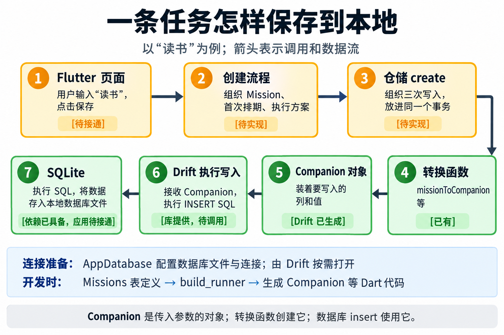

# U04：一条任务怎样保存到本地

2026-10-20。承接用户“不懂这个技术栈”的反馈，用“读书”贯穿保存过程。当前是调用关系说明，不是已接通的功能，也不改变既有架构。

## 运行时：用户点保存以后

1. Flutter 页面收集输入，例如标题“读书”。页面保存入口尚未接通。
2. 创建流程检查输入并组织 `Mission`、首次排期、执行方案三个业务对象。业务对象已有，创建流程待实现。
3. 仓储 `create` 接收三个对象，在同一事务中完成三次写入；接口已有，具体仓储与事务待实现。
4. 仓储调用已有转换函数。以 `missionToCompanion(mission)` 为例，它读取任务字段，把枚举转成约定文本、时间转成毫秒，返回一个 `MissionsCompanion` 对象。
5. Companion 对象记录本次提供哪些列、各列的值；它是调用数据库时使用的参数对象，本身不执行 SQL。它的类由 Drift 工具生成，每次调用构造函数创建的是具体对象。
6. `database.into(database.missions).insert(companion)` 让 Drift 生成带参数的 INSERT SQL 并通过连接交给 SQLite 执行。
7. SQLite 执行 SQL，成功提交后数据保存在应用本地数据库文件。三对象事务全部成功后，保存调用才成功完成，页面才可显示成功；失败则报告错误。

`AppDatabase` 提供表注册与连接配置；`drift_flutter` 帮助准备平台连接，`path_provider` 提供应用目录。普通应用入口尚未创建数据库实例；历史数据库测试用独立内存连接，不证明文件持久化。

## 开发时：为什么会有 Companion 类

我们写 `Missions extends Table` 描述列，开发电脑上的 `build_runner` 启动 Drift 生成器，在 `app_database.g.dart` 中生成 `MissionsCompanion`、`MissionRow` 等配套代码。它不是用户数据文件；用户点击保存时不运行生成命令。

## 查询返回的方向

SQLite 查询结果 → Drift 组装成 `MissionRow` → 数据层按业务需要转成 `Mission` → 页面显示标题。Row 到业务对象的反向转换及页面查询尚未接通。查询不需要先构造 Companion。

## 当前证据与图核验

已核对：main.dart、AppDatabase、三张表、生成类、三个转换函数与仓储接口。图上 1—7 箭头顺序、中文与已有/待实现文字已视觉核对；6、7 的绿色表示依赖能力已具备，具体接通状态以框内文字为准。不表示应用已经保存成功。没有修改业务代码或执行设备验收。

制作记录见[本图制作记录](制作记录/U04-任务保存链路.md)，当前学习状态见[学习进度](学习进度.md)。
