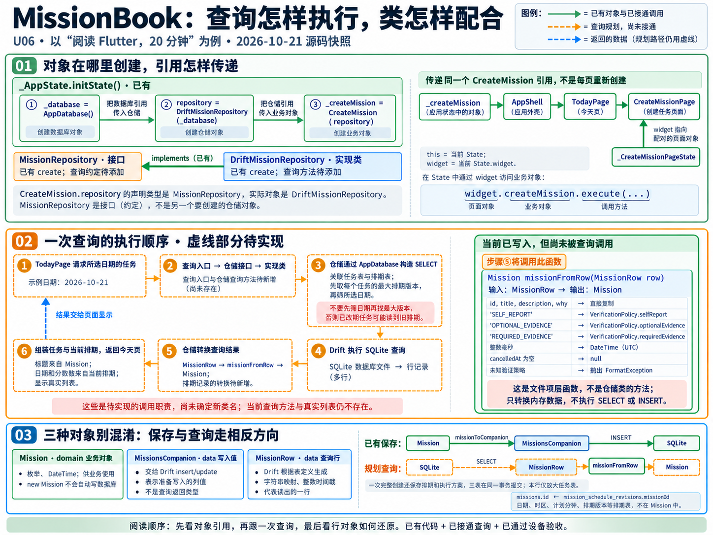

# U06：查询执行过程与类的关系

日期：2026-10-21。下图和本文保留当天接通查询前的源码快照；绿色表示当时已有对象和已接通调用，橙色虚线表示当时尚未接通的查询路径。此后今天页真实查询已落地，当前类名、调用与验证见[今天页真实列表](U06-今天页真实列表.md)。



## 1. 对象怎样建立关系

[App 的 State](../../lib/app.dart) 在 initState 中创建 AppDatabase，将同一个数据库对象传给 DriftMissionRepository，再把仓储传给 CreateMission。CreateMission.repository 的声明类型是 MissionRepository，实际引用的是 DriftMissionRepository 对象；接口不是额外创建的一份仓储。

同一个 CreateMission 对象经 AppShell、TodayPage 传入 CreateMissionPage。创建页的 State 使用 widget 访问配对的页面，再读取 createMission。this 是当前 State，widget 是 State 提供的属性，二者不是同一个对象；这里不沿祖先树查找。

## 2. 已接通的保存路径

表单的 _save 调用 widget.createMission.execute，业务入口校验输入、生成 ID 和时间、创建三个业务对象，再调用 repository.create。真实仓储将三个对象转换成 Companion，在同一个事务中依次写入任务、排期和方案。await 等待事务成功返回后，页面才显示成功；失败时保留表单输入。图中底部的单行保存链只放大任务表，不代表完整创建只写一张表。

## 3. 待实现的查询路径

以下是下一步职责安排，查询入口和方法尚未定义，图没有约定具体新类名。

1. 今天页提出所选日期的查询请求。
2. 查询入口通过仓储接口调用实现类的查询方法。
3. 仓储通过 AppDatabase 构造任务与排期的关联查询：先确定每个任务的最大排期版本，再筛选所选日期。先筛日期再找最大版本可能选中已改期任务的旧记录。
4. Drift 执行 SQLite SELECT，解码得到数据库行对象。
5. 仓储将 MissionRow 交给 missionFromRow，拿回 Mission；排期行的转换仍待实现。
6. 组合任务与当前排期，将结果交给今天页显示。标题来自任务，日期、时区和分钟来自当前排期；持续更新及页面加载、空、错误状态仍需后续接入。

日期和排序依据见[界面与交互](../需求文档v1.0/界面与交互.md)第 4 节，当前排期依据见[领域模型](../需求文档v1.0/领域模型.md)第 4 节。图聚焦创建后的读取，不代替完整 Today 中执行中、暂停、取消折叠等规则。

## 4. 为什么叫 missionFromRow

当前函数是[仓储实现文件](../../lib/data/repositories/drift_mission_repository.dart)中的顶层函数：

```dart
Mission missionFromRow(MissionRow row)
```

输入类型是 MissionRow，输出类型是 Mission。missionFromRow 表示“从行记录得到任务”；若采用“来源 To 目标”风格，missionRowToMission 也可以，命名风格不是 Dart 强制要求。companionToMission 则描述另一种输入类型，不符合当前签名。

- Mission 是 domain 中的业务对象，使用枚举和 DateTime。
- MissionsCompanion 描述准备写入的列值，用于 insert/update，列值还可区分明确赋值与省略。
- MissionRow 是 Drift 根据表定义生成的查询行类型。当前表的策略是字符串，时间是整数毫秒；转换函数负责还原成业务类型。
- missionFromRow 只做内存转换，不执行 SELECT，不执行 INSERT，也不创建新的数据库记录。未知验证策略会抛出 FormatException。

## 5. 本次检查与边界

- 用户已经将 missionFromRow 写入当前源码；静态分析该文件通过。
- 视觉核对对象创建与引用、接口实现方向、State.widget 配对关系、查询顺序、第五步转换函数关联，以及输入输出类型。
- 图已针对已有 implements 关系及第五步调用提示修正一次。
- 仓储接口当前仍只有 create；完整查询、列表、刷新与设备持久化本次未验证。没有修改业务源码。
- 生成方式为内置 image_gen，原始提示词与修订提示见[制作记录](制作记录/U06-任务查询链路.md)。
