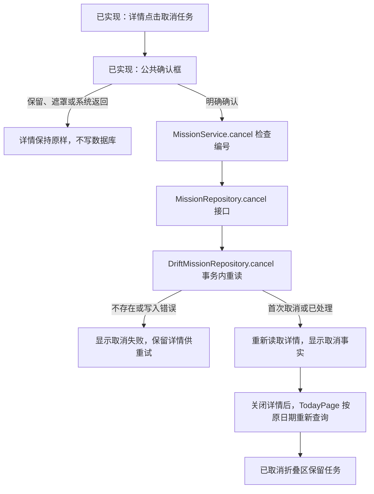
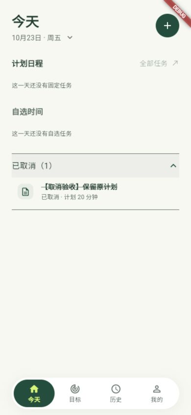

# U07：取消任务从点击到保存

2026-10-23。用户授权助手实现完整流程，再结合代码学习。本文描述已接通的取消切片；同日后续新增的名称、具体目标和排期修改见[编辑任务与改期](U07-编辑任务与改期.md)。执行事件及其余编辑控件尚未接入，不代表全部目标功能完成。

## 1. 先看结果与文件职责

用户从任务详情点击“取消任务”，确认后显示真实取消时间，保留原计划和方案；返回所选日期的列表，任务进入“已取消”折叠区。取消不产生 END 或失败记录。

| 文件 | 本轮变化与职责 |
| --- | --- |
| [任务详情](../../lib/presentation/missions/detail/mission_detail_page.dart) | 修改：确认、等待、错误重试和重新读取，提供真实取消入口 |
| [公共确认框](../../lib/presentation/widgets/app_confirm_dialog.dart) | 仅复用：展示文字，返回用户是否明确确认 |
| [MissionService](../../lib/application/missions/mission_service.dart) | 修改：检查编号，等待仓储完成 |
| [MissionRepository](../../lib/domain/repositories/mission_repository.dart) | 修改：约定取消操作与重复请求语义 |
| [真实仓储](../../lib/data/repositories/drift_mission_repository.dart) | 修改：事务内重读并更新取消事实 |
| [TodayPage](../../lib/presentation/today/today_page.dart) | 仅复用：详情关闭后重新查询原所选日期 |

没有新增生产目录、业务类、表或依赖。测试新增真实取消仓储文件，并扩展详情与列表验证；现有五个仓储替身补齐接口。



## 2. 页面先取得选择，再决定是否调用业务

在详情页 `_requestCancel` 中，当前任务编号来自 `widget.missionId`。它由今天页被点击的任务传入，不使用标题或列表位置代替。

```dart
final confirmed = await AppConfirmDialog.show(
  context: context,
  title: '取消这个任务？',
  message: '取消后仍会保留任务和原计划，可以在已取消列表中查看。',
  cancelText: '保留任务',
  confirmText: '确认取消',
);
```

`await` 等待确认框关闭。只有 `confirmed` 为 true 才继续；其他关闭方式结束本次操作，不查询、不取消。操作开始时同步设置忙碌标志，防止快速点击弹出多个框。

确认后调用 `await service.cancel(missionId: missionId)`。这里等待的是保存，不在点击按钮时提前显示“已取消”。写入期间禁用操作和返回，等待事务结果。

## 3. 业务入口通过接口调用真实仓储

`MissionService.cancel` 接收页面提供的编号，检查不能为空，然后等待 `repository.cancel(missionId)`。`Future<void>` 表示异步操作完成后不返回任务对象；失败会沿 Future 传回页面。

App 原先已经把真实仓储交给同一个 MissionService，所以本轮不需要重新创建数据库或修改装配。接口只约定能力；实际 SQL 在 data 层执行。

## 4. 仓储修改的是真实取消事实

`DriftMissionRepository.cancel` 在同一个事务中完成以下步骤：

1. 按编号重新查询任务。页面可能拿着旧快照，不能用页面状态代替写入前检查。
2. 不存在就报错；已经取消就正常结束，保留首次取消时间。
3. 首次取消只取一次当前 UTC 时间，转换成数据库使用的毫秒整数。
4. 按编号且取消时间仍为空的条件更新两个字段，检查影响行数为 1。

```dart
final changed = await update.write(
  MissionsCompanion(cancelledAt: Value(now), updatedAt: Value(now)),
);
```

这里用普通 Companion 指定要修改的列。`Value(now)` 表示明确写入这个值，没有提供的标题、说明等列保持原样。排期历史和执行方案没有写入操作。

重复请求直接结束，所以不会把“第一次取消发生在什么时候”改成“最后一次点击是什么时候”。任意写入失败由事务回滚，不能先假装成功再补救。

当前三表没有 START 事件，未取消记录都还未开始。U08/U09 接入执行事件时，必须在同一事务中检查任务没有开始，并与开始动作互斥；本轮没有实现该未来能力。

## 5. 保存成功后再读取，返回时再刷新列表

详情把 `_detail` 换成一次新的查询 Future。FutureBuilder 显示加载、真实取消详情或读取错误；它不持续监听数据库。

取消保存失败时保留原详情和重试按钮；保存已经成功但重新查询失败时显示“读取失败”，点击“重新读取”只查询，不再次发起取消。

页面可能在 await 期间被移除或改读另一个任务。因此每次操作固定编号、服务和请求序号，返回时检查 mounted 与序号，旧结果不会更新新任务。

新查询在下一帧才交给 FutureBuilder，错误可能提前到达。`_readDetail` 对原 Future 调用 `ignore()` 接收这个窗口中的未处理错误，再把同一个 Future 返回；FutureBuilder 仍然收到它的原结果并显示错误。这不把读取失败改成成功。

今天页已有 `_openDetail`：等待详情关闭后调用 `_loadMissions`，仍查询原所选日期。已有显示分组读取 cancelledAt，将任务放入折叠区，本轮没有修改今天页生产代码。

## 6. 当前验证与边界

- 静态分析无问题，全量88/88测试通过。仓储覆盖字段与全历史保留、其他任务不受影响、重复/并发请求、缺失编号、事务失败重试及文件库关闭重开。
- 详情覆盖确认取消/保留/遮罩/系统返回、忙碌期间禁止重复及离页、失败重试、保存后读取失败、换任务与离页迟到结果、320宽双倍字体和读屏名称。
- 完整 Widget 路径使用真实仓储：创建 → 详情取消 → 返回列表折叠 → 再开详情读取取消事实。
- 浏览器只创建并操作本轮 `【取消验收】保留原计划` 样本，保留已有数据；目标 Android/Windows 安装包和实物设备尚未验收，不标记用户已掌握。



