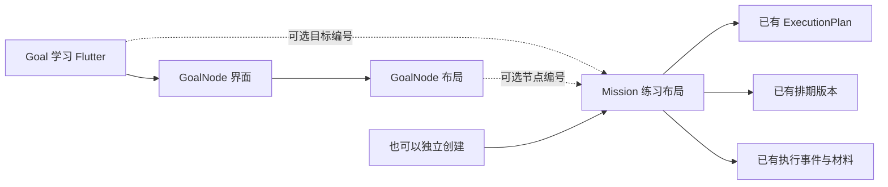
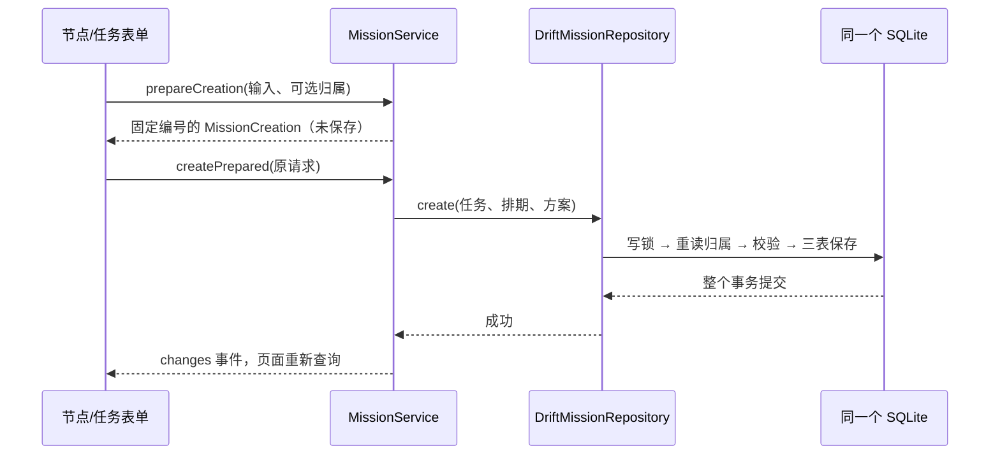

# U15 第三单元：任务关联目标与节点

这次把上一单元的节点树接到已经能执行、报告和交材料的任务上。任务始终可以独立创建，目标和节点都不是必选项；暂不引入整体 Plan 或 AI。

## 1. 先理解要存什么

以“学习 Flutter → 界面 → 布局”为例，你可以直接创建“练习布局”，也可以只把它放到“学习 Flutter”目标下，或者关联到“布局”节点。

| 选择 | Mission.goalId | Mission.goalNodeId |
| --- | --- | --- |
| 独立任务 | null | null |
| 只关联目标 | 学习 Flutter 的编号 | null |
| 关联节点 | 学习 Flutter 的编号 | 布局的编号 |

所以这里给现有 `missions` 表增加两个可空列，不增加一张任务关系表。每个任务最多直接属于一个目标、一个节点；一个目标或节点可以对应多个任务。旧任务升级时这两列自然为空，不根据标题、日期或进入页面的路径猜归属。



## 2. 本轮目录和阅读顺序

| 类型 | 文件 | 这一步负责什么 |
| --- | --- | --- |
| 修改 | [任务表](../../lib/data/local/tables/missions.dart) | 两个可空编号、外键、组合检查和查询索引 |
| 新增 | [数据库归属约束](../../lib/data/local/mission_ownership_guards.drift) | INSERT/UPDATE 时检查节点确实属于所选目标 |
| 修改 | [数据库与升级](../../lib/data/local/app_database.dart) | schema v8，兼容 v1—v7，原数据保留 |
| 修改 | [Mission](../../lib/domain/entities/mission.dart) | 业务对象接收并保存这两个编号 |
| 新增 | [归属对象与查询组合](../../lib/domain/entities/mission_ownership.dart) | 区分保存的编号、选择器的目标节点和阅读用名称路径 |
| 新增 | [固定创建请求](../../lib/domain/entities/mission_creation.dart) | 把任务、首版排期、执行方案作为同一次创建请求保留 |
| 修改 | [仓储接口](../../lib/domain/repositories/mission_repository.dart) | 约定归属查询、目标任务查询和编辑参数 |
| 修改 | [真实仓储](../../lib/data/repositories/drift_mission_repository.dart) | 映射新增字段，在写事务中重读并核对归属 |
| 修改 | [业务服务](../../lib/application/missions/mission_service.dart) | 准备对象、调用保存、提交后发出重读通知 |
| 新增 | [归属输入区](../../lib/presentation/missions/form/mission_ownership_field.dart) | 默认独立，按需打开有效目标/节点选择器 |
| 修改 | [任务表单](../../lib/presentation/missions/form/mission_form_page.dart) | 创建/编辑/重试草稿、归属选择、说明和原因、失败保护 |
| 新增 | [目标下的任务区](../../lib/presentation/goals/outline/goal_missions_section.dart) | 直接关联任务、记录标签、建任务和已有执行工作区 |
| 修改 | [目标节点区](../../lib/presentation/goals/outline/goal_outline_section.dart)及目标列表/详情 | 同时监听目标和任务服务，刷新真实节点与任务 |
| 修改 | [详情正文](../../lib/presentation/missions/detail/mission_detail_content.dart)、[共用标题](../../lib/presentation/missions/shared/mission_execution_display.dart) | 在详情、执行和记录中展示真实归属路径 |
| 参考 | [既有执行工作区](../../lib/presentation/missions/execution/mission_execution_page.dart)、[事件规则](../../lib/domain/rules/execution_event_rules.dart) | 继续复用原来的执行、报告、材料和唯一阶段推导 |

`.drift` 文件是交给 Drift 生成工具读取的 SQL 源文件，不是运行时数据库。它让新装建库、升级和冻结结构快照都能包含相同的归属触发器；生成的 `app_database.g.dart` 仍由工具生成，不手工修改。

## 3. 先定义表，再让业务对象接收归属

任务表的 `goalId` 引用目标表，`goalNodeId` 引用节点表，两个字段都允许为空。数据库还检查：节点不为空时目标必须存在，所选节点必须属于这个目标。

为什么需要额外触发器：SQLite 可以给旧表追加列，但不能直接给已有表追加复合外键。保留旧表和历史数据，只追加两个列，再通过数据库触发器核对编号组合，可以让新装和升级获得同样的保护。触发器只检查关系，目标暂停、节点归档等业务规则仍由仓储在事务中检查。

业务层的 `MissionOwnership` 只装两个编号：

```dart
const independent = MissionOwnership(); // 两个编号默认都是 null，表示独立任务。
final goalOnly = MissionOwnership(goalId: goal.id); // 目标编号由已读到的目标提供。
final atNode = MissionOwnership(goalId: goal.id, goalNodeId: node.id);
```

这些是三种对象构造示例，不会保存数据。表单把当前选择保存在自己的 `_ownership` 中，点击保存后才交给服务。`Mission.ownership` 是按两个字段构造的只读属性，方便编辑时比较“原归属”和“本次选择”，它不是数据库中的第三个归属列。

名称不重复保存到任务：`MissionOwnershipInfo` 是详情查询的组合结果，装目标和从根到叶的节点路径。改节点名称后，任务显示当前名称，但任务保存的目标/节点编号不会变化；这不是历史名称审计。旧执行事件、报告和材料仍原样保留。

## 4. 用一次“从节点建任务”串起调用

1. 用户在“布局”节点点击“建任务”。`GoalMissionsSection` 打开 `MissionFormPage.forGoal`，把已查询的 Goal/GoalNode 传进去。
2. 表单预填节点名称、说明、目标 Why，以及两个归属编号。具体目标默认节点名称，用户仍可改；不自动编造步骤或材料标准，也不自动保存。
3. 用户填写日期和计划分钟，必要时改成独立任务、只关联目标或其他有效节点。控件通过 `onChanged` 把选择交回表单。
4. 点击创建，表单调用 `MissionService.prepareCreation`，得到一个 `MissionCreation`，其中包含 Mission、首版排期和执行方案。三者使用同一个任务编号；此时还没保存。
5. 表单保留该请求，再调用 `createPrepared`。服务把三个对象交给 `MissionRepository.create`，实际运行的是 App 装配的 `DriftMissionRepository`。
6. 仓储先取得写权限，再核对请求身份和最新归属。独立任务直接继续；关联目标必须正在推进，所选节点和祖先必须有效。随后把任务、排期、方案放进同一个事务保存。
7. 事务成功，服务才向 `changes` 添加事件。目标区、今天页等监听者重新查询，各自取得最新事实。失败时不会发出成功通知。



相比 Spring Boot，你可以把 `MissionService` 对照应用业务 Service，把 `MissionRepository` 对照数据访问接口，把 `DriftMissionRepository` 对照具体实现。这里没有网络 HTTP 接口，Flutter 页面直接调用本地 Service；`Future` 用来等待这个异步调用的结果。

## 5. 开始前编辑，开始后锁定

编辑沿用原来的 `MissionService.edit → repository.edit`，没有增加第二套保存入口。接口新增 `ownership`：省略表示保留原归属，显式传 `const MissionOwnership()` 表示解除关联。表单会传完整当前选择。

仓储取得写权限后重新读取任务：取消后拒绝编辑，已经有执行事件也拒绝编辑。然后比较打开编辑页时的原快照，发现其他入口已经改过标题、归属、说明、方案或排期就拒绝覆盖，保留用户输入。

改归属与标题、说明、原因、方案和新排期版本属于同一个事务，后续任何一步失败都会一起回滚。只改归属不会凭空新增排期版本。原归属后来失效时，可以保留它编辑待开始任务的标题；要换归属则必须重新选择有效目标/节点，也始终可以改成独立任务。

归档节点或暂停目标不暂停、不取消已有任务。START、暂停、继续、END、提交材料仍走既有执行流程，不拿“当前还能否新建”去阻止旧任务继续完成。

## 6. 节点如何显示真实记录

节点区通过任务服务一次读取这个目标的任务，各节点只筛选直接关联自己的任务。没有节点编号的任务放在“仅关联目标的任务”，不会塞到某个根节点下。

记录标签按顺序判断：有 COMPLETED 的 END 就显示“有完成记录”；否则有 RUNNING/PAUSED 显示“执行中”；否则有 NOT_STARTED 显示“已安排”；其余为“暂无完成记录”。待补材料另行提示。父节点不会继承孩子的完成记录，新建下一次任务也不会抹掉已有完成标记。

点击标签原位展开真实任务摘要，待做项排在已结束记录之前。开始和继续复用 `MissionInlineWorkspace`，其中仍使用原来的动作控制器与执行页面；已经结束的任务进入记录，待补任务可进入材料办理。没有新的执行状态机，也没有保存节点“已掌握”。

收起路径、切归档区和手动归档前，会先让已有工作区检查未提交报告。查询失败保留上次内容；从其他入口归档正在办理的节点时保留该工作区及祖先，防止隐藏动作销毁草稿。归档后的建任务入口关闭，旧任务仍可办理。

## 7. 失败、再次尝试和验证边界

创建结果未知时，表单锁住原请求，支持用同一编号重试或“检查保存结果”。仓储先识别该请求是否已保存，再判断后来的归档或截止变化。确认尚未保存后才能解锁修改；确认已保存则显示成功，避免重复生成任务。

“再次尝试”沿用原任务归属预填新草稿。如果原目标已停止推进或节点已归档，不自动恢复，也不悄悄改成独立：界面提示用户明确选择其他归属或独立任务。新任务保留 RETRY 来源，不复制旧事件或材料。

自动验证包括：三种归属、外键/同目标限制、开始前更换与解除、旧快照冲突、开始后锁定、关联与改期原子回滚、归档后旧任务执行与交材料、创建响应丢失、真实文件重开，以及窄屏大字体和节点办理链路。v1—v7 迁移保留旧事实；v7 原节点各列保留，末尾触发器创建失败时新增列和索引一起回滚，排除故障后可重试。

本单元未做原生设备升级或新安装包验收；自动检查结果以[学习进度](学习进度.md)当前检查点为准。目标编辑/状态操作、导入、备份及 AI 留到后续单元；这次落地不代表用户已经掌握新增代码。


## 2026-10-25：UI 阅读顺序补正

用户要求对照原正稿重新设计，并强调页面元素必须符合实际业务逻辑。当前把归属移至表单顶部，方案折叠；目标详情和节点树改为开放排列，任务展开获得完整宽度。新任务的默认具体目标在用户单独修改前跟随名称变化。卡片/详情共用只读节点记录摘要，不新增可写状态。样式、动作对应关系与四张实际组件取样见[制作记录](../ui设计手册/制作记录/2026-10-25-目标节点与任务归属界面.md)。
