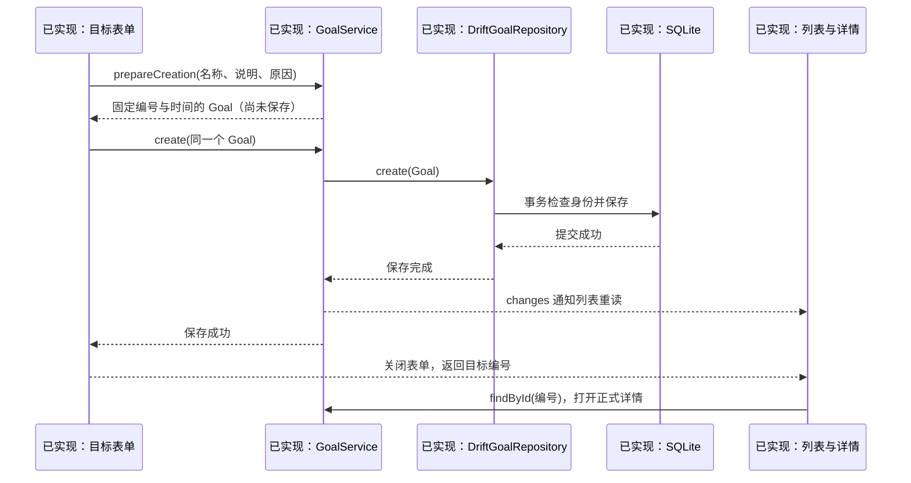

# U15 第一单元：创建目标、保存、列表与详情

日期：2026-10-24。本单元由助手按用户授权实现，按存储 → 业务对象 → 接口 → 实现 → 业务方法 → 页面调用说明。实现、验证与用户理解分别记在[学习进度](学习进度.md)。

本文保留第一单元 schema v6 的实现过程。2026-10-25 第二单元已接通节点树，当前代码的扩展与 v7 迁移见[目标节点树](U15-目标节点树.md)；下文“本轮”仅指第一单元。

## 1. 本轮在解决什么

任务记录回答“做了什么”，目标补充“希望往哪个方向走”。本轮完成手动创建 Goal、保存、列表和详情。节点树、任务归属、目标编辑/状态切换、整体 Plan 与 AI 后续接入；本轮不创建这些功能的空表或接口。

Goal 的字段按[数据模型](../需求文档v1.0/数据模型.md#21-goal)定义，状态按[领域模型](../需求文档v1.0/领域模型.md#21-goal-状态)定义。用户只必填名称，可选说明和原因；初始状态是 ACTIVE。完成任务不会自动把目标判成已达到。

## 2. 文件顺序与职责

| 操作 | 文件 | 为什么放在这里 |
| --- | --- | --- |
| 新增 | [goals.dart](../../lib/data/local/tables/goals.dart) | SQLite 表定义，规定列、默认值和约束 |
| 修改 | [app_database.dart](../../lib/data/local/app_database.dart) | 注册目标表，保留旧数据升级 v6 |
| 自动生成 | [app_database.g.dart](../../lib/data/local/app_database.g.dart) | Drift 根据表定义生成配套读写代码，不手改 |
| 新增 | [goal.dart](../../lib/domain/entities/goal.dart) | 业务中的目标及创建约束，不引用 Drift |
| 新增 | [goal_repository.dart](../../lib/domain/repositories/goal_repository.dart) | 约定保存、列表、按编号查询 |
| 新增 | [drift_goal_repository.dart](../../lib/data/repositories/drift_goal_repository.dart) | 实际 SQL、事务和行对象转换 |
| 新增 | [goal_service.dart](../../lib/application/goals/goal_service.dart) | 输入整理、固定创建请求、保存及成功通知 |
| 新增 | [goals_page.dart](../../lib/presentation/goals/list/goals_page.dart) | 顶层列表、查询状态和导航 |
| 新增 | [goal_form_page.dart](../../lib/presentation/goals/form/goal_form_page.dart) | 输入草稿、保存重试和离开保护 |
| 新增 | [goal_detail_page.dart](../../lib/presentation/goals/detail/goal_detail_page.dart) | 按编号查询正式目标，显示说明和原因 |
| 修改 | [app.dart](../../lib/app.dart)、[app_shell.dart](../../lib/app_shell.dart) | 装配一次目标服务，替换目标导航占位 |
| 仅参考 | 任务服务、任务仓储、任务表单及全局主题 | 沿用分层与视觉规则，任务业务不改写 |

## 3. 先定义保存的形状：Goals 表

从 `data/local/tables/goals.dart` 开始。它描述 SQLite 中每条记录有哪些列，**不是某条目标的数据**。`@DataClassName('GoalRow')` 让生成的数据库行使用 GoalRow 这个名字，避免与下一步的业务对象 Goal 混淆。

```dart
TextColumn get description => text().nullable()(); // 用户不填写时保存 null。
IntColumn get createdAt => integer()(); // UTC Unix 毫秒，不保存格式化日期文字。
```

名称非空、状态取值及主键唯一由数据库再次保护。AppDatabase 将 schemaVersion 从 5 调整到 6：新安装创建全部七表，v5 只追加 goals；v1—v4 先补齐各自缺少的结构，再追加目标表。迁移和版本标记共同提交，不删除旧表。

开发电脑运行 `dart run build_runner build` 生成访问代码；用户打开应用时是 Drift 根据版本执行迁移，不需要用户运行生成命令。结构快照保存在 `drift_schemas/drift_schema_v6.json`，v1—v5 快照保留用于旧库升级测试。

## 4. 再定义业务中的目标：Goal

`domain/entities/goal.dart` 表达一次目标数据。它的 `status` 使用 GoalStatus 枚举，时间使用 DateTime；数据库使用稳定字符串和整数，转换交给 data 仓储。

例如输入“能独立开发 Flutter 应用”，会准备一个带 UUID、名称、可选说明、ACTIVE 状态和时间的 Goal。**对象被创建不等于数据库已经保存。** `validateForCreation()` 检查非空名称、规范化可选文字、初始状态和 UTC 创建时间；这不是目标全部编辑规则，本轮只支持创建。

## 5. 接口先约定操作，实现再决定怎样存

`GoalRepository` 提供三项操作：`create` 保存固定请求，`findAll` 读取默认列表，`findById` 按编号读取目标。它类似 Java 中由业务服务依赖的仓储接口，没有 SQL 或 Flutter 类型。

`DriftGoalRepository` 接收 App 装配的 AppDatabase，和任务仓储使用同一数据库。保存时在事务里取得写权限，查询这个编号：不存在才插入；编号和全部内容相同说明是同一请求重试，直接视为成功；同编号不同内容拒绝覆盖。

```dart
await database.into(database.goals).insert(
  GoalsCompanion.insert(
    id: goal.id,
    title: goal.title,
    description: Value(goal.description), // 明确提供这个值，null 也有意义。
    why: Value(goal.why),
    status: const Value('ACTIVE'),
    createdAt: goal.createdAt.millisecondsSinceEpoch,
    updatedAt: goal.updatedAt.millisecondsSinceEpoch,
  ),
);
```

这段代码位于 `DriftGoalRepository.create` 的事务回调中。Companion 是 Drift 的写入参数，`insert` 才是真正执行写入；`await` 等待这一步，外层事务成功后仓储方法才返回。

列表按创建时间倒序，同一毫秒按编号稳定排序，默认排除 DROPPED。按编号查询仍能读到它。放弃、恢复及其他状态变更入口尚未实现，因此本轮页面创建出的目标全部是正在推进。

## 6. 业务方法组织这一次请求

`GoalService.prepareCreation` 接收表单文字：名称 trim，可选空白转 null，生成 UUID 和同一个毫秒精度 UTC 时刻，再构造 Goal 并检查规则。返回的是**待保存请求**。

`GoalService.create` 接收这个 Goal，再次校验并等待仓储保存。仓储失败则把错误交回页面；成功后发送 changes 通知。通知只是“请重读”，列表仍通过 findAll 查询数据库，不能拿通知代替正式记录。

时间截到毫秒是为了和存储精度一致。同一请求即使保存成功但响应丢失，读回后的时间也能与原请求精确比较，不会误判为内容冲突。

## 7. UI 从输入到正式详情



表单位于 `GoalFormPage._save`。本次表单的控制器提供输入，`_pending` 固定第一次准备的请求：

```dart
_pending ??= widget.service.prepareCreation(
  title: _title.text,
  description: _description.text,
  why: _why.text,
);
await widget.service.create(_pending!);
if (mounted) Navigator.of(context).pop(_pending!.id);
```

`??=` 表示只有左侧为空才准备新请求；重试继续使用同一个 Goal。`widget.service` 是列表传下来的共享服务，不在页面重建时重新创建。保存成功后 pop 返回编号，列表关闭表单后打开详情，返回详情会回到列表。

失败时保留输入和请求，并暂时锁定输入。点“重试保存”提交同一份请求；点“确认结果并继续编辑”先查询原编号：已保存就进入详情，明确未保存才恢复编辑。查询也失败时继续保留输入。保存期间禁用重复提交和返回，离开有输入的表单需要确认。

列表与详情分别使用 FutureBuilder 展示等待、错误和正式结果。FutureBuilder 接收查询返回的 Future；`setState` 的回调只同步替换这个 Future，不能使用返回 Future 的赋值箭头函数。列表收到 changes、页面返回或应用回到前台时重新查询。

界面沿用主页暖白底、白色圆角卡片、森林绿和现有文字层级。列表突出目标名称与状态，详情突出名称、说明和原因；没有编造进度百分比或未接通的节点按钮。

## 8. 验证与下一单元

新增测试见 `test/data/repositories/goal_repository_test.dart`、`test/presentation/goals_page_test.dart`；旧迁移测试补充 v5 六表逐字段保全，再确认新建目标表与关闭重开。自动测试包括目标文件持久化、重复请求、同编号冲突、保存前失败、成功响应丢失、返回保护、加载详情和大字体布局。

这些结果不代表已完成 Android/Windows 设备升级验收，也不代表用户已经理解或独立实现。下一单元才加入 GoalNode，再把 Mission 的归属接入创建与查询；本轮目标对象保持稳定身份，为关联提供实际基础。
