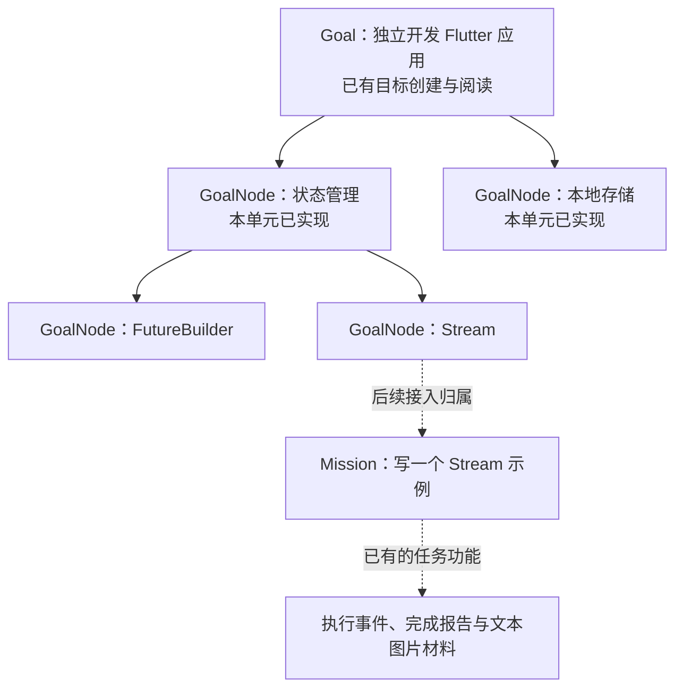
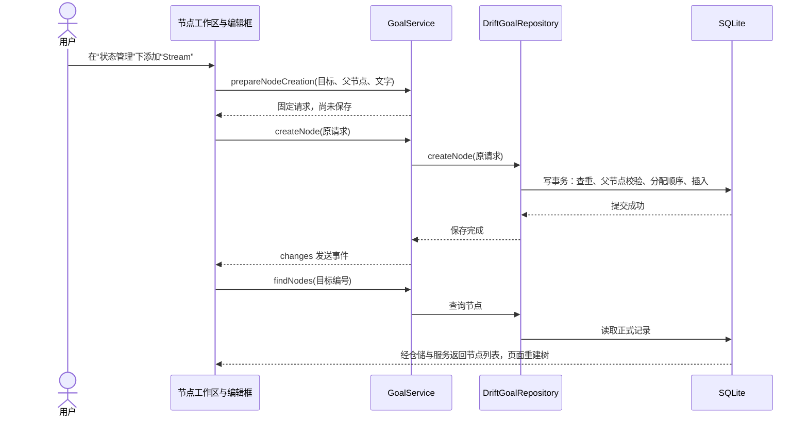
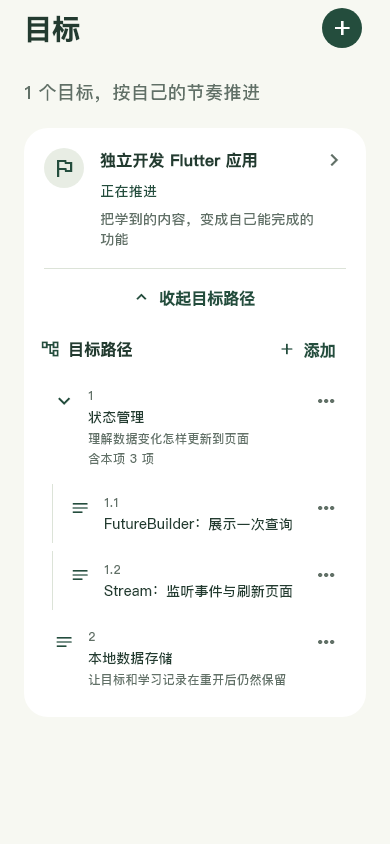
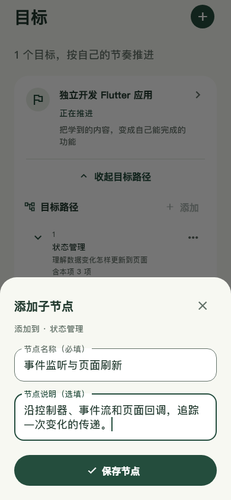

# U15 第二单元：把目标拆成节点树

日期：2026-10-25。承接[目标创建与阅读](U15-目标创建与阅读.md)。本单元已实现手动维护节点树；任务归属、任务记录标签、覆盖率与 AI 仍待后续接入。实现和用户理解分别记录，不因为助手写完就记为用户已经掌握。

## 1. 先用一个例子确定对象关系

目标是“独立开发 Flutter 应用”，下面有“状态管理”和“本地存储”；“状态管理”又可以拆为“FutureBuilder”和“Stream”。这些都是 GoalNode。以后安排“今天花 30 分钟写一个 Stream 示例”，才是一次可以开始、暂停、结束的 Mission。

**节点负责表达内容和位置，任务负责一次行动。** 本单元先把内容组织起来，下一单元再把真实任务关联过来。



## 2. 本轮文件顺序

下面的链接按阅读顺序排列。沿用已有 GoalService、GoalRepository 和同一个 AppDatabase，没有再建立一套目标服务或数据库连接。

| 操作 | 文件 | 作用 |
| --- | --- | --- |
| 新增 | [goal_nodes.dart](../../lib/data/local/tables/goal_nodes.dart) | 定义节点表、父子外键及查询索引 |
| 修改 | [app_database.dart](../../lib/data/local/app_database.dart) | 注册表，v7 增量升级 |
| 自动生成 | [app_database.g.dart](../../lib/data/local/app_database.g.dart)、[v7 快照](../../drift_schemas/drift_schema_v7.json) | 配套数据库访问代码与可复现结构，不手改生成文件 |
| 新增 | [goal_node.dart](../../lib/domain/entities/goal_node.dart) | 已保存节点 GoalNode、保存前请求 GoalNodeCreation |
| 修改 | [goal_repository.dart](../../lib/domain/repositories/goal_repository.dart) | 约定节点创建、查询、编辑、同级调序及子树归档恢复 |
| 修改 | [drift_goal_repository.dart](../../lib/data/repositories/drift_goal_repository.dart) | 事务内读取、校验、分配顺序和保存，转换数据库行 |
| 修改 | [goal_service.dart](../../lib/application/goals/goal_service.dart) | 整理页面输入、准备固定请求、组织业务调用、成功后通知 |
| 新增 | [goal_outline_section.dart](../../lib/presentation/goals/outline/goal_outline_section.dart) | 查询与展示树、折叠选择、节点菜单及归档区 |
| 新增 | [goal_node_editor.dart](../../lib/presentation/goals/outline/goal_node_editor.dart) | 在当前位置填写新增/子节点/编辑，保护草稿与保存重试 |
| 修改 | [goals_page.dart](../../lib/presentation/goals/list/goals_page.dart)、[goal_detail_page.dart](../../lib/presentation/goals/detail/goal_detail_page.dart) | 列表卡内直接展开路径，详情复用同一节点工作区 |
| 新增/修改 | [节点仓储测试](../../test/data/repositories/goal_nodes_test.dart)、[节点页面测试](../../test/presentation/goal_nodes_flow_test.dart)、[迁移测试](../../test/data/local/execution_events_migration_test.dart) | 真实 SQLite、文件升级、保存失败与页面路径验证 |
| 仅参考 | 现有任务表、执行规则、材料服务和全局主题 | 节点单元沿用原架构，暂不增加任务归属列 |

节点工作区被提取出来，是因为列表和详情真正复用，而且有自己的查询、监听、展开状态和编辑交互；普通节点行仍留在同一文件，没有仅为减少行数再拆组件。

## 3. 先定义表：各层节点放在哪里

所有层级放进 `goal_nodes`，不为第一层、第二层分别建表，也不把整棵树作为一段 JSON 保存。可以用简化编号理解数据：

| id | goalId | parentNodeId | title | orderIndex |
| --- | --- | --- | --- | --- |
| n1 | g1 | null | 状态管理 | 0 |
| n2 | g1 | null | 本地存储 | 1 |
| n3 | g1 | n1 | FutureBuilder | 0 |
| n4 | g1 | n1 | Stream | 1 |

`parentNodeId` 为空表示直接放在目标下面；有值时，通过这个编号找到父节点。`orderIndex` 只比较同级，所以 n1 与 n3 都是 0 并不冲突。id 决定“是哪一个节点”，改名不换 id。

其他保存字段是选填的 description、归档时刻 archivedAt、创建和最近编辑时刻 createdAt/updatedAt。时间使用 UTC 毫秒；空说明保存 null。节点没有单独的完成状态或掌握度字段。

表中 `goalId` 引用 goals。父子关系使用 `(parent_node_id, goal_id)` 组合外键，同时核对父节点编号和所属目标，所以数据库也拒绝把 g1 的节点挂到 g2 的节点下。`UNIQUE (id, goal_id)` 为这个组合引用提供唯一键；这些约束都不级联删除历史。

同级查询有 `(goal_id, parent_node_id, order_index)` 索引。顺序连续、父节点有效等需要读取多条记录的规则，在仓储事务内处理。

AppDatabase 从 v6 升为 v7：v6 只追加节点表及索引；v1—v5 先补齐各自缺失结构，再追加节点。结构和 user_version 一起提交，失败一起回滚，原有目标、任务、执行事件与图片引用不重建。v1—v6 冻结快照保留。

## 4. 再定义业务对象：为什么有两个类

`GoalNode` 是已经保存的节点，包含实际分配的 orderIndex、归档状态和创建/编辑时刻。数据库查询生成的 `GoalNodeRow` 由仓储转换成它，页面不用操作 Drift 的行类型。

`GoalNodeCreation` 则是一次保存前的固定请求。编辑框提供目标编号、父节点编号及用户文字；服务整理文字，生成节点编号和创建时刻，再交回编辑框保留。**这时还没有写入数据库，也还不知道同级序号。**

序号不能根据页面看到的数量提前决定：两次新增可能看到同样的列表。仓储取得写权限后重新查询同级节点，才分配正确位置，所以请求对象不包含 orderIndex。请求只在首次提交时准备一次，失败重试继续使用原 id、内容和创建时刻。

## 5. 接口与实现：一次“添加 Stream”怎样保存

GoalRepository 增加节点的存取约定。GoalService 依赖这个接口，运行时 App 仍传入原来的 DriftGoalRepository。新增方法并不需要重新装配另一套服务。

在 DriftGoalRepository.createNode 中，实际过程是：

1. 校验请求的编号、文字及 UTC 毫秒精度。
2. 进入 transaction，先取得 SQLite 写权限。
3. 按固定 id 查询。相同请求已存在就成功返回；同 id 不同内容明确失败，不覆盖。
4. 查询目标与该目标的节点，检查父节点存在、属于同一目标且未归档。
5. 统计同级节点，包含归档项，把数量作为新的 orderIndex。
6. 使用 GoalNodesCompanion.insert 写入节点；所有步骤成功后提交。

`transaction` 接收的是我们提供的回调，由 Drift 执行。回调中的 `await` 等待每次数据库操作；其中任何一步抛出异常，整个写操作回滚，异常沿仓储 → 服务 → 编辑框返回。

查询时 `_nodeFromRow` 把数据库整数时刻还原成 DateTime。`_readNodes` 还会检查父子关系、循环、归档祖先和同级连续顺序；如果数据关系损坏，明确报错，不把无法连接的分支悄悄丢掉。

## 6. 业务方法：谁调用，结果交给谁

点击“状态管理”的“添加子节点”后，节点工作区把当前 goalId 和“状态管理”的 id 传给 GoalNodeEditor。编辑框中输入“Stream”，首次保存时调用 `prepareNodeCreation`，把返回的 GoalNodeCreation 放到自己的 `_pending` 字段，再交给 `createNode`。

下面是 GoalService 中实际保存方法的完整逻辑，位于已有类内部，调用者是编辑框的 `_save`：

```dart
Future<void> createNode(GoalNodeCreation request) async {
  await repository.createNode(request); // 等待仓储校验并提交；失败会把异常传回编辑框。
  _notify(); // 提交成功后，向监听 changes 的页面发送一次事件。
}
```

`changes` 仍是你刚理解的公开只读属性。节点工作区通过 `listen` 登记回调；事件到来时调用 findNodes，重新读取已保存的节点，再把新的查询结果交给 FutureBuilder 展示。它不会靠通知中的内容直接拼出新节点。



## 7. 树怎样显示、编辑和整理

数据库返回平面列表。工作区先按 parentNodeId 把同一父节点的孩子放在一个列表里，再从顶层开始展示。`_visibleEntries` 用一个待处理列表逐个取节点；后面的兄弟先放进去，先取出的就是前面的兄弟，从而保持同级顺序。

折叠状态保存在 `_collapsed` 这个 Set 中：放进去的节点暂不展示后代，删除编号后再展示。它只是当前界面的选择，不会归档节点或改数据库。展示编号如 1.2 在过滤归档项后生成，不写回 orderIndex。深层节点限制视觉缩进，并保留真实层级编号和层数，避免窄屏文字被挤到看不见。

本单元接通的维护操作：

- **编辑名称与说明**：提交原节点与新文字。仓储重新读取文字，若别人已经修改则拒绝覆盖；仅更新文字与编辑时间，不用页面旧对象覆盖新排序或归档信息。相同目标内容重复提交可以确认成功。
- **上移/下移**：服务用页面读到的全部同级节点准备新顺序，跳过归档项寻找相邻有效节点。仓储核对完整旧顺序，再一次事务保存全部 orderIndex；旧列表过期则要求刷新。按明确的新顺序重试，不会再相对移动一次。
- **归档**：确认后收集所选节点及全部后代，一次事务填写 archivedAt；不物理删除，保持原顺序。已有归档时刻不被重复操作覆盖。
- **恢复**：所选节点及后代一起恢复；父节点须有效。如果父节点也归档，先恢复父节点。不改任务历史。

归档/恢复与调序发生错误时，工作区重新读取正式记录，让用户看到实际结果，而不是在页面里先假装成功。

## 8. 页面与失败返回

目标卡直接展开路径，完整详情仍是可选阅读入口。添加/编辑共用底部填写框，顶部始终说明添加到哪个目标或父节点。字段只要求名称，说明选填。普通点击不先经过节点详情或另一个编辑路由。

保存中禁止重复提交和离开。失败保留输入并锁定本次请求，可直接重试；“确认结果并继续编辑”先按原编号查询。已保存相同内容就关闭并读取正式树；确认未创建才能改输入重新准备请求。编辑冲突时读取最新节点，再让用户核对保留的输入。系统返回和关闭按钮共同检查未保存内容。

列表刷新保留目标卡展开状态。节点区收到服务通知、应用回到前台，以及父页面返回后重新构建时均会重读，补足响应丢失时未发成功通知的情况。归档区添加新节点后切回当前路径，使保存结果可见。

界面沿用暖白背景、白卡和森林绿，目标名称、路径标题、节点名称与辅助说明分层。以下为真实组件使用独立内存示例的 390×844 渲染；取样加载 Windows 中文字体，按钮显式选择同一字体以避开测试环境 Ahem 方框。不是原生设备或浏览器验收，也没有向用户数据库写入示例。





## 9. 已验证与下一单元

- 静态检查无问题，全量 270 项测试通过。
- v1—v6 增量升级、新装、失败回滚与重开；v5 六表及 v6 七表逐字段保留，v6 四种目标状态保留。
- 并发新增同级连续顺序、创建请求查重、跨目标外键、归档父节点约束、调序失败整组回滚、子树归档恢复和真实文件重开。
- 目标卡内新增、子节点、折叠、编辑、移动、归档恢复；草稿返回、慢保存防重复、提交前失败、提交后响应丢失、编辑冲突与列表/详情重读。
- 320 宽、双倍字号、12 层节点及键盘遮挡时，页面和编辑框可滚动，未出现布局溢出。

尚未构建新安装包，也未完成 Android/Windows 设备升级与视觉验收。任务的 goalId/goalNodeId、节点任务列表、记录标签与覆盖率仍是下一单元：把已有执行事实和材料按真实节点归属查询出来。节点本身不被自动判定“已掌握”。
