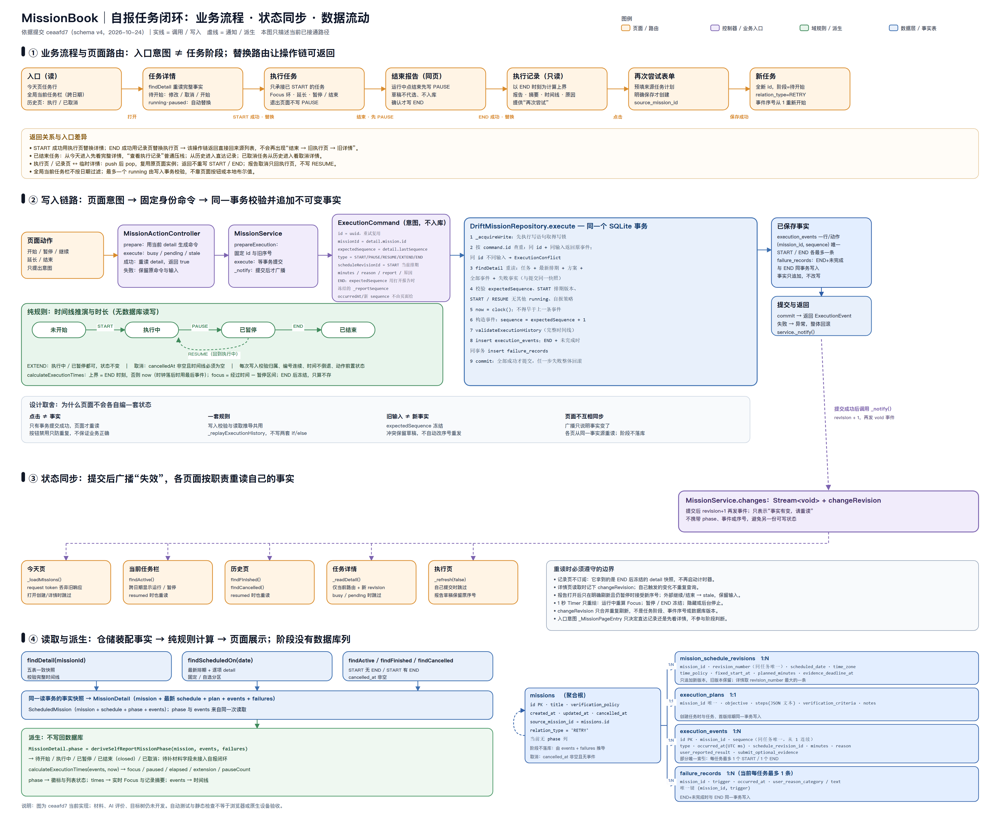
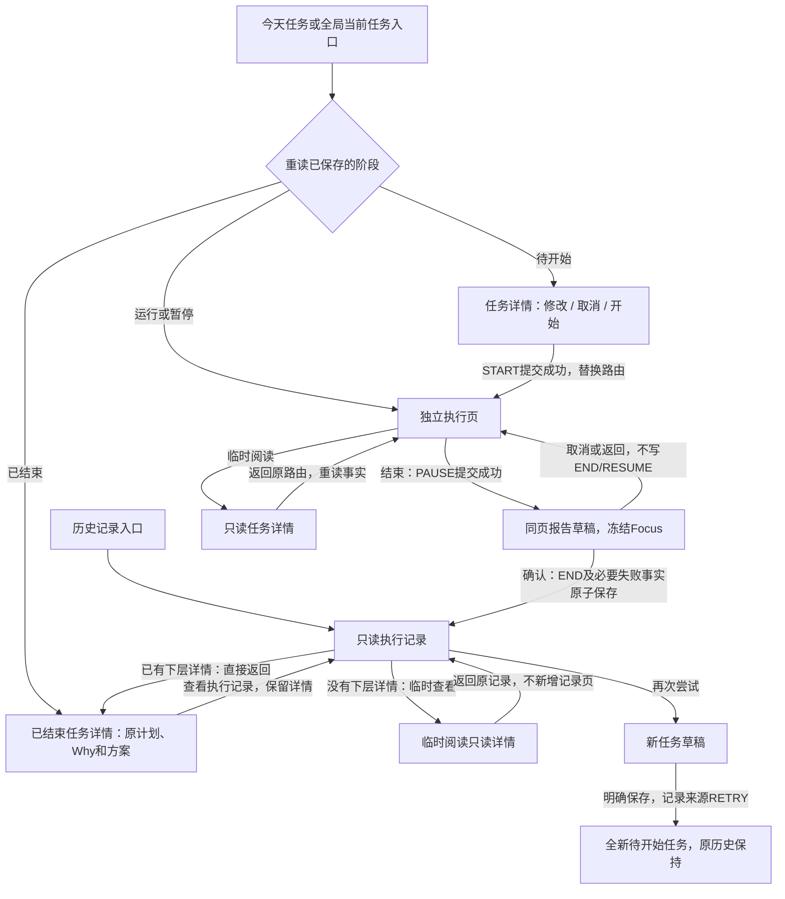
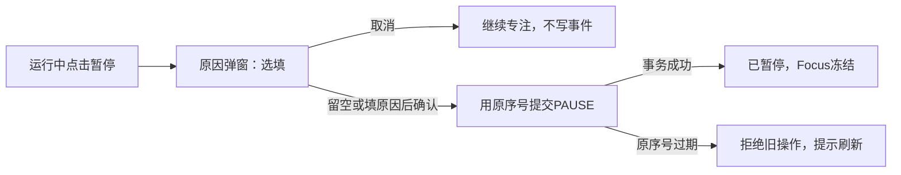

# 任务页面与执行状态流转

更新：2026-10-25。这里说明当前执行与材料闭环；目标树已落地，AI 评价仍待后续开发。下方图片是 2026-10-24 自报切片的历史快照，未包含后来的材料、目标表及记录页事实刷新；当前实现以本文正文和源码为准。

页面目录已按表单、详情、执行、记录、历史和共享组件归类。找页面及内部区域时，先看[页面代码索引](../../lib/presentation/README.md)；本次只调整文件组织和区域组件，下面的保存与同步流程保持。

## 三个页面各做什么

| 页面 | 内容 | 可以做什么 |
| --- | --- | --- |
| 任务详情 | 名称、阶段、排期、Why、方案，有内容才展示材料要求 | 待开始直接修改、取消、开始；已结束可查看记录；从执行/记录临时进入则返回原页面 |
| 执行任务 | 真实Focus、额度、延长、当前目标、可选暂停说明 | 运行时暂停/结束，暂停时继续/结束；结束报告在本页切换 |
| 执行记录 | 用户报告、冻结执行摘要、材料要求/正式材料、真实时间线，有填写才显示失败原因 | 查看执行事实、整理/提交材料、修正已有材料、可选材料放弃提交；再次尝试创建新任务 |

## 一张图看全



[打开矢量版 SVG](assets/u08/执行闭环与状态同步总图.svg)，可放大查看每个字段和箭头；PNG 适合直接阅读。

沿四条带读：

1. **① 业务流程**：入口只带任务编号。详情读取当前事实后决定动作；START 成功用执行页替换详情，END 成功用记录页替换执行页。从今天或当前任务栏进入运行/暂停任务会落到执行页；已结束任务从今天进入先看完整详情，从历史进入直达记录。
2. **② 写入链路**：页面只准备 `ExecutionCommand`（意图）。仓储在同一个事务里取得写锁、按 `id` 查重、重读五表、核对 `expectedSequence`、构造事件、用完整时间线校验，最后追加 `execution_events`；END 报告未完成时，`failure_records` 与 END 一起提交。页面给的 `occurredAt` 和最终序号都不被接受。
3. **③ 状态同步**：图中 `MissionService` 等仓储成功返回后先增加 `changeRevision`，再通过 `changes` 广播无业务内容的 `void` 信号；计数是单独属性。同一操作成功重试也会通知。图中的记录页尚未订阅；当前记录页也随通知重读材料、放弃和失败事实，执行摘要仍冻结在 END。
4. **④ 读取与派生**：仓储从事实装配 `MissionDetail` / `ScheduledMission`，domain 用同一套规则计算 `MissionPhase` 和 `ExecutionTimes`，页面只负责显示。阶段没有数据库列。

三个层次不要混：

| 层次 | 本次实现中的对象 | 是否落库 |
| --- | --- | --- |
| 操作意图 | `ExecutionCommand` 的 `id`、`expectedSequence`、`type` | 否；失败重试复用同一对象 |
| 已保存事实 | `execution_events` 一行、`failure_records` 一行、`missions.cancelled_at` | 是；只追加，不改写 |
| 派生结果 | `MissionPhase`、Focus / 暂停时长、列表状态文字 | 否；每次从事实计算 |

一次 START 的值流动：详情页读到的 `detail.lastSequence=0` 和 `detail.schedule.id` 进入命令 → 事务内重读并确认序号仍为 0 → 仓储捕获 `now`、分配 `sequence=1` → 事件入库并提交 → 广播 → 各页重读 → `detail.phase` 变成 `running` → 执行页显示 Focus 环。按钮点击本身没有改变任何阶段。

一次 END 的关键差异：打开报告时把当时的事件序号冻结在 `_reportSequence`；确认结束时用它作为 `expectedSequence`。如果其它入口在这期间恢复或结束了任务，仓储会因序号不一致拒绝旧报告，页面保留输入并标记过期，不会用旧草稿覆盖新事实。



START成功以执行页替换详情；END成功以记录页替换执行页，因此该操作链返回直接到来源列表。之后从今天再次点击已结束任务，先读完整详情，“查看执行记录”使用普通压栈，返回仍为原详情。从执行或记录临时阅读详情只压入一层，返回复用原页面实例，不创建第二份执行/记录页，也不再次写START或END。页面入口意图不是另一个持久化任务阶段。

## 页面间怎样保持一致

1. `MissionService.execute/edit/cancel/create` 等待仓储事务提交后才广播 `changes`。通知表示“事实有变，需要重读”，不携带另一份可写阶段。
2. 今天、当前任务栏、详情、执行页、记录页和历史按各自职责重读。日期快速切换忽略旧响应，FutureBuilder也不会让旧Future覆盖新Future；记录页将并发刷新串行合并，失败时保留快照并给出重试入口，材料草稿不被刷新替换。
3. `MissionDetail.phase` 使用同一套时间线核心推导；列表的阶段和事件来自同一次读事务。页面不根据按钮点击或本地布尔值宣布开始/完成。
4. `calculateExecutionTimes` 是唯一时间计算入口。运行按事件与now计算；暂停/结束冻结Focus。实时标签只重绘，不每秒查库或追加事件。窗口可见但失焦（inactive）仍刷新；真正隐藏／挂起以及路由TickerMode关闭时停止重绘，恢复后立即按真实时刻追上。刷新器幂等启停，不因父组件重建或数据重读反复推迟下一秒。

记录页的执行摘要冻结在 END，材料事实仍可变化。待补强制材料的可见记录页每30秒通过服务检查截止，恢复前台立即重读；超时只由原有仓储事务保存 FailureRecord，页面不自行改 phase。离开可见范围时停止截止轮询，正式提交与超时仍按互斥事务处理。

点击暂停后才询问原因，确认前仍在专注；弹窗按打开时的事件序号提交，不能使用外部变更后的新序号覆盖旧事实：


5. 退出执行页只是导航，不会暂停或结束。今天行显示执行阶段和Focus；全局当前任务栏不按所选日期过滤。运行/暂停点击直接进入执行页，已结束的今天任务先进入完整详情再查看记录；历史记录则直达结果。信息来源相同，阅读入口的意图不同。

## 从一个任务看懂查询与通知

例子：任务A“阅读”，排在2026-10-24，计划20分钟，尚未开始。

### 查到的数据为什么放在一起

`findDetail('A')` 按任务编号读同一任务的五类数据，再装成 `MissionDetail`。这是一次查询结果，数据库没有额外的“详情表”。

| 成员 | 例子中的内容 | 用在哪里 |
| --- | --- | --- |
| `mission` | A、标题“阅读”、尚未取消 | 确定任务身份、显示标题、检查取消与验证策略 |
| `schedule` | 排期A-1、10月24日、20分钟 | 日期筛选、计划展示、开始时固定采用的排期 |
| `executionPlan` | 具体目标、用户填写的步骤 | 详情与执行页展示行动方案 |
| `events` | 开始前为空，成功开始后含START | 推导运行/暂停等阶段和实际时长 |
| `failures` | 开始前为空，自报未完成后才有失败事实 | 校验结束报告与失败事实是否完整一致 |

这些记录通过同一个 `missionId=A` 关联，不靠标题或列表位置配对。仓储里的 `eventRows` 是SQLite查询得到的行，转换后的 `events` 是页面能使用的业务对象列表；`MissionDetail` 再把它与另外四类对象装在一起。

**排期不表示实际执行状态。** 今天列表先看最新排期是否属于所选日期，决定“显示哪些任务”；详情还要显示计划，并让START绑定用户确认的那版排期，所以查询会读它。判断A是否运行则读取任务与事件：即使计划日期到了，没有START仍是待开始。详情查询先关联排期和方案只是组织查询的次序，不是阶段计算的前置步骤。

### 从保存到收到通知

`MissionService.execute` 中这两句按顺序执行：

```dart
final event = await repository.execute(command);
_notify();
```

第一句等待事务提交或返回原来已成功的事件；失败会抛异常，不执行第二句。`_notify` 是项目自己写的普通方法，notify意为“通知”，名称开头的 `_` 限制它只能在当前Dart库内部调用。它增加刷新计数，然后用 `_changes.add(null)` 发出一次信号，信号里没有A的标题、排期或阶段。

页面先前已经通过 `service.changes.listen((_) { ... })` 登记了回调。`listen` 表示监听，括号里的函数是收到信号后执行的代码，`_` 表示忽略没有业务内容的通知。页面和发送者持有同一个服务对象，因此连接的是同一个广播流。服务发送后，Dart异步调用这些已登记回调；页面销毁时取消订阅。

今天页回调调用 `_loadMissions`，按当前日期重查；详情页回调通过 `_retry` 重查当前任务。今天页自己打开详情期间暂缓通知刷新，返回时再读取；正在提交的详情由Controller主动重读。它们都不从通知里取阶段。

### 阶段具体怎么算

`MissionDetail.phase` 将 `mission`、`events`、`failures`、`evidence` 和最新 `schedule` 交给 `deriveMissionPhase`（完整六阶段入口）。行动方案不参与阶段判断。

开始前 `events=[]`，规则从待开始出发，没有事件改变它；START成功提交后查到 `[START(sequence:1)]`，规则读到START就从待开始变成运行。后续读到PAUSE变暂停，RESUME变运行，EXTEND不切换阶段。每次都根据按序号排列的已保存事件重新推导，同时检查序号、时间和动作是否合法；结束后再结合报告、正式材料与失败记录推导待补材料或已结束。

所以这次变化是“保存START → 查询得到START → 规则返回running → 页面显示执行中”，没有一条“把排期改为运行”或“把通知写成运行”的操作。

## 报告与失败恢复

- 打开报告前先保存PAUSE，失败时仍留执行布局；已暂停不重复写PAUSE。
- 初始不代选完成情况，原因可留空。报告保留打开时的事件序号；其它入口恢复或延长后，不自动将旧草稿当成新报告提交。
- 自动状态同步保留草稿并禁用过期提交；明确刷新且仍暂停时才接受新序号。取消草稿不写RESUME，运行必须明确点击继续。
- 未确认的动作保留同一个事件编号和输入，“重试原操作”只确认或执行同一次动作，不重复延长/开始/结束。
- 另一个运行任务冲突不静默暂停。明确暂停对方成功后，仍由用户手动开始或恢复当前任务。
- 记录页以END时刻作为计算上界，不启动计时器。原因未填写就不造“未完成原因”空区块。
- 取消记录从历史的“已取消”找回，只显示真实取消时间、排期和没有执行记录。

## 数据与实现位置

历史上 schema v4 在既有五表上增加 Mission 的来源编号与 RETRY 类型；当前 schema v9 已有八表，保留旧版增量升级路径。重试来源在创建事务内验证为已结束或已取消；原任务不复活，新的事件序号从1开始。

- [详情与入口分派](../../lib/presentation/missions/detail/mission_detail_page.dart)
- [执行与报告](../../lib/presentation/missions/execution/mission_execution_page.dart)
- [只读记录](../../lib/presentation/missions/record/mission_record_page.dart)
- [动作等待、冲突与幂等重试](../../lib/presentation/missions/shared/mission_action_controller.dart)
- [列表实时标签](../../lib/presentation/missions/shared/mission_live_status.dart)
- [事务仓储](../../lib/data/repositories/drift_mission_repository.dart)
- [跨页面行为测试](../../test/presentation/mission_navigation_sync_test.dart)

自动测试与静态检查不能代替用户的浏览器/原生设备验收；当前没有正式材料、AI评价、目标路径或完整历史筛选，不把图中的例子显示成真实记录。
