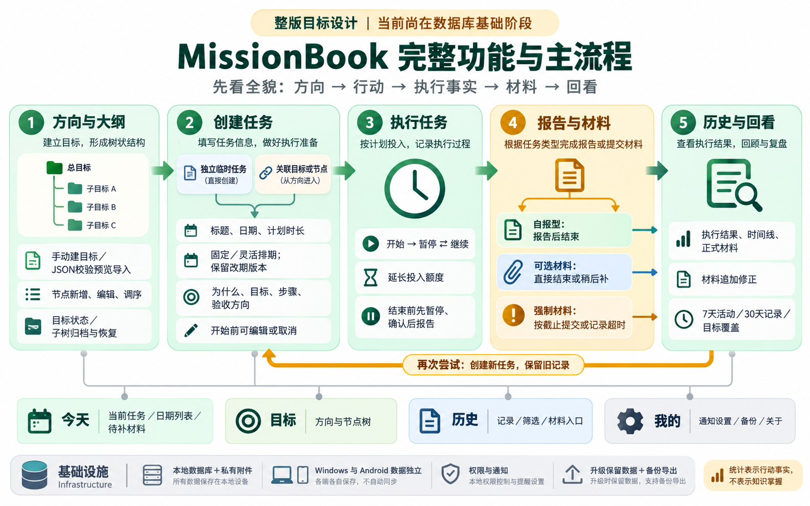
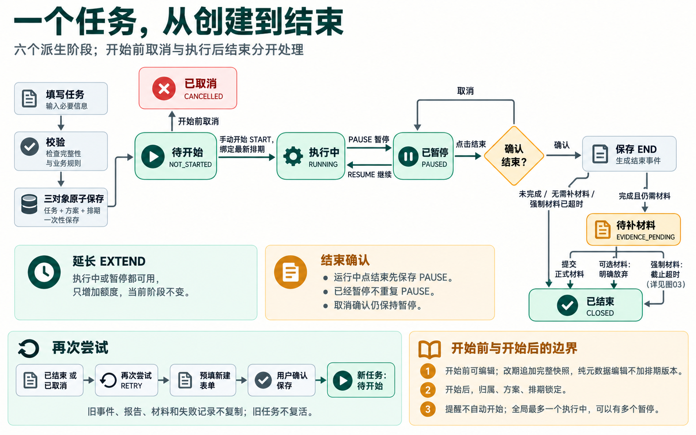
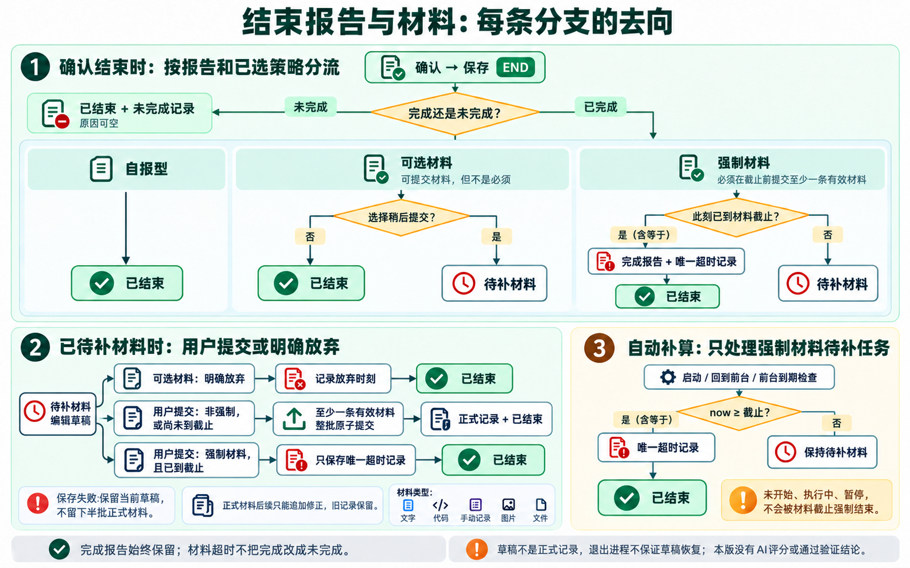
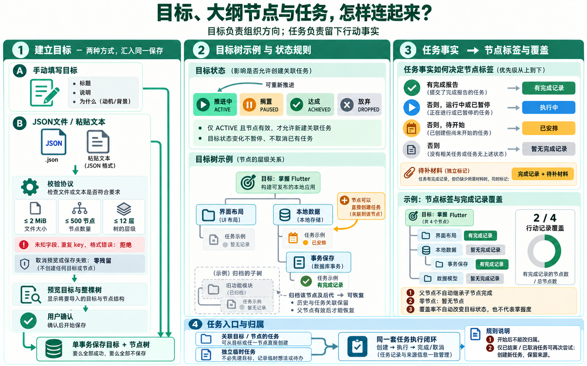
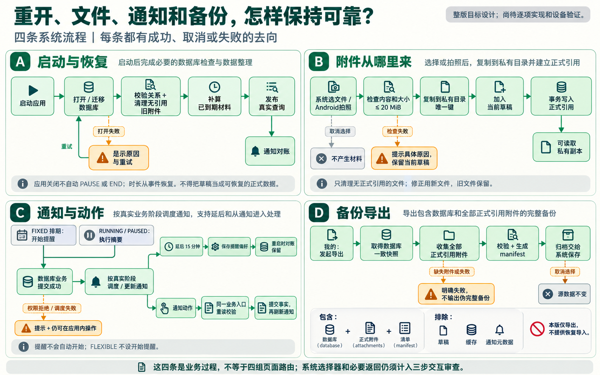

# MissionBook 完整功能图解

建立日期：2026-10-19。本图集通过内置生图工具生成，按“产品全貌 → 具体业务分支 → 技术数据流 → 系统流程 → 开发顺序”阅读。完整提示词见[生成提示词](制作记录/功能图解-生成提示词.md)，课程文字解释见[教纲](教纲.md)。

这些图覆盖现存规格所描述的本地整版目标。图中的进度标识是 2026-10-19 的快照；当前 U04 三个对象的转换函数已有，完整仓储与事务尚未接通，最新状态见[学习进度](学习进度.md)；阶段、业务步骤和模块关系不等于已经完成的功能，也不自动代表独立页面。具体页面路径仍须遵守[三步交互原则](../ui设计手册/三步交互原则.md)进行审查。

2026-10-29：独立 Agent、助手主导航和万任务按需检索尚未进入这套既有图片；当前以[Agent 接入 App](../设计/Agent接入App.md)的流程图与文字契约为准。分支中的会话/工具/页面只是部分实现，不能把下面的七张总图理解成 Agent 已接通。

## 01 完整功能总览

先看方向、任务、执行、报告与材料、历史回看的主线，再看今天、目标、历史、我的四个入口，以及通知和本地数据支持。再次尝试回到新任务，旧记录保留。

依据：[领域模型](../需求文档v1.0/领域模型.md)、[界面与交互](../需求文档v1.0/界面与交互.md)。图中统计表示行动记录，不是知识掌握或验证评分。

## 02 任务全生命周期

沿一个任务看六个派生阶段：待开始、执行中、暂停、待补材料、结束、取消。特别留意暂停与继续、延长时不改变阶段、结束确认取消后保持暂停，以及重试创建新任务的回路。

依据：[排期与执行事件](../需求文档v1.0/领域模型.md#4-排期与执行事件)、[六阶段与分流](../需求文档v1.0/领域模型.md#5-missionphase-与流程)、[结束确认](../需求文档v1.0/界面与交互.md#7-结束确认)。六个阶段由真实记录推导，END 是事件，不能再被当成第七个阶段保存。

## 03 结束报告与材料分流

先按“完成／未完成”分流，再按自报、可选材料、强制材料分流。图中特别展开首次提交、放弃可选材料、截止超时、正式材料修正，避免把“报告完成”“提交材料”“通过验证”混为一件事。

依据：[END 分流矩阵](../需求文档v1.0/领域模型.md#52-end-的分流矩阵)、[材料与草稿](../需求文档v1.0/领域模型.md#7-evidence-与草稿)、[截止与失败](../需求文档v1.0/领域模型.md#8-截止时间与失败记录)。now 等于截止即到期；完成报告保留；材料超时与首次提交互斥。草稿提交失败保留当前编辑，进程退出不保证恢复。图的条件是业务判定；END、报告和该动作必要的失败记录仍须同一事务提交，不能把图中方框各自提交后拼接。

## 04 目标大纲与任务关系

2026-10-27 新场景分支：[目标计划万级导入设计](../设计/目标计划导入/总览.md)，针对单 Goal 约 1 万个任务，补充[现有模型与待实施工作流图](assets/goal-import/目标计划万级导入.png)。旧总图只作关系参考；新目标包、暂存和导入回执仍待实施，不能沿用旧快照推断功能已完成。

左侧看手动创建和 JSON 校验预览导入，中间看目标树与任务归属，右侧看节点标签和覆盖率。临时任务可以独立存在；目标暂停或放弃不会取消已有任务。

依据：[Goal 与 GoalNode](../需求文档v1.0/领域模型.md#2-goal-与-goalnode)、[大纲导入](../需求文档v1.0/数据落地与平台.md#5-goal-outline-导入)。节点覆盖只统计有效节点的直接关联任务，父节点不自动继承子节点完成；目标状态由用户决定。

## 05 完整技术架构与数据流

当前课细图：[U04：一条任务怎样保存到本地](U04-任务保存链路.md)，沿“读书”的一次保存定位 Companion、Drift、SQLite 与数据库文件。

查询细图：[U06：查询执行过程与类的关系](U06-任务查询链路.md)，区分已有对象与待接通查询，沿 MissionRow → missionFromRow → Mission 理解反向转换；图中已有与规划状态为 2026-10-21 快照。

当前落地：[U06：今天页真实列表](U06-今天页真实列表.md)，已接通共享仓储、最新排期查询、固定/自选排序及一次查询后的主动刷新，配有旧 watch/map 转换解释和当前调用说明。

执行闭环细图：[任务页面与执行状态流转](任务页面与执行状态流转.md)，含[业务流程、写入事务、广播重读与读取派生总图](assets/u08/执行闭环与状态同步总图.png)。当前只接通自报任务；材料、AI 评价与完整六阶段仍未完成。

从界面动作向下跟踪一次业务命令，从数据库向上跟踪真实查询结果。图中列出八张目标核心表，并标出当前已有的三表基础；仓储转换、统一查询、附件目录与平台能力有各自职责。

依据：[数据模型](../需求文档v1.0/数据模型.md)、[核心表与关系](../需求文档v1.0/数据落地与平台.md#1-核心表与关系)、[存储与事务](../需求文档v1.0/数据落地与平台.md#2-存储格式与事务)。此图说明目标职责，不提前锁定所有具体类。业务对象与接口不引用 Drift 表，data 实现负责转换。阶段与统计由事实查询得出，不另建可写状态表。

## 06 本地系统与可靠性流程

分别看启动恢复、附件副本、通知对账和备份导出四条过程。文件准备和通知调度跨越数据库边界，需要各自的失败处理，不能只把成功路线画出来。

依据：[Schema、启动与备份](../需求文档v1.0/数据落地与平台.md#3-schema启动与备份)、[附件](../需求文档v1.0/数据落地与平台.md#4-evidence-附件)、[通知与权限](../需求文档v1.0/数据落地与平台.md#7-通知与权限)。启动图对初始化次序作教学概括：应用恢复和附件清理期间不并发创建草稿，发布业务查询前完成截止补算。通知失败不回滚业务事实；备份仅导出，不含恢复入口。

## 07 图形化开发教纲

将 21 个单元放到五阶段路径中，标出每阶段的目标结果。图中“当前 U03、下一实现 U04”是 2026-10-19 制图时的状态，现只用于说明路线；当前位置见[学习进度](学习进度.md)。代码、验证和掌握分别记录，图中的理解检查不要求每轮强制口述。

依据：[学习开发教纲](教纲.md)、[学习进度](学习进度.md)。U00—U02 是回查入口；后续分阶段实施，不要求把所有目标表和接口提前搭好。

## 核验与后续更新

图中文字、箭头、分支和当前／规划标识需逐张视觉核对。具体核验结果记录在[变更记录](变更记录.md)；图片不是运行或用户掌握的验收证据。配图与规格存在差异时，以已核对的业务规则修正配图，不让错误图形反过来改变业务。

后续讲一课时，从对应总图定位，再生成该课需要的调用、数据或交互细图；流程变化给出前后图、原因、影响与新的验收。可通过[原配图说明](配图说明.md)回看此前两张局部教学图。
