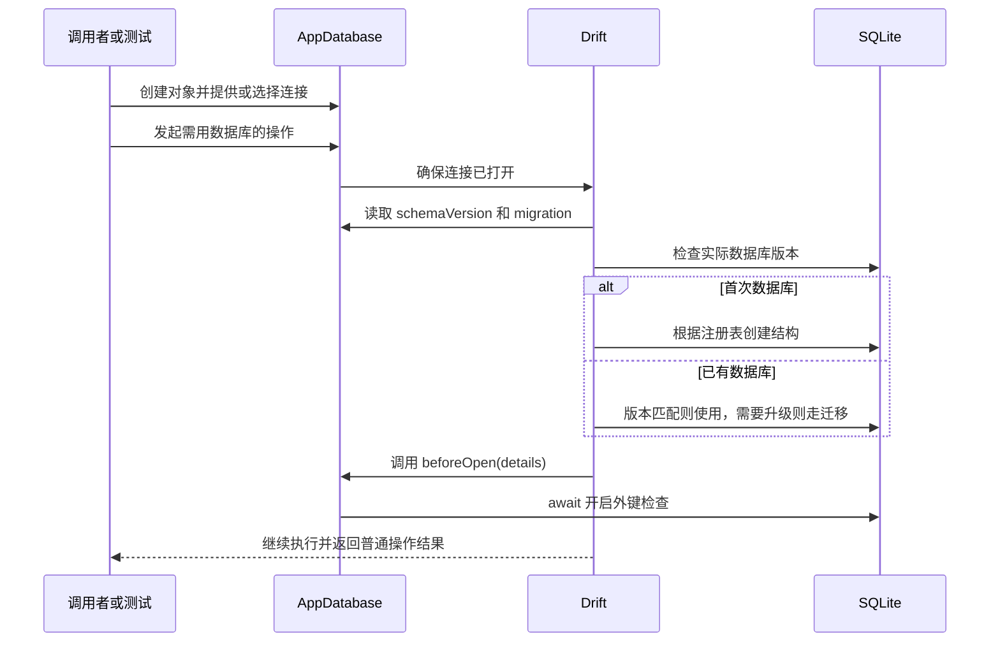

# U03 参考课：数据库何时真正打开

配套：[教纲](教纲.md) · [学习进度](学习进度.md)。本文保留 U03 回查材料；当前学习位置以学习进度为准，不因文件名带“当前课”而自动回到 U03。本课只讲已有代码，不新增业务功能。目标是看清“我们给配置，Drift 在开库流程中读取并调用它”。

## 这一课的范围

你已有的理解记录是：`AppDatabase()` 没传 executor，所以选择右侧 `driftDatabase(...)`，把结果传给父类。现在从这里接着看，不重新展开继承。

源码在 [app_database.dart](../../lib/data/local/app_database.dart)。当前普通应用入口尚未使用它，现有使用者是[数据库测试](../../test/data/local/app_database_test.dart)。因此下面描述的是该类被使用时的过程，不是声称打开今天页已执行这条链。

## 先串起一次真实过程



这是简化的语义顺序。连接可能延迟到首次需要数据库时才实际打开；`AppDatabase()` 构造对象、生成 Dart 代码、在设备上建立/打开数据库文件，是不同的动作。测试注入内存连接时不会因此证明本地文件已落盘。

## 只看眼前这段配置

```dart
@override
int get schemaVersion => 1;

@override
MigrationStrategy get migration => MigrationStrategy(
  beforeOpen: (details) async {
    await customStatement('PRAGMA foreign_keys = ON');
  },
);
```

| 眼前的代码 | 谁定义名称、谁提供值 | 在过程里做什么 |
| --- | --- | --- |
| `schemaVersion` | 属性约定来自 Drift；`1` 由我们按结构版本写定 | Drift 读取我们期望的数据库结构版本；它不是任务排期版本，也不是应用商店版本 |
| `migration` | 属性约定来自 Drift；策略对象由我们提供 | Drift 读取开库/迁移策略；写出这个 getter 不是立即执行所有 SQL |
| `MigrationStrategy(...)` | 类与命名参数由 Drift 提供 | 构造配置对象，其中包含我们交给 Drift 的函数 |
| `beforeOpen:` | 参数名由 Drift API 定义 | 这是放置回调函数的位置，不是我们自创的变量名 |
| `(details) async { ... }` | 函数是我们写的；形参名 details 由我们取，实际参数由 Drift 调用时传入 | Drift 在开库阶段调用它；本项目当前没使用 details，但它不是自动从某个文件查出来的名字 |
| `customStatement(...)` | Drift 提供执行 SQL 的方法；SQL 字符串由我们写定 | 请求当前连接开启 SQLite 外键检查；不是在这里定义三张表 |
| `await` | Dart 语言语法 | 等这次 SQL 完成后回调才结束，让开库流程继续，不让普通操作抢在它前面 |

这里没有自定义 `onCreate`，采用 Drift 默认的注册表创建行为；注册的是文件顶部注解里的三张表。已有库如果未来结构变化，只把 `1` 改成 `2` 不代表完成了迁移，需要对应迁移逻辑和旧数据验证。参见 [Drift 迁移文档](https://drift.simonbinder.eu/migrations/)、[迁移 API](https://drift.simonbinder.eu/migrations/api/)。

## 可选复习与验证边界

需要复习这条开库过程时，可以围绕下列问题定位疑问；它们是参考，不是每轮必须回答的考题，也不是进入 U04 的强制问答门槛。

1. 开库时谁读取 `schemaVersion`？这个版本控制什么？
2. `beforeOpen` 的函数是谁写的、谁调用的？`details` 的值从哪来？
3. 外键开启前就写关联记录会有什么影响？这里为什么等待完成？

2026-10-19 的数据库测试证明孤儿关联被拒绝及事务回滚，没有证明页面已接通，也没有验证未来迁移。U03 的已有理解和待确认项分别保留在学习进度；不能把检查通过直接记成掌握。

后续 U04 的目标是三个业务对象的转换与事务保存。具体从哪里继续由当前问题和实际代码决定，见[教纲](教纲.md)。
