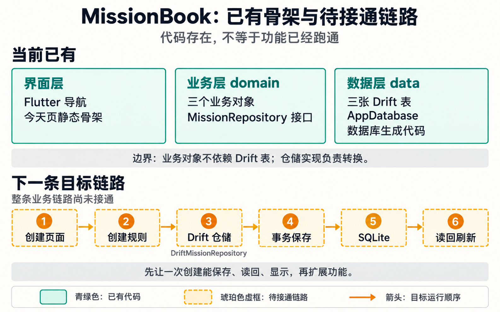
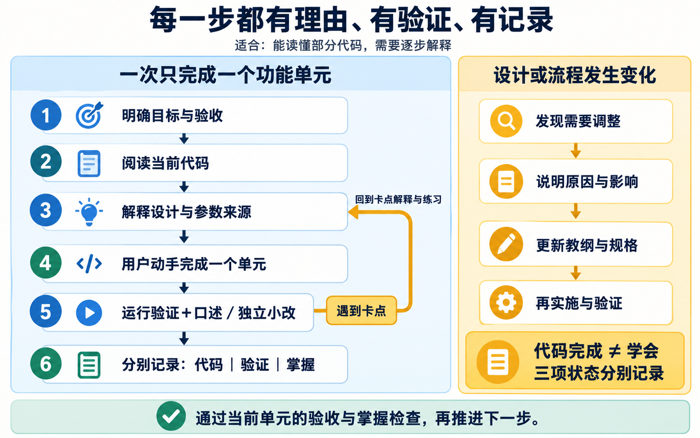

# 教学配图说明

生成与核验日期：2026-10-19（Asia/Shanghai）。

完整产品级图解已补充为[完整功能图解](完整功能图解.md)，包含总览及六张业务、架构与教学路线分图，完整提示词见[生成提示词](制作记录/功能图解-生成提示词.md)。本文件下方保留的是 2026-10-19 的两张局部教学图；图中已有/待实现属于当时快照，现状查[学习进度](学习进度.md)，讲解方式以[开发执行计划](开发执行计划.md)为准。

这两张图用于 MissionBook 可视化教纲：一张说明当前代码与第一条完整业务链路的距离，一张说明后续每个教学单元如何推进、如何处理卡点和变更。它们是教学解释图片，不是运行截图，也不构成功能验收证据。后续代码或教纲变更时，应先更新本文件中的文字语义，再决定是否重生成对应图片。

## 1. 已有骨架与待接通链路

图片：`assets/missionbook-architecture.png`

图例：

- 青绿色卡片：当前已有的代码结构。
- 琥珀色虚框：还需要接通的目标业务链路。SQLite 所在框也属于这条目标链路，不能据此理解为项目完全没有数据库基础设施。
- 单向箭头：一次创建操作的目标运行顺序。它不是 Dart import、类继承或模块依赖箭头。
- 上方三张卡片没有连接箭头，避免把代码边界与运行顺序混在一起。

可审阅的文字语义：

1. 界面层已有 Flutter 导航和今天页静态骨架。
2. 业务层已有三个业务对象和 `MissionRepository` 接口。
3. 数据层已有三张 Drift 表、`AppDatabase` 和数据库生成代码。
4. 业务对象保持独立，不依赖 Drift 表。未来的仓储实现负责在业务对象与数据库记录之间转换；这一句话描述职责，不表示实现已经完成。
5. 下一条目标链路是：创建页面 → 创建规则 → `DriftMissionRepository` → 事务保存 → SQLite → 读回刷新。
6. 当前不能把已有模型、表或生成代码等同于上述链路已经跑通。先完成一次创建的保存、读回和显示，再扩展其他功能。
7. 这是一张教学简图。事务保存包含需要一致完成的写入；图中省略了失败分支、异常反馈和具体表关系，实施时应以教纲与规格中的验收条件为准。

## 2. 教学推进与变更流程

图片：`assets/teaching-workflow.png`

图例：

- 左侧蓝绿色主流程：一个教学单元的推进顺序。
- 琥珀色回转箭头：出现卡点时，回到该点所需的解释和练习。
- 右侧琥珀色区域：设计或流程发生变化时，先解释和更新文档，再实施验证。

可审阅的文字语义：

1. 先明确本单元的目标和验收条件。
2. 阅读与本单元有关的当前代码，避免脱离仓库事实讲解。
3. 解释设计理由与参数来源，包括为什么这样组织、数据从哪里来、选择是否合理。
4. 默认用户亲手完成一个功能单元；授权代写或排错时由助手完成明确范围。
5. 运行针对性验证，理解状态另从实际对话或独立操作观察；需要时自然安排练习，不要求每轮口述。仅复制成功、构建成功或测试通过不能单独证明掌握。
6. 分别记录代码状态、验证状态、掌握状态；不得用同一个“已完成”覆盖三者。
7. 遇到卡点时回到该点解释与练习。图中将回转落点统一画在第 3 步，是简化表示；实际可回到具体的阅读、概念、实现或验证问题。
8. 依据当前卡点、实现依赖和用户意图决定下一步，保留待确认项；用户明确不懂时先处理疑问，不用强制问答充当推进门槛。
9. 设计或流程变更的顺序为：发现需要调整 → 说明原因与影响 → 更新教纲与规格 → 再实施与验证。实施不能悄悄领先于变更说明。

制作过程与原始提示词另存于[基础配图生成记录](制作记录/基础配图-生成记录.md)。
