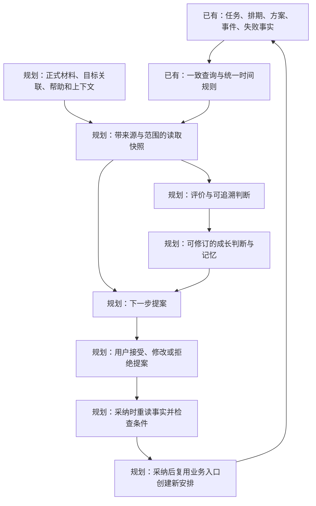

# 面向 Agent 的成长数据与开发规划

2026-10-24 后续实现更新：本文五表清单是研究时基线；已按用户确认接通 schema v5 文本/图片、可选材料、强制截止与待补入口。真实实现与调用过程见[文本图片材料实现](U12-文本图片材料实现.md)，验收边界见[学习进度](学习进度.md)。后续 Goal/Agent 路线仍为待安排建议，不因材料落地自动实现。

日期：2026-10-24。研究基线：`f7fe078`（本轮先提交的完整工作检查点）。

本文回答：MissionBook 应该保留哪些信息，才能让未来 Agent 理解用户做过什么、目前能做什么，以及下一步怎样安排。它是基于当前源码和产品思路形成的开发建议，不是已实现清单，也不把未来对象直接升级为本版规格。用户可据此继续安排工作；开始具体单元时再展开字段、交互和代码。

## 1. 对产品思路的理解

依据[产品纲领](../需求文档v1.0/产品纲领.md)和[未来方向](../需求文档v1.0/未来方向.md)，产品的长期循环是：

**长期方向 → 可执行行动 → 真实经历与产出 → 有依据的判断 → 用户决定 → 下一轮行动。**

Agent 要同时理解三种变化：

- **行动变化**：原来计划多久，实际记录了多久，在哪里暂停、未完成，后来怎样调整。
- **能力变化**：在什么问题和条件下，用户能解释、能操作、能独立解决，哪些结论还缺证据。
- **现实条件变化**：当前可用时间、环境、临时事务和用户明确表达的偏好，哪些只是短期情况。

任务结束只是一次行动的结果。学习任务需要区分本人独立完成、看提示完成和 AI 代写后运行成功；跑步、办事等任务则不必强套知识掌握度。规划应服务于用户的目标和可持续生活，不只追求完成数。

这也适用于开发 MissionBook 本身：当前代码由助手实现，自动检查通过，可以证明软件行为；这些证据不能直接证明用户已经独立掌握同一段代码。仓库的教学进度是开发协作记录，目前不会自动成为应用内用户画像。

## 2. 当前真正保存了什么

当前为 **Drift + SQLite、schema v4、五张表**。注册和迁移见[AppDatabase](../../lib/data/local/app_database.dart)；以下结论同时核对了表、应用入口和仓储，未只凭枚举或注释判断功能已经接通。

| 已有数据 | 保存的主要内容 | 未来 Agent 能据此回答 | 证据边界 |
| --- | --- | --- | --- |
| [Mission](../../lib/data/local/tables/missions.dart) | 标题、说明、Why、验证策略、取消时刻、RETRY 来源、创建/修改时刻 | 这是哪次行动，为什么安排，与哪次重试有关 | 创建页面尚未开放全部元数据；当前没有 Goal 归属和材料放弃字段 |
| [排期版本](../../lib/data/local/tables/mission_schedule_revisions.dart) | 日期、时区、固定时刻、计划分钟数、改期原因及版本 | 原来怎样安排，后来改过哪些排期 | 有截止和原因列不等于相应入口已接通；当前只开放自报排期 |
| [执行方案](../../lib/data/local/tables/execution_plans.dart) | 具体目标、有序步骤、验收方向、备注 | 这次准备做什么、按什么要求回看结果 | 普通新建目前主要填具体目标，steps 默认空；验收方向尚无完整填写链路 |
| [执行事件](../../lib/data/local/tables/execution_events.dart) | START / PAUSE / RESUME / EXTEND / END、序号、时刻、开始绑定的排期、用户报告 | 应用记录的执行顺序、时段和用户最后的报告 | 事件证明应用记录了动作；Focus 是运行时段推导值，不能证明持续注意力、实际质量或掌握程度 |
| [失败记录](../../lib/data/local/tables/failure_records.dart) | 未完成触发、时刻、可选原因 | 用户报告未完成，以及愿意说明的原因 | 目前实际接通用户未完成；材料超时尚未接通。原因属于用户自述，不是 AI 诊断 |

当前调用关系为：

1. [App](../../lib/app.dart) 创建数据库、仓储和共享的 [MissionService](../../lib/application/missions/mission_service.dart)。
2. 创建时，服务组织任务、首版排期和执行方案，仓储在一个事务内保存三者。
3. 执行动作经过 [DriftMissionRepository.execute](../../lib/data/repositories/drift_mission_repository.dart)，在写事务内重读事实、检查旧序号与操作身份，再保存事件；未完成 END 与必要失败记录同事务提交。
4. 详情在一致读事务内组装五类数据，再由[统一规则](../../lib/domain/rules/execution_event_rules.dart)推导阶段；提交后的通知让页面重读，不把阶段另存一份。

**保留范围也有边界。** 执行事件、失败记录追加保存，排期是追加版本；待开始任务的标题、具体目标允许修改，当前没有每次编辑的完整审计历史。开始后任务与方案锁定，所以能回看执行采用的内容，但不能宣称保留了开始前每一次文字修改。

当前 Windows、Android、浏览器预览的数据各自独立。以后读取其中一个库，只能代表该数据源所覆盖的经历，不能默认已经拥有用户的跨设备完整历史。此次研究未读取用户运行数据库或实际材料。

## 3. 哪些信息必须分开理解

| 信息性质 | 示例 | 保存与使用方式 |
| --- | --- | --- |
| 应用记录的业务事实 | 某次 START、某版排期、正式提交的代码 | 保留身份、时间、所属关系和正式历史，后续判断引用它 |
| 用户陈述 | “今天只剩两小时”“这段代码主要由 AI 写” | 保存谁在何时这样说明；陈述存在不等于内容已经客观核验 |
| 确定性计算 | Focus、阶段、暂停次数、完成记录覆盖率 | 复用规则计算；需要缓存时也应可重建，不成为另一份可写真相 |
| Agent 判断 | “能按示例修改，但尚缺独立实现证据” | 单独记录依据、适用范围、不确定性和版本；允许以后推翻 |
| 建议及用户决定 | “建议做一次独立练习”，用户接受或拒绝 | 提案与正式安排分开；采纳后由业务入口创建新行动，保留原历史 |

例如“用户说今天很累”是有来源的陈述；“疲劳造成了这次失败”仍是待核实判断。某天只完成一个任务，也不足以推断身体或心理情况。

不能把“报告完成”“已交材料”“评价达到标准”“长期能力已经形成”压成同一个 completed 或 mastery 字段。

## 4. 从未来判断反推当前缺口

### 4.1 首先缺少可回看的产出

当前没有 Evidence 表和正式材料入口。Agent 即使读到“学习 Flutter 60 分钟，报告完成”，仍不知道实际做了什么。

U12 应先接入文字、代码和手动记录。材料草稿只是编辑状态；提交成功后才成为正式事实，至少一条有效材料整批保存，失败不留下半批数据。当前材料字段与修正规则已经在[数据模型](../需求文档v1.0/数据模型.md#51-evidence)规定，不能为 Agent 再建一套重复材料模型。

同时开放清楚的具体目标与验收方向。学习任务可自愿补充：本人做了哪部分、用过什么帮助、遇到什么困难、还有哪里没确认。它们可以先作为材料正文的轻量提示，不新增必填问卷，也不假装已经有可结构化查询的帮助记录。

### 4.2 还缺少经历所属的明确方向

没有 Goal / GoalNode 关联，长期分析只能依赖任务标题猜测“是否在学习同一种能力”。重命名、同名任务和跨领域任务都会产生歧义。

建议将 U15 的“目标树与任务归属”核心提前到 U12 之后，使后续材料能沿稳定身份归到方向。GoalNode 用来组织目标和经历，不能直接充当能力分数，也不必现在引入庞大的知识图谱。

实施前需明确节点语义变更的边界：同一节点只是润色名称，还是已经换成另一种学习内容？建议含义明显改变时新建节点并保留旧节点。现行节点可编辑规则不等于历史名称有完整版本，这一补充须在 U15 设计时同步正式规格，不能由本计划悄悄当成已定规则。

旧任务可继续保持独立，不按标题自动回填归属；如需给已开始或已结束任务补关联，应单独定义历史归属规则，不能绕过当前编辑锁定。

### 4.3 独立程度没有真实采集路径

材料来源 `USER` 表示由用户提交，不能说明代码由用户本人写成。只看产出容易把 AI 代写后的成功运行认成独立能力。

未来应有可选的帮助/尝试记录，关联对应任务和必要的材料：发生时间、尝试内容、得到的提示或示例、帮助来源、本人完成部分、记录者与信息来源。用户手填、外部片段导入和应用内 Agent 观察，可信边界不同；没记录时表达“未知”，不能默认为“独立”。

这些信息在发生时最容易获得。U12 可先用可选正文保留线索；正式结构化采集需随真实入口一起开发。晚接入不能自动补回此前没有记录的帮助经历。

### 4.4 未完成时的学习经历不能消失

现行[END 分流](../需求文档v1.0/领域模型.md#52-end-的分流矩阵)规定：报告未完成直接关闭，正式材料首次提交只允许待补材料阶段。因此，U12 按现有规则完成后，也不会自动收集未完成任务的半成品、错误尝试和调试经过。FailureRecord 保存未完成与可选原因，不能替代这些过程证据。

这些经历对理解水平很重要：“花了时间但未交付”可能已经学会了某个局部；“完成”也可能只是复制运行。未来帮助/尝试和反思的采集，应能关联未完成任务，并明确允许在哪些阶段新增、如何引用当时的片段或产出；它们不改变 END，也不冒充正式验收材料。是否需要保存中间代码或文件，应有明确选择入口，不自动录下所有操作。

本轮不偷偷放开已结束任务补交首批正式材料。近期未完成时，用户可自愿在现有原因正文保留过程线索；需要完整过程记录时，单独提升规格、实现入口和迁移，而不是要求用户为留下材料谎报完成。

### 4.5 能力判断需要可比较的多次证据

一次任务的验收方向描述“这次要做到什么”，未必覆盖一个长期能力。未来判断应标明具体范围，例如“能根据现有示例修改一个事务”，而非直接写“掌握数据库”。

同类任务还要比较任务条件、难度、帮助程度、间隔回忆和迁移应用。可以支持不同观点及反例，不按任务数量、时长或单次评分直接推算掌握百分比。尚无统一标准时先呈现发现和待验证点，不制造数字精度。

## 5. 推荐的数据存储分工

### 5.1 现在继续保持的存储方式

- **SQLite 保存结构化关系和正式业务记录**：实体身份、归属、排期版本、执行事件、材料文本与元数据、失败事实。
- **应用私有目录保存正式附件副本**：数据库保存相对 storageKey，避免只留外部临时路径。每次正式修正保留旧记录和旧附件。
- **JSON 用作受控输入或导出协议**：不能把整段成长历史塞进一个大 JSON 后作为唯一业务数据库。已有 steps 这样的有序小列表仍可按现行规格整体保存，不机械拆表。
- **备份与 Agent 上下文分工不同**：备份保障可保全原始数据；上下文导出选择本次分析需要的信息，必须说明缺失与截断，不能用一份摘要替代备份。

不因未来有 Agent 就更换现有存储或引入向量数据库。将来确有语义检索需要时，索引可以从正式材料和获准的文本重建，并保留原始记录引用；向量和摘要都不能成为唯一历史。

### 5.2 随真实功能再落地的未来记录

下表是职责建议，不是本轮建表清单；最终字段、约束和迁移随对应入口定稿。

| 未来记录 | 至少要表达什么 | 不能替代什么 |
| --- | --- | --- |
| 帮助/尝试记录 | 哪次行动、何时尝试、得到何种帮助、谁记录、依据来自哪里、本人完成部分或未知；可选关联当时产出，包含未完成经历 | 正式验收材料及“用户实际已掌握”的判断 |
| ContextState | 用户陈述或模型推断、来源、适用时间、复查/结束机制、当前限制 | 长期固定画像；复查时间不表示已经恢复 |
| Evaluation | 针对哪个任务/方向、所依据的确切记录与材料版本、判据、发现、限制、生成时刻、模型来源、替代关系 | END、原材料、用户原因 |
| ProgressState / Derived Memory | 从哪些事实与评价得到什么范围的判断、更新时间、反例或失效条件 | 原始经历；重复汇总同一份材料也不能变成多份独立证据 |
| 提案与 Plan 版本 | 提出什么、依据何时的数据、用户接受/拒绝/修改了什么、哪个正式安排由此形成 | 已确认的 Mission；未来 Plan 也不同于现有任务执行方案 ExecutionPlan |
| 用户反思或异议 | 谁说了什么、何时说、关联哪些记录、是否修订 | AI 的自我总结；用户异议应可独立保留 |

Evaluation 需要知道**当时读到了哪一版材料和目标说明**。只存一个时间和“最新材料”引用，会导致旧评价以后对应到新内容。可用明确的原始 ID、版本及必要输入快照固定依据；哈希可校验内容，但不能代替原文。追溯输入不承诺模型再次生成完全相同输出。

AI 请求失败、超时、重试属于分析任务的运行记录，不能写成“用户未完成”或“材料未达到标准”。模型换代后可追加新评价，旧评价及旧依据继续可查；用户不同意时保留其说明，不抹掉原记录。

## 6. Agent 怎样读取和采用这些数据

下面是数据关系说明，“已有”框为源码已接通的部分；“规划”框为未来能力，箭头表示建议的数据关系，不代表已经建表或接入 Agent。

首次接入建议从**只读、按目标选取的结构化快照**开始。模型读取上下文，先给出可核对的观察、证据缺口和建议；正式写入随后逐步接入。不需要一开始给 Agent 任意 SQL 或搭复杂多 Agent 调度系统。

读取快照至少要交代：

1. 协议版本、生成时刻、数据来源标识和所选范围。不同设备或不同导出不能默认属于一个已完整合并的视图。
2. 目标及任务身份、相关原计划、完整的所选任务事件、报告、有效材料与必要修正历史。明确哪些是原始记录、哪些是计算或 AI 结论。
3. 对可变内容固定版本或必要快照，引用过的材料不能在后续修正时悄悄换成新内容。
4. 分析窗口、时区、遗漏的任务/材料数量或范围、内容截断情况。未实现、未采集、未加载和确实没有记录应分别表达。
5. 按实际问题选取资料，保留回查原记录的方式。历史多时分层摘要、按需展开，不能把整个库或所有私人聊天默认塞进请求。

为完整推导某个任务而加载的执行事件不能只截取分析窗口内的一半；可以先选任务，再读入每个所选任务的完整时间线。汇总提供趋势，引用让结论可检查。

以后用户采纳旧建议时，重新读取最新事实并校验前置条件；过期提案不得改写已开始任务的计划。正式记录和材料保存成功后，AI 离线或失败也不能让它们回滚。

## 7. 用一个学习过程检验方案

以下为设计示例，不是对用户现有水平的评价，也不是已写入数据库的数据。

| 经历 | 留下的依据 | 允许作出的判断 |
| --- | --- | --- |
| 第一次：运行 AI 提供的事务实现 | 目标、应用记录的执行时段、代码、运行结果；用户说明主要由 AI 完成 | 能运行这份代码；独立实现尚缺证据 |
| 第二次：看提示后修复事务回滚 | 新任务与所属方向、改动前后材料、提示记录、用户说明 | 在特定帮助下完成排错；不能直接推广到所有数据库问题 |
| 第三次：间隔一段时间，在新场景独立实现并解释 | 新任务、明确验收方向、代码和验证结果、独立程度来源 | 对这一具体能力形成更强支持；继续记录适用范围和未覆盖条件 |

Evaluator 可以提出“下一次换个场景独立实现”的建议，Planner 再结合当前时间与目标决定是否安排。用户确认后创建新任务；第一次的 END 和材料始终保留，不因后续能力增长重写过去。

## 8. 推荐的开发顺序与验收门槛

原教纲 U12 → U13 → U14 → U15 可以完整交付本地产品；本轮建议仅把 **U15 的目标与归属核心提前到 U12 后**。原因是未来分析更早需要稳定的语义关联，目标树本身没有文件附件技术依赖；原前置主要是教学顺序。其余完整功能和验收要求保留。

这是一份供用户安排的推荐路线；原课程编号不重排，现行教纲中的执行前置暂不改成已采纳。真正开始提前的 U15 时，先同步其领域、数据、交互和课程前置，防止两份文档给出冲突的执行要求。

| 阶段 | 具体交付 | 为什么这样安排 | 进入下一阶段前要看到什么 |
| --- | --- | --- | --- |
| 0：本轮研究 | 保存代码检查点、五表事实清单、缺口与本计划 | 让当前实现与长期目标有可核对的连接 | 本文与源码一致；不把建议写成已实现 |
| 1：U12 文字材料 | 可选材料策略、验收方向、文字/代码/手动材料草稿、整批正式提交、放弃提交、相关完整阶段查询 | 先能回看真实产出；原执行事件模型继续复用 | 旧库保留；失败保留草稿；提交重试不重复；END 不重写；三个入口都能继续待补材料 |
| 2：提前 U15 核心 | Goal / GoalNode、真实归属、目标/节点维护与历史关系保护 | 使新经历明确属于哪个方向，减少标题猜测 | 树无环、归属合法、归档不删历史；自报及可选材料任务都能正常关联和重试 |
| 3：完成本地事实闭环 | U13 强制材料截止；U14 附件与修正；U19 一致备份 | 形成完整材料规则，并保障长期积累的数据可保全 | 截止竞争、原文件删除后的副本、修正留痕、独立归档检查通过；设备升级/重开有实际证据 |
| 4：本地交付配套 | U16 大纲导入、U17 行动统计、U18 通知、U20 双平台验收 | 兑现现行本地范围，以真实自用反馈决定安排；这是交付支线，不是所有 Agent 功能的技术前置 | 宣称本地整版交付前在 Windows / Android 分别验收；完成数和覆盖率不冒充能力指标 |
| 5：补足成长记录入口 | 可选帮助/尝试、包含未完成任务的过程线索、用户反思、短期可用时间和限制的真实采集；单独确定未来范围 | 让判断独立程度与现实约束有依据，不能从结果倒推虚构经历 | 来源和未知可表达；未完成仍可保留有来源的过程记录且不改 END；临时上下文可结束/复查；迁移与保全方案齐全 |
| 6：只读 Agent 分析 | 版本化读取协议、范围快照、Evaluation、证据引用；再按真实需要增加可重建成长判断 | 先检验“是否看懂、是否判断诚实”，再赋予规划写入能力 | 相同任务不同帮助程度可区分；材料修正后旧评价仍可追溯；数据不足明确说不知道；AI 失败不影响事实 |
| 7：建议到规划闭环 | 提案、接受/拒绝/修改记录；必要 Plan 版本与用户确认后的业务写入 | 让 Agent 产生可解释、可协商且能校验的新安排 | 过期建议拒绝或重算；采纳只产生正确的新安排；拒绝不改事实；可回看计划为何调整 |

U19 按已有材料能力分步实现即可；已有库的一致导出无需等待完整智能系统。开始长期连续积累前应安排数据保全，正式附件接入后同步覆盖全部正式引用。不得用 Git 提交代替用户数据备份。

**依赖与优先级要分开。** 若用户优先检验 Agent 是否能读懂经历，阶段 3 的事实闭环与保全稳定后，可先安排阶段 5—6 的小范围试验；大纲导入、精细统计和系统通知并非只读分析的技术前置。这样调整须同步扩展正式范围，不能直接宣布本地整版已交付。完整平台交付仍需完成阶段 4；原始记录的可靠保存不能因追求早接 AI 而省略。

阶段 5—7 属于未来范围，须按真实入口提升规格后实施。若用户希望提前记录帮助，先使用阶段 1 的可选文字线索；如要提前结构化开发，应显式插入一个完整采集单元，而不是先埋一批空字段。此计划不要求在当前切片中重做现有分层、执行事件或时间线核心。

## 9. 下一轮可直接安排的工作

2026-10-24 用户进一步确认：首批主要输入是文本和图片，二者任选或混合提交；图片不强制说明，以降低记录成本。材料是否必交由任务策略决定：可选材料可以不交；强制材料任务在报告完成、结束执行后尚未提交时，任务项必须有待补提示及提交入口。可选材料仅在明确选择稍后提交后进入待补，直接结束不产生欠交提示。对应交互与截止边界见[材料编辑](../需求文档v1.0/界面与交互.md#8-材料编辑)。U12 的文本提交基础继续承接，随后尽早接通图片所需的私有副本、预览与安全引用；原课程编号及其余材料类型保留，不把本次确认当作图片、强制材料或全部 U14 已实现。

下一轮建议先完成 **U12 的材料提交设计和数据契约**，再分单元由用户实现或按其授权代写。进入代码前应交付：

1. 用同一任务走通自报、可选材料直接结束、选择稍后补、提交、跳过、失败重试和返回分支；从各顶层入口核算路径，遵守三步原则。
2. 明确正式 Evidence 的已有字段、材料放弃事实、首次提交与修正的边界，以及草稿的归属和失败保留方式。按真实实现范围升级 schema 并保存新旧快照，不预定以后所有版本号。
3. 说明本轮新增/修改/仅参考的目录：预计涉及 `domain` 材料对象与规则、`data/local` 表及迁移、现有仓储/服务和任务页面；最终目录按职责确定，不先批量建立空文件。
4. 为提交身份与重试定清契约：首次成功后响应丢失不能再插入一批材料；同一提交身份不同输入应冲突。沿用已有“稳定身份、事务重读、原子保存”的原则，不默认单靠按钮禁用或“已经 CLOSED”足以处理重试。
5. 列出必要验证：旧库升级、半批失败回滚、重复提交/提交与跳过竞争、可选与自报分流、草稿离开保护、页面同步、重开读取。后续 U13 再联验截止竞争，不能提前宣称全部六阶段验收完成。

课程中继续沿“用户填写 → 草稿 → 业务校验 → 仓储事务 → 正式材料 → 页面重读”讲解。数据库方法随这一条真实调用补充，不强制回到已理解的课程，也不把助手代写记成用户独立完成。

## 10. 仍需在相应阶段定稿的选择

- 帮助记录采用整次任务摘要，还是按关键尝试记录：建议先轻量摘要，真实需要出现后再细化，不自动收集所有聊天。
- 学习方向的最小粒度和“能够独立完成”的判据：先在真实 GoalNode 与几次任务上验证，不先建立通用能力评分体系。
- 首个 Agent 在外部读取导出，还是在应用内直接读取：建议先只读快照验证协议与判断质量，再根据实际使用决定接入方式。
- 提交身份怎样与批量材料绑定、修正怎样回执：在 U12 契约及 U14 修正单元定稿，不能直接照搬执行事件 sequence。

这些选择不影响本轮保存检查点与研究，也不要求用户现在一次性答完。每个选择随真实功能确定并补充验收。

## 11. 本轮证据与限制

- 已提交原工作区全部待跟踪改动，检查点 `f7fe078`；提交后工作区干净。本计划及导航文档在研究完成后另行提交。
- 对照阅读产品纲领、未来方向、本地应用规格、领域/数据/平台/交互规格、教纲、学习进度、执行设计审查，并核对 App 装配、五表、服务、仓储和阶段规则。
- 资料提取由本机 Command Code 分担，关键结论由当前源码及规格复核；外部模型的完成陈述不作为验收证据。
- 本计划及相关入口已检查本地链接、章节锚点和差异空白；这类文档检查不作为业务功能验收。
- 最近已有记录为静态检查与全量 192 项测试通过；本轮仅研究与文档更新，未重新执行 Flutter 测试、Android 构建或原生设备验收。检查点中包含既有 Android 构建配置调整，其兼容性不能由 Dart 测试推出。
- 未读取或更改用户实际任务、数据库和附件；没有新增表、业务代码、AI 接入、账号、同步或模型账户配置。没有新增用户能力已掌握的判断。

后续实现状态统一记录在[学习进度](学习进度.md)，业务定义继续由[领域模型](../需求文档v1.0/领域模型.md)和[数据模型](../需求文档v1.0/数据模型.md)承接，本文不复制维护第二套正式规则。
