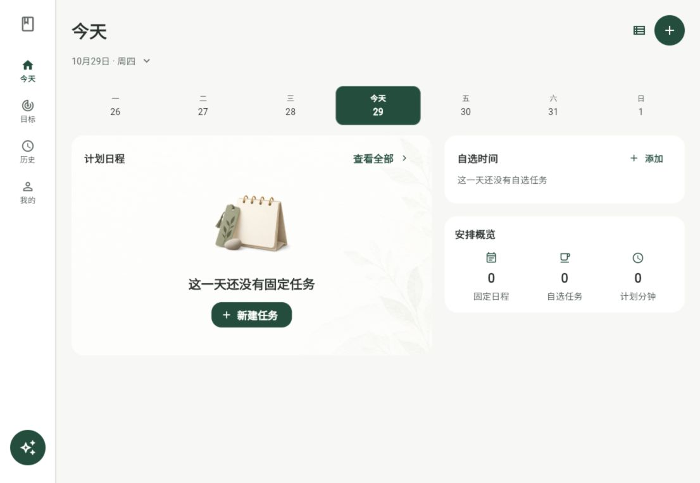
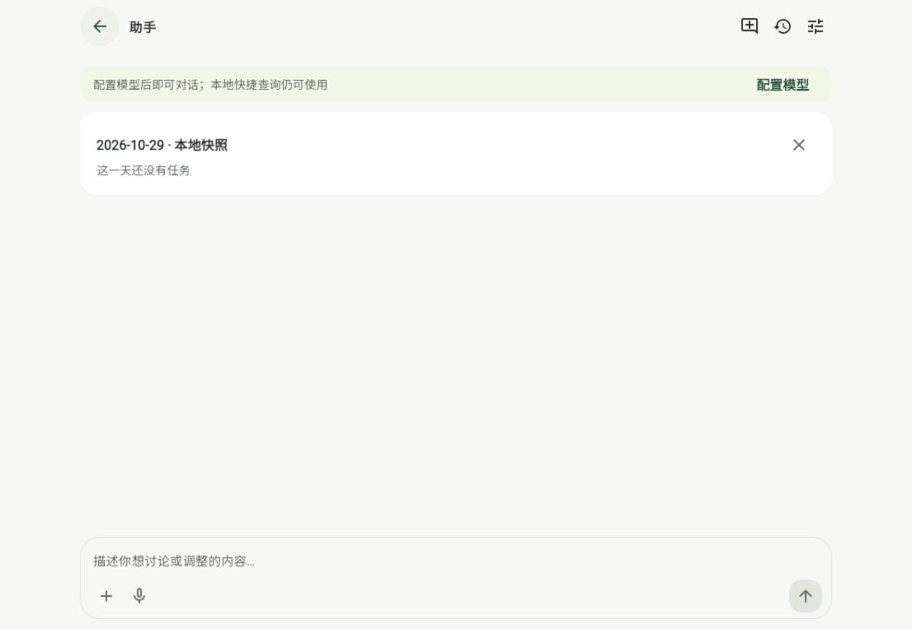
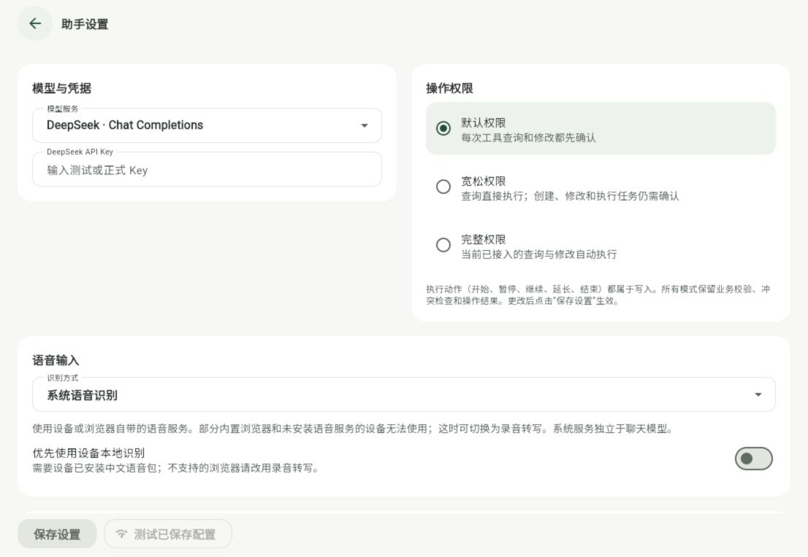

# 助手六项浏览器反馈修复

日期：2026-10-29。仓库 `E:\working\mission_book`，main 基线 `7fb056c`，修改未提交/推送。验证聚焦本轮涉及的功能，没有重跑整个历史套件或消耗真实聊天模型额度。

## 已取得证据

- `flutter analyze --no-pub`：无问题。
- `git diff --check`：通过；自动生成的平台注册文件有 Windows 换行提醒，不是内容校验错误。
- 46 项针对性测试通过：助手控制器/语音控制器、设置存储、系统/录音转写适配、助手交互和外壳布局。新增覆盖三档真实授权、取消零写入、旧设置迁移、图片与文本实际进入模型请求并重开恢复、WAV/独立凭据/multipart/认证失败、取消转写后重录的迟到回调隔离。模型和转写响应使用本地脚本/模拟服务，未冒充真实供应商调用。
- 浏览器 `http://localhost:8085/` 实际检查：1106×764 侧栏底部 AI 与顶部标识居中；390×844 附件输入区；真实文本/图片选择、文本预览、返回再打开后附件保留；配置提示与本地日程间距；三档权限与语音设置呈现。截图如下。
- Android 调试构建成功；仅证明当前代码和录音插件可构建，不代表已安装到用户实体设备或验证真实人声。

## 实际截图

## 明确边界

- 没有实际语音服务 Key 或已录制的人声样本，未宣称完成真实中文识别。系统模式依赖设备/浏览器语音服务；录音转写需要用户配置独立地址、模型、可选 Key，Web 服务需允许 CORS。没有新增自建服务器。
- 当前附件支持图片和 UTF-8 文本文件；PDF/Word 不直接解析，选择不支持类型时明确说明转换方式。未发附件草稿只在当前进程内保留；已发附件进入会话日志和既有数据库备份。
- Android 只进行调试构建，未重签发布、自动安装或发布。macOS 已补录音/出站网络声明，本环境未运行 macOS/iOS 实机验证。
