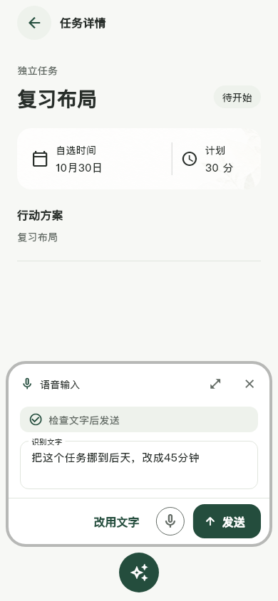
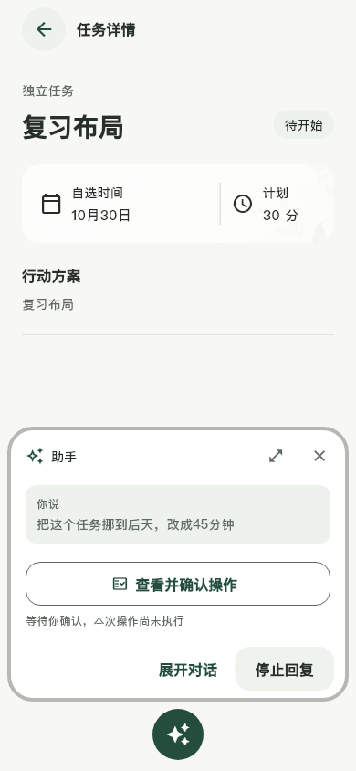
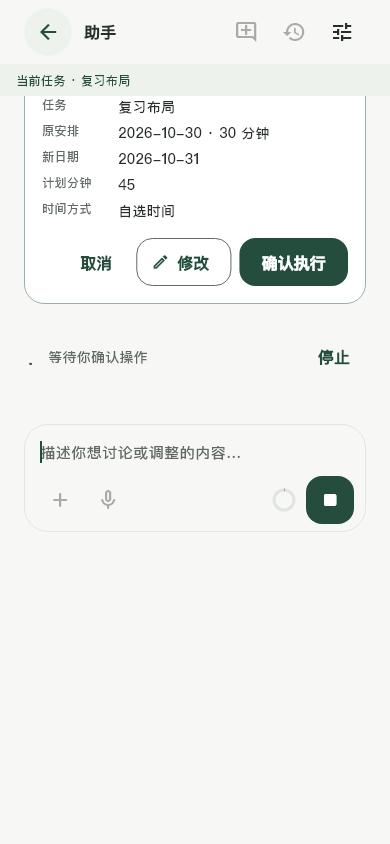

# 2026-10-30 助手交互与历史课表

应用0.2.12+14，数据库v13；实现与边界见[设计](../../../设计/助手历史任务与交互收整.md)。

- 基础定向检查88项通过，覆盖历史补报、整批回滚、重试与旧预览冲突、旧库升级保留、导入确认及退出保护、日期隔离、语音状态及大字号。追加反馈后40项检查通过（包含重跑）：健康请求切后台仍能完成、回前台无进展时结束旧等待、继续原轮次不重复用户消息，以及新版目标/个人页交互。静态分析无问题。
- Web实际操作：10月30日向左滑切换10月31日；目标进入独立导入工作区；加号菜单包含图片、文件、今天安排、规划、压缩，空会话压缩禁用。
- 生成并接入统一旅程插画，浏览器实际查看992宽目标图文卡和个人封面、三项紧凑统计；完整提示词与资源路径见[制作记录](../../制作记录/2026-10-30-统一旅程插画.md)。
- 下方是实际Flutter组件、隔离任务及脚本模型截图，不是供应商自然语言或真实人声验收。
- 当前ADB无设备，未安装此版到手机，未新增人声、连续离线识别及后台系统挂起/杀进程验收。没有新增Android前台保活服务。用户课表未被批量改写，安装后按实际目标提出操作。
- 按用户要求只检查本轮相关能力，未跑全量测试。

## 交付

交付分支main；安装包为ARM64 release构建，使用现有Android Debug证书，本机交付路径 `C:\Users\Liuxin\Downloads\MissionBook-0.2.12-arm64.apk`。版本0.2.12，versionCode2014，71,505,252字节（约68.2MiB）。构建成功并通过APK签名验证；SHA-256：`EF4B309B68E1B483CC5C181A527AF92154270BC0538B0AC19A2C93A7C1DE8157`。模型继续按需下载/复用本机已部署文件，不进入Git。
