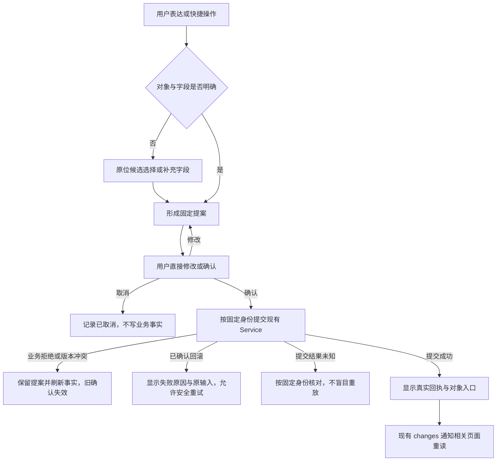
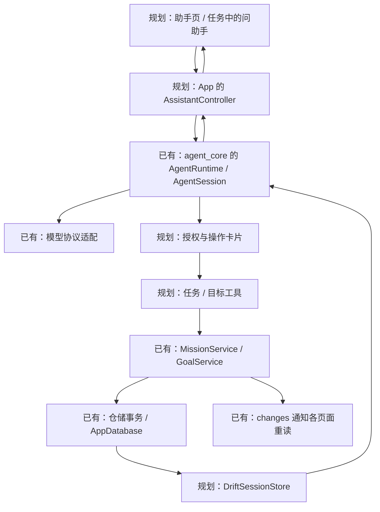

# Agent 接入 App：职责、交互与实施顺序

当前直接开发与完整验收追踪见[助手实现与验收](助手实现与验收.md)；下文保留设计和分支研究依据，阶段描述不能替代最新核对。

最新收尾：已接入 1–20 项创建/改期计划卡、整批事务保存、角色名称/定位/回答风格/图标配置及统一字号与新欢迎插画；[实现范围和边界](助手批量计划与角色.md)优先于下文未落地的历史设计描述。按用户额度提醒停止扩展，任务总结与目标记忆仍为下一阶段。

2026-10-29 浏览器反馈修订：平板/桌面助手入口固定在侧栏底部，顶部标识居中；手机底部胶囊保留。对话外框改为 960，统一顶栏/正文/输入区对齐和卡片间距；附件工具位于输入框底部，设置保存操作固定在页面底部。三档权限、图片/文本附件及系统/可配置录音转写已落地，具体范围及未验收项见实现清单；本段优先于下文早期的“附件未实现”“权限未分类”阶段描述。

日期：2026-10-29。状态：混合交互、统一 UI、完整流程与按需工具检索方向已确认；App 入口、业务工具、会话与凭据已经装配，真实 DeepSeek 核心链路已验证；整体验收仍在进行。最新万任务上下文契约与实测见 §6，不能将下文设计目标当作已实现。

当前交互以 §2.1 的最新确认方案为准：中央 AI 圆泡提供全局与页面上下文入口，文字进入二级对话，语音在原页冒泡；完整工作台保留为展开方案。此前独立主导航草案不再作为当前移动端入口要求。沿用自配供应商 API、无自建服务器、多供应商、DeepSeek 优先和精简可读的方向。界面必须复用全站设计系统，操作必须覆盖正常、修改、取消、冲突、失败重试、返回与恢复，不只做顺利路径。权限具体分类、后台主动性等未决项仍以[内置 Agent](../需求文档v1.0/内置Agent.md)为准。

## 1. 接入后的使用过程

助手的价值是围绕真实目标、任务和材料完成工作。对话是入口，操作卡片承担预览、确认和实际结果展示。

| 用户从哪里进入 | 带入什么 | 一次交互的结果 |
| --- | --- | --- |
| 全局 AI 入口：“今天先做什么？” | 当前日期、时区和获授权的数据范围 | 查询真实任务，给出有来源的建议；任务引用可点击打开 |
| 任务详情：“这一步不会” | 明确的任务编号，输入框上方显示引用标签 | 按需读方案、用户选择的材料；解释可以留在会话里，也可提出修改方案 |
| 目标详情：“下周怎么安排？” | 当前目标编号 | 按需读目标、相关任务、日期安排；形成计划草案，按权限保存 |
| 上传截图：“根据课表安排学习” | 用户选择的图片及说明 | 识别不确定内容、澄清时间，再形成可检查的方案；识别图片不直接等于写入任务 |

贯穿例子：“把明天的单词复习挪到后天。”

1. 工具按日期查找任务；有重名或多个候选时显示选择，不能自行猜编号。
2. 读取所选任务的当前排期和执行事实。已开始任务不能按现有规则改期。
3. 形成结构化变更：任务编号、原排期版本、新日期及相关字段。卡片文字由 App 根据这些值生成。
4. 当前模式需要确认时，展示“明天 → 后天”“保持 30 分钟”，提供“确认调整 / 取消”；修改方案后原确认失效。
5. 提交时在业务事务里重新检查原版本、任务状态和权限；冲突就刷新方案，不覆盖用户刚做的修改。
6. 保存成功后显示“已调整”和“打开任务”；今天、目标、详情继续通过现有服务通知重新查询。

完整权限下，同一操作经过业务检查后直接执行，卡片展示结果，不暗中恢复逐次确认。模型说“已完成”不能代替业务提交结果。

## 2. App 内的界面与导航

### 2.1 移动端轻量入口与二级对话（2026-10-29 确认方向）

用户已认可文字与语音分流的主线：任务、目标或节点页面可随时唤出助手；长按底部中央 AI 按钮后，按钮上方浮出“文字”和“语音”两个独立圆泡，滑动选择。圆泡应悬浮，不采用文字流程示意图中首屏的横向菜单容器；该细节以本段最新反馈为准。

- 文字：进入当前页面上方的二级聊天页，显示任务/目标/节点引用和必要路径，输入时为键盘留空间，不展示主导航。返回恢复原页面的滚动、展开和草稿状态；已提交修改通过既有服务刷新。不以切换“助手”主导航代替此入口。
- 语音：留在原页面录入，短回复、进度和简单操作提案在 AI 按钮上方冒泡；需要打字或长篇内容时展开到同一会话的二级聊天页，保留语音转写和已有提案。
- 上下文：绑定唤出时的对象身份与页面来源，发送时按授权查询最新事实；用户主动附上草稿时才读取未保存内容。切页不把已有提案悄悄改指其他对象。
- 权限：示意图使用默认需确认模式。完整权限仍按既定授权直接执行，气泡展示实际结果；文字/语音入口不另设业务写入通道。

原完整助手工作台保留为展开/备用方案，下面的主导航与宽屏设计继续参考。轻点快捷方式、长按阈值、语音发送/取消手势、语音识别适配、浮层避让和会话选取细节尚未定稿；图不代表这些能力已实现。

[文字：唤出、二级对话、确认和返回](../教学/assets/assistant-ui-20261029/mobile-text-context-return-v4.png)；[语音：节点内冒泡与展开同一对话](../教学/assets/assistant-ui-20261029/mobile-voice-node-expand-v4.png)。提示词和制作核对见[制作记录](../教学/制作记录/2026-10-29-助手UI示意图.md)。

### 2.2 完整助手与宽屏参考

建议主导航顺序为“今天 / 目标 / 助手 / 历史 / 我的”，顺序和具体视觉可在原型里微调。手机仍用底部导航，平板和桌面复用侧栏。

助手页面保持四个区域：

- 顶栏：会话标题、新会话、历史入口；模型放在次级入口，不占据正文。
- 对话区：文字、图片、任务或目标引用。读取过程显示“正在查看明天的安排”，技术日志放详情。
- 行动卡片：待确认、执行中、成功、已取消、需要核对；失败原因和重试入口紧邻该操作。
- 输入区：文本、图片、发送或停止。当前任务/目标作为可移除引用标签；模型、思考强度等归到设置或输入区次级菜单。

同一个助手支持多段会话。全局入口继续上次会话；任务入口优先继续该任务最近的会话，也能新建。关联关系是 App 的索引，不把所有任务聊天串成一个无限对话。目标记忆可以被多个相关会话按需读取。

**“带上任务”是显式引用，不是助手持续读取用户当前屏幕。** 用户切换页面后，已发送消息的引用仍指向原任务；发送前由 App 读取最新授权数据。未保存表单内容只有用户主动附加时才作为草稿说明进入对话。

手机从详情点“问助手”时，在原路由上方打开助手，返回回到原详情。宽屏先复用现有详情面板栈，在助手与任务详情之间返回；不一开始就新增第三栏。从助手点击任务卡，同样复用 `openDetailPane`。

关键约束：`AppShell._selectPage` 目前会清空详情栈，因此“问助手”不能简单调用主导航切换。入口需独立打开助手路由，底层仍使用同一会话对象。已有 `DetailPaneController` 的草稿守卫、缩放保留状态规则继续适用。

### 2.1 混合工作台：对话表达意图，卡片直接操作

采用“轻量工作台”，不做纯文字聊天，也不增加第三栏或把现有表单逐页搬进对话。自然语言负责说明目的，结构化对象负责选择、修改和确认，真实回执负责核对与继续工作。

| 交互层 | 统一做法 | 避免的问题 |
| --- | --- | --- |
| 引用 | 任务/目标入口自动附带稳定编号；输入区可用 `@` 添加或移除引用；引用标签显示名称与类型 | 不重复描述“这个任务”，不把当前屏幕当成永久上下文 |
| 本地快捷操作 | 查看今天、当前执行等确定性动作可直接调用只读/业务入口；是否经过模型由具体动作需要决定 | 简单查询也等待模型、消耗额度 |
| 候选选择 | 重名或多个对象时在原卡片显示候选及关键区别，选择后原位形成提案 | 为多轮文字澄清反复往返 |
| 可编辑提案 | 日期、时长、步骤等直接编辑；卡片显示原值 → 新值及不变字段；修改后原授权失效 | 显示一套参数却执行另一套，或只能接受/重写提示词 |
| 批量计划 | 每项可选择、编辑和查看状态；一次确认只对应同一批固定输入，结果逐项列出 | 部分成功被写成整批成功 |
| 依据与过程 | 显示数据日期、时区、来源对象和具体查询动作；技术日志默认折叠 | 用长篇模型思考代替证据，或让用户猜测是否读取成功 |
| 真实回执 | 成功来自 Service/仓储提交；提供“打开任务/目标”和允许的后续操作 | 模型声称成功但数据库没有变化 |

常用输入效率：桌面支持 Enter 发送、Shift+Enter 换行、Esc 停止，`/` 提供真实快捷命令；手机保留文本、图片和上下文入口。快捷命令只填充或执行已接通动作，不用空菜单冒充能力。

### 2.2 UI 统一约束

- 主页面使用现有 `AppPageHeader`，二级助手/设置/会话历史使用 `AppTopBar`；正文沿用 `AppLayout` 的边距与限宽，宽屏仍复用当前详情面板，不新增第三栏。
- 所有颜色、字号、输入、按钮、卡片和反馈读取 `AppColors`、`AppTypography`、`AppTheme`；普通内容以中性面为主，森林绿只用于当前提案边线、主操作和小面积状态，柑橘不铺大面积背景。
- 对话正文使用 `bodyMedium`，区块与操作使用 `titleMedium` / `labelLarge`，来源和短状态才使用 `bodySmall`。用户消息、模型回复、提案和回执有明确层级，不把每行都包成大卡。
- 复用 `AppSectionCard`、`AdaptiveColumns`、`AppConfirmDialog` 及现有按钮反馈；窄屏、大字体和键盘下内容可滚动，操作至少 48 触控区域，图标配 tooltip 和读屏名称。
- 动效只用于新提案/状态变化，遵循系统减少动态效果；流式文字不造成页面跳动，返回原会话时先恢复快照再订阅增量。

### 2.3 每类操作的完整流程

以下流程是实施与验收的共同清单，不能只实现“模型返回 → 确认成功”：

| 场景 | 必须保留的状态与结果 |
| --- | --- |
| 修改提案 | 更新卡片参数摘要；只有最新固定输入可确认，旧 Completer/按钮失效 |
| 取消授权 | 工具收到明确拒绝；没有业务写入，用户可继续修改或发送新消息 |
| 提交中重复点击 | 同一操作只等待一次；按钮禁用只是体验，数据库身份与约束负责去重 |
| 版本冲突 | 不覆盖新事实；显示最新对象与差异，用户重新形成提案 |
| 网络失败 | 区分模型请求失败与业务已提交；未开始写入可重试，未知结果先核对 |
| 页面返回/切页 | 控制器与本轮会话保持；详情 → 助手 → 返回恢复原详情及草稿 |
| 进程重启 | 重放已提交会话记录；未完成写工具进入结果核对，待确认旧卡片不可直接批准 |
| 权限变化 | 执行前重新读取当前权限；撤销后旧授权不继续放行 |
| 删除会话 | 先关闭当前写入者并明确确认；只删除选中的会话，不触碰任务/目标事实 |

交互研究依据：[DirectGPT 的对象引用与可逆直接操作](https://arxiv.org/html/2310.03691v2)、[Mixed-Initiative 的主动性与用户控制](https://www.microsoft.com/en-us/research/publication/principles-mixed-initiative-user-interfaces/)、[直接操作的可见对象与即时反馈](https://www.nngroup.com/articles/direct-manipulation/)，以及[Human-AI Agent Interaction 的上下文、控制与透明性研究](https://arxiv.org/html/2606.18716)。这些提供设计原则，不代替 MissionBook 自己的流程验收。

## 3. 代码怎样接起来

这张图表示调用与数据返回；DriftSessionStore 和业务仓储都使用 AppDatabase，基座不依赖 Flutter 或 MissionBook。

建议随功能新增的文件职责如下，现在不创建空文件：

| 位置 | 负责什么 |
| --- | --- |
| `lib/application/assistant/assistant_controller.dart` | 持有运行时、会话、发送/停止、当前活动和待确认项；生命周期长于页面 |
| `lib/application/assistant/mission_tools.dart` | 任务查询、创建和后续修改；参数转换、权限范围及业务错误映射 |
| `lib/application/assistant/goal_tools.dart` | 目标及节点的查询和后续操作；随该单元增加 |
| `lib/data/assistant/drift_session_store.dart` | 实现包的 SessionStore，按序读写会话记录；维护可重建的列表索引 |
| `lib/data/assistant/assistant_credentials.dart` | 把 credentialKey 映射到设备凭据；不进入聊天或模型配置 JSON |
| `lib/presentation/assistant/assistant_page.dart` | 对话、引用、输入和操作卡片；普通区域先留在同一文件 |
| `lib/presentation/assistant/assistant_settings_page.dart` | 供应商、凭据、连接测试、模型和权限设置 |

现有文件修改集中在 `pubspec.yaml`、`app.dart`、`app_shell.dart`、数据库表/迁移，以及需要实际扩展的业务入口。包通过本地 path 依赖引入，和 App 同一进程运行。CLI 是另一个宿主示例，不放进 Flutter。

装配在 `App` 完成，按需初始化助手。打开页面只获取已有控制器，页面销毁只解除监听，不关闭整个会话。首版建议同一时刻只运行一轮交互，允许切页查看，其他会话提示当前工作尚未结束；暂不增加后台并发调度器。

页面通过 `AgentSession.transcript` 和 `activity` 读取当前快照，再监听 `changes` 并重读，避免只订阅增量导致返回页面时丢字。持久消息与尚未落盘的流式片段分开展示；进程被杀后不能承诺恢复每个未完成字符。

## 4. 存储、配置、图片与设备适配

### 会话放进现有 Drift 数据库

接入前基线为 schema v10；当前工作分支已开始 v11 的会话索引、按 `(sessionId, sequence)` 唯一的会话记录及操作回执，迁移/备份整体验收未完成。记录保留基座的类型和版本；标题、更新时间、关联目标/任务等列表字段应是可重建索引，与对应记录在同一事务更新，当前实现仍需按此约束核查。

不能为了显示会话列表而逐个打开完整历史。SessionStore 的 `listSessionIds` 供核心使用，App 的列表分页查询由 Drift 适配实现提供，不需要扩展所有后端接口。

单会话写入所有权由 App 常驻控制器管理，并在数据库边界验证顺序/冲突；第二运行时或窗口竞争必须测试，不能只用 Dart static 锁宣称跨进程安全。首版发现冲突时明确拒绝第二写入者，不自动抢占活跃会话。

数据库操作按现有后台连接方式执行；不要在一个数据库事务里等待模型网络返回或用户确认。Drift 事务具有原子提交语义，异步操作必须正确等待，参见[官方事务说明](https://drift.simonbinder.eu/dart_api/transactions/)。

`DatabaseBackupService` 当前遍历注册的表，但附件只枚举正式材料。增加会话表后仍需验证备份体积、导出版本和会话一致性；加入聊天图片时补附件清单。当前 App 没有恢复导入入口，不把“纳入导出”写成“可在 App 中恢复”。

### 模型配置与凭据

面向普通使用者先显示“DeepSeek / 自定义服务、API Key、连接测试”。高级设置再显示协议、模型名、上下文、输出预算、思考能力和摘要模型。DeepSeek 用已验证预设；其他供应商保留独立配置和能力校验，不默认都支持 1M、图片或所有思考参数。

连接测试依次验证凭据、可用模型和一条短请求，错误按“凭据无效 / 网络失败 / 不支持的能力”呈现。运行期间切换配置先完成或停止本轮，再重建所需模型装配；不能让同一轮中途换凭据或供应商。

设备凭据可采用 `flutter_secure_storage` 适配现有 `CredentialResolver`。该插件支持 Android、Windows 等平台，Web 要求 HTTPS 或 localhost；具体版本、构建和备份设置在实施时验收，不能从插件声明推定设备验证通过。见[插件维护者说明](https://pub.dev/packages/flutter_secure_storage)。凭据不写进会话、普通数据库备份、日志或源码。

Web 作为独立适配目标：浏览器凭据环境与原生系统存储不同，直连供应商还需实测跨域限制；首版可默认只保留当前网页会话的 Key。不通过临时代理绕开“无自建服务器”的方向。优先完成 Windows 与 Android 使用路径。

### 图片

聊天图片与正式任务材料区分保存，发送聊天图片不意味着提交正式材料。引用已有材料也需要读取授权；拿到存储路径本身不代表获准发送其内容。

按模型能力选择上传或内联；模型不支持图片时明确提示更换模型。DeepSeek 上传后的 fileId 不能替代本地原图：要记录所属供应商、有效期和本地附件关联，过期后可重新上传；切换供应商不能复用旧 fileId。

当前基座的图片块还不能直接理解 App 的本地附件键，接入图片单元时需补请求前的附件解析/引用映射，避免每次上下文或会话导入都复制巨量 base64。该项是实际适配工作，不是假定已有功能。清理聊天附件不能删仍被正式材料或其他会话引用的原图；删除本地会话与删除供应商文件是两个动作。

### 页面与进程生命周期

| 场景 | 建议行为 |
| --- | --- |
| 在 App 内切到今天页 | 本轮继续，助手入口保留活动标记；回来读取会话快照 |
| 窗口缩放、页面重建、暂时失去焦点 | 保留会话和待确认项，不重复发送请求；`inactive` 不直接当作进入后台 |
| 手机隐藏、锁屏或进入后台 | 首版停止后续模型/工具步骤并保留进度；已开始的写入需等待或核对真实结果 |
| 进程被系统关闭后重开 | 读取已提交记录；先核对未知写入，再允许用户继续，不能盲目重放 |
| 等待确认时退出或超时 | 原卡片变成失效/需要重新检查；旧按钮不可继续执行 |

Flutter 官方明确说明进程突然结束时可能没有生命周期通知，因此记录必须在关键步骤及时持久化，不能只在退出时保存。见[AppLifecycleState](https://api.flutter.dev/flutter/dart-ui/AppLifecycleState.html)。后台持续运行与主动提醒另开功能单元，不用一个永不结束的模型循环实现。

## 5. 工具、权限与执行结果

第一批工具从具体用途收敛，读查询按日期/目标/分页返回简短字段，详情和材料按需展开。先做“查日期任务、查任务详情、查目标与节点、创建单个任务”，之后再加改期、执行动作和批量计划。

模型需要的工具参数用稳定编号；标题只是展示。时间由宿主提供当前日期/时区，执行事实时刻仍由写事务生成。模型可以提出 START、PAUSE、RESUME、EXTEND、END 的意图，不能写入任意历史事件、阶段或伪造用户报告。END 等依赖用户陈述的动作随其交互单元单独实现。

### 不能直接套用的现有接口

1. **查询有维护副作用。** `MissionService.findScheduledOn/findDetail/findForGoal` 会先补算材料截止。纯只读工具需提供明确的快照查询路径，复用仓储与完整阶段推导；截止补算继续由现有 App 调度承担。快照注明查询时刻，过期但尚未补记的状态不能伪称已关闭。不能仅因为函数名以 find 开头就设置 `readOnly: true`。
2. **不是所有操作都有可复用身份。** 执行动作已有 `commandId + expectedSequence`；创建已有 `prepareCreation/createPrepared`；工作分支已开始给编辑追加 `operationId` 和同事务回执，但完整异常/恢复验证尚未完成。各工具上线前仍须落实固定请求、按身份查询和重复调用处理，不从局部测试推定所有工具都安全。
3. **工具异常需要按实际提交边界分类。** 已确认未写入或回滚的业务冲突返回 `ToolRejected`；未知写入保留 outcome_unknown。不能把所有 StateError/Exception 都转成普通失败。
4. **确认内容必须绑定真实输入。** ToolAuthorizer 目前只有 tool/call/cancellation，没有会话身份。首版单运行可由宿主明确绑定当前会话；以后并发时扩展为显式调用上下文，不以全局“当前页面”猜归属。

待确认卡片记录会话、调用、参数摘要、原始快照/版本和权限范围。批准只对应这一份操作；编辑卡片要取消旧调用、形成新提案，不能显示一套参数却执行旧的 `call.input`。

当前授权回调会占用本轮时长预算（默认 15 分钟），不是跨重启的待办系统。首版到期/关闭后让旧批准失效，再由用户发起重新检查；若以后需要“明天再批准”，应实现可持久化的提案流程，不能简单挂住 Future。

三档权限的精确差异尚未确定。建议先把“可读哪些数据”和“哪些动作要确认”分开设置；默认对业务修改展示确认，完整权限按已授权范围直接操作。宽松模式是否自动开始/暂停、批量和取消如何分类留待定稿，不在实现中擅自填空。

写入时将 `ToolContext.idempotencyKey` 映射到固定业务请求。已有命令身份能满足的就复用；对改期等缺少结果身份的操作，随该功能增加最小操作回执，并在**同一业务事务**提交事实和回执。不要在 Service 外面包大事务然后提前触发它的 `_notify()`。

未知结果由宿主先按持久身份核对，再调用 `resolveToolOutcome`。没有可验证结果就继续标记“需要核对”，不展示“重试一下”去重复写入。批量工具未提供整批事务之前，必须逐项报告已成功/失败，不宣称全有或全无。

## 6. 万任务规模的上下文与目标记忆

2026-10-29 用户确认方向：让 AI 在需要时调用我们设计的工具查询具体内容，避免一次带入全部任务。下面是设计契约；分层检索已获方向确认，字段、额度与接口名是待实现和测量的建议，不代表当前工具已经满足。

**模型决定还需要哪些信息，工具限制可读取的范围和返回体，宿主控制整个请求的工作集。** 用户不必手工选择数据库字段；容量、授权和完整性不能只靠提示词。

### 6.1 当前缺口与实际测量

工作分支的 `goal_query` 调用 `findForGoalSnapshot`，目前仍装配整个目标的全部 `MissionDetail` 并序列化每项 objective、steps、notes。仓储每 200 条分块查询关联表，不等于向调用者分页；返回值仍包含全目标。`mission_query` 也默认带全部步骤、备注和执行事件。查到的数据少、工具标为只读，都不能证明上下文有界。

复用[万任务样本 course](../../test/data/repositories/goal_package_scale_test.dart)：500 节点、10000 个未来固定任务，每项 3 个短步骤和短备注，无执行事件或材料。在 Windows 隔离文件双库中经真实导入与当前只读工具调用，再用当前 `ApproximateTokenEstimator`、当前工具目录、短问题和短系统提示测量：

| 测量对象 | UTF-8 返回字节 | 含工具定义的请求估算 token | 说明 |
| --- | ---: | ---: | --- |
| 当前全量 `goal_query` | 4,457,018 | 1,871,545 | 包含 10000 任务与 500 节点；高于当前 Flash 的 1,048,576 配置窗口 |
| 研究 SQL 的 20 条轻量字段投影 | 5,290 | 4,447 | 只示范按需读取的体积；尚无阶段计算和完整分页契约，不与全量工具语义等价 |
| 单任务合法长方案 | 660,103 | 178,389 | 100 条各 2000 字的步骤和 20000 字备注，经现有 Service 编辑保存后调用 `mission_query` |

空结果请求基线估算为 2130 token。以上是本地估算而非供应商 tokenizer 或计费；没有发送真实模型请求、使用测试 Key 或访问用户库。仓库外探针 1 项通过，当前工具一次读序列化约 327ms、研究轻量 SQL 约 9ms，仅为单次宿主证据，不代表设备性能或正式分页已验收。大字段证明“每页 20 条”不是充分保护，单条也必须分段。

当前基座没有工具结果字节/token 和累计读取量的硬限制；自动压缩按模型窗口比例触发，不能拆开一个巨大的调用/结果组，可能报 `summary_unit_too_large` 或 `compaction_insufficient`。`injectContext` 仅追加，没有可替换上下文资源槽。不能先塞进 1 万条，再指望摘要挽救。

### 6.2 四层读取，不按任务总数扩大默认上下文

| 层级 | 默认提供什么 | 明确不自动提供什么 |
| --- | --- | --- |
| 入口背景 | 当前时间/排期时区、这次问题、显式引用编号与简短名称、授权范围；已有且相关的精简目标记忆 | 全站目标、全部个人资料、其他会话、未保存表单、整目标任务 |
| 目标概览 | 目标名称/状态/简短说明；指定范围的确切任务数、用户报告完成数、计划/实际投入等有明确定义的聚合；节点目录首层或选中路径 | 10000 个任务名称、500 节点的全部说明、把“报告完成”称为掌握度 |
| 候选任务索引 | 按目标/节点/日期/搜索词及明确排序返回一页任务；默认 20、条数上限建议 40，仍受字节和 token 双重上限 | 全部 steps、notes、事件序列、材料正文、图片或每任务模型总结 |
| 选中对象的详情片段 | AI 选择任务和需要的 section，再按段取完整方案、执行摘要/事件页、材料索引/正文片段 | 因为选中一个任务，就自动加载它所有历史、所有修正或所有图片 |

每个候选项的字段建议如下。没有读取的字段是 `not_loaded`，不存在的是明确空/零，不用同一个 null 混淆两者。

| 字段 | 何时提供 | 语义 |
| --- | --- | --- |
| `missionId`、`titlePreview` | 总是 | 稳定身份、短标题；标题过长按 Unicode 字符截取并标记，正式原文不修改 |
| `phase` | 候选页需要决策时 | 由完整领域事实推导的六阶段，不是模型推测，不新增可写 phase |
| `scheduledDate`、`timeZone`、`plannedDurationMinutes` | 排期相关查询 | 日期、时区和计划分钟；同页相同的时区可放响应公共字段，但例外必须显式覆盖 |
| `fixedStartAt` | 固定任务 | 带偏移或 UTC 的绝对时刻；不把设备时区当作排期时区 |
| `goalNodeId` | 有节点归属时 | 用来继续查路径，避免每项重复完整目标/节点说明 |
| `objectivePreview` | 具体目标与标题不同且与查询有关时 | 建议最多约 100 个 Unicode 字符，不加入全部方案 |
| `verificationPolicy`、`evidenceDeadlineAt` | 待补材料或截止相关查询 | 材料要求及真实截止；不能仅凭到点宣称超时事实已提交 |
| `availableSections`、`sourceVersion` | 可继续展开的对象 | 有哪些详情可查，以及本次快照版本引用；它们不是读写权限 |

标题预览初值建议 80 个 Unicode 字符；所有文本仍纳入返回额度，不能依赖导入的 200 字限制，因为手工创建标题目前没有同样上限。完整标题可以用详情工具取得。不会用几条精选任务伪装目标全貌。

### 6.3 工具要表达意图与读取层级

建议替换模糊的 `goal_query` / `mission_query`，不用一个无限扩展的 `includeEverything` 开关：

| 工具契约建议 | 用途与返回边界 |
| --- | --- |
| `get_goal_overview(goalId, dateRange?)` | 目标与指定范围的聚合；不返回任务数组。没有实现的统计明确 unavailable |
| `list_goal_nodes(goalId, parentNodeId?, cursor?)` | 分层目录与该层聚合；深节点只提供祖先路径，不每次整树遍历入上下文 |
| `find_missions(goalId?, nodeId?, dateRange?, query?, phase?, cursor?, limit?)` | 一页 `MissionIndexEntry`；稳定编号、轻量字段、明确排序/过滤与匹配范围 |
| `read_mission_section(missionId, section, cursor?)` | `plan` 返回目标及步骤/备注片段；`execution` 先返规则计算的投入/暂停/报告摘要，完整事件另分页；`evidenceIndex` 只返元信息 |
| `read_evidence_excerpt(evidenceId, sourceVersion, offset, limit)` | 读取指定文字/代码窗口；图片另走用户授权的选图与模型能力检查，不把原图藏进 JSON 文本 |
| `get_schedule_window(from, to)` | 按日期区间取得安排聚合/冲突/可用时段线索，相关任务另分页；App 日历不冒充用户完整现实日历 |
| `read_goal_memory(goalId)` / `find_mission_summaries(...)` | 接通长期记忆后按需读取，缺少或过期明确标识；当前不能注册空工具冒充已实现 |

响应至少提供 `items`（适用时）、`returnedCount`、`hasMore`、`nextCursor`、`observedAt`、`coverage`。`matchedCount` 只有完整计算过才给确切数，不能填候选数或样本数；否则标记 unknown 并引导使用统计工具。被截掉的字段列出 `omittedSections` / `truncatedFields` 和继续读取的入口，返回始终是完整可解析 JSON，不能截断序列化字符串。

`nextCursor` 是宿主签发或校验的分页位置，不是授予访问权限。过滤条件、排序或权限改变后，旧游标须拒绝或重新开始；固定排序应有稳定编号作为最后一项，不能只按可能重复的日期或标题。首版可以声明实时分页：不同页的 `observedAt` 不代表同一数据库快照。若需要跨页一致性，必须另持久化选集/版本，而不是在模型思考或等待用户时保持数据库事务。

### 6.4 三道独立预算与有界本地查询

以下数字只是首轮测试初值，不是用户已确认的最终配额或模型官方能力：

| 层级 | 建议初值 | 超限行为 |
| --- | --- | --- |
| 单次工具结果 | 16 KiB UTF-8 与约 4096 token 两者先到为准；长正文按更小窗口读取 | 少返回完整条目/片段并给游标；连一项预览都超限时缩小该预览并说明，不破坏 JSON |
| 一轮累计检索 | 约 12 Ki token 新资料，并限制工具调用数及扫描时长 | 返回结构化 budget_exhausted，提示缩小日期/节点/问题；本轮保留已有证据，不无限翻页 |
| 当前模型输入工作集 | 初值 32 Ki token；约 24 Ki 触发整理，目标约 16 Ki | 先淘汰可重查资料，再压缩旧对话；固定必要内容已超限时显式拒绝，不能静默丢用户要求 |

`effectiveInputLimit = min(maxWorkingContextTokens, modelContextWindowTokens - requestedOutputTokens - safetyHeadroomTokens)`。工具说明、系统提示、最新用户要求、图片开销和工具结果都计入；输出预算与累计读取额度是不同概念。估算器留安全余量并用供应商 usage 校准，不能声称近似估算必然精确。

分页必须下推数据库：先按目标/节点/日期/文字条件缩小候选、按稳定顺序和游标限数，再读取这一批所需列，不能 `findForGoal(...).take(20)`。概览计数在本地 SQL 或流式分块聚合；结构化条件优先普通索引查询，不为 10000 条记录立刻引入向量库。只有真实问题需要语义召回，再增加全文/向量检索，来源、权限和召回覆盖仍须可说明。

六阶段与执行时长仍复用领域规则。SQL 可以做安全的候选粗筛，不另写近似 CASE 状态机；阶段筛选需继续扫描直到填满页或达到扫描预算，并返回续查位置，不能只筛第一页就说其余不存在。涉及完整阶段计数时，分块处理全部必要事实并明确代价；如需最小事实投影，须用当前规则的等价回归证明，而不是把未加载的材料当作不存在。数据读取、模型返回、会话存储三层都要有界，不能只限制网络包。

### 6.5 原始历史、当前工作集、长期记忆分开

- **原始历史**用于审计与恢复，保留用户输入、模型回复、工具调用/结果、确认与真实回执；资料只保存实际读取的有界片段或资源引用，不预先把整目标复制成聊天日志。
- **当前工作集**只放与这次问题有关的内容。同一对象同一 section、同一事实版本不重复注入；版本更新后替换工作集引用，而不是越查越长。完成本步后保留关键结论、来源编号和继续读取入口，不每轮重带旧任务列表。
- **必须保护的内容**是最新用户要求、授权范围、尚未完成的提案、未核对的写入结果和相关业务版本；不能只依靠一段可能有损的模型摘要保存它们。
- **核心接口缺口**：当前 `injectContext` 只追加，原始日志与投影由会话共同校验。需新增可重放的上下文选择/替换记录或请求资源装配入口；不能直接改旧消息正文或只删除 ToolResult，破坏调用—结果配对和恢复。淘汰按完整已结束工具组处理，保留可重查引用；未知写入未核对前继续阻止运行。
- **新鲜度**：任务 updatedAt 不覆盖所有执行事件和材料变化。版本引用应由宿主根据所读事实生成，如排期编号、方案版本、事件序号、取消/放弃与材料修正链摘要；不能拿一个旧时间戳当全对象版本。写入前仍在业务事务内验证，而非只验证显示卡片。
- **传输授权**：只读不等于可外发；模型只能查获授权对象。用户材料中的指令不能扩大权限；切换供应商或摘要模型也须遵守资料发送范围，云端图片文件引用还要区分供应商账号与有效期。API Key 不进入任何上下文。

### 6.6 任务独立总结与目标精简记忆

沿用用户已确定的路径：任务事实提交 → 单任务独立总结 → 当前目标记忆结合新总结更新并自动保存。任务总结只读取该任务的必要事实与授权材料，不带目标记忆、主聊天或其他任务；先看执行摘要、材料索引，再按需分段读取，不能因它是后台总结就绕过预算。

目标只保留一份精简记忆，包含有依据的能力观察、当前困难、有效方法、注意事项和必要来源；不拼接 10000 份总结，不以报告完成推定掌握。具体数值统计从数据库重算，不让模型维护累计完成数。每任务总结初值约 512 token、目标记忆约 1024 token，实际提示词与长度需按用户反馈调整；缺失、过期或尚未读取分别表示。

总结绑定输入事实版本及模型/提示词版本。材料晚交或修正后，只重新处理受影响任务；目标更新使用当前版本比较，避免并发总结互相覆盖，也避免同一新总结重复记入。新版本替代旧依据但保留原文可回查。没有目标的任务仍可有总结，不凭空创建目标。离线与模型失败只进入可重试工作状态，不能回滚任务；批量补历史须可暂停、续作并有费用/调用上限，不能启动即偷偷总结一万个任务。

### 6.7 与统一 UI 结合的三个完整场景

| 用户问题 | AI 与宿主各做什么 | 界面与失败分支 |
| --- | --- | --- |
| “这个目标有一万项，我今天该做什么？” | 先看目标概览/相关记忆与今天安排，再按相关节点/日期查约 20 个候选；仅对少数候选展开方案，结合用户时间约束给建议 | 显示查询范围、匹配总量/已读数量与少量候选；用户直接选择任务，不逐次确认每个普通授权范围内的只读查询 |
| “这一步不会，结合我的代码帮我” | 入口显式引用任务；读取当前方案 section，再读用户选择的代码窗口或图片，缺失信息才询问 | 点击出处打开原任务/材料；页面“展开更多”仅改变本地显示，不自动把全部内容发给模型；超限引导选定片段 |
| “把所有还没开始的任务整体顺延一天” | 由宿主按规则生成固定选集、逐项版本及结构化调整，不让模型循环调用一万次单条写入；模型只看影响数量、例外和有限前后对照 | 本地可分页检查完整选集；确认绑定同一选集版本。原子提交还是分批必须事先明示；逐批回执可恢复，不能将部分成功写成全部成功 |

如果用户要对全部一万任务做逐条内容质量审查，不能拿 20 条抽样冒充完成：按节点/时间分组做受限扫描或分组模型分析，保存每组覆盖范围与出处，再汇总；每次窗口有界不等于总费用恒定。需明确扫描进度、预计调用量、暂停/恢复和未覆盖内容，这不是普通聊天自动翻到最后一页。

UI 继续遵守 §2.2：同一套主题、顶栏、卡片和详情栈。可展开“本次依据”显示相关目标、已读任务/材料数及资料时间，不强迫用户管理 token 或数据库字段；来源 chip 必须来自真实工具元信息。语义明确的状态为“未读取 / 无记录 / 已截取 / 已过期 / 读取失败”，不能只给一个含糊的“无数据”。

### 6.8 代码语义与落地验收

- `MissionIndexEntry` 表达候选索引，不叫摘要却携带完整详情；`MissionPlanSection` 与 `MissionExecutionSummary` 区分方案原文、规则统计；`MissionSummary` 留给独立模型总结，避免同名混用。
- `GoalOverview`、`MissionSearchQuery`、`MissionSearchPage` 在实际接入时增加；字段采用 `plannedDurationMinutes`、`returnedCount`、`sourceVersion`，不为省 token 改成含糊缩写。省略重复 payload 比牺牲命名收益更大。
- 工具边界验证 JSON，进入应用层即转换为明确类型；待确认写入使用不可变提案和已读版本，不用 `Map<String, Object?>` 同时装模型 JSON、`MissionDetail` 与任意状态，不在 `_call` 失败时无条件回退未授权参数。
- 先改全量查询与工具返回，再加工作集预算/去重和上下文重查，最后接总结记忆；保留原有 Service、事务、阶段核心及只读快照入口，不推倒重写基座或提前建空表。

| 正式验收（尚待实施） | 必须验证的证据 |
| --- | --- |
| 10000 任务查询 | 概览计数真实且不返回任务全文；第一页/末页/空页可验证，SQL 不全量装配详情后再裁切；输出条数、UTF-8、token 都受限 |
| 单条极大输入 | 长标题、100×2000 步骤、20000 字备注、大量事件及材料分段；Unicode 截取合法、JSON 可解析、可以继续读，不删用户原文 |
| 连续多轮检索 | 实际每次 ModelRequest 都低于预算，不仅最后一条；重复对象去重、过期引用刷新、停止或额度耗尽无死循环 |
| 查询完整性 | 同日/同名稳定顺序、过滤与游标绑定、页间数据变动明确、阶段粗筛/精化与完整规则一致，统计不以样本代替 |
| 记忆和恢复 | 单任务总结不混入目标/其他任务；晚交材料只更新相关依据；模型失败与重开不破坏业务事实、未知写入仍先核对 |
| 安全与交互 | 未授权目标/材料拒绝读取，换供应商不扩大传输；引用可打开、待确认提案不被压缩遗忘、批量部分失败可核对 |

本节是研究与建议的可验收设计，不把上面的探针通过视为这些正式契约已落地。公开工程参考：[Agent SDK 的检索、上下文隔离与压缩讨论](https://claude.com/blog/building-agents-with-the-claude-agent-sdk)；它提供方法参考，不是本项目必须引入的 SDK 或性能证明。

## 7. 实施顺序与验收

| 单元 | 完整交付 | 当前分支状态（2026-10-29） | 可观察的验收 |
| --- | --- | --- | --- |
| 1. App 内真实对话与查询 | path 依赖、凭据与模型设置、Drift 会话、助手主导航、任务引用、日期/详情查询工具、流式展示和停止 | **部分落地，不可交付**：path/安全存储依赖、v11 会话草稿、控制器、查询/详情工具和页面草稿已有；尚未接入 App，页面静态检查未通过；查询仍全量返回目标详情 | 问“今天有什么任务”能返回数据库内容；点卡片打开原任务；切页不断会话，重开可恢复，失败可解释 |
| 2. 第一次真实写入 | 创建单个任务、结构化预览、明确权限、固定业务请求、结果核对、页面同步 | **局部测试通过，未端到端**：控制器测试覆盖编辑后创建、取消零写入、自动权限、旧提案冲突和停止；改期/执行回执未完成正式恢复矩阵，页面未接通 | 确认后今天页出现任务；取消零写入；重复点击、提交后中断再恢复都只产生一份任务 |
| 3. 围绕目标完成工作 | 目标工具、图片附件、改期及批量计划、对应回执/冲突控制 | **未完成**：已有基础目标查询与创建工具草稿，仍是全量/非分页；图片输入、目标规划、批量计划与正式附件适配未实现 | 图片可查看原图与识别结果；并发改期不覆盖新版本；批量结果可核对；新增附件纳入备份 |
| 4. 跨任务积累 | 单任务总结、目标记忆、依据回查和纠正 | **未开始**：只在 §6.6 定义契约，没有表、服务、自动更新或查看/纠正入口 | 晚交材料能更新总结；断网可重试；记忆更新不改任务事实；主助手按需读取 |

每个单元再做 Windows/Android 的实际入口、键盘遮挡、返回链、应用重启和凭据读取验收；Web 单列验证。布局至少覆盖窄手机、平板竖/横屏和桌面缩放，尤其是原详情里有草稿时打开助手再返回。当前只有部分存储与控制器测试，未完成装配和设备验收。

第一单元目标仍是能查真实任务的助手，第二单元形成“说一句话 → 看具体提案 → 任务落地”的产品闭环。在正式接入前，先完成 §6 的有界工具读取；不能一边全量读取、一边靠压缩或提示词控制。

## 8. 当前源码依据与交付边界

已存在的基础：

- [App 装配](../../lib/app.dart)、[导航与详情面板](../../lib/app_shell.dart)、[面板栈和草稿守卫](../../lib/presentation/widgets/detail_pane.dart)。
- [任务业务服务](../../lib/application/missions/mission_service.dart)、[目标业务服务](../../lib/application/goals/goal_service.dart)、[事务和幂等](../../lib/data/repositories/drift_mission_repository.dart)。
- [当前数据库](../../lib/data/local/app_database.dart)、[备份导出](../../lib/data/backup/database_backup_service.dart)。
- [运行时和活动快照](../../packages/agent_core/lib/src/sessions/agent_runtime.dart)、[存储接口](../../packages/agent_core/lib/src/sessions/session_store.dart)、[工具与授权接口](../../packages/agent_core/lib/src/tool.dart)。

分支中新增但尚未交付：

- [Drift 会话存储](../../lib/data/assistant/drift_session_store.dart)、[设备安全存储适配](../../lib/data/assistant/assistant_settings_store.dart)、[会话与回执表](../../lib/data/local/tables/assistant_sessions.dart)、[操作回执表](../../lib/data/local/tables/operation_receipts.dart)。
- [助手控制器](../../lib/application/assistant/assistant_controller.dart)、[业务工具草稿](../../lib/application/assistant/assistant_tools.dart)；后者仍包含全量 `goal_query` / `mission_query`，正式有界接口尚未落地。
- [助手页面草稿](../../lib/presentation/assistant/assistant_page.dart)、[操作卡片草稿](../../lib/presentation/assistant/assistant_operation_card.dart)、[Scope 草稿](../../lib/presentation/assistant/assistant_scope.dart)；没有装配到 `AppShell`。
- [会话存储测试](../../test/data/assistant/drift_session_store_test.dart) 5/5、[控制器/工具测试](../../test/application/assistant/assistant_controller_test.dart) 7/7 通过；这是局部证据，不是全量回归、迁移、设备或真实 API 验收。

当前静态分析有 5 个错误、1 个警告、1 个提示，集中在助手历史/设置页和输入框参数；v10→v11 迁移、现有迁移测试版本断言、备份遍历、Web SQLite 资源与依赖升级回归尚未完成。用户已确认按需检索方向，但尚未获得正式分页、预算或数据库实现的独立操作证据。实现、验证与用户理解分别以[学习进度](../教学/学习进度.md)为准。
