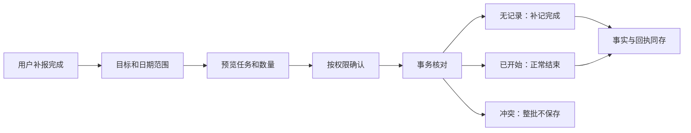

# 助手历史任务与交互收整

2026-10-30；应用0.2.12+14，数据库v13。依据用户课表导入及手机截图反馈实现。

## 历史任务

新增 `mission_complete_history`：按真实目标、截止日期（不含当天）和用户明确提供的完成依据，预览并提交最多10000项。沿用三档权限，标准权限一次确认整批。

- 无执行记录的历史自报任务保存一条 `END/COMPLETED`，`isRetrospective=true`，绑定原排期，reason保存用户依据。时间为本次补报时刻；不写START，不倒填过去时间，不产生Focus。
- 已经执行中或暂停的历史自报任务正常结束。已结束、取消和有材料要求的任务保留原事实，预览报告跳过数量。
- 预览固定任务集合；事务重读排期和事件序号，任一变化整批拒绝，写入失败整批回滚。事实与回执一起保存，同请求重试不重复执行，未知结果仍核对回执。
- 历史查询、完成统计及记录页识别补报；自选补记不生成实际执行时间条。普通END和材料规则保留。

v13追加默认false的 `is_retrospective` 列；v1直接创建完整表，v2–v12追加列，旧事实不改写，继续复用唯一时间线推演核心。

## 界面和交互

- 导入独立工作区，宽屏复用详情区，手机打开次级页；文件优先、JSON粘贴折叠，空输入无法校验。确认按钮在摘要之后、明细之前。历史计划默认保留，仅实际发现当前时段自动开始或重叠时显示对应选择。错误指出具体任务/节点和原因，不铺内部错误码；退出保护和封存预览恢复保留。
- 语音共享准备、录音计时、转写、待发送、取消及错误状态。自动停止也进入转写；资源释放后开放下一轮。识别文字可编辑，发送前显式结束录音。浮层请求和回复分区，只显示本轮内容，正文滚动、操作固定；展开同一会话保留草稿。没有接回系统识别窗口。
- 聊天有消息时反向布局，进入默认定位最新消息，上滑阅读停止跟随；空会话从顶部布局。输入框适配键盘和大字号。上下文圆环以当前模型实际上下文、系统提示和工具定义估算，点击显示数值；不是供应商计费，也不含未发送草稿。半组工具调用单独估算，避免请求编码校验导致页面报错。
- 加号菜单为44高紧凑行，提供图片、文件、今天安排、规划今天和压缩会话；压缩真实调用 `AgentSession.compact()`，保留原始日志，失败不清空记录。
- 今天页左右滑动切相邻日期，复用原查询及迟到结果隔离。节点侧滑归档放在卡片下方，避免挤压标题；已结束AI操作收起参数，执行错误与任务完成结果分开。设置复用主题并收紧卡片尺寸和留白。

## 依据与验收

追加反馈已处理：移除应用hidden/paused时自动调用助手stop；只取消麦克风，inactive继续按前台处理。回前台后模型20秒无任何进展才结束旧连接，保留会话并开放“继续本轮”，不重复添加用户输入；等待用户确认和已开始的业务工具不被此看门狗中断。没有新增Android前台保活服务，系统挂起/杀进程的实机表现仍需设备验收。

目标空态和资料封面共用新生成的旅程场景；手机先图后操作、宽屏图文并排。个人概览改为紧凑统计，减少空白和独立立体装饰。素材、保存路径及完整提示词见[制作记录](../教学/制作记录/2026-10-30-统一旅程插画.md)。

统一复用AppColors、AppTopBar、AppLayout和主题字号，主要操作保留48触控区域。参照[Flutter无障碍指南](https://docs.flutter.dev/ui/accessibility/ui-design-and-styling)。系统麦克风隐私提示由Android控制，参照[Android权限说明](https://developer.android.com/training/permissions/explaining-access)。

实际检查和设备边界见[本轮验收](../教学/验收记录/2026-10-30-助手交互与历史课表/README.md)。授权代写不等于用户已经掌握。
