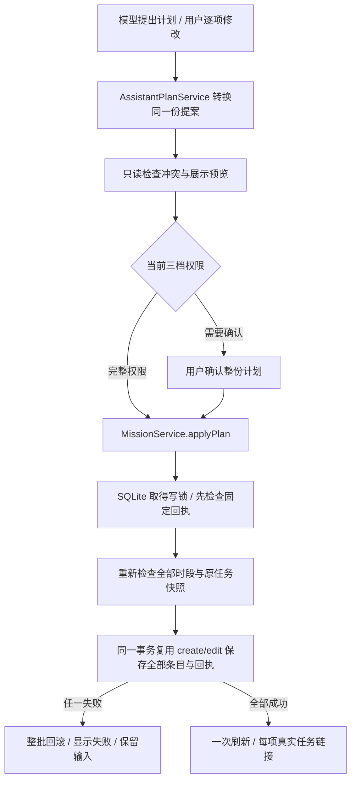

# 助手批量计划与角色

2026-10-29，本轮已实现。继续完善项目时优先落实批量创建、批量改期和可编辑计划卡；用户补充要求统一 UI 尺寸，并允许配置角色名称、风格与特色资源。

## 使用流程

用户提出安排需求 → 助手查询真实目标、任务与已有排期，询问缺少的可用时间 → 使用 `mission_plan` 提出 1–20 项创建/改期 → 根据当前权限等待确认或自动执行 → 保存后逐项打开真实任务。

默认/宽松档展示整份计划，用户可修改每项日期、时长、时间方式与新任务名称/具体目标，移除条目后更新合计。改期保留原任务名称、内容、归属与材料要求；不得借编辑替换条目身份、目标或任务。完整权限不额外插入确认，实际工具执行仍复查业务条件。取消提案不写入任务。

时间冲突按已有未取消、未结束任务的当前固定排期，以及计划内的全部固定时段检查；首尾相接不算冲突，跨午夜和原任务时区按绝对时刻处理。自选任务未绑定时间，不推断它已经占用某个时段。已有 App 排期不代表完整个人日历；模型不能把未提供的时间当成空闲。

## 保存边界

- 固定计划身份和条目编号生成稳定任务/排期编号；已提交的相同计划返回原回执，不重复创建或增加版本。相同身份换内容会被拒绝。
- 复用现有任务创建、编辑校验和事务。整份计划保存采取全部成功或全部回滚，没有部分成功列表或通用撤销承诺。
- 回执使用已有 operation_receipts 表，和业务事实同事务提交，无新表或数据库版本变化；未知结果通过回执核对，不能直接重放。
- 冲突候选在 SQL 中筛选，每项最多展示三条外部冲突，不装配整个目标或万条任务。计划内两两检查最多 20 项。
- 失败保留原会话输入，可选择重新核对计划；该操作重新查询并提出新计划，不直接重放旧保存。成功卡和最终批准参数随已有会话恢复。

## 角色与统一 UI

助手设置顶部“角色与风格”可展开编辑：角色名称 1–24 字符；角色定位为效率助理/学习教练/计划顾问；回答风格为简洁直接/耐心讲解/温和鼓励；入口图标为灵感/书页/指南针。

配置保存在设备设置中。名称同步到聊天标题与语音浮层，图标同步到助手入口；角色与回答风格写入实际模型 system prompt，保存后更新当前会话，重开旧会话时同步最新设置。原消息不改写。设置期间/运行中仍禁止并发修改，角色不能改变工具权限或业务事实。

字号与按钮复用应用主题：区块/任务标题 titleMedium，时间日期 bodyMedium，辅助信息 bodySmall，按钮使用全局主题。计划卡宽屏按时间和内容分栏，手机与大字模式自然纵排，日期不被图标挤断。欢迎图采用纸张/叶片/森林绿的新插画，图标沿用原有线性图标体系。[制作过程、完整提示词和真实组件图](../教学/制作记录/2026-10-29-批量计划与助手角色.md)。

## 实际验证与后续

针对性测试共 43 项通过，含 6 项整批业务路径、1 项多尺寸计划卡交互，以及角色存储/模型请求/设置表单和已有助手回归。静态分析无问题；git diff --check 通过。计划卡实际渲染覆盖 320 宽 1.6 倍字号、390 和 1106 宽；数据为隔离样例。

没有进行新的真实模型批量调用、实体设备安装或人声识别，不以脚本模型与截图代替这些验收。当前本地 Web 预览服务已热重启；自动浏览器读取遇到连接接口不可用，未将其记为本轮浏览器目视通过。

本轮未完成的产品能力：任务总结、每目标精简记忆、任务已有图片的按需访问与 PDF 解析；超出 20 项、批量执行/删除或跨目标全量操作不属于当前工具能力。后续优先接任务总结和目标记忆，不因已有计划卡宣称完整 Agent 已交付。
