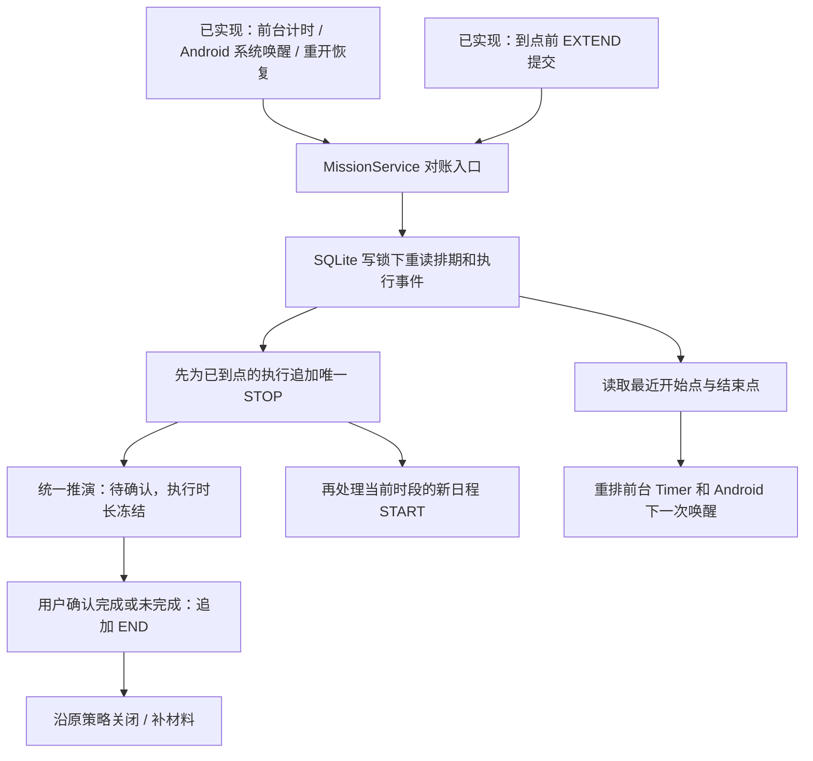

# 固定日程到点停止与待确认

2026-10-30，按用户本轮更正：固定计划适用于课程、会议等日程；时间到只停止执行，不自动认定完成。用户之后确认完成情况，再按原验证策略提交材料。

## 规则和数据流

- 固定日程应结束时刻 = fixedStartAt + 原计划分钟数 + 已提交 EXTEND 分钟数。暂停不顺延；到点前可以在执行或暂停期间加时，到点后的旧加时/继续请求拒绝。
- 延迟唤醒的 START 仍记真实开始时刻，不虚构投入；结束仍按固定结束点。完全错过时段且从未开始的任务继续保留待开始；用户明确手动补做时，从实际 START 获得原计划时长，再加已增加额度。
- 到点写入独立 STOP，occurredAt 为应结束时刻；没有完成报告、失败记录或材料。阶段由统一推演核心得到 REPORT_PENDING，页面显示“待确认”。STOP 后只允许 END 报告，不能恢复或追加额度。
- END 仍记录用户实际确认时刻及结果，不改写 STOP。Focus、Elapsed、Paused 以 STOP 为上界，等待确认的五小时不会计入任何执行时长。完成统计日期继续按用户确认的 END 日期。
- 完成自报、可选材料选择、强制材料截止及未完成原因沿用既有事务。待确认本身不制造完成记录、目标覆盖或失败；强制材料截止只在原条件满足时处理，不把等待确认当作已报告完成。
- 已保存的旧事件不重写。旧版本可能在原结束点之后已经写了暂停/加时等事实，STOP 不能插到这些事实之前，最低取最后事件时刻，避免倒序时间线。

普通用户动作前单独提交必要 STOP，再提交用户命令。旧序号命令失败不能回滚已发生的停止事实。仓储在第二次事务锁内再次检查结束点，避免前置检查后刚好跨点仍接受加时。没有事实提交的普通失败继续不发送变更通知。

## 目录与兼容

- 新增 `scheduled_execution_rules.dart`：唯一结束点公式，供仓储、候选快照和调度共用。
- 修改 ExecutionEvent、MissionPhase、统一推演和时间统计：增加 STOP / REPORT_PENDING，区分停止与报告；不增加表或可写阶段。
- 修改仓储、服务、调度与前后台通知：先停止再开始，下一次唤醒取最近开始/结束，停止通知移除继续按钮。
- 修改执行页、详情/今天/全部任务/目标路由及标签：待确认直接进入报告，可稍后确认；原材料工作区继续使用。
- schema v14 重建执行事件表以放宽 type CHECK，保留全部行及 START/END 唯一索引。冻结 v13 快照保留，新增 v14 快照。

## 验证边界

新增自动化覆盖五小时恢复、加时与系统重排、暂停到点、延迟开始、错过后补做、相邻日程、迟到动作、事务回滚、回拨、前台 Timer、独立连接并发与重开、待确认报告和补材料。迁移检查包含 v13 到 v14 的逐字段保留、结构校验和外键检查。

Android 沿既有系统唤醒通道安排结束点；关机、强行停止或厂商限制下仍可能延迟，但下一次运行按应结束时刻结算。Windows/Web 完全退出后仍依靠重开结算，不新增退出后的系统唤醒能力。构建与自动化结果不等同于锁屏、进程回收或目标设备后台准点验收。
