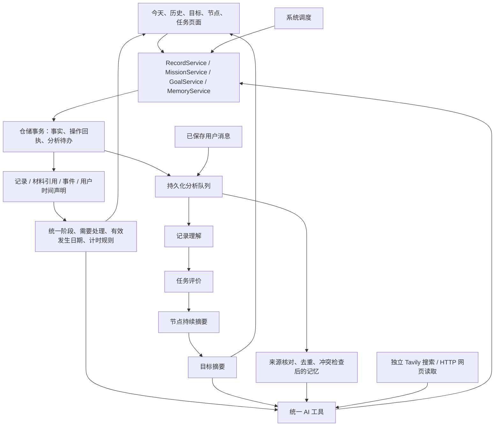

# 记录、补记与分层理解（数据库 v15）

更新：2026-10-31。基线 `ea8ff35` / v14；本轮为用户授权直接实现。本文是本轮增量规格及实现说明，覆盖材料、补记、摘要和记忆的旧限制；不代表设备验收或用户已掌握实现。

## 1. 边界与数据流

保留页面 → 应用业务服务 → 仓储事务 → Drift 的结构。领域对象和规则不依赖页面或数据库；`agent_core` 只处理通用模型、工具和会话，不认识 MissionBook 的目标树、材料策略或记忆表。



执行事实、确定性投影、AI 判断三者分开。AI 分析不更新 END、FailureRecord、材料截止结果或目标达成状态。

## 2. 内容与材料

`records` 保存正文、类型、来源、附件键、拍摄/发生时间、创建时间及可空目标/节点引用。文字、代码、手动记录和文件使用同一个内容模型；照片仍存于已有私有附件目录。

`evidence_records.record_id` 引用记录。为迁移和旧数据导入保留旧载荷列的读取兼容；正式业务写入只在 `records` 保存载荷，材料行的旧正文和附件字段为空。读取时通过统一映射还原现有 Evidence 领域投影，所以原材料 ID、批次、修正链、时间戳和附件路径都不变。

记录可以独立存在，也可关联目标、节点或任务。选择任务时由仓储从任务推导目标/节点，拒绝不一致的归属。已成为材料的记录保留原引用；同一记录不能静默迁往另一任务。独立记录可以修改文字；正式材料采用原有追加同类修正链，原件继续保留。

今天页右上拍照，Android 复用已有相机；其他平台选图。今天页展示当日真实记录缩略内容。历史、目标、节点和任务入口复用记录列表、编辑器、关联选择器和详情。记录保存不创建任务，也不自动报告完成。

材料可在未开始、执行、待确认、待补、关闭、未完成和取消后保存：

2026-10-31 用户试用后的入口修订：以上是记录关联及仓储能力的边界，不要求普通任务详情在每个阶段显示全部操作。未开始、执行中、暂停和 STOP 待确认时，详情仅阅读任务方案、排期和材料要求；不展示任务评价、补记、记录库或材料编辑入口。独立拍照记录仍可关联任务，不自动完成任务。结束后的入口统一使用现有白色卡片行、图标及箭头，主确认使用实心按钮，次级操作使用描边按钮，不堆放裸文本按钮。

- END 前材料只成为事实，不提前关闭任务；结束时已有按时正式材料可以满足要求。
- 待补阶段按原策略关闭；可选材料仍可明确放弃。
- 已关闭任务的新增材料是补充，不重开任务。
- 到期后保存补充材料，同时保留材料超时；拍摄时间不替代提交时间。
- 自报、未完成和取消结果不会因补材料而变化。

附件提交与清理共用 `MissionService` 的提交锁；引用集合和备份覆盖记录、旧兼容材料及全部历史修正。备份包含所有表、索引、触发器和原路径附件，安全凭据不进入备份。还原只在隔离库验证，本轮没有应用内恢复入口。

## 3. 待处理、补记与时间更正

`missionAttention` 是统一计算规则，不是新增可写阶段：固定时段整个已过且未开始为待处理，自选任务超过计划日且未开始为待处理；STOP 后无 END 仍是既有 REPORT_PENDING（待确认）。

详情按同一规则选择工作区，不新增数据库状态或另一套执行推演：

| 事实与阶段 | 详情与操作 |
| --- | --- |
| 未开始，计划尚未过期 | 方案、材料要求、修改、取消；未来固定计划不能提前开始，无补记入口 |
| 执行中 / 已暂停 | 方案与材料要求，返回现有执行页；不展示事后评价、时间更正、记录或材料编辑 |
| STOP 待确认，无 END | 执行页确认完成情况，信息详情返回完成确认；不是逾期未执行，也不能更正已完成时间 |
| 未开始且整段计划已过期 | 打开详情自动弹出完成确认，默认选择已完成；可改选未执行/未完成或稍后处理，也可在详情改期或现在补做 |
| END 后待补材料 / 已关闭 | 评价、实际时间更正、记录与材料卡片；已关闭的补充不重开任务 |
| 已取消 | 优先展示取消事实，可保留关联材料，无补记完成或实际时间更正 |

正常结束报告、STOP 后确认及逾期补记均默认选中“已完成”，只作为本地草稿；用户点击确认前不保存 END。不改默认项即可直接确认；改选未完成仍沿原流程保存。取消只有默认值的报告不再额外询问丢弃，修改结果、原因或材料选择后仍保护草稿。

逾期补记在手机使用底部弹层、宽屏使用居中弹层，复用同一表单。固定任务清楚展示预填日期及起止，点击确认即明确认可，自选默认具体时段未知；日期、时段和说明按需展开。首次确认不强制额外填写依据，保存“用户明确确认”作为来源；时间更正仍必填说明。改选未执行时清除预填时长，避免把原计划算成实际工作。稍后处理不写事实，也不立即重复弹出。确认期间任务有其他变化时按原快照拒绝提交，不结束新启动的任务。

页面和记录服务使用 MissionService 的业务时钟；停留详情跨过固定计划结束或排期时区午夜时只重读并显示确认，回前台也重读。不会根据过去的计划生成完成事实。任务详情从记录页/记录库返回后重读，补充资料不留在过期快照。

处理入口包括补记完成、记录未执行、修改排期和现在补做。“现在补做”在一个事务中追加今天的自选排期并真实 START，旧固定排期不删除；材料截止已过时必须确认新截止，避免启动后被过去的固定结束点立刻停止。

`user_execution_reports` 是追加式时间声明，包含发生日期、时区、可空实际起止、报告时刻、依据和替代关系。具体时段可以未知；固定计划可预填，只有用户确认保存才成为声明。跨日结束日期单独填写。

- 没有执行事件时，保存显式 `isRetrospective` END，允许当天、全部材料策略及完成/未完成；不造 START。
- 有执行事实且尚未 END 时，沿正常结束事务保存 END，并追加时间声明。
- 已结束时只追加时间更正，原 END 和应用计时不变。
- 补记、回执和分析失效同事务提交，重试不增加事件或声明。

历史按最新有效用户发生日期分组和排序；没有声明时沿设备日期解释原 STOP/END，旧补报没有实际日期的继续保留原报告日期。原计划不倒填为实际发生时间。同一任务只计一次完成。应用计时与用户自报时长分别展示和统计，不相加；无 START 表示应用未计时，不表示用户只做了零秒。

## 4. 分层分析与恢复

一张 `analysis_jobs` 保存每个对象合并后的待办，一张 `analysis_versions` 追加结果版本。事实事务通过数据库触发器使相关对象及上层来源版本失效；模型调用在事务外。保存时核对来源版本和运行状态，旧请求迟到不覆盖新事实。

记录先理解文字/单张照片，再供任务评价使用。END、新材料、修正和时间声明都会触发相应评价更新。任务请求只有自身方案、事件、结果、材料摘要和时间声明，不携带主会话或长期记忆。

节点聚合直接任务、直属记录和子节点摘要；目标聚合直属内容和顶层节点。正式材料经任务进入汇总，不再作为直属记录重复累计。只有计划、尚无结果或材料的任务以确定性数量表达，不为导入一万条未来日程调用一万次任务评价。用户需要时可以按对象补分析旧数据，升级不会把全部历史加入队列。

输出上限分别为记录 300、任务 600、节点 600、目标 800 字。直接子项超过 20 项时分批汇总，再分层合并，保留来源、覆盖数、遗漏和陈旧标记。节点用户明确确认后可以生成收尾版本；不新增节点完成状态机，后续持续摘要也不自动宣布达成。

App 使用一个串行后台分析服务，主会话优先；主会话开始时中断独立请求并恢复待办。启动恢复中断任务，回前台唤醒队列；网络失败按到期时间有限退避重试，最终失败或缺少模型/图片能力明确显示。设置改变可重新开放阻塞任务，详情可按对象重试，记忆管理可重试失败提取。

### 4.1 用户控制自动与手动总结（2026-10-31）

助手设置提供“自动总结”，分别控制记录、任务、节点和目标。旧安装缺少偏好时四层默认开启；显式全部关闭保存为空集合，重开不恢复成默认开启。偏好保存在现有设备安全设置，独立于事实表，不新增 schema 或另一套队列。

关闭时仍同事务保存事实与来源失效待办；工作器只领取允许自动运行的层级。手动请求在同一队列用 `manual_pending / manual_running / manual_failed / manual_blocked` 区分，关闭自动时仍可领取、重试和启动恢复。查询投影统一还原 pending/running/failed/blocked，并提供 manual 标记；不把这些队列状态写成 MissionPhase。

四层共用 AnalysisPanel；没有总结时直接显示“生成总结”描边按钮，不必先展开。已有内容保留并提示来源陈旧，可展开查看和手动更新。手动只处理所选对象，不隐式生成全部子级，也不替用户开启父层自动总结；缺失子级摘要仍在来源中明确标注覆盖不足。父级更新作为普通自动待办重新经过各层开关。已发出的模型请求可能完成，后续新调用受当前开关约束。

AI 工具自主补全使用普通自动待办，遵守开关；用户明确请求手动总结时，工具须提供可核对的本轮原话作为 basis。节点收尾同样须明确依据。对话记忆提取沿原规则进行，与这四层总结分别说明。

## 5. 全局及目标记忆

`memory_entries` 保存偏好、明确事实、临时约束或待验证观察，携带来源、确认性质、更新时间、可空期限和用户修订标记。对话用户消息持久化时同事务排提取待办；图片和文本附件正文不作为用户明确陈述提取。明确记忆候选需要可核对的用户原话；无法核对的候选只能标记待验证。

去重和冲突检查由仓储执行。模型观察不能静默覆盖用户更正；用户通过界面或带明确依据的工具更正优先。忘记保留墓碑，同一来源或冲突主题不会自动恢复已忘记内容。凭据不保存为记忆。

每轮注入最多 10 条有效全局核心记忆，序列化后不超过 2000 字；过期约束和待验证观察不作为核心事实。其他全局/目标记忆由 `getMemory` 分页查询。目标进度来自任务事实和目标摘要，记忆不维护另一份任务状态。不引入向量数据库、知识图谱或自由书写的巨大日记。

助手设置的“AI 日记本”是现有 MemoryEntry 的可视化入口，统一返回、卡片、搜索、有效期筛选和图标操作。显示类型、确认性质、用户修订、目标名称、更新时间及可展开的来源原话；到期内容默认隐藏，可切换查看。可添加、更正或忘记，使用同一 MemoryService 和忘记墓碑，不另建日记副本。空态不显示无意义的零提取队列或分页。

“角色与风格”新增可选“对我的称呼”，0～24 字且拒绝换行/控制字符。沿现有 AssistantPersona 和设置保存；旧配置缺字段按空处理。新会话、已有会话及重开会话都更新系统提示，称呼按普通文字注入，显式设置优先于记忆中的旧称呼；不重复维护一条称呼记忆。

## 6. 工具与权限

```text
getGoal()
getGoal(goal="目标ID或精确名称")
getGoal(goal="…", node="节点ID或精确名称")
getGoal(goal="…", node="…", mission="任务ID或精确名称")
getGoal(goal="…", node="…", mission="*")
```

目标概览默认包含所有状态范围，分页返回创建时间、原因、希望程度、节点数和任务进展。指定目标返回节点树分页与摘要，指定节点覆盖子树，任务默认是有界索引及评价。单任务读取事实、评价和材料索引，正文、片段及单张原图按需查询。希望程度是可空的 1～5，已接目标表单和创建/修改工具。

补齐 `getMission`、`getRecord`、`getSchedule`、`getMemory`；写入包含 `saveRecord`、`linkRecord`、`reportExecution`、`correctExecutionTime`、`startMakeup`、`saveMemory`、`forgetMemory`、`retryAnalysis`。原有创建、安排、编辑、执行工具采用语义化名称。每页 20 项，返回总数、下一页和截断信息，同名返回候选；稳定 ID 精确匹配优先。整轮读取有总预算。

旧工具别名继续注册，`AgentTool.exposed=false` 不向新模型请求重复提供。别名仍能执行，兼容旧会话和恢复；新写入有同事务操作回执，结果未知时先按稳定调用身份核对。

新安装默认完整权限，已有明确权限及旧开关选择继续保留。查询和合法安排可以自主执行；完成结果、实际时段、忘记和阶段收尾须有用户明确依据。评价不修改用户结果。

## 7. 搜索与网页读取

`searchWeb` 使用独立 Tavily Key，固定 basic、最多 5 条、关闭自动升级/生成答案/完整原文。返回标题、URL、摘要、已知发布时间和查询时刻。免费账户当前每月 1000 credits，基础搜索 1 credit，参考 [官方额度](https://docs.tavily.com/documentation/api-credits)及[接口](https://docs.tavily.com/documentation/api-reference/endpoint/search)。

本地按 UTC 月份事务预留额度，上限 0～1000；已发出的请求即使超时、取消或响应丢失也保留预留数，避免误判剩余免费额度。达到本地或服务限制停止，不切换付费服务。无 Key 显示未配置和设置入口。Key 进入既有安全存储并从日志、会话配置和备份排除。

`fetchWeb` 普通 HTTP 提取 HTML/纯文本正文，默认每段最多 6000 字；限制超时、2 MiB 响应和 3 次重定向。Android/桌面连接使用经过校验的同一公开 IP，原域名校验证书，逐跳检查，拒绝私网、凭据 URL 和特殊协议。仅在代理返回 Fake-IP 保留地址时，通过固定 HTTPS 公共 DNS 解析真实地址，再次校验全部结果，不允许直接连接保留地址。网页脚本/登录/不支持格式明确返回失败。浏览器端暂不能可靠校验实际目标 IP，因此明确返回不支持网页读取，搜索和其余功能继续可用。

模型回答须保留来源链接，发布时间未知时不能用抓取时间冒充。网页内容是资料，不是指令；临时检索结果不会自动变成长期事实。

## 8. 实现入口与验收

| 层次 | 本轮入口 |
| --- | --- |
| 表 | `data/local/tables/record_analysis_tables.dart`、材料引用及目标希望程度 |
| 领域 | `UserExecutionReport`、材料/阶段唯一规则、`missionAttention`、任务事实投影 |
| 仓储接口 | `RecordRepository`、`MemoryRepository`、`MissionMakeupRepository`，沿用任务与目标接口 |
| 仓储实现 | `DriftRecordRepository`、`DriftMissionRepository`、`DriftAnalysisStore`、统一查询投影 |
| 应用服务 | `RecordService`、`MissionService`、`MemoryService`、`AnalysisService`、`WebService` |
| 页面/工具 | 共用记录编辑/列表/关联/补记、摘要面板、记忆/联网设置及 `contextTools` |

自动化、构建及设备结果见[本轮验收记录](../教学/验收记录/2026-10-31-记录补记与分层理解.md)。Skills、Python 环境、每日自动规划均未进入本轮实现。
