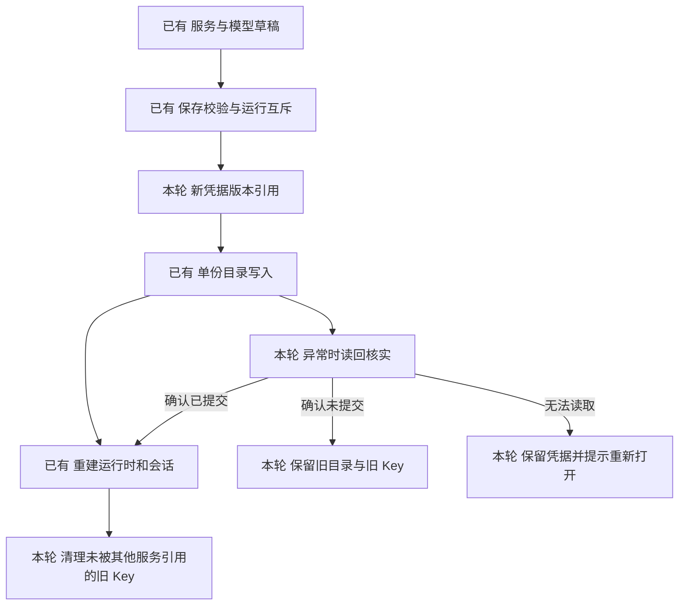

# 助手模型与分支修复

修复基线为 `13bdd78`，对应 Terra 审查中的 12 类问题。当前实现入口见[助手架构](../架构/前端/助手与总结/总览.md)，后续工作见[实施状态](../设计/Agent能力升级/工作包与验收.md#实施状态)。

## 修复与回归对照

| 审查项 | 本轮实现 | 回归入口 |
| --- | --- | --- |
| 1 DeepSeek 供应商身份 | `ProviderConfig.modelProvider` 独立于服务编号，内置与旧目录补缺使用 `deepseek`，自定义网关可显式选择适配 | `assistant_provider_catalog_test` 检查编译身份与两种协议的 off/low 思考字段 |
| 2 Messages 默认地址 | 内置前缀改为 `/anthropic/v1`，官方旧 `/anthropic` 前缀在地址边界补全 | 同上，覆盖已保存目录 |
| 3 无 Key 仍读旧凭据 | HTTP 模型在无 Key 模式直接跳过解析与鉴权头，模型获取也跳过草稿/已存 Key | `model_streaming_test` 令凭据解析器抛错，仍能完成无鉴权请求 |
| 4 凭据被提前替换或清除 | 新版本引用先暂存，目录提交后回收旧引用，共享旧 Key 留给其他服务。目录异常先读回核实 | `assistant_controller_test` 覆盖替换/清除失败、重新初始化、共享 Key、已提交但返回异常 |
| 5 分支引用丢失 | 原索引的任务/目标/节点引用放进分支种子，Drift 与日志同一事务建立索引 | `assistant_controller_test` 逐类验证切换、重开与控制器重建 |
| 6 摘要配置缺失阻断主请求 | 注册表接收已解析快照，模型调用和规格日志使用同一快照。App 挂载历史时按全局设置重新绑定摘要 | `snapshot_model_recovery_test` 经本机 HTTP 完成缺失主/摘要配置的对话和压缩，控制器回归覆盖主模型可用而旧摘要缺失 |
| 7 编辑重发丢文本附件 | 仅替换用户正文，图片和文本附件块继续随消息发送 | `assistant_entry_test` 实际编辑并重发 Markdown 附件，核对正文与文件内容 |
| 8 摘要选择入口不一致 | 全局摘要保存即时应用当前会话，重开再次同步。修改默认主模型保留独立摘要选择，文字分析与压缩共用选择 | 控制器测试验证实际压缩模型，模型预算测试和 Widget 测试核对选择入口 |
| 9 编辑页保存边界 | 模型停用只改本地草稿，保存统一校验，成功后替换服务/模型/凭据引用基线 | Widget 与浏览器验证放弃停用及保存后返回 |
| 10 模型列表只有第一页 | 使用 `has_more` / `last_id`，Messages 用 `after_id`，Chat 兼容分页用 `after`，去重并检测游标重复 | `assistant_model_catalog_test` 覆盖两协议、分页失败、重复游标和取消关闭客户端 |
| 11 完成回答分支显示中断 | 保留回答后的结束记录，编辑边界排除用户输入所属的轮次开始记录，部分轮次主动取消 | `session_runtime_test` 检查完成原因、再次分支的父会话以及排除边界，控制器验证继续本轮状态 |
| 12 长模型编号无法添加 | 本地 profileId 独立生成，供应商 modelId 原文保存 | Widget 从获取列表选择超过 100 字符的编号并保存、重新打开 |

另外修正多次分支时旧元数据覆盖新父会话的问题，模型注册表按完整快照复用客户端。记忆仓储的 `SqliteException` 改从 `sqlite3/common.dart` 导入，解除 Web 预览引入原生 FFI 的编译阻塞。历史模型恢复测试改为脚本模型，避免访问 `example.invalid` 导致网络超时。

## 提交与恢复边界

安全存储缺少跨多键事务，进程退出或清理失败可能留下未被目录引用的 Key。当前会告知已知清理失败，未实现残留扫描。无法读回确认目录时保留凭据，避免删除可能已经生效的 Key。所有生效请求仍通过目录引用取 Key，无 Key 模式完全跳过读取。

摘要选择沿用 M01 的全局配置约定。未独立选择摘要时跟随新会话默认模型，当前会话主模型单独切换。全局选择变化会记录为当前会话 `models_changed`，历史实际用过的摘要快照继续留在日志。摘要单独更新无需重新验证主模型的历史图片，历史回看保留可用路径。

## 验证结果

- `flutter analyze --no-pub` 无问题。
- `flutter test --no-pub --concurrency=4 --reporter expanded` 1087 项通过、49 项跳过。
- `packages/agent_core` 的 `dart analyze --fatal-infos` 无问题，`dart test --reporter expanded` 157 项通过、1 项真实 API 跳过。
- 23 个修改或新增 Dart 文件格式检查通过，差异空白按仓库 CRLF 设置检查通过。文档路径与章节锚点通过本轮链接检查。
- 官方协议依据已核对，DeepSeek 思考字段与 Messages 地址分别见[思考模式](https://api-docs.deepseek.com/guides/thinking_mode/)及[接口说明](https://api-docs.deepseek.com/guides/build_a_chatbot/)，Messages 分页见[Claude 模型列表](https://platform.claude.com/docs/en/api/models/list)。

浏览器预览使用隔离来源 `http://127.0.0.1:8846`。已实际检查服务目录、官方 Messages 地址与供应商适配字段、停用后放弃修改再打开仍可用、新服务保存后返回无未保存提示，以及 390×844 的服务表单。Widget 另覆盖 320dp 双倍字号、长模型编号、附件编辑重发和选择入口。

页面证据见[桌面保存成功](../教学/验收记录/2026-11-14-助手模型与分支/服务保存-桌面.jpg)与[390 宽度服务编辑](../教学/验收记录/2026-11-14-助手模型与分支/服务编辑-390.jpg)。预览新增的“本机验收服务”只保存在该浏览器来源，没有配置真实 Key 或发起供应商请求。

真实 DeepSeek/其他供应商、Android/Windows 原生安全存储及设备交互、带新凭据版本的本机资源备份恢复仍待实测。当前模型发现保留单次选择，根级路径自动探测、供应商能力元数据刷新、额外请求头及分支来源跳转登记于实施计划。用户掌握没有新增独立操作证据。
