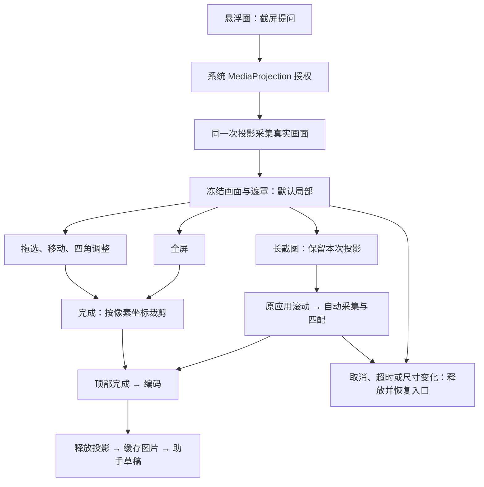

# 语音、悬浮圈与截图交互修复

## 本轮目标与实现

用户要求修复聊天语音操作、悬浮圈靠边隐藏及向内呼出，并把截图改为遮罩当前画面、顶部快捷栏和默认局部选择。沿用已认可的暖白表面、森林绿、细边框与克制信息量。截图使用原生 Canvas 绘制真实屏幕帧，不用示意图替代真实截图。

| 功能 | 当前行为 |
| --- | --- |
| 聊天语音 | 点麦克风开始；录音期间只保留“取消 / 完成”操作，完成后回填文字，检查后另行发送 |
| 文字与光标 | 在光标处插入，存在文字选区时替换选区；保留前后原文，不再强制末尾换行追加 |
| 取消语音 | 准备、录音、转写均可取消，恢复录音前原文及光标；后台取消同步恢复保存的聊天草稿 |
| 语音错误 | 权限拒绝、准备失败等原因保留在输入区；完成或取消后不再接受该轮迟到文字回填 |
| 悬浮圈 | 拖到左 / 右边缘后收起为 24dp 宽、64dp 高的浅绿把手；命中区宽 48dp |
| 呼出 | 从把手向内滑过 24dp 恢复圆形；也支持点按展开，再点圆形打开菜单 |
| 系统返回手势 | Android 10+ 仅对把手实际所在的小块区域申请手势排除，其余边缘保留给系统 |
| 局部截图 | 系统授权后冻结当前画面并加遮罩；默认局部，手指拖出矩形，框内移动，四角调整，框外可重选 |
| 工具栏 | 顶部“局部 / 全屏 / 长截图 / 完成 / 取消”；窄屏或大字号可以横向滚动，不挤压画布 |
| 长截图 | 从同一顶部工具栏进入，已有选区则只采集选区，没有选区则整屏；自由滚动、自动拼接，顶部完成或取消 |
| 长截图限制 | 沿用最多 12 屏、输出高度最多 20000px、宽最多 1080px、五分钟取消；不能可靠拼接时提示且保留已接上的内容 |
| 截图返回 | 保留原有缓存交接和助手草稿流程，选区或全屏确认后才回聊天，不自动发送 |
| 尺寸变化 | 屏幕旋转、被截应用内容尺寸变化时取消本次截图并提示重选，避免用旧坐标裁错区域 |

语音本轮按明确的点按开始、完成转文字实现。未收到进一步说明的按住说话偏好，因此没有擅自将聊天改为松手即发送。

## 已核实的问题

- 聊天原实现始终在末尾追加转写，取消时已填入的半截文字未恢复；识别完成后页面仍持有回填状态。
- 原生悬浮圈只有拖动和坐标下限，没有收起状态、向内呼出或边缘样式；上下和另一侧也没有完整边界约束。
- 普通截图采集一帧后立即回聊天，没有选区画布。授权页十秒超时不适用于需要用户调整的截图编辑。
- 长截图每轮采集前移除控制条，等待合成时又提前消费并丢弃新帧；静止页面可能只有一帧变化，随后等待超时。现在先丢弃旧缓冲，等待期间保留新帧，200ms 后主动读取；未收到帧时恢复控制条。
- 长截图原先约 280–420ms 就再次隐藏控制条。现在采集后间隔约 1.2 秒，失败时适当延后；控制条为一行计数与完成/取消，采集时仍短暂移除，避免写入图片。此取舍仍需真机确认手感，不能宣称完全无闪动。

## 调用与资源边界

同一会话只创建一次 VirtualDisplay。预览期间投影保持到用户选择，转长截图时继续使用这次授权，不复用已结束的授权令牌，不重复创建显示。普通截图确认后与长截图完成后都释放投影，再在单一后台线程压缩编码。取消与失败移除遮罩/控制条、关闭投影、释放位图并恢复已启用的悬浮入口。

源码入口：

- [聊天页面](../../lib/presentation/assistant/chat/assistant_page.dart)、[输入区](../../lib/presentation/assistant/chat/assistant_composer.dart)。
- [悬浮服务](../../android/app/src/main/kotlin/chat/liuxin/mission_book/AssistantOverlayService.kt)、[边缘几何](../../android/app/src/main/kotlin/chat/liuxin/mission_book/OverlayEdgeGeometry.kt)。
- [截屏服务](../../android/app/src/main/kotlin/chat/liuxin/mission_book/AssistantScreenCaptureService.kt)、[授权页](../../android/app/src/main/kotlin/chat/liuxin/mission_book/AssistantCaptureConsentActivity.kt)。
- [截图编辑器](../../android/app/src/main/kotlin/chat/liuxin/mission_book/CaptureEditorView.kt)、[遮罩画布](../../android/app/src/main/kotlin/chat/liuxin/mission_book/CaptureSelectionView.kt)、[矩形几何](../../android/app/src/main/kotlin/chat/liuxin/mission_book/CaptureSelection.kt)。

## 研究依据

- [Android MediaProjection](https://developer.android.com/media/grow/media-projection)：系统授权、单应用投影、一次会话的令牌及 VirtualDisplay 生命周期、尺寸回调。
- [Android 手势导航](https://developer.android.com/develop/ui/views/touch-and-input/gestures/gesturenav)：处理边缘操作冲突，只对必要区域排除系统返回手势。
- [Microsoft 截图工具](https://support.microsoft.com/en-us/windows/apps/use-snipping-tool-to-capture-screenshots)：矩形与全屏模式及先选择范围再操作的交互参考；本项目仍使用已有 Android 原生链路。

## 本机验证

Dart 格式及 `git -c core.whitespace=cr-at-eol diff --check` 通过；新增文档链接均核对存在。

本轮尚未提交 Git、升级版本或交付 APK。构建检查不会替代安装与体验验收。

- `flutter analyze --no-pub --fatal-infos`：通过，零问题（最终复验 6.6 秒）。
- `flutter test --no-pub test/presentation/assistant/assistant_entry_test.dart test/application/assistant/assistant_voice_test.dart test/data/assistant/recorded_assistant_speech_test.dart --reporter expanded`：94 项通过，包含新加的窄手机双倍字号、平板和后台取消草稿恢复。
- `cd android && ./gradlew :app:compileReleaseKotlin --offline --console=plain`：通过；最终原生小修后另以 `-x :app:compileFlutterBuildRelease` 复核 Kotlin 通过，避免重复执行无关 AOT。已有旧 API 和 Gradle 插件弃用警告，本轮没有将其表述为零警告。
- `python3 test/support/run_capture_interaction_checks.py`：纯 JVM 几何检查通过，覆盖四角、反向拉选、移动边界、取消恢复、过小框、全屏、尺寸边界、左右吸边与向内方向。它不测试 Android 窗口、系统手势路由或投影。
- 语音图片为真实 Flutter Widget 渲染，录音源使用可控测试替身：[录音](assets/2026-11-17-input-capture/voice-recording.png)、[回填待检查](assets/2026-11-17-input-capture/voice-review.png)。它们只证明界面状态，不证明真实麦克风识别质量。

`adb devices -l` 当前无在线设备。Android 系统授权、全屏/单应用画面坐标、刘海与导航栏、边缘返回冲突、横竖屏、长截图固定栏拼接、控制条移除时序、真实人声与识别耗时均需在目标平板复验。没有原生实拍截图或手感证据时，不把 Kotlin 编译和几何检查描述为真机验收。
